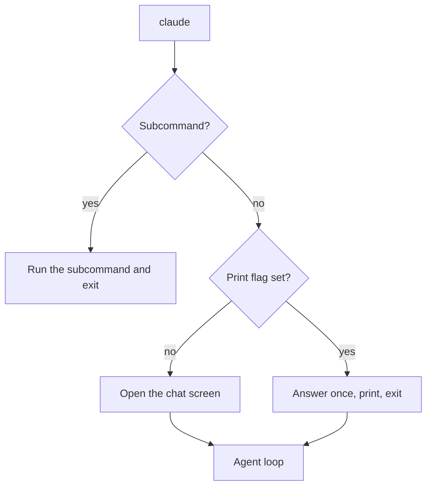

`claude` is the command that starts Claude Code.
Alone, it opens a chat in your terminal. With `-p`, it answers once and exits, which is how scripts and CI jobs use it.
Flags change one run. Subcommands do separate jobs, such as sign-in, plugins, and background sessions.

## At a Glance

| Question | Answer |
| --- | --- |
| Can you use it? | ✅ Yes. Run `claude` in a project folder. |
| Can you change it? | ✅ Yes. Add flags for one run, or set the same choice in a settings file or an environment variable. |
| Can you turn it on or off? | Each flag is its own switch. A flag is on when you pass it, and some have a `--no-` twin, such as `--no-chrome`. Flags win over settings for that run. A subcommand runs only when you call it. |
| Where does it live? | The `claude` program on your `PATH`. Run `claude --help` for the list. |
| Status | <Documented /> <Undocumented /> |

## Example

```bash
claude                                   # chat
claude "explain this project"            # chat with a first prompt
claude -p "list the TODOs" > todos.txt   # one answer, then exit
git diff | claude -p "review this diff"  # pipe in text
```

## Ways to Start

Source: the official [CLI Reference](https://code.claude.com/docs/en/cli-reference) and [Run Claude Code Programmatically](https://code.claude.com/docs/en/headless) pages.

| Command | Status | What it does |
| --- | --- | --- |
| `claude` | <Documented /> | Starts an interactive session. |
| `claude "query"` | <Documented /> | Starts an interactive session with a first prompt. |
| `claude -p "query"` | <Documented /> | Prints one answer and exits, and it skips the trust dialog, so use it only in folders you trust. |
| `cmd \| claude -p "query"` | <Documented /> | Prints one answer for the text that you pipe in. |
| `claude -c`, `claude -r "<session>"` | <Documented /> | Continues or resumes a session (see [Sessions and Storage](../../how-it-works/sessions-and-storage.md)). |
| `claude --bg "query"` | <Documented /> | Starts a background session, and `claude agents` lists the sessions. |
| `claude --bare` | <Documented /> | Starts with no hooks, plugins, MCP servers, auto memory, or `CLAUDE.md` discovery, and sets `CLAUDE_CODE_SIMPLE=1`. |
| `claude --safe-mode` | <Documented /> | Starts with all customizations off to debug a broken setup, and sets `CLAUDE_CODE_SAFE_MODE=1`. |
| `claude --restricted` | <Documented /> | Removes the tools that run code, and ignores user, project, and local settings. |
| `claude --cloud`, `--environment`, `--teleport` | <Documented /> | Work with cloud sessions. |

:::warning
Print mode (`-p`) skips the trust dialog for the folder. Use it only in folders you trust.
It also ignores settings files that fail validation, without any error.
:::

## Print Mode Flags

Print mode runs once and prints the result. These flags shape its input and output.
Some of them work only together, for example `--include-partial-messages` needs `--output-format stream-json`.

| Flag | Status | What it does |
| --- | --- | --- |
| `--output-format text\|json\|stream-json` | <Documented /> | `json` gives one result object, and `stream-json` gives one JSON line for each event (see [Stream JSON](../../extend/headless/stream-json.md)). |
| `--input-format text\|stream-json` | <Documented /> | `stream-json` reads JSON lines from stdin. |
| `--include-partial-messages`, `--include-hook-events`, `--forward-subagent-text`, `--replay-user-messages` | <Documented /> | Add events to the stream, with `stream-json` only. |
| `--json-schema <schema>` | <Documented /> | Checks the final answer against a JSON Schema. |
| `--max-budget-usd <amount>` | <Documented /> | Stops at a spend limit. |
| `--max-turns <n>` | <Documented /> | Stops after `n` agent turns, and the flag is hidden in `--help`. |
| `--permission-prompts host\|none` | <Documented /> | `none` denies everything that would ask. |
| `--permission-prompt-tool <tool>` | <Documented /> | Lets an MCP tool answer permission prompts, and the flag is hidden in `--help`. |
| `--no-session-persistence` | <Documented /> | Writes no transcript. |
| `--init`, `--init-only`, `--maintenance` | <Documented /> | Run `Setup` hooks, and the flags are hidden in `--help`. |

The result of `--output-format json` has a `usage` field.
Its `cache_creation` part is split into `ephemeral_1h_input_tokens` and `ephemeral_5m_input_tokens`.
Source: the official [How Claude Code Uses Prompt Caching](https://code.claude.com/docs/en/prompt-caching#choose-the-ttl-yourself) page.

## How It Works

Claude Code reads your flags first. A flag then wins over the same choice in an environment variable or a settings file, with a few exceptions that [Environment Variables](../env-vars/index.md#which-value-wins) lists.



Source: the program (`claude --help`, `2.1.306`).

## Related Pages

- [All Flags](flags.md) lists every flag, including the hidden ones.
- [Subcommands](subcommands.md) lists every `claude <command>`.
- [Environment Variables](../env-vars/index.md) holds the variables that match many flags.
- [Permissions](../permissions/index.md) explains `--permission-mode` and the tool allow lists.
- [Sessions and Storage](../../how-it-works/sessions-and-storage.md) explains `-c` and `-r`.
- [The Agent Loop](../../how-it-works/agent-loop.md) shows what runs after startup.
