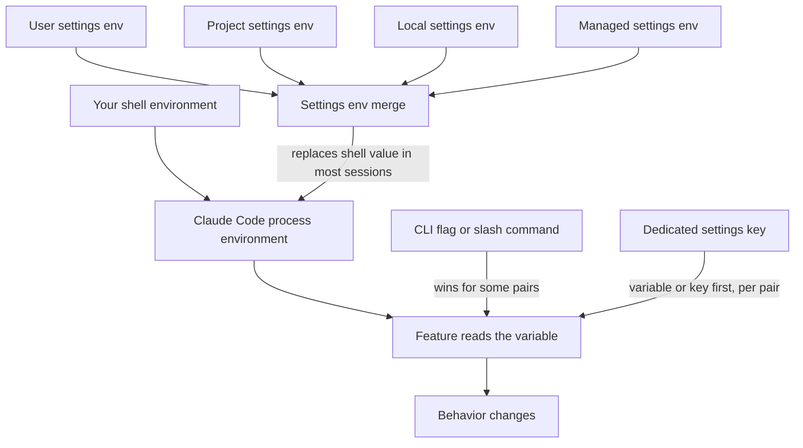

An environment variable is a named setting that a program reads when it starts.
Claude Code `2.1.303` reads well over a thousand of them.
This section lists 1399 that you can use, split into groups so you can find them.
A few are in the official docs. Most are found only in the program.

## At a Glance

| Question | Answer |
| --- | --- |
| Can you use it? | Yes. Set a variable in your shell, or under `env` in a `settings.json` file. |
| Can you change it? | Yes. Change the value, then restart `claude`. Values in a settings `env` block also apply to a running session when the file changes. |
| Can you turn it on or off? | Delete the variable. In a settings file you cannot remove one that your shell sets, but you can set it to an empty string. |
| Where does it live? | Your shell, or the `env` key of `~/.claude/settings.json`, `.claude/settings.json`, `.claude/settings.local.json`, or managed settings. |
| Status | <Documented /> <Undocumented /> <Differs /> <Gated /> |

## How Claude Code Reads Variables

Claude Code starts with the environment it inherits from your shell.
It then reads the `env` key of every settings file and writes each entry into its own process environment.
Source: the official [Environment Variables](https://code.claude.com/docs/en/env-vars) page.



### Which Value Wins

1. A value in a settings `env` block replaces the value from your shell in most sessions. The official docs list the sessions that keep the shell value.
2. Between settings files, `env` values follow the normal settings order. A managed entry beats the same variable in user or project settings.
3. Some behaviors have a variable, a settings key, and a flag. Which one wins differs for each pair. For example, `--model` and `/model` beat `ANTHROPIC_MODEL`, and `ANTHROPIC_MODEL` beats the `model` key. But `CLAUDE_CODE_EFFORT_LEVEL` beats `--effort` and `/effort`.
4. Project and local settings cannot set some variables, such as `CLAUDE_CONFIG_DIR` and the OpenTelemetry exporter variables. Most other `env` values from a project wait until you trust the folder.
5. You cannot remove a variable from a settings file. To cancel one that a shell profile exports, set it to an empty string, for example `"CLAUDE_CODE_USE_VERTEX": ""`. Claude Code treats the empty value as unset for provider selection, but child processes still inherit the empty value.

Each row says what applies to it. Look in the Notes column for the words "Project `env` can set it before trust" or "Not set from project `env` before trust".

## Set Variables in `settings.json`

Put variables under the `env` key. Claude Code copies the values as written. No shell expands them, so `~` and `$HOME` stay as typed. Use absolute paths.

```json title="~/.claude/settings.json"
{
  "env": {
    "API_TIMEOUT_MS": "1200000",
    "BASH_DEFAULT_TIMEOUT_MS": "300000",
    "CLAUDE_CODE_EFFORT_LEVEL": "high"
  }
}
```

Or set one in your shell for one session.

```bash
export API_TIMEOUT_MS=1200000
claude
```

Removing a variable from the file does not unset it in a running session. The removal applies the next time you start `claude`.
Features that read their variables only once at startup, such as OpenTelemetry, keep their startup values until you restart.

Numeric variables, such as timeouts and token budgets, accept forms like `2e3` (2000) and `64_000` (64000) as well as plain digits. A few rows say they take plain digits only.

## Twenty Useful Variables

| Variable | Page | What it does |
| --- | --- | --- |
| `ANTHROPIC_API_KEY` | [Auth and Accounts](auth-and-accounts.md) | Your API key. |
| `ANTHROPIC_BASE_URL` | [Network and Proxy](network-and-proxy.md) | Send API calls to another address. |
| `ANTHROPIC_MODEL` | [Models and Effort](models-and-effort.md) | The model for the session. |
| `ANTHROPIC_DEFAULT_SONNET_MODEL` | [Models and Effort](models-and-effort.md) | The model ID that the `sonnet` alias means. |
| `CLAUDE_CODE_EFFORT_LEVEL` | [Models and Effort](models-and-effort.md) | How hard the model thinks. Wins over `--effort` and `/effort`. |
| `CLAUDE_CODE_MAX_OUTPUT_TOKENS` | [Models and Effort](models-and-effort.md) | The most output tokens for a request. |
| `CLAUDE_CODE_USE_BEDROCK` | [Cloud Providers](cloud-providers.md) | Use Amazon Bedrock. |
| `CLAUDE_CODE_USE_VERTEX` | [Cloud Providers](cloud-providers.md) | Use Google Vertex AI. |
| `HTTPS_PROXY` | [Network and Proxy](network-and-proxy.md) | Send traffic through an HTTPS proxy. |
| `NO_PROXY` | [Network and Proxy](network-and-proxy.md) | Hosts that skip the proxy. |
| `API_TIMEOUT_MS` | [Network and Proxy](network-and-proxy.md) | How long an API request may take. Default is 600000. |
| `BASH_DEFAULT_TIMEOUT_MS` | [Tools and Bash](tools-and-bash.md) | Default time limit of a foreground shell command. |
| `BASH_MAX_OUTPUT_LENGTH` | [Tools and Bash](tools-and-bash.md) | How many characters of shell output Claude reads back. |
| `CLAUDE_AUTOCOMPACT_PCT_OVERRIDE` | [Context and Compaction](context-and-compaction.md) | Start compaction earlier. |
| `CLAUDE_CONFIG_DIR` | [Sessions and Storage](sessions-and-storage.md) | Use another folder instead of `~/.claude`. |
| `DISABLE_AUTOUPDATER` | [Sessions and Storage](sessions-and-storage.md) | Stop automatic background updates. |
| `DISABLE_TELEMETRY` | [Telemetry and Debug](telemetry-and-debug.md) | Opt out of telemetry. Any non-empty value counts. |
| `CLAUDE_CODE_ENABLE_TELEMETRY` | [Telemetry and Debug](telemetry-and-debug.md) | Turn on OpenTelemetry metrics and logs. |
| `MCP_TIMEOUT` | [Plugins and MCP](plugins-and-mcp.md) | How long an MCP server gets to start. |
| `CLAUDE_CODE_SIMPLE` | [Features and Toggles](features-and-toggles.md) | Run a minimal mode. `--bare` sets it. |

## Variable Groups

| Page | What is in it | Variables |
| --- | --- | --- |
| [Models and Effort](models-and-effort.md) | Environment variables that pick the model, pin model aliases, set thinking effort, and limit output size | 84 |
| [Auth and Accounts](auth-and-accounts.md) | Environment variables for API keys, login tokens, credential helpers, and account details | 71 |
| [Cloud Providers](cloud-providers.md) | Environment variables for Amazon Bedrock, Google Vertex AI, Microsoft Foundry, and gateway setups | 78 |
| [Network and Proxy](network-and-proxy.md) | Environment variables for API addresses, proxies, TLS certificates, time limits, and retries | 64 |
| [Context and Compaction](context-and-compaction.md) | Environment variables for the context window, compaction, memory, and the prompt cache | 49 |
| [Tools and Bash](tools-and-bash.md) | Environment variables for the Bash tool, file tools, search, permissions, and the sandbox | 101 |
| [UI and Terminal](ui-and-terminal.md) | Environment variables for the terminal screen, colors, voice, keys, and notifications | 88 |
| [Sessions and Storage](sessions-and-storage.md) | Environment variables for config folders, session files, resume, install, and updates | 78 |
| [Telemetry and Debug](telemetry-and-debug.md) | Environment variables for usage data, OpenTelemetry, debug logs, and error reports | 139 |
| [Plugins and MCP](plugins-and-mcp.md) | Environment variables for plugins, MCP servers, skills, hooks, and marketplaces | 90 |
| [Agents and Teams](agents-and-teams.md) | Environment variables for subagents, agent teams, background tasks, and workers | 77 |
| [Features and Toggles](features-and-toggles.md) | Environment variables that turn single features on or off, including server-gated features | 66 |
| [Remote and Cloud Sessions](remote-and-cloud-sessions.md) | Environment variables for cloud sessions, the bridge, the desktop app, Chrome, Cowork, and Slack | 137 |
| [SDK and Automation](sdk-and-automation.md) | Environment variables for programs that host Claude Code, the Agent SDK, and automation | 21 |
| [System and Third-Party](system-and-third-party.md) | Environment variables owned by your system or other tools that Claude Code reads, such as HOME, TERM, and ALL_PROXY | 130 |
| [Bundled Libraries](bundled-libraries.md) | Environment variables read only by libraries bundled inside Claude Code, such as the AWS SDK, gRPC, and cloud detectors | 126 |

## How to Read the Tables

Every group page has the same columns.

| Column | Meaning |
| --- | --- |
| Variable | The exact name. Names are case sensitive. |
| Status | Badges. <Documented /> means the official docs name it. <Undocumented /> means only the program shows it. <Differs /> means the docs and the program disagree. <Gated /> means a feature flag or server gate is involved. |
| What it does | The effect, in plain words. |
| Values and default | The accepted values and the default, as far as the program shows. A dash means the source gave no detail. |
| Notes | Where it applies, and whether a project `env` block can set it before you trust the folder. |

:::warning
Treat <Undocumented /> and <Gated /> rows with care.
They work in `2.1.303`, but nothing promises they will work in the next release.
:::

Some rows mention a probe. That means a run of the real binary against a local stub showed what the variable changed in the request. No model call leaves the machine in a probe. A run with no visible effect does not prove that a variable does nothing.

## What Is Left Out

The tables list only variables you can use. They leave out removed or inert names, test-only names, names for Anthropic staff, and flags whose purpose nobody knows.
For every item that only the program shows, see [Undocumented Items](../../reference/undocumented.md).

## Related Pages

- [How to Read These Docs](../../start/how-to-read.md)
- [What Changed](../../start/what-changed.md)
- [Settings Files and Scopes](../settings/index.md) and the `env` key
