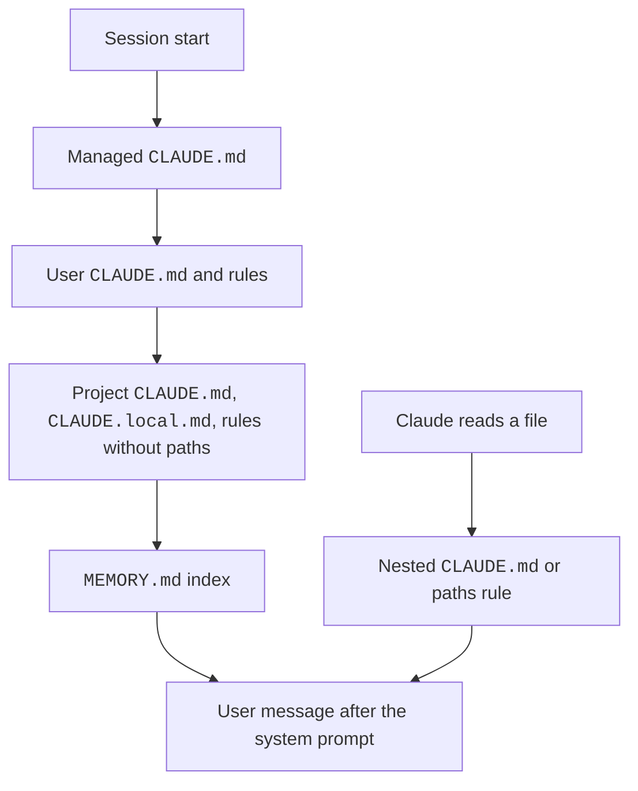

Claude Code remembers your project in two ways.
`CLAUDE.md` files hold instructions that you write. Auto memory holds notes that Claude writes.
Rules in `.claude/rules/` split instructions by topic and by file path.
Claude treats all of these as context, not as enforced configuration. The text arrives as a user message after the system prompt.
Write `CLAUDE.md` in your project, or run `/memory`. Auto memory lives in `~/.claude/projects/<project>/memory/`.

## Example

```text title="CLAUDE.md"
# Project Notes
Use bun, not npm.
Run `bun test` before you say a task is done.
@docs/architecture.md
```

```markdown title=".claude/rules/api.md"
---
paths:
  - "src/api/**/*.ts"
---
Every handler returns a typed error object. Never throw a plain string.
```

The first file loads in every session and imports `docs/architecture.md`. The second loads only after Claude touches a file that matches `src/api/**/*.ts`.

## Instruction File Locations

The list runs in load order. Broad scope loads first. A later file sits later in the context.
Official page: [How Claude Remembers Your Project](https://code.claude.com/docs/en/memory).

| Item | Status | What it does | How it works | Where to set it |
| --- | --- | --- | --- | --- |
| Managed `CLAUDE.md` | <Documented /> | Organization instructions | `/Library/Application Support/ClaudeCode/CLAUDE.md` (macOS), `/etc/claude-code/CLAUDE.md` (Linux and WSL), `C:\Program Files\ClaudeCode\CLAUDE.md` (Windows). It loads first, then `~/.claude/CLAUDE.md`, then project files. `claudeMdExcludes` cannot exclude it, not even by its absolute path. We checked this. See [Probes](../reference/probes.md#managed-folder-probe) | Machine |
| `claudeMd` setting | <Documented /> | Managed `CLAUDE.md` text inside managed settings | It has the same precedence as the managed file. Claude Code honors it only from managed settings | `managed-settings.json` |
| `~/.claude/CLAUDE.md` | <Documented /> | Personal instructions | It loads for all projects. Imports in it need no approval dialog | User |
| `~/.claude/rules/*.md` | <Documented /> | Personal rules | They load before project rules. Neither set overrides the other | User |
| `./CLAUDE.md` or `./.claude/CLAUDE.md` | <Documented /> | Project instructions | Files in the working directory and each directory above it load at launch | Project |
| `./CLAUDE.local.md` | <Documented /> | Private project notes | Claude Code appends it after `CLAUDE.md` in the same directory. Add it to `.gitignore` | Project |
| Subdirectory `CLAUDE.md` | <Documented /> | Lazy instructions | Loads once after Claude reads, writes, or edits a file in that subdirectory | Project |
| `AGENTS.md`, `.claude/AGENTS.md` | <Documented /> | Read when no `CLAUDE.md` or `CLAUDE.local.md` is in or above the working directory | Needs `2.1.277`. `AGENTS.local.md`, `AGENTS.override.md`, and `.agents/` are not read | Project |
| `.claude/rules/**/*.md` | <Documented /> | Project rules | Claude Code finds them recursively. Rules without `paths` load at launch with the priority of `.claude/CLAUDE.md` | Project |
| `--add-dir` directories | <Documented /> | Extra directories | Memory files load only when `CLAUDE_CODE_ADDITIONAL_DIRECTORIES_CLAUDE_MD=1`. These files load: `CLAUDE.md`, `.claude/CLAUDE.md`, `.claude/rules/*.md`, and `CLAUDE.local.md` | CLI |

## Imports and Rule Files

| Item | Status | What it does | How it works | Where to set it |
| --- | --- | --- | --- | --- |
| `@path/to/file` | <Documented /> | Imports a file at launch | Relative paths resolve from the importing file. The maximum depth is four hops. Put a backslash before each space in the path. Quoted paths do not import. Claude Code skips code spans and fenced blocks | Any memory file |
| External import | <Documented /> | An import that resolves outside the working directory | A dialog asks once per project. If you decline, the imports stay off. User-scope files skip the dialog | Project files |
| `paths` frontmatter in a rule | <Documented /> | Scopes a rule to files | The value is a YAML list or comma string of globs. The rule loads when `Read`, `Write`, or `Edit` (or a Bash read such as `cat`) touches a match. The brace expansion budget is 1,000 patterns and 4 MiB per rule | `.claude/rules/*.md` |
| Other rule frontmatter keys | <Documented /> | Ignored | Claude Code reads only the `paths` key. Bad YAML loads the rule without `paths` | `.claude/rules/*.md` |
| HTML block comments | <Documented /> | Claude Code strips them before injection | Comments in code blocks stay | Any `CLAUDE.md` |
| Symlinks in `.claude/rules/` | <Documented /> | Shares rules across projects | A target outside the working directory counts as an external import. Network paths do not load | `.claude/rules/` |
| `claudeMdExcludes` | <Documented /> | Skips files by glob | It matches absolute paths with `picomatch`. Arrays merge across scopes. It applies only to user, project, and local files | Any settings scope |
| **Project instructions** (`/config`) | <Documented /> | Chooses `claude-md-or-agents-md` (default), `claude-md-and-agents-md`, `claude-md`, or `managed-only` | Stored in `pluginConfigs["cc-plugin-agents-md@builtin"].options.instructionFiles`. Read from user, `--settings`, and managed settings. `agents-md@builtin` also works from `2.1.285` | User, managed |
| `includeGitInstructions` | <Documented /> | Removes built-in commit and PR instructions | The default is `true`. The environment variable `CLAUDE_CODE_DISABLE_GIT_INSTRUCTIONS=1` wins | Settings |
| `CLAUDE_CODE_DISABLE_CLAUDE_MDS` | <Documented /> | Keeps `CLAUDE.md` files out of context | `1` disables user, project, and auto memory files | Env |

## Auto Memory

Auto memory is a folder of notes that Claude writes for itself. `MEMORY.md` is the index.

| Item | Status | What it does | How it works | Where to set it |
| --- | --- | --- | --- | --- |
| `autoMemoryEnabled` | <Documented /> | Turns auto memory on or off | The default is on in local sessions. The `/memory` toggle writes it to user settings | Any settings scope |
| `CLAUDE_CODE_DISABLE_AUTO_MEMORY` | <Documented /> | An environment switch | `1` disables auto memory. `0` forces it on, even with `--bare` or `autoMemoryEnabled: false` | Env |
| `autoMemoryDirectory` | <Documented /> | Sets the memory location | The value is an absolute path or `~/`. The default is `~/.claude/projects/<project>/memory/`. The schema text says checked-in project settings ignore it. The docs say project scope works after trust | Settings |
| `autoMemoryDirectory` scope | <Differs /> | The schema says Claude Code ignores the setting in project settings. [How Claude Remembers Your Project](https://code.claude.com/docs/en/memory) says project and local scopes work under workspace trust | Docs and schema text differ | Settings |
| `MEMORY.md` | <Documented /> | Index file | The first 200 lines or 25KB load at each session start. Topic files load on demand | Memory directory |
| Memory types | <Documented /> | `user`, `feedback`, `project`, `reference` in the `type` frontmatter | Claude writes a `modified` ISO 8601 field (since `2.1.214`) | Memory files |
| `/memory` | <Documented /> | Lists memory files, toggles auto memory, opens the folder | The editor opens a file | Interactive |
| `autoDreamEnabled` | <Undocumented /> | Background memory consolidation (auto-dream) | It overrides the server default | Settings |
| `/pause-memory` | <Undocumented /> | Pauses memory for the session | Only the user can turn it back on. The text is `memory access blocked by /pause-memory` | Interactive |
| `CLAUDE_CODE_REMOTE_MEMORY_DIR`, `CLAUDE_CODE_POST_TURN_MEMORY`, `CLAUDE_COWORK_MEMORY_*`, `CLAUDE_MEMORY_STORES` | <Undocumented /> | Cloud, Cowork, and post-turn memory | `CLAUDE_CODE_REMOTE_MEMORY_DIR`: in a remote session (`CLAUDE_CODE_REMOTE=1`), auto memory is off unless you set this variable. It sets the memory folder. The value is a full path outside Claude temp folders. `CLAUDE_MEMORY_STORES` is a JSON list of `{"name","path"}` objects. The built-in memory section stays. Claude Code names each store as a `memory/team/<dir name>` folder marked "(shared with all users of this project)". Claude Code also adds a 4 KB limit note per memory file. A list of strings, `[]`, or text that is not JSON changes nothing. Set to `1`, it drops the `MEMORY.md` pointer rule and adds the 4 KB note. No `memory_*` tool was added. `CLAUDE_CODE_POST_TURN_MEMORY` needs `CLAUDE_CODE_POST_TURN_MEMORY_CONFIG` (JSON with a required `instruction`). Without a valid config, the pass is off. The pass also needs a cloud memory server. In a local run, the debug log says `skipping (mcp) - CCR memory server not mounted`. For this reason its live effect is not verified. The `CLAUDE_COWORK_MEMORY_*` variables take text. `_PATH_OVERRIDE` names the memory folder. It is an absolute path, and it lets auto memory stay on in a remote session. `_GUIDELINES` replaces the built-in memory instructions. `_EXTRA_GUIDELINES` adds to them. `_INDEX_CONTENT` replaces the `MEMORY.md` text. An empty string turns the index read off. We ran the four `CLAUDE_COWORK_MEMORY_*` variables in `-p` | Env |
| Subagent `memory` field | <Documented /> | A separate memory directory for a subagent | See [Subagents](../extend/subagents/frontmatter.md) | Agent frontmatter |

## Limits

| Item | Status | What it does | How it works | Where to set it |
| --- | --- | --- | --- | --- |
| `CLAUDE.md` size | <Documented /> | Claude Code skips files over 4 MiB | A warning shows for files over 200 lines and for a combined size | Instruction files |
| `MEMORY.md` size | <Documented /> | The limit is 200 lines or 25KB | A write over the limit succeeds but returns an error. The error asks for a rewrite | Memory |
| Compaction | <Documented /> | Claude Code re-reads the project-root `CLAUDE.md` after `/compact` | Nested files and `paths` rules load again on demand. `InstructionsLoaded` shows `load_reason` `compact` | Context |

## The `InstructionsLoaded` Hook

The hook fires when an instruction file enters context.
It runs async and has no decision control.
It does not fire for an `AGENTS.md` that loads through the Project instructions setting.
The matcher runs on `load_reason`. Official page: [Hooks Reference](https://code.claude.com/docs/en/hooks).

| Item | Status | What it does | How it works | Where to set it |
| --- | --- | --- | --- | --- |
| `file_path` | <Documented /> | Absolute path of the file | String | Hook input |
| `memory_type` | <Documented /> | Scope | `User`, `Project`, `Local`, `Managed` | Hook input |
| `load_reason` | <Documented /> | Why it loaded | `session_start`, `nested_traversal`, `path_glob_match`, `include`, `compact` | Hook input |
| `globs`, `trigger_file_path`, `parent_file_path` | <Documented /> | Extra context | `globs` appears only for `path_glob_match`. `parent_file_path` appears for `include` | Hook input |
| `InstructionFileKind` | <Undocumented /> | Tiers `managed`, `user`, `project`, `local`, `memory` | The Mod API uses it | Mod API |

## How It Works

Instruction files do not go into the system prompt.
Claude Code reads them at launch. It walks up from the working folder. It adds the text as a user message.
Nested `CLAUDE.md` files and `paths` rules load later, when Claude reads a matching file.
After `/compact`, Claude Code reads the project-root `CLAUDE.md` again.
See [The System Prompt](../how-it-works/system-prompt.md) and [Context and Compaction](../how-it-works/context-and-compaction.md).



:::note[Instruction File Size Warning]
Source: the program (read), and a probe of the interactive screen (2.1.305, local stub, fake key). See [Interactive Probes](../reference/probes.md#interactive-probes). The warning shows in two places: a banner line under the header at start, and the Status screen (`/status`). It does not show in `-p`, in `claude doctor`, or in the `get_status` control reply (checked with a 45,000-character `CLAUDE.md`).

- We saw this live at start on Sonnet 4.5: `CLAUDE.md is over the 40.0k-char limit (45.6k chars) · /memory to free up context`. A 45.6k file on Opus 5.5 gave no warning. In `/status`, we saw: `Large CLAUDE.md will impact performance (45.6k chars > 40.0k)`.
- We saw the warning for the total live. Four files of 34.4k characters each (all under 40k) gave a banner `4 instruction files add up to 137.6k chars, over the 120.0k-char total limit`, with the largest files named. `/status` said `Instruction files will impact performance: 4 files, 137.6k chars in total > 120.0k`.
- We saw this live on Opus 5.5 (1M window). A 156.0k-character file gave `CLAUDE.md is over the 150.0k-char limit (156.0k chars)`. A 116k file gave no warning. That checks 3 characters per token for that model.

- The one-file limit is the larger of 40,000 characters and 5% of the context window, turned into characters. Claude Code uses 4 characters per token for Claude 3 models, Opus 4.0 to 4.6, Sonnet 4.0 to 4.6, and Haiku 4.5. It uses 3 per token for every other model (Opus 4.7 and later, Sonnet 5 and later, Haiku 5.5, Fable, Mythos, and unknown names).
- For a 200k window, 200,000 x 0.05 x 4 = 40,000. Also 200,000 x 0.05 x 3 = 30,000. The 40,000 floor applies to both.
- For a 1M window, 1,000,000 x 0.05 x 4 = 200,000 for the 4-per-token models. For the rest, 1,000,000 x 0.05 x 3 = 150,000.
- The total limit is the larger of 120,000 characters and the one-file limit. Only files under the one-file limit add to the total.
- `User`, `Project`, `Local`, and `Managed` instruction files count, including the files they import. `MEMORY.md` does not count.
- The messages are `Large <file> will impact performance (<n> chars > <limit>)` for one file, and `Instruction files will impact performance: <n> files, <total> chars in total > <limit>` for the total.
- Since `2.1.309`, a nested `CLAUDE.md` over the size limit loads only its start, so reading files under it no longer makes the session compact again and again ([v2.1.309 release notes](https://github.com/anthropics/claude-code/releases/tag/v2.1.309)). Which limit applies is unconfirmed.

:::

## Errors

Each row is a family of messages. The backticked text is the start that every message in the family shares. A row marked `Various` gathers the messages of one feature that do not share one start.

| Start of Message | Status | What It Means | Cases |
| --- | --- | --- | --- |
| Various | <Undocumented /> | **Memory stores.** Claude Code refused a memory store key, mount, or sync. | A key escapes the memory directory (a null byte, backslash, absolute path, traversal, or symlink). A key is reserved. A key targets an excluded subtree. A mount name cannot be derived. `CLAUDE_MEMORY_STORES` is not valid JSON. A store listing returned an error. |

## Related Pages

- [Environment Variables](env-vars/index.md) for the memory variables.
- [Output Styles](output-styles.md) for answer style, which is separate from project facts.
- [The System Prompt](../how-it-works/system-prompt.md)
- [Captured CLAUDE.md Prompt](../prompts/context-and-memory/claude-md.md)
- [Hook Events](../extend/hooks/events.md) for the `InstructionsLoaded` event and [Subagent Frontmatter](../extend/subagents/frontmatter.md) for the subagent `memory` field.
