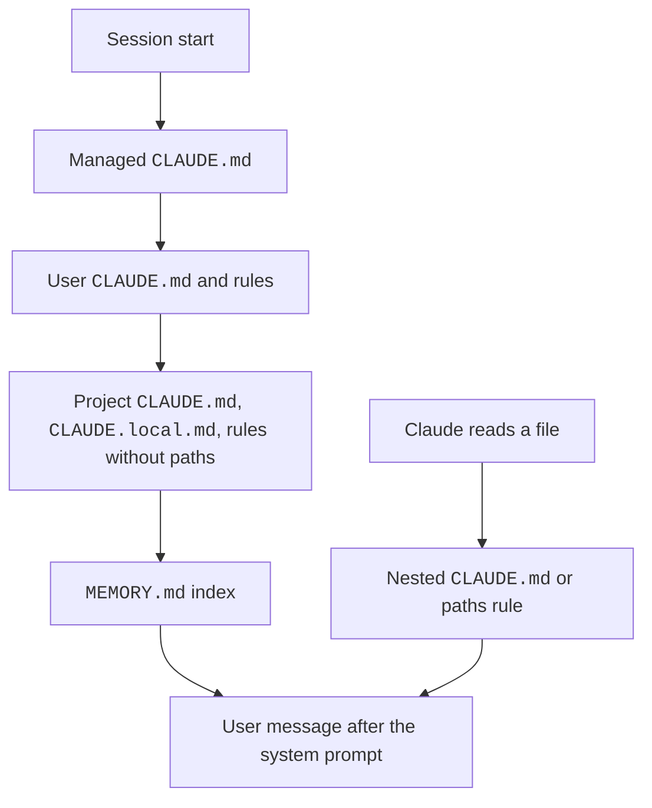

Claude Code remembers your project in two ways.
`CLAUDE.md` files hold instructions that you write. Auto memory holds notes that Claude writes.
Rules in `.claude/rules/` split instructions by topic and by file path.
Claude treats all of these as context, not as enforced configuration. The text arrives as a user message after the system prompt.

## At a Glance

| Question | Answer |
| --- | --- |
| Can you use it? | ✅ Yes. Write `CLAUDE.md` in your project, or run `/memory`. |
| Can you change it? | ✅ Yes. Edit the files, or set `autoMemoryEnabled`, `autoMemoryDirectory`, and `claudeMdExcludes`. |
| Can you turn it on or off? | `autoMemoryEnabled`, `CLAUDE_CODE_DISABLE_AUTO_MEMORY=1`, and `CLAUDE_CODE_DISABLE_CLAUDE_MDS=1`. |
| Where does it live? | `~/.claude/CLAUDE.md`, `./CLAUDE.md`, `.claude/rules/`, and `~/.claude/projects/<project>/memory/`. |
| Status | <Documented /> <Undocumented /> <Differs /> |

## Example

```text title="CLAUDE.md"
# Project Notes
Use bun, not npm.
Run `bun test` before you say a task is done.
@docs/architecture.md
```

```markdown title=".claude/rules/api.md"
---
paths:
  - "src/api/**/*.ts"
---
Every handler returns a typed error object. Never throw a plain string.
```

The first file loads in every session and imports `docs/architecture.md`. The second loads only after Claude touches a file that matches `src/api/**/*.ts`.

## Instruction File Locations

The list runs in load order, broad scope first. A later file sits later in the context.
Official page: [How Claude Remembers Your Project](https://code.claude.com/docs/en/memory).

| Item | Status | What it does | How it works | Where to set it |
| --- | --- | --- | --- | --- |
| Managed `CLAUDE.md` | <Documented /> | Organization instructions | `/Library/Application Support/ClaudeCode/CLAUDE.md` (macOS), `/etc/claude-code/CLAUDE.md` (Linux and WSL), `C:\Program Files\ClaudeCode\CLAUDE.md` (Windows). Loads first, then `~/.claude/CLAUDE.md`, then project files. `claudeMdExcludes` cannot exclude it, not even by its absolute path (checked; see [Probes](../reference/probes.md#managed-folder-probe)) | Machine |
| `claudeMd` setting | <Documented /> | Managed `CLAUDE.md` text inside managed settings | Same precedence as the managed file. Honored only from managed settings | `managed-settings.json` |
| `~/.claude/CLAUDE.md` | <Documented /> | Personal instructions | Loads for all projects. Imports in it need no approval dialog | User |
| `~/.claude/rules/*.md` | <Documented /> | Personal rules | Load before project rules. No override between the two sets | User |
| `./CLAUDE.md` or `./.claude/CLAUDE.md` | <Documented /> | Project instructions | Files in the working directory and each directory above it load at launch | Project |
| `./CLAUDE.local.md` | <Documented /> | Private project notes | Appended after `CLAUDE.md` in the same directory. Add it to `.gitignore` | Project |
| Subdirectory `CLAUDE.md` | <Documented /> | Lazy instructions | Loads once after Claude reads, writes, or edits a file in that subdirectory | Project |
| `AGENTS.md`, `.claude/AGENTS.md` | <Documented /> | Read when no `CLAUDE.md` or `CLAUDE.local.md` is in or above the working directory | Needs `2.1.277`. `AGENTS.local.md`, `AGENTS.override.md`, and `.agents/` are not read | Project |
| `.claude/rules/**/*.md` | <Documented /> | Project rules | Found recursively. Rules without `paths` load at launch with the priority of `.claude/CLAUDE.md` | Project |
| `--add-dir` directories | <Documented /> | Extra directories | Memory files load only when `CLAUDE_CODE_ADDITIONAL_DIRECTORIES_CLAUDE_MD=1`. Loads `CLAUDE.md`, `.claude/CLAUDE.md`, `.claude/rules/*.md`, `CLAUDE.local.md` | CLI |

## Imports and Rule Files

| Item | Status | What it does | How it works | Where to set it |
| --- | --- | --- | --- | --- |
| `@path/to/file` | <Documented /> | Imports a file at launch | Relative paths resolve from the importing file. Maximum depth is four hops. Put a backslash before each space in the path. Quoted paths do not import. Code spans and fenced blocks are skipped | Any memory file |
| External import | <Documented /> | An import that resolves outside the working directory | A dialog asks once per project. If declined, they stay off. User-scope files skip the dialog | Project files |
| `paths` frontmatter in a rule | <Documented /> | Scopes a rule to files | YAML list or comma string of globs. Loads when `Read`, `Write`, or `Edit` (or a Bash read like `cat`) touches a match. Brace expansion budget: 1,000 patterns and 4 MiB per rule | `.claude/rules/*.md` |
| Other rule frontmatter keys | <Documented /> | Ignored | `paths` is the only key read. Bad YAML loads the rule without `paths` | `.claude/rules/*.md` |
| HTML block comments | <Documented /> | Stripped before injection | Comments in code blocks stay | Any `CLAUDE.md` |
| Symlinks in `.claude/rules/` | <Documented /> | Share rules across projects | A target outside the working directory counts as an external import. Network paths do not load | `.claude/rules/` |
| `claudeMdExcludes` | <Documented /> | Skips files by glob | Absolute paths with `picomatch`. Arrays merge across scopes. User, project, and local files only | Any settings scope |
| **Project instructions** (`/config`) | <Documented /> | Chooses `claude-md-or-agents-md` (default), `claude-md-and-agents-md`, `claude-md`, or `managed-only` | Stored in `pluginConfigs["cc-plugin-agents-md@builtin"].options.instructionFiles`. Read from user, `--settings`, and managed settings. `agents-md@builtin` also works from `2.1.285` | User, managed |
| `includeGitInstructions` | <Documented /> | Removes built-in commit and PR instructions | Default `true`. Env `CLAUDE_CODE_DISABLE_GIT_INSTRUCTIONS=1` wins | Settings |
| `CLAUDE_CODE_DISABLE_CLAUDE_MDS` | <Documented /> | No `CLAUDE.md` files in context | `1` disables user, project, and auto memory files | Env |

## Auto Memory

Auto memory is a folder of notes that Claude writes for itself. `MEMORY.md` is the index.

| Item | Status | What it does | How it works | Where to set it |
| --- | --- | --- | --- | --- |
| `autoMemoryEnabled` | <Documented /> | Turns auto memory on or off | Default on in local sessions. `/memory` toggle writes it to user settings | Any settings scope |
| `CLAUDE_CODE_DISABLE_AUTO_MEMORY` | <Documented /> | Env switch | `1` disables. `0` forces on even with `--bare` or `autoMemoryEnabled: false` | Env |
| `autoMemoryDirectory` | <Documented /> | Memory location | Absolute path or `~/`. Default `~/.claude/projects/<project>/memory/`. Ignored in checked-in project settings in the schema text. The docs say project scope works after trust | Settings |
| `autoMemoryDirectory` scope | <Differs /> | The schema says project settings are ignored. [How Claude Remembers Your Project](https://code.claude.com/docs/en/memory) says project and local scopes work under workspace trust | Docs and schema text differ | Settings |
| `MEMORY.md` | <Documented /> | Index file | The first 200 lines or 25KB load at each session start. Topic files load on demand | Memory directory |
| Memory types | <Documented /> | `user`, `feedback`, `project`, `reference` in the `type` frontmatter | Claude writes a `modified` ISO 8601 field (since `2.1.214`) | Memory files |
| `/memory` | <Documented /> | Lists memory files, toggles auto memory, opens the folder | Editor opens a file | Interactive |
| `autoDreamEnabled` | <Undocumented /> | Background memory consolidation (auto-dream) | Overrides the server default | Settings |
| `/pause-memory` | <Undocumented /> | Pauses memory for the session | Only the user can turn it back on. Text `memory access blocked by /pause-memory` | Interactive |
| `CLAUDE_CODE_REMOTE_MEMORY_DIR`, `CLAUDE_CODE_POST_TURN_MEMORY`, `CLAUDE_COWORK_MEMORY_*`, `CLAUDE_MEMORY_STORES` | <Undocumented /> | Cloud, Cowork, and post-turn memory | `CLAUDE_CODE_REMOTE_MEMORY_DIR`: in a remote session (`CLAUDE_CODE_REMOTE=1`) auto memory is off unless this is set. It sets the memory folder (full path, outside Claude temp folders). `CLAUDE_MEMORY_STORES`: a JSON list of memory stores (`path`, `mode` `rw` or `ro`). While set, the built-in auto-memory text is not added and org memory sync is off. The `memory_*` tools did not appear without a server flag. `CLAUDE_CODE_POST_TURN_MEMORY` needs `CLAUDE_CODE_POST_TURN_MEMORY_CONFIG` (JSON with a required `instruction`); without a valid config the pass is off. The pass also needs a cloud memory server: in a local run the debug log says `skipping (mcp) - CCR memory server not mounted`, so its live effect is not verified. The `CLAUDE_COWORK_MEMORY_*` variables take text: `_PATH_OVERRIDE` names the memory folder (an absolute path, and it lets auto memory stay on in a remote session), `_GUIDELINES` replaces the built-in memory instructions, `_EXTRA_GUIDELINES` adds to them, and `_INDEX_CONTENT` replaces the `MEMORY.md` text (an empty string turns the index read off). We ran the four `CLAUDE_COWORK_MEMORY_*` variables in `-p` | Env |
| Subagent `memory` field | <Documented /> | A separate memory directory for a subagent | See [Subagents](../extend/subagents/frontmatter.md) | Agent frontmatter |

## Limits

| Item | Status | What it does | How it works | Where to set it |
| --- | --- | --- | --- | --- |
| `CLAUDE.md` size | <Documented /> | Files over 4 MiB are skipped | A warning shows for files over 200 lines, and for a combined size | Instruction files |
| `MEMORY.md` size | <Documented /> | 200 lines or 25KB | A write over the limit succeeds but returns an error that asks for a rewrite | Memory |
| Compaction | <Documented /> | Project-root `CLAUDE.md` is re-read after `/compact` | Nested files and `paths` rules load again on demand. `InstructionsLoaded` shows `load_reason` `compact` | Context |

## The `InstructionsLoaded` Hook

The hook fires when an instruction file enters context.
It runs async and has no decision control.
It does not fire for an `AGENTS.md` that loads through the Project instructions setting.
The matcher runs on `load_reason`. Official page: [Hooks Reference](https://code.claude.com/docs/en/hooks).

| Item | Status | What it does | How it works | Where to set it |
| --- | --- | --- | --- | --- |
| `file_path` | <Documented /> | Absolute path of the file | String | Hook input |
| `memory_type` | <Documented /> | Scope | `User`, `Project`, `Local`, `Managed` | Hook input |
| `load_reason` | <Documented /> | Why it loaded | `session_start`, `nested_traversal`, `path_glob_match`, `include`, `compact` | Hook input |
| `globs`, `trigger_file_path`, `parent_file_path` | <Documented /> | Extra context | `globs` only for `path_glob_match`. `parent_file_path` for `include` | Hook input |
| `InstructionFileKind` | <Undocumented /> | Tiers `managed`, `user`, `project`, `local`, `memory` | Used by the Mod API | Mod API |

## How It Works

Instruction files do not go into the system prompt.
Claude Code reads them at launch, walks up from the working folder, and adds the text as a user message.
Nested `CLAUDE.md` files and `paths` rules load later, when Claude reads a matching file.
After `/compact`, the project-root `CLAUDE.md` is read again.
See [The System Prompt](../how-it-works/system-prompt.md) and [Context and Compaction](../how-it-works/context-and-compaction.md).



:::note[Instruction File Size Warning]
Source: the program (read), and a probe of the interactive screen (2.1.304, local stub, fake key). See [Interactive Probes](../reference/probes.md#interactive-probes). The warning shows in two places: a banner line under the header at start, and the Status screen (`/status`). It does not show in `-p`, in `claude doctor`, or in the `get_status` control reply (checked with a 45,000-character `CLAUDE.md`).

- Seen live at start: `CLAUDE.md is over the 40.0k-char limit (45.6k chars) · /memory to free up context`. In `/status`: `Large CLAUDE.md will impact performance (45.6k chars > 40.0k)`.
- Seen live for the total: four files of 34.4k characters each (all under 40k) gave a banner `4 instruction files add up to 137.6k chars, over the 120.0k-char total limit`, with the largest files named. `/status` said `Instruction files will impact performance: 4 files, 137.6k chars in total > 120.0k`.
- Seen live on Opus 5.5 (1M window): a 156.0k-character file gave `CLAUDE.md is over the 150.0k-char limit (156.0k chars)`, and a 116k file gave no warning. That confirms 3 characters per token for that model.

- The one-file limit is the larger of 40,000 characters and 5% of the context window, turned into characters. Claude Code uses 4 characters per token for Claude 3 models, Opus 4.0 to 4.6, Sonnet 4.0 to 4.6, and Haiku 4.5, and 3 per token for every other model (Opus 4.7 and later, Sonnet 5 and later, Haiku 5.5, Fable, Mythos, and unknown names).
- A 200k window: 200,000 x 0.05 x 4 = 40,000, and 200,000 x 0.05 x 3 = 30,000, so the 40,000 floor applies to both.
- A 1M window: 1,000,000 x 0.05 x 4 = 200,000 for the 4-per-token models, and 1,000,000 x 0.05 x 3 = 150,000 for the rest.
- The total limit is the larger of 120,000 characters and the one-file limit. Only files under the one-file limit add to the total.
- `User`, `Project`, `Local`, and `Managed` instruction files count, including the files they import. `MEMORY.md` does not count.
- The messages are `Large <file> will impact performance (<n> chars > <limit>)` for one file, and `Instruction files will impact performance: <n> files, <total> chars in total > <limit>` for the total.

:::

## Related Pages

- [Environment Variables](env-vars/index.md) for the memory variables.
- [Output Styles](output-styles.md) for answer style, which is separate from project facts.
- [The System Prompt](../how-it-works/system-prompt.md)
- [Captured CLAUDE.md Prompt](../prompts/claude-md.md)
- [Hook Events](../extend/hooks/events.md) for the `InstructionsLoaded` event and [Subagent Frontmatter](../extend/subagents/frontmatter.md) for the subagent `memory` field.
