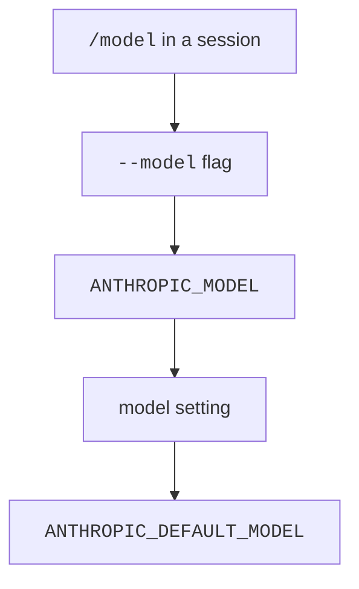

Claude Code has a built-in list of 22 models.
It also knows the model names of each cloud provider, and a set of short aliases such as `opus`.
You choose a model with a flag, an environment variable, a setting, or the `/model` command.
This page lists every model, alias, and provider switch. For how the choice is made at run time, read [Models](../how-it-works/models.md).

## At a Glance

| Question | Answer |
| --- | --- |
| Can you use it? | ✅ Yes. Run `claude --model opus` or type `/model` in a session. |
| Can you change it? | ✅ Yes. Use `--model`, `ANTHROPIC_MODEL`, `ANTHROPIC_DEFAULT_*_MODEL`, or the `model` and `modelOverrides` settings. |
| Can you turn it on or off? | Pick a provider with `CLAUDE_CODE_USE_BEDROCK` and its siblings. Limit choices with `availableModels`. |
| Where does it live? | `~/.claude/settings.json` (user), `.claude/settings.json` (project), managed settings, and your shell environment. |
| Status | <Documented /> <Undocumented /> |

## Choose a Model



The list runs from highest to lowest priority.
Source: [Model Configuration: Setting Your Model](https://code.claude.com/docs/en/model-config#setting-your-model).

| Item | Status | What it does |
| --- | --- | --- |
| `/model <alias\|name>` | <Documented /> | Switches now. With no argument it opens the picker. `Enter` saves your choice as the default. `s` switches for this session only. |
| `--model <model>` | <Documented /> | Sets the model for one session. |
| `ANTHROPIC_MODEL` | <Documented /> | Sets the model with the same values as `--model`. |
| `model` | <Documented /> | The settings key that stores the default. |
| `ANTHROPIC_DEFAULT_MODEL` | <Documented /> | Sets the default for new sessions. |
| `availableModels` | <Documented /> | An allowlist in managed settings. It limits `/model`, `--model`, the env vars, and alias resolution. Entries can be a family (`sonnet`), a version prefix (`claude-sonnet-4-5`), or a full ID. |
| `modelOverrides` | <Documented /> | Maps an Anthropic model ID to the provider string Claude Code sends, such as a Bedrock inference profile ARN. Since `2.1.305`, `/effort` and `/autocompact` settings apply even when the model name differs from a `modelOverrides` value by letter case or a `[1m]` tag ([v2.1.305 release](https://github.com/anthropics/claude-code/releases/tag/v2.1.305)). |
| `modelPicker` | <Documented /> | Lists your own rows for the `/model` picker, in your order and labels. |
| `ANTHROPIC_CUSTOM_MODEL_OPTION` | <Documented /> | Adds one custom entry to the picker. The ID is not validated. Add `_NAME` and `_DESCRIPTION` for a label. |
| `CLAUDE_CODE_ENABLE_GATEWAY_MODEL_DISCOVERY` | <Documented /> | Fills the picker from the gateway `/v1/models` endpoint. Off by default. |
| `CLAUDE_CODE_GATEWAY_MODEL_DISCOVERY_TIMEOUT_MS` | <Documented /> | Timeout of that request. Default `3000`. |
| `CLAUDE_CODE_SUBAGENT_MODEL` | <Documented /> | The default model for subagents, teammates, and workflow agents with no model set. |
| `--include-unsupported-models` | <Undocumented /> | Offers models your account can use that this version does not know. |
| `PreModelSwitch`, `PostModelSwitch` hooks | <Documented /> | Run around a switch. `PreModelSwitch` can block it. |

## Aliases

An alias is a short name for the newest model of a family.
The catalog holds `opus`, `sonnet`, `haiku`, and `fable`. The help text of `--model` names `fable`, `opus`, and `sonnet`.

| Alias | Status | Resolves to | Exceptions |
| --- | --- | --- | --- |
| `default` | <Documented /> | Clears the override. The model is then the runtime default for your account: Opus 5.5 on the Anthropic API, on the paid plans, and on AWS and Google Cloud. | Not an alias in the strict sense. |
| `opus` | <Documented /> | `claude-opus-5-5` | Foundry uses `claude-opus-4-6`. Gateways use `claude-opus-4-7`. |
| `sonnet` | <Documented /> | `claude-sonnet-5-5` | Bedrock, Vertex, Foundry, and Mantle use `claude-sonnet-4-5`. Claude Platform on AWS and gateways use `claude-sonnet-4-6`. |
| `haiku` | <Documented /> | `claude-haiku-5-5` | Every other provider uses `claude-haiku-4-5`. |
| `fable` | <Documented /> | `claude-fable-5-1` | Gateways use `claude-fable-5`. In Claude apps gateway sessions, `fable` and `best` resolve to Fable 5. |
| `best` | <Documented /> | The model `fable` resolves to, where you have Fable. Otherwise the same as `opus`. | |
| `opusplan` | <Documented /> | `opus` in plan mode, then `sonnet` to run the plan. | |
| `sonnet[1m]`, `opus[1m]`, `fable[1m]` | <Documented /> | The alias with a 1M window. | No effect when the alias already has a native 1M window. |

Sources: [Model Configuration](https://code.claude.com/docs/en/model-config) for the aliases, and the program for the exceptions.
Opus 5.5 needs Claude Code v2.1.280 or later, Sonnet 5.5 needs v2.1.284, Haiku 5.5 needs v2.1.293, and Fable 5.1 needs v2.1.257.

### Pin the Models Behind an Alias

| Environment variable | Status | Effect |
| --- | --- | --- |
| `ANTHROPIC_DEFAULT_OPUS_MODEL` | <Documented /> | The model for `opus`, and for `opusplan` in plan mode. |
| `ANTHROPIC_DEFAULT_SONNET_MODEL` | <Documented /> | The model for `sonnet`, and for `opusplan` outside plan mode. |
| `ANTHROPIC_DEFAULT_HAIKU_MODEL` | <Documented /> | The model for `haiku` and for background work. |
| `ANTHROPIC_DEFAULT_FABLE_MODEL` | <Documented /> | The model for `fable`. It also marks the ID as a Fable model for fallback. |
| `ANTHROPIC_SMALL_FAST_MODEL` | <Documented /> <Deprecated note="Use ANTHROPIC_DEFAULT_HAIKU_MODEL" /> | Deprecated. Use `ANTHROPIC_DEFAULT_HAIKU_MODEL`. |
| `ANTHROPIC_DEFAULT_<FAMILY>_MODEL_NAME` | <Documented /> | The display name of the pinned model in the picker. Works on third-party providers and gateways. |
| `ANTHROPIC_DEFAULT_<FAMILY>_MODEL_DESCRIPTION` | <Documented /> | The description in the picker. |
| `ANTHROPIC_DEFAULT_<FAMILY>_MODEL_SUPPORTED_CAPABILITIES` | <Documented /> | A comma list that tells Claude Code what the pinned model supports. Values: `effort`, `xhigh_effort`, `max_effort`, `thinking`, `adaptive_thinking`, `interleaved_thinking`. |

`<FAMILY>` is `OPUS`, `SONNET`, `HAIKU`, or `FABLE`. The `_NAME`, `_DESCRIPTION`, and `_SUPPORTED_CAPABILITIES` suffixes also work with `ANTHROPIC_CUSTOM_MODEL_OPTION`.
Pin versions before you roll Claude Code out on a third-party provider, because the alias default can lag the newest model.
A native 1M model runs with 1M with no suffix when the pinned ID contains its Anthropic API ID. For a model that reaches 1M through `[1m]` (Opus 4.6, Sonnet 4.6), add `[1m]` to the variable.

## Catalog

The catalog is a JavaScript object in the program with the comment `Hand-maintained baked-in model catalog`.
It holds the provider names, the window, the output limits, the price, the default effort, and the capability flags of each model.
A row is <Documented /> when an official docs page names the model. It is <Undocumented /> when no page names it.
The docs do not list the catalog fields, so the window, the limits, and the prices are program facts for all rows.

"Larger window" says how to get a bigger one: `native 1M` means the model has 1M already, `context-1m` is the beta that asks the API for it, and `[1m]` is the suffix for `--model`.
"Output" shows the default and the highest output limit in tokens. Prices are in [Pricing](#pricing) and default efforts are in [Effort](#effort).

| `id` | Status | Name | Knowledge cutoff | Window | Larger window | Output |
| --- | --- | --- | --- | --- | --- | --- |
| `claude-3-5-haiku` | <Undocumented /> | Haiku 3.5 | - | not set | - | 8,192 / 8,192 |
| `claude-haiku-4-5` | <Documented /> | Haiku 4.5 | February 2025 | 200,000 | `[1m]` suffix | 32,000 / 64,000 |
| `claude-haiku-5-5` | <Documented /> | Haiku 5.5 | June 2026 | 1,000,000 | native 1M, `context-1m` | 128,000 / 128,000 |
| `claude-3-5-sonnet` | <Undocumented /> | Sonnet 3.5 | - | not set | - | 8,192 / 8,192 |
| `claude-3-7-sonnet` | <Undocumented /> | Sonnet 3.7 | - | not set | - | 32,000 / 64,000 |
| `claude-sonnet-4-0` | <Undocumented /> | Sonnet 4 | January 2025 | 200,000 | `context-1m`, `[1m]` | 32,000 / 64,000 |
| `claude-sonnet-4-5` | <Documented /> | Sonnet 4.5 | January 2025 | 200,000 | `context-1m`, `[1m]` | 32,000 / 64,000 |
| `claude-sonnet-4-6` | <Documented /> | Sonnet 4.6 | August 2025 | 200,000 | `context-1m`, `[1m]` | 32,000 / 128,000 |
| `claude-sonnet-5` | <Documented /> | Sonnet 5 | January 2026 | 1,000,000 | native 1M, `context-1m` | 64,000 / 128,000 |
| `claude-sonnet-5-5` | <Documented /> | Sonnet 5.5 | June 2026 | 1,000,000 | native 1M, `context-1m` | 128,000 / 128,000 |
| `claude-opus-4-0` | <Undocumented /> | Opus 4 | January 2025 | 200,000 | `[1m]` suffix | 32,000 / 32,000 |
| `claude-opus-4-1` | <Documented /> | Opus 4.1 | January 2025 | 200,000 | `[1m]` suffix | 32,000 / 32,000 |
| `claude-opus-4-5` | <Documented /> | Opus 4.5 | May 2025 | 200,000 | `[1m]` suffix | 32,000 / 64,000 |
| `claude-opus-4-6` | <Documented /> | Opus 4.6 | May 2025 | 200,000 | `context-1m`, `[1m]` | 64,000 / 128,000 |
| `claude-opus-4-7` | <Documented /> | Opus 4.7 | January 2026 | 1,000,000 | native 1M, `context-1m`, `[1m]` | 64,000 / 128,000 |
| `claude-opus-4-8` | <Documented /> | Opus 4.8 | January 2026 | 1,000,000 | native 1M, `context-1m`, `[1m]` | 64,000 / 128,000 |
| `claude-opus-5` | <Documented /> | Opus 5 | May 2026 | 1,000,000 | native 1M, `context-1m`, `[1m]` | 64,000 / 128,000 |
| `claude-opus-5-5` | <Documented /> | Opus 5.5 | June 2026 | 1,000,000 | native 1M, `context-1m`, `[1m]` | 128,000 / 128,000 |
| `claude-fable-5` | <Documented /> | Fable 5 | January 2026 | 1,000,000 | native 1M, `context-1m` | 64,000 / 128,000 |
| `claude-fable-5-1` | <Documented /> | Fable 5.1 | June 2026 | 1,000,000 | native 1M, `context-1m` | 64,000 / 128,000 |
| `claude-mythos-5` | <Documented /> | Mythos 5 | January 2026 | 1,000,000 | native 1M, `context-1m` | 64,000 / 128,000 |
| `claude-mythos-5-1` | <Undocumented /> | Mythos 5.1 | June 2026 | 1,000,000 | native 1M, `context-1m` | 64,000 / 128,000 |

Notes:

- A model with no window in the table has no `context` entry in the catalog.
- The catalog keeps a rank for each model for the advisor tool (`--advisor`). The ranks run from `1` for `claude-haiku-4-5` to `9` for `claude-fable-5-1` and `claude-mythos-5-1`.
- A model can name a model to use instead on a third-party provider. For example, `claude-opus-5-5` falls back to `claude-opus-5`, and `claude-fable-5-1` falls back to `claude-fable-5`.
- The Mythos models have a name on the Anthropic API only, and none on the cloud providers.

## Other Model IDs in the Program

These IDs are not catalog rows. The program names them for one task each. All rows are <Undocumented />.

| `id` | Status | Where the program uses it |
| --- | --- | --- |
| `claude-3-opus`, `claude-3-sonnet`, `claude-3-haiku` | <Undocumented /> | The `Read` tool refuses a whole-PDF read on these models. Use the `pages` parameter instead. |
| `claude-haiku-3-5`, `claude-sonnet-3-7` | <Undocumented /> | Short names in a table that shortens a model name for the commit and pull request attribution line. A name that contains `haiku-3-5` or `sonnet-3-7` maps to the ID. |
| `claude-mythos-preview` | <Undocumented /> | The model-name check accepts it as a known name, next to the aliases. It has no catalog row. |
| `claude-sonnet-4-5-20250929[1m]` | <Undocumented /> | On the Anthropic API, a startup migration changes a user-settings `model` of this value to `sonnet[1m]`. |
| `claude-fable-5[1m]` | <Undocumented /> | A startup migration changes a user-settings `model` of this value to `fable[1m]`. |
| `claude-sonnet-4-6[1m]`, `claude-opus-4-6[1m]` | <Undocumented /> | The value of the "1M context" entries in the `/model` picker on the Anthropic API. |
| `claude-opus-5[1m]`, `claude-opus-5-5[1m]`, `claude-sonnet-5-5[1m]` | <Undocumented /> | The refusal fallback table treats each like the ID without `[1m]`. |
| `claude-sonnet-5[1m]`, `claude-opus-4-8[1m]` | <Undocumented /> | Keys of a built-in per-model threshold table (`severityByModel`), next to the same IDs without `[1m]`. |

## Pricing

Prices are in US dollars for each million tokens. A search request costs `0.01` in every group.
Haiku 5.5 costs `0.5` for input and `2.5` for output above 100,000 prompt tokens.
All rows are <Undocumented />.

| Models | Input | Output | Cache write 5m | Cache write 1h | Cache read |
| --- | --- | --- | --- | --- | --- |
| `claude-sonnet-5` | 2 | 10 | 2.5 | 4 | 0.2 |
| `claude-sonnet-5-5` | 2 | 10 | 2.5 | 4 | 0.1 |
| `claude-3-5-sonnet`, `claude-3-7-sonnet`, `claude-sonnet-4-0`, `claude-sonnet-4-5`, `claude-sonnet-4-6` | 3 | 15 | 3.75 | 6 | 0.3 |
| `claude-opus-4-5`, `claude-opus-4-6`, `claude-opus-4-7`, `claude-opus-4-8`, `claude-opus-5` | 5 | 25 | 6.25 | 10 | 0.5 |
| `claude-opus-4-0`, `claude-opus-4-1` | 15 | 75 | 18.75 | 30 | 1.5 |
| `claude-fable-5`, `claude-mythos-5` | 10 | 50 | 12.5 | 20 | 1 |
| `claude-fable-5-1`, `claude-mythos-5-1` | 10 | 50 | 12.5 | 20 | 0.25 |
| `claude-opus-5-5` | 4 | 20 | 5 | 8 | 0.2 |
| `claude-3-5-haiku` | 0.8 | 4 | 1 | 1.6 | 0.08 |
| `claude-haiku-4-5` | 1 | 5 | 1.25 | 2 | 0.1 |
| `claude-haiku-5-5` | 0.1 | 0.5 | 0.125 | 0.2 | 0.01 |

## Effort

The effort levels are `low`, `medium`, `high`, `xhigh`, and `max`.
A level the model does not accept runs as the highest accepted level below it.
The effort cost index scales the cost of a level against `high`, which is `1`.
It comes from the catalog (<Undocumented />). `claude-opus-4-7` has the default `xhigh` and no index. Other models not listed have no default effort in the catalog.

| Item | Status | What it does |
| --- | --- | --- |
| `--effort <level>` | <Documented /> | Sets the effort for a session. `ultracode` sets `xhigh` and turns on the workflow mode. |
| `CLAUDE_CODE_EFFORT_LEVEL` | <Documented /> | Sets the effort. It wins over `--effort`, `/effort`, and settings. `auto` uses the model default. |
| `effortLevel`, `maxEffortLevel`, `modelSettings` | <Documented /> | Settings for the default level and a cap. |
| `output_config.effort` | <Documented /> | The request field that carries the level. |
| `per-turn-control-2026-07-01` | <Undocumented /> | A beta that lets some models take the effort with each message. |
| `ultrathink` | <Documented /> | A word in a prompt that asks for deeper thinking on that turn only. |
| Default effort | <Documented /> | `high`, except `medium` for Opus 5.5, Sonnet 5.5, and Haiku 5.5, and `xhigh` for Opus 4.7. |

| `id` | Default effort | Index (`low`, `medium`, `high`, `xhigh`, `max`) |
| --- | --- | --- |
| `claude-fable-5` | high | 0.6, 0.77, 1, 1.74, 1.91 |
| `claude-fable-5-1` | high | 0.75, 0.86, 1, 1.38, 1.74 |
| `claude-haiku-5-5` | medium | 0.38, 0.52, 1, 2.03, 4.34 |
| `claude-mythos-5-1` | high | 0.75, 0.86, 1, 1.38, 1.74 |
| `claude-opus-4-7` | xhigh | none |
| `claude-opus-4-8` | high | 0.72, 0.9, 1, 1.65, 1.88 |
| `claude-opus-5` | high | 0.67, 0.76, 1, 1.6, 1.7 |
| `claude-opus-5-5` | medium | 0.48, 0.66, 1, 1.66, 3.44 |
| `claude-sonnet-5` | high | 0.47, 0.74, 1, 2.41, 5.59 |
| `claude-sonnet-5-5` | medium | 0.49, 0.54, 1, 1.87, 5.5 |

## Thinking

Sources: [Model Configuration](https://code.claude.com/docs/en/model-config) and [Environment Variables](https://code.claude.com/docs/en/env-vars).

| Item | Status | What it does |
| --- | --- | --- |
| `thinking: {type: "adaptive"}` | <Documented /> | Lets the model choose how long it thinks. Newer models always use it. |
| `MAX_THINKING_TOKENS` | <Documented /> | Sets a fixed thinking budget. `0` turns thinking off on the Anthropic API. It cannot turn thinking off on Opus 5.5, Sonnet 5.5, Haiku 5.5, and the Fable models. |
| `CLAUDE_CODE_DISABLE_ADAPTIVE_THINKING` | <Documented /> | Goes back to the fixed budget on Opus 4.6 and Sonnet 4.6. No effect on newer models. |
| `CLAUDE_CODE_DISABLE_THINKING` | <Documented /> | Leaves out the `thinking` field, for proxies that reject it. |
| `alwaysThinkingEnabled`, `showThinkingSummaries` | <Documented /> | Settings for thinking. `Option+T` or `Alt+T` toggles it. |
| `--thinking <enabled\|adaptive\|disabled>` | <Undocumented /> | Hidden print-mode flag. `enabled` equals `adaptive`. |
| `--thinking-display <summarized\|omitted\|highlights>` | <Undocumented /> | Hidden flag. Sets how thinking text comes back. |
| `--max-thinking-tokens` | <Undocumented /> <Deprecated note="Use --thinking" /> | Hidden and deprecated. Use `--thinking`. |

## Fallback and Retries

Sources: [Model Configuration](https://code.claude.com/docs/en/model-config) and [Error Reference: Automatic Retries](https://code.claude.com/docs/en/errors#automatic-retries).

| Item | Status | What it does |
| --- | --- | --- |
| `--fallback-model <model...>`, `fallbackModel` | <Documented /> | A chain of up to three models for overload and server errors. |
| `CLAUDE_CODE_NO_MODEL_FALLBACK` | <Undocumented /> | Forbids the substitution of a model. |
| `CLAUDE_CODE_MAX_RETRIES` | <Documented /> | Number of retries. Default 10, up to 15. |
| `CLAUDE_CODE_RETRY_WATCHDOG` | <Documented /> | Retries `429` and `529` errors without end and removes the cap. Off by default. |
| `CLAUDE_CODE_OVERLOADED_RETRY_BASE_DELAY_MS`, `CLAUDE_CODE_OVERLOADED_RETRY_MAX_DELAY_MS` | <Documented /> | Start and longest wait after a `529`. Defaults 500 and 32000. |
| `API_TIMEOUT_MS` | <Documented /> | Request timeout. Default 600000. |
| `CLAUDE_STREAM_IDLE_TIMEOUT_MS`, `CLAUDE_STREAM_FIRST_BYTE_TIMEOUT_MS` | <Documented /> | Stream silence and first-byte deadlines. The program sets the defaults. A value below 5 minutes for `CLAUDE_STREAM_IDLE_TIMEOUT_MS` counts as 5 minutes. |
| `CLAUDE_CODE_DISABLE_NONSTREAMING_FALLBACK` | <Documented /> | Stops the retry without streaming after a stream fails. Off by default. |

The rules for these are on [Models](../how-it-works/models.md#fallback) and [Retries and Timeouts](../how-it-works/models.md#retries-and-timeouts).

## Providers

The program knows these provider keys: `first_party`, `bedrock`, `vertex`, `foundry`, `anthropic_aws`, `anthropic_google_cloud`, `mantle`, and `gateway`.
These environment variables choose the provider.
The order when several are set is: gateway, Bedrock, Foundry, Claude Platform on AWS, Google Cloud, Mantle, Vertex.

| Env var | Status | Provider |
| --- | --- | --- |
| `CLAUDE_CODE_USE_BEDROCK` | <Documented /> | Amazon Bedrock. |
| `CLAUDE_CODE_USE_VERTEX` | <Documented /> | Google Cloud Agent Platform (Vertex). |
| `CLAUDE_CODE_USE_FOUNDRY` | <Documented /> | Microsoft Foundry. |
| `CLAUDE_CODE_USE_MANTLE` | <Documented /> | The Mantle endpoint of Amazon Bedrock. With Bedrock on, `anthropic.*` model IDs route to Mantle. |
| `CLAUDE_CODE_USE_ANTHROPIC_AWS` | <Documented /> | Claude Platform on AWS. |
| `CLAUDE_CODE_USE_ANTHROPIC_GOOGLE_CLOUD` | <Undocumented /> | Claude Platform on Google Cloud. |
| `CLAUDE_CODE_USE_GATEWAY` | <Undocumented /> | A host-managed gateway. Needs `ANTHROPIC_BASE_URL` and a token. |

The Anthropic API, `anthropic_aws`, `anthropic_google_cloud`, and `gateway` providers use the first-party names, so the name tables below leave them out.

### Endpoint and Region Variables

| Env var | Status | Provider | Effect |
| --- | --- | --- | --- |
| `ANTHROPIC_BEDROCK_BASE_URL` | <Documented /> | Bedrock | Overrides the endpoint URL. |
| `ANTHROPIC_BEDROCK_MANTLE_BASE_URL` | <Documented /> | Mantle | Overrides the Mantle endpoint. Default `https://bedrock-mantle.<region>.api.aws`. |
| `ANTHROPIC_BEDROCK_REGION_PREFIX` | <Documented /> | Bedrock | Cross-region profile prefix that Claude Code tries first. |
| `ANTHROPIC_BEDROCK_SERVICE_TIER` | <Documented /> | Bedrock | Sent in the `X-Amzn-Bedrock-Service-Tier` header. |
| `ANTHROPIC_SMALL_FAST_MODEL_AWS_REGION` | <Documented /> | Bedrock, Mantle | Region of the Haiku-class model. |
| `AWS_REGION`, `AWS_DEFAULT_REGION`, `AWS_PROFILE` | <Documented /> | Bedrock | Standard AWS region and profile. Region order: `AWS_REGION`, `AWS_DEFAULT_REGION`, shared config, `us-east-1`. |
| `ANTHROPIC_VERTEX_BASE_URL` | <Documented /> | Vertex | Overrides the endpoint URL. |
| `ANTHROPIC_VERTEX_PROJECT_ID` | <Documented /> | Vertex | The GCP project. Last choice after `GCLOUD_PROJECT` and `GOOGLE_CLOUD_PROJECT`. |
| `ANTHROPIC_FOUNDRY_BASE_URL` | <Documented /> | Foundry | Full base URL of the resource. Wins over the resource name. |
| `ANTHROPIC_FOUNDRY_RESOURCE` | <Documented /> | Foundry | Resource name. Builds `https://<resource>.services.ai.azure.com`. |
| `ANTHROPIC_AWS_BASE_URL`, `ANTHROPIC_AWS_WORKSPACE_ID` | <Documented /> | Claude Platform on AWS | Endpoint and workspace. |
| `ANTHROPIC_GOOGLE_CLOUD_BASE_URL`, `_LOCATION`, `_PROJECT`, `_WORKSPACE_ID` | <Undocumented /> | Claude Platform on Google Cloud | Endpoint, location, project, and workspace (full names start with `ANTHROPIC_GOOGLE_CLOUD`). |
| `CLAUDE_CODE_SKIP_BEDROCK_AUTH`, `CLAUDE_CODE_SKIP_VERTEX_AUTH`, `CLAUDE_CODE_SKIP_FOUNDRY_AUTH`, `CLAUDE_CODE_SKIP_MANTLE_AUTH`, `CLAUDE_CODE_SKIP_ANTHROPIC_AWS_AUTH` | <Documented /> | Each provider | Skip client-side auth, for a gateway that signs requests itself. |
| `CLAUDE_CODE_SKIP_ANTHROPIC_GOOGLE_CLOUD_AUTH` | <Undocumented /> | Claude Platform on Google Cloud | The same, for that provider. |

### Provider Names

Each cell is the model name for that provider. A dash means the provider has none.
A row is <Documented /> when a docs page such as Amazon Bedrock or Model Configuration names the model, and <Undocumented /> when only the program has the names.

| `id` | Status | `first_party` | `bedrock` | `vertex` | `foundry` | `mantle` |
| --- | --- | --- | --- | --- | --- | --- |
| `claude-3-5-haiku` | <Undocumented /> | `claude-3-5-haiku-20241022` | `us.anthropic.claude-3-5-haiku-20241022-v1:0` | `claude-3-5-haiku@20241022` | `claude-3-5-haiku` | - |
| `claude-haiku-4-5` | <Documented /> | `claude-haiku-4-5-20251001` | `us.anthropic.claude-haiku-4-5-20251001-v1:0` | `claude-haiku-4-5@20251001` | `claude-haiku-4-5` | `anthropic.claude-haiku-4-5` |
| `claude-haiku-5-5` | <Documented /> | `claude-haiku-5-5` | `us.anthropic.claude-haiku-5-5` | `claude-haiku-5-5` | `claude-haiku-5-5` | `anthropic.claude-haiku-5-5` |
| `claude-3-5-sonnet` | <Undocumented /> | `claude-3-5-sonnet-20241022` | `us.anthropic.claude-3-5-sonnet-20241022-v2:0` | `claude-3-5-sonnet-v2@20241022` | `claude-3-5-sonnet` | - |
| `claude-3-7-sonnet` | <Undocumented /> | `claude-3-7-sonnet-20250219` | `us.anthropic.claude-3-7-sonnet-20250219-v1:0` | `claude-3-7-sonnet@20250219` | `claude-3-7-sonnet` | - |
| `claude-sonnet-4-0` | <Undocumented /> | `claude-sonnet-4-20250514` | `us.anthropic.claude-sonnet-4-20250514-v1:0` | `claude-sonnet-4@20250514` | `claude-sonnet-4` | - |
| `claude-sonnet-4-5` | <Documented /> | `claude-sonnet-4-5-20250929` | `us.anthropic.claude-sonnet-4-5-20250929-v1:0` | `claude-sonnet-4-5@20250929` | `claude-sonnet-4-5` | - |
| `claude-sonnet-4-6` | <Documented /> | `claude-sonnet-4-6` | `us.anthropic.claude-sonnet-4-6` | `claude-sonnet-4-6` | `claude-sonnet-4-6` | - |
| `claude-sonnet-5` | <Documented /> | `claude-sonnet-5` | `us.anthropic.claude-sonnet-5` | `claude-sonnet-5` | `claude-sonnet-5` | `anthropic.claude-sonnet-5` |
| `claude-sonnet-5-5` | <Documented /> | `claude-sonnet-5-5` | `us.anthropic.claude-sonnet-5-5` | `claude-sonnet-5-5` | `claude-sonnet-5-5` | `anthropic.claude-sonnet-5-5` |
| `claude-opus-4-0` | <Undocumented /> | `claude-opus-4-20250514` | `us.anthropic.claude-opus-4-20250514-v1:0` | `claude-opus-4@20250514` | `claude-opus-4` | - |
| `claude-opus-4-1` | <Documented /> | `claude-opus-4-1-20250805` | `us.anthropic.claude-opus-4-1-20250805-v1:0` | `claude-opus-4-1@20250805` | `claude-opus-4-1` | - |
| `claude-opus-4-5` | <Documented /> | `claude-opus-4-5-20251101` | `us.anthropic.claude-opus-4-5-20251101-v1:0` | `claude-opus-4-5@20251101` | `claude-opus-4-5` | - |
| `claude-opus-4-6` | <Documented /> | `claude-opus-4-6` | `us.anthropic.claude-opus-4-6-v1` | `claude-opus-4-6` | `claude-opus-4-6` | - |
| `claude-opus-4-7` | <Documented /> | `claude-opus-4-7` | `us.anthropic.claude-opus-4-7` | `claude-opus-4-7` | `claude-opus-4-7` | `anthropic.claude-opus-4-7` |
| `claude-opus-4-8` | <Documented /> | `claude-opus-4-8` | `us.anthropic.claude-opus-4-8` | `claude-opus-4-8` | `claude-opus-4-8` | `anthropic.claude-opus-4-8` |
| `claude-opus-5` | <Documented /> | `claude-opus-5` | `us.anthropic.claude-opus-5` | `claude-opus-5` | `claude-opus-5` | `anthropic.claude-opus-5` |
| `claude-opus-5-5` | <Documented /> | `claude-opus-5-5` | `us.anthropic.claude-opus-5-5` | `claude-opus-5-5` | `claude-opus-5-5` | `anthropic.claude-opus-5-5` |
| `claude-fable-5` | <Documented /> | `claude-fable-5` | `us.anthropic.claude-fable-5` | `claude-fable-5` | `claude-fable-5` | `anthropic.claude-fable-5` |
| `claude-fable-5-1` | <Documented /> | `claude-fable-5-1` | `us.anthropic.claude-fable-5-1` | `claude-fable-5-1` | `claude-fable-5-1` | `anthropic.claude-fable-5-1` |
| `claude-mythos-5` | <Documented /> | `claude-mythos-5` | - | - | - | - |
| `claude-mythos-5-1` | <Undocumented /> | `claude-mythos-5-1` | - | - | - | - |

### Vertex Region Variables

Each model has an environment variable that sets its region on Vertex. [Environment Variables](https://code.claude.com/docs/en/env-vars) in the official docs lists them.
The Mythos models have none, because they have no Vertex name.

| `id` | Status | Env var |
| --- | --- | --- |
| `claude-3-5-haiku` | <Documented /> | `VERTEX_REGION_CLAUDE_3_5_HAIKU` |
| `claude-haiku-4-5` | <Documented /> | `VERTEX_REGION_CLAUDE_HAIKU_4_5` |
| `claude-haiku-5-5` | <Documented /> | `VERTEX_REGION_CLAUDE_HAIKU_5_5` |
| `claude-3-5-sonnet` | <Documented /> | `VERTEX_REGION_CLAUDE_3_5_SONNET` |
| `claude-3-7-sonnet` | <Documented /> | `VERTEX_REGION_CLAUDE_3_7_SONNET` |
| `claude-sonnet-4-0` | <Documented /> | `VERTEX_REGION_CLAUDE_4_0_SONNET` |
| `claude-sonnet-4-5` | <Documented /> | `VERTEX_REGION_CLAUDE_4_5_SONNET` |
| `claude-sonnet-4-6` | <Documented /> | `VERTEX_REGION_CLAUDE_4_6_SONNET` |
| `claude-sonnet-5` | <Documented /> | `VERTEX_REGION_CLAUDE_5_SONNET` |
| `claude-sonnet-5-5` | <Documented /> | `VERTEX_REGION_CLAUDE_5_5_SONNET` |
| `claude-opus-4-0` | <Documented /> | `VERTEX_REGION_CLAUDE_4_0_OPUS` |
| `claude-opus-4-1` | <Documented /> | `VERTEX_REGION_CLAUDE_4_1_OPUS` |
| `claude-opus-4-5` | <Documented /> | `VERTEX_REGION_CLAUDE_4_5_OPUS` |
| `claude-opus-4-6` | <Documented /> | `VERTEX_REGION_CLAUDE_4_6_OPUS` |
| `claude-opus-4-7` | <Documented /> | `VERTEX_REGION_CLAUDE_4_7_OPUS` |
| `claude-opus-4-8` | <Documented /> | `VERTEX_REGION_CLAUDE_4_8_OPUS` |
| `claude-opus-5` | <Documented /> | `VERTEX_REGION_CLAUDE_5_OPUS` |
| `claude-opus-5-5` | <Documented /> | `VERTEX_REGION_CLAUDE_5_5_OPUS` |
| `claude-fable-5` | <Documented /> | `VERTEX_REGION_CLAUDE_FABLE_5` |
| `claude-fable-5-1` | <Documented /> | `VERTEX_REGION_CLAUDE_FABLE_5_1` |

### Gateways

A gateway is a server between Claude Code and a model API.
Set `ANTHROPIC_BASE_URL` to point at it. That variable changes where requests go, not which model answers.
Pin the model IDs the gateway serves with the `ANTHROPIC_DEFAULT_*_MODEL` variables, and let the picker find them with `CLAUDE_CODE_ENABLE_GATEWAY_MODEL_DISCOVERY=1`.
A gateway that does not serve `claude-fable-5-1` rejects it, so the `fable` alias falls to `claude-fable-5` on gateways.

## Capabilities

The model catalog gives each model a list of capability flags.
The code tests a flag to switch a feature on for that model.
The docs do not list these flags, so every row is <Undocumented />.
The meaning is given only where the docs or a string in the program make it clear.
The column "Models" counts the models that have the flag.
For pinned models on third-party providers, you can state the capabilities yourself with `_SUPPORTED_CAPABILITIES` (see above).

| Flag | Status | What it does | Models |
| --- | --- | --- | --- |
| `context_management` | <Undocumented /> | The model works with the `context-management-2025-06-27` beta. | 18 |
| `effort` | <Undocumented /> | The model accepts the `effort` setting. | 12 |
| `max_effort` | <Undocumented /> | The model accepts the level `max`. | 12 |
| `xhigh_effort` | <Undocumented /> | The model accepts the level `xhigh`. | 10 |
| `adaptive_thinking` | <Undocumented /> | The model accepts adaptive thinking. | 12 |
| `mid_conv_tool_change` | <Undocumented /> | The tool list can change in the middle of a conversation. | 8 |
| `rejects_disabled_thinking` | <Undocumented /> | Thinking cannot be turned off, as the docs say for `MAX_THINKING_TOKENS`. | 6 |
| `per_turn_effort` | <Undocumented /> | The model can take the effort with each message. | 4 |
| `per_turn_timing` | <Undocumented /> | The model can take the current time with each message. | 4 |
| `lean_prompt` | <Undocumented /> | The model-side input for the short system prompt. See [The System Prompt](../how-it-works/system-prompt.md#short-or-full-prompt). | 8 |
| `org_locked_thinking` | <Undocumented /> | The organization locks the thinking setting. | 2 |
| `haiku_5_5_early_stopping_guidance` | <Undocumented /> | Claude Code adds guidance against early stopping. | 1 |
| `refusal_fallback` | <Undocumented /> | A refused request can run again on a fallback model. | 5 |
| `silent_turn_reminder` | <Undocumented /> | Claude Code adds a reminder after a turn with no text. | 1 |
| `fast_mode` | <Undocumented /> | The model supports `/fast`. | 3 |
| `thinking_disabled_effort_cap` | <Undocumented /> | The program does not state the purpose. | 1 |
| `opus_5_prompt_bundle` | <Undocumented /> | The model gets the prompt sections for Opus 5. | 1 |
| `opus_5_5_prompt_bundle` | <Undocumented /> | The model gets the prompt sections for Opus 5.5. | 1 |
| `fable_5_mitigations` | <Undocumented /> | The model gets extra safety text for Fable 5. | 3 |
| `fable_5_1_prompt_bundle` | <Undocumented /> | The model gets the prompt sections for Fable 5.1. | 2 |

The flags `effort`, `max_effort`, `xhigh_effort`, and `adaptive_thinking` say which effort levels and which thinking mode a model accepts.
The betas `per-turn-control-2026-07-01` and `timing-2026-09-09` match the flags `per_turn_effort` and `per_turn_timing`.

## Example

Pin Opus and Sonnet on Amazon Bedrock, then start Claude Code on a 1M window of Opus.

```bash
export CLAUDE_CODE_USE_BEDROCK=1
export AWS_REGION=us-east-1
export ANTHROPIC_DEFAULT_OPUS_MODEL='us.anthropic.claude-opus-4-8'
export ANTHROPIC_DEFAULT_SONNET_MODEL='us.anthropic.claude-sonnet-4-5-20250929-v1:0'
claude --model opus[1m] --effort high
```

Limit what users can pick in managed settings:

```json title="managed-settings.json"
{
  "availableModels": ["sonnet", "claude-opus-4-8"],
  "modelOverrides": {
    "claude-opus-4-8": "arn:aws:bedrock:us-east-2:123456789012:application-inference-profile/opus-prod"
  }
}
```

## Related Pages

- [Models](../how-it-works/models.md)
- [Request and Cache](../how-it-works/request-and-cache.md)
- [The System Prompt](../how-it-works/system-prompt.md)
- [Settings](settings/index.md), [Environment Variables](env-vars/index.md), and [CLI](cli/index.md) pages in Configure.
