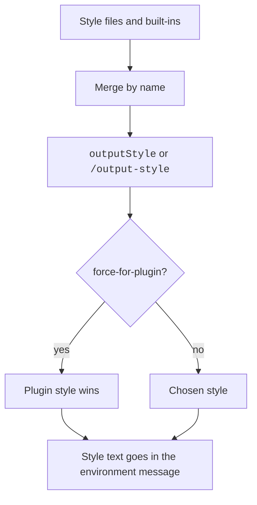

An output style changes the role, tone, and format of Claude's answers in a session.
You pick one with `/output-style`. It applies from the next message.
An output style is an instruction, so nothing enforces it.
For project facts, use [Memory and Rules](memory-and-rules.md). For actions that must always happen, use hooks.

## Example

```markdown title=".claude/output-styles/terse-reviewer.md"
---
name: Terse Reviewer
description: Short code review notes
keep-coding-instructions: true
---
Review the change. List problems as short bullets, worst first.
Skip praise and recaps.
```

```json title=".claude/settings.json"
{ "outputStyle": "Terse Reviewer" }
```

Restart `claude` so it finds the new file. Then Claude answers as a terse reviewer and still keeps its coding instructions.

## Built-In Styles

Each non-default style keeps the standard coding instructions and adds its own.
Source: the program sets `keepCodingInstructions: true` and `source: "built-in"` for the four styles.
Official page: [Output Styles](https://code.claude.com/docs/en/output-styles).
The captured prompts are on these pages: [Proactive](../prompts/output-styles/style-proactive.md), [Concise](../prompts/output-styles/style-concise.md), [Explanatory](../prompts/output-styles/style-explanatory.md), and [Learning](../prompts/output-styles/style-learning.md).

| Item | Status | What it does | How it works | Where to set it |
| --- | --- | --- | --- | --- |
| `default` | <Documented /> | No style instructions | The standard system prompt for software engineering. It shows in the `/output-style` list | All sessions |
| `Proactive` | <Documented /> | Starts work at once and assumes on routine choices | Claude does not use plan mode unless you ask. It checks in the chat before it deletes data or changes shared systems. It does not change the permission mode | All sessions |
| `Concise` | <Documented /> | Leads with the result, no preamble, narration, or recap | Simple answers take one to three sentences. Full length stays for requested detail and safety content. Needs `2.1.237`. The bundle gives it a `turnReminder` | All sessions |
| `Explanatory` | <Documented /> | Adds `Insight` blocks | Each block has two or three points. Claude does not write them into files | All sessions |
| `Learning` | <Documented /> | Adds `Insight` blocks and `TODO(human)` tasks | Claude asks you to write 2 to 10 lines when it generates 20 or more lines with a design choice. It then stops and waits | All sessions |

## The `outputStyle` Setting and Switching

| Item | Status | What it does | How it works | Where to set it |
| --- | --- | --- | --- | --- |
| `outputStyle` | <Documented /> | Names the active style | The value is case-sensitive. `Explanatory` works. `explanatory` gives Default. No value means Default. A project file wins over user settings | Any settings scope |
| `/output-style <style>` | <Documented /> | Switches the style | Saves to `.claude/settings.local.json`. No argument lists the styles. Ignores case. Works in print mode and the SDK. Needs `2.1.269` for remote lists | Interactive, print |
| `/config` Output style | <Documented /> | Menu picker | Saves to local settings | Terminal |
| Switch in a session | <Documented /> | New style applies from the next message | Before `2.1.251` it needed `/clear`. Prompt caching costs the first message | All sessions |
| Custom style over Remote Control | <Undocumented /> | You cannot select it | The bundle text tells you to pick one in the session itself | Remote Control |
| `CLAUDE_CODE_SIMPLE_SYSTEM_PROMPT` | <Documented /> | Chooses the full or short system prompt | `0` selects the full prompt. `keep-coding-instructions` has no effect on the short prompt | Env |
| Safe mode | <Documented /> | Styles do not load | `CLAUDE_CODE_SAFE_MODE=1` skips output styles | Env |

## Locations and Precedence

| Item | Status | What it does | How it works | Where to set it |
| --- | --- | --- | --- | --- |
| `~/.claude/output-styles/*.md` | <Documented /> | User styles | The file name is the style name unless you set `name` | User |
| `.claude/output-styles/*.md` | <Documented /> | Project styles | Every such directory between the working directory and the repository root loads. The closest one wins for a name | Project |
| Managed `.claude/output-styles` | <Documented /> | Policy styles | The styles are inside the managed settings directory | Managed |
| Plugin `output-styles/` | <Documented /> | Plugin styles | See Plugins | Plugin |
| `outputStylesPath`, `outputStylesPaths` | <Undocumented /> | Manifest key for style files or directories | When set, Claude Code does not auto-load the `output-styles/` directory | Plugin manifest |
| Merge order | <Undocumented /> | For the same name the later source wins | The order is built-in, plugin, user, project, then policy. Plugin style names start with the plugin name and a colon, so they do not clash with the others. With safe mode on, only the built-ins load | All |
| File reading | <Documented /> | Styles load when Claude Code starts | A new file needs a restart in the terminal | Terminal |

## Frontmatter Keys

All keys are optional. Claude Code ignores a misspelled key. Bad YAML loads the style under its file name with no fields.

| Item | Status | What it does | How it works | Where to set it |
| --- | --- | --- | --- | --- |
| `name` | <Documented /> | Style name in the picker | The default is the file name | Style file |
| `description` | <Documented /> | Text in the picker | String | Style file |
| `keep-coding-instructions` | <Documented /> | Keeps the built-in software engineering section | The default is `false`. It works only on the full system prompt | Style file |
| `force-for-plugin` | <Documented /> | Applies the style when you enable the plugin | It overrides `outputStyle`. The first loaded plugin wins. A warning names the others. On a non-plugin style, Claude Code ignores the key and shows a warning | Plugin styles |

Captured prompts for custom styles: [Custom Style](../prompts/output-styles/style-custom.md), [Custom Style on the Full Prompt](../prompts/output-styles/style-custom-full.md), and [Custom Style with Keep Coding Instructions](../prompts/output-styles/style-custom-keep.md).

## How It Works

- The active style text goes with every request. Source: the official [Output Styles](https://code.claude.com/docs/en/output-styles) page.
- A style applies to the main thread and to a fork. Other subagents use their own system prompt. Source: the same page.
- The style name shows in the status line field `output_style.name`. See [Status Line](status-line.md).
- The SDK init message can report `outputStyle` as `null` or as `{ name, isKeepingCodingInstructions }`. Source: the program string `no { outputStyle } (null, or { name, isKeepingCodingInstructions })`.



:::note
A probe set `outputStyle` in user settings and added a plugin style with `force-for-plugin: true`. The system prompt used the forced style and not the configured one. The `init` event still showed the setting's name. With several forced styles, the first wins. A warning lists all. In a user style, Claude Code ignores `force-for-plugin`. A managed `outputStyle` with its style file in the managed folder won over user, project, local, and `--settings` values. See [Probes](../reference/probes.md#configure-and-memory) and [Managed Folder Probe](../reference/probes.md#managed-folder-probe).
The captures linked above hold the full text of each built-in style prompt. We compared them with the strings in the program. The only difference is the blank lines that the capture adds after the style header and between paragraphs.
:::

## Where the Style Text Goes

The probe of 2.1.316 shows that the style text does not go in `system[2]`. Claude Code puts it in the environment message, a system-role message in `messages`, under the line `# Output Style: <name>`. The front matter is not sent. Source: [Style Custom](../prompts/output-styles/style-custom.md).
The first line of the body, `You are an agent working with the user ...`, becomes `You are an interactive agent that helps users according to your "Output Style", which describes how you should respond to user queries.` when a style is active and keeps no coding instructions.
A reminder line follows the deferred tool list and the command list: `<name> output style is active. Remember to follow the specific guidelines for this style.` The probe sent one user message, so this page does not state how often the reminder repeats.

## Exact Fields

The exact fields are in the `output-style` definition in `https://clawdipedia.cc/schemas/claude-code-frontmatter.json`. The program's frontmatter validators produce it.
It lists every field of this release. Build on the fields it names. Look each one up there before you rely on it.

## Related Pages

- [Memory and Rules](memory-and-rules.md)
- [Status Line](status-line.md)
- [The System Prompt](../how-it-works/system-prompt.md)
- [Captured Prompts](../prompts/index.md)
