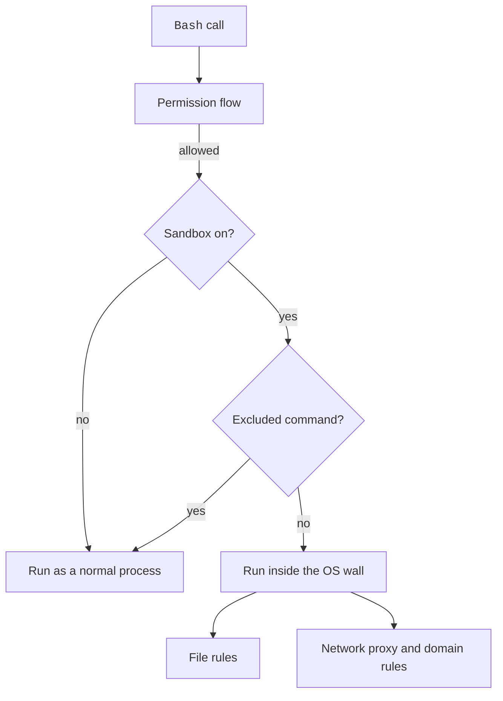

The sandbox runs `Bash` commands inside a wall that the operating system enforces.
It limits which files a command can write and which hosts it can reach, even when a permission rule allows the command.
Permission rules decide whether a call runs. The sandbox limits what the call can touch once it runs.

The sandbox works on macOS, Linux, and WSL. `sandbox.enabled` turns it on. It is `false` by default. Without its dependencies, a warning shows. Commands then run unsandboxed. The `sandbox` key works in any settings scope, but some keys work only in managed or user settings.

## Example

```json title="~/.claude/settings.json"
{
  "$schema": "https://clawdipedia.cc/schemas/claude-code-settings.json",
  "sandbox": {
    "enabled": true,
    "failIfUnavailable": true,
    "network": {
      "allowedDomains": ["github.com", "*.npmjs.org"]
    },
    "filesystem": {
      "allowWrite": ["~/.cache/build"],
      "denyRead": ["~/.ssh"]
    }
  }
}
```

`Bash` runs in the sandbox. It reaches only those two hosts. It can also write to the cache folder. It cannot read `~/.ssh`.
Claude Code exits at startup if the sandbox cannot start.

## Core Keys

Official pages: [Configure the Sandboxed Bash Tool](https://code.claude.com/docs/en/sandboxing) and [Settings Reference](https://code.claude.com/docs/en/settings-reference).

| Key | Status | What it does | How it works | Scope |
| --- | --- | --- | --- | --- |
| `sandbox.enabled` | <Documented /> | Runs `Bash` in the sandbox | The default is `false`. Without dependencies, a warning shows. Commands run unsandboxed | Each scope |
| `sandbox.failIfUnavailable` | <Documented /> | Exit at startup if the sandbox cannot start | Default `false`. For managed hard gates | Each scope |
| `sandbox.autoAllowBashIfSandboxed` | <Documented /> | Auto-allows sandboxed commands | Reason text `Auto-allowed with sandbox`. Default `true` per the `filesystem.disabled` text | Each scope |
| `sandbox.allowUnsandboxedCommands` | <Documented /> <Caution /> | Lets a call use `dangerouslyDisableSandbox` | The default is `true`. When `false`, Claude Code ignores the parameter. A `false` from managed, `--settings`, or user settings holds | Each scope |
| `sandbox.excludedCommands` | <Documented /> | Patterns that run outside the sandbox | `Bash` rule syntax. An entry takes a call out of the sandbox only when every command in the call matches an entry. In a pipe or a chain such as `a && b`, each part needs its own match. A call with a `cd`, a command substitution, or a redirect other than a file-descriptor duplication such as `2>&1` stays sandboxed. A convenience, not a boundary: the permission flow still applies. Only managed, `--settings`, and user entries count. Since `2.1.309`, while the sandbox is on but cannot run, these commands ask before they write to the sandbox's write-list paths, and the fallback that runs them outside the sandbox is refused ([v2.1.309 release notes](https://github.com/anthropics/claude-code/releases/tag/v2.1.309)) | Merged |
| `sandbox.ignoreViolations` | <Documented /> | Map of command patterns (`*` for all) to paths whose violations are not reported | Merged across scopes | Each scope |
| `sandbox.enableWeakerNestedSandbox` | <Documented /> | Linux: no fresh `/proc` mount | It suits hosts like unprivileged Docker. It reduces security. The default is `false` | Each scope |
| `sandbox.enableWeakerNetworkIsolation` | <Documented /> | macOS: allow `com.apple.trustd.agent` | It suits Go tools with a MITM proxy. It reduces security. The default is `false` | Each scope |
| `sandbox.allowAppleEvents` | <Documented /> | macOS: allow Apple Events | `open` and `osascript` need it. It removes code-execution isolation. The default is `false` | User, managed, `--settings` |
| `sandbox.allowNestedUserNamespaces` | <Documented /> <Caution note="Removes code-execution isolation" /> | Linux and WSL: lets sandboxed commands create user namespaces of their own | Added in `2.1.305`. Needed by tools that sandbox themselves that way, such as Chromium and Electron, a nested `bwrap`, and `unshare`. The `2.1.305` and `2.1.306` schemas also named rootless podman and buildah. The `2.1.307` schema does not. Default `false`. In any folder a hostile command may write, it can then get around `filesystem.denyWrite`, `filesystem.denyRead`, `credentials.files` entries, and the paths the sandbox always write-protects (such as `.claude/settings.json`, git hooks, and git config). Source: the [v2.1.305 release](https://github.com/anthropics/claude-code/releases/tag/v2.1.305) and the settings schema | User, managed, `--settings`. `true` from project settings is ignored |
| `sandbox.ripgrep.command`, `sandbox.ripgrep.args` | <Undocumented /> | Custom `rg` for bundled ripgrep support | Strings | User, managed, `--settings` |
| `sandbox.bwrapPath` | <Documented /> | Linux and WSL: path to `bwrap` | The value is an absolute path. It overrides `PATH` detection | Managed only |
| `sandbox.socatPath` | <Documented /> | Linux and WSL: path to `socat` | The value is an absolute path | Managed only |

## Network Keys

| Key | Status | What it does | How it works | Scope |
| --- | --- | --- | --- | --- |
| `sandbox.network.allowedDomains` | <Documented /> | Domains reachable without a prompt | Wildcards such as `*.example.com` work. Claude Code merges them with `WebFetch(domain:...)` allow rules | Merged |
| `sandbox.network.deniedDomains` | <Documented /> | Domains always blocked | It wins over `allowedDomains`. Claude Code merges it from all scopes | Merged |
| `sandbox.network.allowManagedDomainsOnly` | <Documented /> | Only managed domains count | Denied domains still come from all scopes | Managed only |
| `sandbox.network.strictAllowlist` | <Documented /> | Deny hosts not in `allowedDomains` without a prompt | It does not apply to in-process tools such as `WebFetch`. `WebFetch` rules leave the allowlist | User, managed, `--settings` |
| `sandbox.network.allowUnixSockets` | <Documented /> | macOS: socket paths to allow | Linux ignores it | Merged |
| `sandbox.network.allowAllUnixSockets` | <Documented /> | Allow all Unix sockets | It works on both platforms | Each scope |
| `sandbox.network.allowLocalBinding` | <Documented /> | macOS: bind to localhost ports | Boolean | Each scope |
| `sandbox.network.allowMachLookup` | <Documented /> | macOS: extra XPC or Mach names | A trailing `*` gives a prefix match. It suits iOS Simulator or Playwright. Each entry lets a sandboxed command reach a service outside the sandbox. The sandbox does not confine what that service does for the command | Merged |
| `sandbox.network.httpProxyPort`, `sandbox.network.socksProxyPort` | <Documented /> | Use your own proxy | Local TCP port | Each scope |
| `sandbox.network.tlsTerminate.caCertPath`, `.caKeyPath` | <Gated note="Marked EXPERIMENTAL in the settings schema" /> <Experimental /> | Experimental TLS termination | It lets the filter see HTTPS bodies. Omit both for an ephemeral CA. The gate is the mark `[EXPERIMENTAL]` | User, managed, `--settings` |

## Filesystem Keys

| Key | Status | What it does | How it works | Scope |
| --- | --- | --- | --- | --- |
| `sandbox.filesystem.allowWrite` | <Documented /> | Extra writable paths | The program limits repo-committed entries to trusted tiers | Merged |
| `sandbox.filesystem.denyWrite` | <Documented /> | Paths denied for writes | - | Merged |
| `sandbox.filesystem.denyRead` | <Documented /> | Paths denied for reads | - | Merged |
| `sandbox.filesystem.allowRead` | <Documented /> | Re-allows reads inside `denyRead` | Wins over `denyRead` | Merged |
| `sandbox.filesystem.allowManagedReadPathsOnly` | <Documented /> | Only managed `allowRead` paths | Boolean | Managed |
| `sandbox.filesystem.disabled` | <Documented /> | Skip filesystem isolation | It works on macOS, Linux, and WSL only. Network and seccomp stay. Native Windows ignores it. Claude Code pins it to managed when managed sets filesystem rules | User, managed, `--settings` |

## Credential Keys

These keys hide secrets from commands. A command sees a placeholder. The proxy swaps in the real value only for the hosts you name.

| Key | Status | What it does | How it works | Scope |
| --- | --- | --- | --- | --- |
| `sandbox.credentials.files[]` | <Documented /> | Protects credential files or directories | Fields `path`, `mode` (`deny` or `mask`), `extract`, `onExtractNoMatch` (`warn`, `deny`, `error`), `decode` (`jwt`), `maskClaims`, `maskDuplicates`, `injectHosts`. | Merged |
| `sandbox.credentials.envVars[]` | <Documented /> | Protects environment variables | Fields `name`, `mode`, `extract`, `onExtractNoMatch`, `decode`, `maskClaims`, `injectHosts`. You cannot combine `extract` and `decode` | Merged |
| `sandbox.credentials.allowPlaintextInject` | <Documented /> | Sentinel swap on the plain HTTP path | The default is `false` | User, managed, `--settings` |
| `sandbox.credentials.awsPairs` | <Documented /> | Groups masked env vars into AWS pairs for SigV4 re-signing | The standard AWS trio pairs by itself | User, managed, `--settings` |
| `sandbox.credentials.sigv4` | <Documented /> | Policy for SigV4 shapes the proxy cannot re-sign | `deny` (default) or `passthrough` | User, managed, `--settings` |

## Environment Variables

Source: the program. See also [Environment Variables](../env-vars/index.md).

| Variable | Status | What it does | How it works | Scope |
| --- | --- | --- | --- | --- |
| `CLAUDE_CODE_BASH_SANDBOX_SHOW_INDICATOR` | <Undocumented /> | Shows `SandboxedBash` as the tool name | Truthy value, for sandboxed calls | Env |
| `IS_SANDBOX` | <Undocumented /> | Marks a host that is already a sandbox | Skips the sandbox gate when truthy | Env |
| `CLAUDE_CODE_SANDBOXED` | <Undocumented /> | Treats the folder as trusted | Skips the trust dialog check | Env |
| `CLAUDE_CODE_SANDBOX_LEAVE_PARENT_FOLDERS_ALONE` | <Undocumented /> | Windows: skip the parent-folder grants | Boolean | Env |
| `CLAUDE_CODE_SANDBOX_LEAVE_DENIES_TO_SRT_WIN` | <Undocumented /> | Windows: leave the deny lists to `sandbox-runtime` | Boolean | Env |

## Other Behavior

- The `Bash` tool takes `dangerouslyDisableSandbox: true`. The tool prompt tells the model to use it only after a violation that blocks the task. `sandbox.allowUnsandboxedCommands: false` ignores it.
- A call with `allowed_domains` goes to the [auto mode](auto-mode.md) classifier. Allow rules do not approve those hosts.
- The sandbox creates empty placeholder files such as `.mcp.json` in places where none exists.
- Since `2.1.304`, sandboxed commands start on Linux when a `sandbox.filesystem.denyRead` glob has brackets that are not a character class, such as a `[user-id]` route folder. Source: the [release notes](https://github.com/anthropics/claude-code/releases/tag/v2.1.304).
- Linux ignores glob patterns in `Edit` and `Read` rules for the sandbox. It shows a warning.
- Since `2.1.310`, on Linux, `/sandbox` and the startup warning name Ubuntu's AppArmor limit on user namespaces when it stops bubblewrap. The fix they give is to add bubblewrap's AppArmor profile, or to run `sudo sysctl -w kernel.apparmor_restrict_unprivileged_userns=0`, which holds until reboot.
- Since `2.1.310`, when some deny paths are on another computer, a startup warning says the sandbox does not enforce them. A `Read` or `Edit` rule for such a path still applies to the file tools. `claude doctor` lists every entry.

Source for the others: the program prompt and warning texts. The AppArmor item is also in the [v2.1.310 release](https://github.com/anthropics/claude-code/releases/tag/v2.1.310).

## How It Works



With `sandbox.autoAllowBashIfSandboxed` on, a sandboxed command skips the prompt.
See [Permission Flow](../../how-it-works/permission-flow.md).

## Errors

Each row is a family of messages. The backticked text is the start that every message in the family shares. A row marked `Various` gathers the messages of one feature that do not share one start.

| Start of Message | Status | What It Means | Cases |
| --- | --- | --- | --- |
| Various | <Undocumented /> | **Sandbox.** The sandbox could not start or run a command. | A dependency is not available. A bridge process did not start or died. The platform does not support the configuration. Windows needs a provisioned sandbox user (`npx sandbox-runtime windows-install`). A path is not allowed. A command-specific network list is invalid. |

## Related Pages

- [Permission Rules](rules.md)
- [Permission Modes](modes.md)
- [Auto Mode](auto-mode.md)
