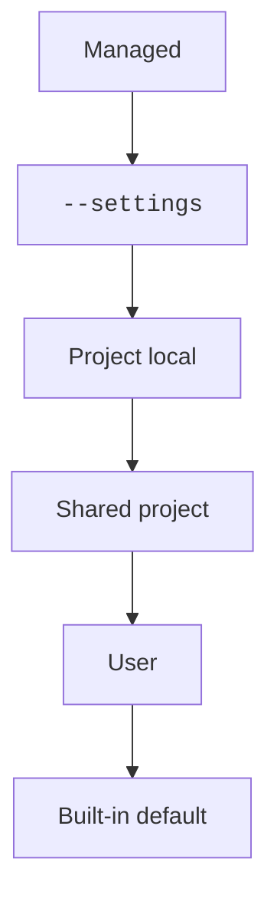

Settings are JSON files that change how Claude Code behaves.
You can pick a model, add permission rules, turn off a feature, or share the same rules with a whole team.
This page explains the files, the scopes, and which value wins. The other pages in this folder list every key.

## At a Glance

| Question | Answer |
| --- | --- |
| Can you use it? | ✅ Yes. Create or edit a settings file, or run `/config`. |
| Can you change it? | Edit the JSON files below, pass `--settings`, use `/config` or `/model` for some keys, or ask an administrator to deploy managed settings. |
| Can you turn it on or off? | Each key is its own switch. `disableAllHooks` turns off hooks, the status line, and file suggestions at once. |
| Where does it live? | `~/.claude/settings.json`, `.claude/settings.json`, `.claude/settings.local.json`, managed files, and `~/.claude.json` |
| Status | <Documented /> <Undocumented /> <Differs note="appendPlugins and prependPlugins" /> |

The managed schema of `2.1.307` lists 194 top-level keys. The user schema lists 171, and the other 23 are managed-only.
Source: the program (the published settings schemas).

## Example

A project can share one small file with the whole team.

```json title=".claude/settings.json"
{
  "$schema": "https://xsyetopz.github.io/claude-code-docs/schemas/claude-code-settings.json",
  "model": "opus",
  "permissions": {
    "allow": ["Bash(bun test)"]
  }
}
```

Every session in that folder starts on Opus and may run `bun test` without asking.
A teammate can still override `model` in `.claude/settings.local.json`.

## Pages for Each Group of Keys

Each key has a row on one of these pages.

| Page | Keys |
| --- | --- |
| [Core Settings](core.md) | Compaction, memory, cleanup, shell, files, `env`, `sandbox`, updates |
| [Model Settings](model.md) | Model, effort, thinking, fast mode, cache lifetime, token reminders |
| [Auth Settings](auth.md) | Credential helpers, login rules, API provider limits |
| [Agents and Remote Settings](agents-and-remote.md) | `agent`, workflows, background work, Remote Control, peer sessions |
| [Hooks, Plugins, and Skills Settings](hooks-and-plugins.md) | Hooks, plugins, marketplaces, skills, `permissions`, `statusLine`, `outputStyle` |
| [MCP and Channels Settings](mcp-and-channels.md) | MCP servers, claude.ai connectors, channels |
| [Interface Settings](ui.md) | Theme, spinner, `tui`, voice, notices, feedback |
| [Enterprise Settings](enterprise.md) | How managed policy arrives, version limits |
| [Extra Keys and Global Config](extra-keys.md) | Keys the schema omits, and the keys of `~/.claude.json` |

## How to Read the Key Tables

- The `Status` column uses the badges from [How to Read These Docs](../../start/how-to-read.md).
- `Type` shows Unknown when neither the official docs nor the schema give a type. `Default` shows `-` when no default is known.
- `Where to Set It` says which files may set the key. `Any settings file` means the user, project, local, and managed files.
  `Settings files` means the settings files without a narrower scope in the source.
- Many boolean keys are written as the thing to switch off, such as `spinnerTipsEnabled`. Read the row before you pick a value.
- Items that are removed or do nothing in `2.1.307` are left out. See the end of this page.

## Where Settings Live

| Scope | File | Who it affects |
| --- | --- | --- |
| User | `~/.claude/settings.json` | You, in every project. `CLAUDE_CONFIG_DIR` moves `~/.claude`. |
| Shared project | `.claude/settings.json` | Everyone who works in the folder. Commit it so teammates get it. |
| Project local | `.claude/settings.local.json` | You, in this project only. Claude Code keeps the file out of git. |
| Command line | `--settings <file-or-json>` | One session. It cannot set managed or global config keys. |
| Managed | `managed-settings.json` and the other managed sources | Everyone your organization deploys it to. |
| Global config | `~/.claude.json` | You. Claude Code writes it. It holds sign-in data, MCP servers, per-project state, and a few keys. |

Source: [Settings Files and Precedence](https://code.claude.com/docs/en/settings) and [Explore the .claude Directory](https://code.claude.com/docs/en/claude-directory).

- Settings files are strict JSON. A comment or a trailing comma is a syntax error.
- Claude Code reads the shared project file from the primary working directory.
  After `/cd`, it reads the new directory (v2.1.246 or later).
- In a git repository, the local file lives at the repository root. In a worktree, it lives at the main checkout root.
- Claude Code adds `**/.claude/settings.local.json` to your global git excludes file when it writes the local file.
- Claude Code watches the files and reloads them. It runs the `ConfigChange` hook for each change in a settings file.
- Managed settings from MDM or the console reach a running session on a schedule, not on save.
- A cloud session reads only the shared project file and server-managed settings.
- Run `/status` to see the `Setting sources` line. Run `claude doctor` to see the entries that Claude Code dropped.
- The flag `--setting-sources <sources>` loads only the sources you name (`user`, `project`, `local`).

Source: the program names the five sources `userSettings`, `projectSettings`, `localSettings`, `flagSettings`, and `policySettings`.

## Which Value Wins

The highest level that sets a key wins.

1. Managed settings.
2. Command line (`--settings`).
3. Project local settings.
4. Shared project settings.
5. User settings.



Read the chart from the top. The first level that sets the key decides its value.
Environment variables are not a level.
Each pair of key and variable decides alone, such as `ANTHROPIC_MODEL` over `model`.
See [Models and Effort Variables](../env-vars/models-and-effort.md) for examples.
Source: [Settings Files and Precedence](https://code.claude.com/docs/en/settings).

## How Lists and Model Keys Merge

- List keys such as `permissions.allow` merge across scopes.
- `allowManagedPermissionRulesOnly` stops that merge for permission rules.
- `fallbackModel` is an ordered chain. The whole value comes from the highest scope that sets it.
- `modelPicker` never merges. The whole value comes from managed settings, `--settings`, or user settings.
  Claude Code ignores project and local values (v2.1.242 or later).
- `availableModels`: a managed list applies as it is. Across the other scopes, the arrays merge.
- `modelSettings` resolves one model at a time, together with `effortLevel`.
- Managed `env` blocks merge per key across admin sources. `CLAUDE_CODE_DISABLE_ADMIN_ENV_UNION=1` turns that off.

Source: [Settings Files and Precedence](https://code.claude.com/docs/en/settings) and [Environment Variables](https://code.claude.com/docs/en/env-vars).

## Managed Settings

An administrator puts managed settings on a machine in one of these ways.
Source: [Deploy Managed Settings](https://code.claude.com/docs/en/managed-settings).

| Platform | Where Claude Code looks |
| --- | --- |
| macOS | `/Library/Application Support/ClaudeCode/managed-settings.json`, and the `com.anthropic.claudecode` managed preferences domain |
| Linux and WSL | `/etc/claude-code/managed-settings.json` |
| Windows | `C:\Program Files\ClaudeCode\managed-settings.json`, and the registry keys `HKLM\SOFTWARE\Policies\ClaudeCode` and `HKCU\SOFTWARE\Policies\ClaudeCode` |
| WSL on Windows | The Windows sources, only when `wslInheritsWindowsSettings` is on |
| All | The `managed-settings.d/` folder next to the file, server-managed settings (cached in `~/.claude/remote-settings.json`), and the SDK `managedSettings` option or `--managed-settings` flag |

- Claude Code merges `managed-settings.json` first, then each `*.json` file of `managed-settings.d/` in alphabetical order.
  Number the files to set the order, such as `10-telemetry.json`.
- `managedSourcesBehavior` decides how sources combine. `first-wins` uses the highest source alone. `merge` deep-merges them.
- `parentSettingsBehavior` does the same for the SDK parent tier.
- `policyHelper` and `policyHelpers` compute managed settings at startup.

The keys are in [Enterprise Settings](enterprise.md).

## Exceptions to Managed Precedence

For a few keys, a lower scope may set a stricter value, and Claude Code honors it over the managed value.
Source: [Settings Files and Precedence](https://code.claude.com/docs/en/settings).

| Keys | Status | Value Claude Code honors | Where it can come from |
| --- | --- | --- | --- |
| `disableClaudeAiConnectors`, `isolatePeerMachines`, `permissions.blockReadsOutsideWorkingDirectories` | <Documented /> | `true` | Any scope |
| `enableArtifact`, `disableArtifact` | <Documented /> | `enableArtifact: false` or `disableArtifact: true` | Any scope |
| `autoMode.classifyAllShell` | <Documented /> | `true` | `~/.claude/settings.json` or `--settings`. Any `true` wins, and `false` never turns it off |
| `remoteControlAtStartup` | <Documented /> | `false` | `.claude/settings.json` or `.claude/settings.local.json` |
| `crossSessionInbound` | <Documented /> | A stricter value on the ladder `accept`, `hold`, `refuse` | `.claude/settings.json` or `.claude/settings.local.json` |
| `useAutoModeDuringPlan`, `syncClaudeAiSkills`, `syncClaudeAiPlugins` | <Documented /> | `false` | Managed, `--settings`, `~/.claude/settings.json`, or `.claude/settings.local.json` |
| `maxEffortLevel` | <Documented /> | The lowest cap (v2.1.267 or later) | Any scope |
| `modelProposedGoals`, `feedbackDrafts`, `availableModelsMatch`, `askUserQuestionTimeout`, `dialogExpiry` | <Undocumented /> | A strict value | Source: the program lists them as keys with a strict value. The docs do not list them here. |

An app that runs Claude Code inside itself and sets `CLAUDE_CODE_PROVIDER_MANAGED_BY_HOST` is also an exception.
Claude Code then takes the model keys of that app over the managed values.

## Left Out on Purpose

These keys do nothing in `2.1.307`, so the pages do not list them.

- `taskOutputMaxChars` — The `TaskOutput` tool was removed.
- `keybindingFlavor` — Word-editing keys always follow Bash (readline) rules now.
- `permissionExplainerEnabled` — Removed in v2.1.257.
- `teammateDefaultModel` — Removed in v2.1.234.

## Related Pages

- [Environment Variable Groups](../env-vars/features-and-toggles.md) list the variables that pair with some keys.
- [How to Read These Docs](../../start/how-to-read.md) explains the badges.
- [Undocumented Items](../../reference/undocumented.md) indexes every undocumented item.
- [Permissions](../permissions/index.md) covers `permissions`, `sandbox`, and `autoMode`.
- [Settings Reference](https://code.claude.com/docs/en/settings-reference) lists each key in the official docs.
