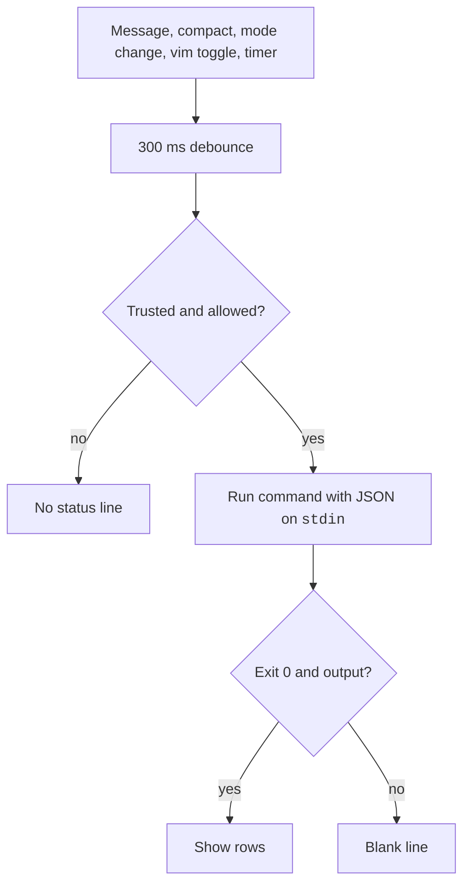

The status line is a bar at the bottom of Claude Code that shows the output of a script you write.
The script gets session data as JSON on `stdin`, such as the model and the cost. It prints what to show on `stdout`.
It does not use API tokens.

## At a Glance

| Question | Answer |
| --- | --- |
| Can you use it? | ✅ Yes. Run `/statusline` and describe what you want, or write a script yourself. |
| Can you change it? | ✅ Yes. Edit the `statusLine` key in a settings file. |
| Can you turn it on or off? | Remove `statusLine`, or run `/statusline delete`. `disableAllHooks: true` turns off custom ones. |
| Where does it live? | The `statusLine` key of user, project, local, or managed settings, and the script it names. |
| Status | <Documented /> <Undocumented /> <Differs /> |

## Example

```bash title="~/.claude/statusline.sh"
#!/bin/sh
input=$(cat)
model=$(echo "$input" | jq -r '.model.display_name')
used=$(echo "$input" | jq -r '.context_window.used_percentage // 0')
echo "$model | context ${used}%"
```

```json title="~/.claude/settings.json"
{
  "statusLine": {
    "type": "command",
    "command": "~/.claude/statusline.sh",
    "padding": 1,
    "refreshInterval": 30
  }
}
```

The bar shows the model name and how full the context window is. The script also re-runs every 30 seconds.

## Settings

Official page: [Customize Your Status Line](https://code.claude.com/docs/en/statusline).

| Item | Status | What it does | How it works | Where to set it |
| --- | --- | --- | --- | --- |
| `statusLine.type` | <Documented /> | Kind of status line | Must be `"command"`. Required | User, project, local, managed |
| `statusLine.command` | <Documented /> | Script path or inline shell command | Runs in a shell. A change to it runs the new command at once, without the debounce | Same |
| `statusLine.padding` | <Documented /> | Extra horizontal space in characters | Default `0`. Adds to the built-in spacing | Same |
| `statusLine.refreshInterval` | <Documented /> | Re-runs the command every N seconds | Minimum `1`. The bundle uses `Math.max(1, n) * 1000` ms. For clocks and idle sessions | Same |
| `statusLine.hideVimModeIndicator` | <Documented /> | Hides the built-in `-- INSERT --` text | Use when the script prints `vim.mode` itself | Same |
| `subagentStatusLine` | <Documented /> | Custom row for each subagent in the agent panel | Fields `type` (`"command"`) and `command`. See the next section | Same |
| `/statusline` | <Documented /> | Writes a script in `~/.claude/` and the setting | Takes natural language. `/statusline delete` removes it | Interactive |
| Workspace trust | <Documented /> | The command waits for trust | `--debug` logs `Status line command skipped: workspace trust not accepted` | Project files |
| `CLAUDE_CODE_SAFE_MODE` | <Documented /> | Status line commands do not load | Managed policy still applies | Env |

Two hook settings also act on the status line. `disableAllHooks` set outside managed settings leaves only a managed `statusLine` (with none, the status line is off), and `allowManagedHooksOnly` shows only a managed `statusLine`, so a custom one disappears without a warning. Their rows are on [Hooks, Plugins, and Skills Settings](settings/hooks-and-plugins.md#keys).

## When the Script Runs

| Item | Status | What it does | How it works | Where to set it |
| --- | --- | --- | --- | --- |
| Session start and resume | <Documented /> | First run | Runs once | Each session |
| New assistant message, `/compact` done, permission mode change, vim mode toggle | <Documented /> | Re-runs the command | Debounced at 300ms. A new trigger cancels a running script | Each session |
| Rate-limit `resets_at` and cache `expires_at` | <Documented /> | Re-runs at the earliest time | Taken from the data the script last received | Each session |
| Model, fast mode, effort, thinking, and PR status change | <Differs /> | Also re-run the command | The bundle watches `mainLoopModel`, `fastMode`, `effortValue`, `thinkingEnabled`, `prStatus`. The docs list do not name them | Each session |

## Output Rules

- Each printed line is a row. ANSI colors and OSC 8 links work.
- The output shows only after exit code `0`. A non-zero exit or empty output blanks the line.
- Claude Code sets `COLUMNS` and `LINES` before it runs the `statusLine` script. `tput cols` does not work. The `subagentStatusLine` command does not get them (checked in the interactive screen); it gets `columns` in its JSON.
- The variables `CLAUDECODE` and `CLAUDE_CODE_CHILD_SESSION` are set in the script process. See [Environment Variables](env-vars/index.md).
- `claude --debug` logs `stderr` of each run and the exit code of the first run.
- The line hides during the help menu and permission prompts. The command does not run while a permission or MCP input dialog is open (checked). Outside fullscreen, notifications share the row.
- On Windows, use forward slashes in `command`. `CLAUDE_CODE_POWERSHELL_RESPECT_EXECUTION_POLICY` changes the PowerShell policy flag.

Source for this list: the official [Customize Your Status Line](https://code.claude.com/docs/en/statusline) and [Environment Variables](https://code.claude.com/docs/en/env-vars) pages.

## Subagent Status Line

`subagentStatusLine` customizes each subagent row in the agent panel.
Its command runs once per refresh tick (a fixed 5 seconds, checked in the interactive screen) and gets all visible rows as one JSON object.
It prints one JSON line for each row it wants to override: `{"id": "<task id>", "content": "<row body>"}`.
A row without `id` keeps the default. An empty `content` hides the row.
The same trust, `disableAllHooks`, and `allowManagedHooksOnly` gates apply.
A plugin can ship a default `subagentStatusLine` in its `settings.json`.
The input fields are in the `Subagent Task Fields` table below.

## JSON Fields

These fields arrive on `stdin`. A field marked "may be absent" is missing from the JSON when it has no value.
Always read optional fields with a default, for example `jq -r '.vim.mode // empty'`.

### Session and Model Fields

| Field | Status | What it holds | Notes | Where |
| --- | --- | --- | --- | --- |
| `session_id` | <Documented /> | Session id | String | Status line |
| `session_name` | <Documented /> | Custom name or AI title | May be absent. The default display name does not fill it | Status line |
| `prompt_id` | <Documented /> | UUID of the prompt in work | May be absent before the first input | Status line |
| `transcript_path` | <Documented /> | Transcript file path | String | Status line |
| `cwd` | <Documented /> | Working directory | Same value as `workspace.current_dir` | Status line |
| `version` | <Documented /> | Claude Code version | `2.1.304` here | Status line |
| `model.id`, `model.display_name` | <Documented /> | Model id and name | Strings | Status line |
| `output_style.name` | <Documented /> | Active style name | `default` when none. See [Output Styles](output-styles.md) | Status line |
| `fast_mode` | <Documented /> | Fast mode on | Boolean | Status line |
| `effort.level` | <Documented /> | `low`, `medium`, `high`, `xhigh`, `max` | May be absent when the model has no effort | Status line |
| `thinking.enabled` | <Documented /> | Extended thinking on | Boolean | Status line |
| `vim.mode` | <Documented /> | `NORMAL`, `INSERT`, `VISUAL`, `VISUAL LINE` | May be absent. Present when vim mode is on | Status line |
| `agent.name` | <Documented /> | Agent name | Present with `--agent` or agent settings | Status line |
| `remote.session_id` | <Undocumented /> | Id of a remote session | Present when the session is remote. The docs do not list `remote` | Status line |

### Workspace Fields

| Field | Status | What it holds | Notes | Where |
| --- | --- | --- | --- | --- |
| `workspace.current_dir` | <Documented /> | Current directory | Preferred over `cwd` | Status line |
| `workspace.project_dir` | <Documented /> | Launch directory | The bundle fills it from the original cwd | Status line |
| `workspace.added_dirs` | <Documented /> | Directories from `/add-dir` or `--add-dir` | Empty array if none | Status line |
| `workspace.git_worktree` | <Documented /> | Linked worktree name | Absent in the main tree | Status line |
| `workspace.repo.host`, `.owner`, `.name` | <Documented /> | Repository identity from `origin` | May be absent. GitLab subgroups give a slash path in `owner` | Status line |
| `worktree.name`, `.path`, `.branch`, `.original_cwd`, `.original_branch` | <Documented /> | Worktree session data | Only in a worktree session. `branch` and `original_branch` may be absent for hook-based worktrees | Status line |
| `pr.number`, `pr.url` | <Documented /> | Open PR or GitLab merge request | Removed once it merges or closes | Status line |
| `pr.review_state` | <Documented /> | `approved`, `pending`, `changes_requested`, `draft` | May be absent alone | Status line |
| `pr.kind` | <Documented /> | `mr` for a GitLab merge request | Absent for GitHub | Status line |

### Cost, Context, and Limit Fields

| Field | Status | What it holds | Notes | Where |
| --- | --- | --- | --- | --- |
| `cost.total_cost_usd` | <Documented /> | Estimated cost | Client-side list price. Resets at `/clear` | Status line |
| `cost.total_duration_ms`, `cost.total_api_duration_ms` | <Documented /> | Wall time and API wait time | Milliseconds | Status line |
| `cost.total_lines_added`, `cost.total_lines_removed` | <Documented /> | Lines changed | Numbers | Status line |
| `context_window.total_input_tokens`, `.total_output_tokens` | <Documented /> | Tokens in the window | From the last response. `0` before it | Status line |
| `context_window.context_window_size` | <Documented /> | Window size | `200000` or `1000000` | Status line |
| `context_window.used_percentage`, `.remaining_percentage` | <Documented /> | Percent used and left | Input tokens only. May be `null` early | Status line |
| `context_window.current_usage` | <Documented /> | Per-category tokens | Keys `input_tokens`, `output_tokens`, `cache_creation_input_tokens`, `cache_read_input_tokens`. `null` before the first call and after `/compact` | Status line |
| `exceeds_200k_tokens` | <Documented /> | Last response is over 200k tokens | Fixed threshold | Status line |
| `rate_limits.five_hour`, `.seven_day` | <Documented /> | `used_percentage` and `resets_at` | Claude.ai Pro and Max only. A window drops after its reset time | Status line |
| `rate_limits.spend_limit.used_percentage`, `.resets_at` | <Documented /> | Gateway spend limit | Needs `2.1.251` | Status line |
| `rate_limits.spend_limit.used_usd`, `.limit_usd`, `.period` | <Documented /> | Spend in dollars and period `daily`, `weekly`, `monthly` | Needs `2.1.284`. Off with `CLAUDE_CODE_DISABLE_NONESSENTIAL_TRAFFIC` | Status line |

### Prompt Cache Fields

The object `prompt_cache` appears after the first main-conversation response (needs `2.1.251`). Subagent requests are not counted.

| Field | Status | What it holds | Notes | Where |
| --- | --- | --- | --- | --- |
| `prompt_cache.warm` | <Documented /> | Cache is within its TTL | Boolean | Status line |
| `prompt_cache.caching_observed` | <Documented /> | Any response reported cache tokens | `false` means caching is off or not reported | Status line |
| `prompt_cache.ttl` | <Documented /> | Cache lifetime | `"5m"` or `"1h"` | Status line |
| `prompt_cache.expires_at` | <Documented /> | When the cache goes cold | Epoch seconds. `null` if no cache tokens | Status line |
| `prompt_cache.requests`, `.misses`, `.expected_rebuilds` | <Documented /> | Request and miss counts | A miss is over 5% and at least 2,000 tokens re-processed | Status line |
| `prompt_cache.hit_ratio` | <Documented /> | Cache reads over all input tokens | 0 to 1. `null` when counts are zero | Status line |
| `prompt_cache.cache_write_tokens`, `.miss_recache_tokens` | <Documented /> | Tokens written | Totals for the session and for misses | Status line |
| `prompt_cache.last_miss_at` | <Documented /> | Time of the last miss | Epoch seconds. `null` if none | Status line |
| `prompt_cache.last_miss_cause` | <Documented /> | Likely cause | `causes` array (such as `tools_changed`, `system_prompt_changed`, `ttl_expired_5m`, `likely_server_side`), plus `tools_added`, `tools_removed`, `system_char_delta`. Needs `2.1.260` | Status line |
| `prompt_cache.miss_causes` | <Documented /> | Count per cause | Map | Status line |
| `prompt_cache.recache_tokens_if_cold` | <Documented /> | Tokens a cold cache re-caches | `null` after a compaction until the next request | Status line |

### Subagent Task Fields

The `subagentStatusLine` command gets the base hook fields, `columns`, and a `tasks` array.

| Field | Status | What it holds | Notes | Where |
| --- | --- | --- | --- | --- |
| `columns` | <Documented /> | Usable row width | Number | `subagentStatusLine` |
| `tasks[].id` | <Documented /> | Task id | Echo it back as `id` | `subagentStatusLine` |
| `tasks[].name` | <Documented /> | Address name | Optional | `subagentStatusLine` |
| `tasks[].type` | <Documented /> | Kind of task | `local_agent` | `subagentStatusLine` |
| `tasks[].agentType` | <Documented /> | Subagent type | Same value as hook `agent_type`. Needs `2.1.293` | `subagentStatusLine` |
| `tasks[].status` | <Documented /> | State | `running`, `completed`, `failed`, `killed` | `subagentStatusLine` |
| `tasks[].description`, `tasks[].label` | <Documented /> | Short text | `label` is a progress summary, else `description` | `subagentStatusLine` |
| `tasks[].startTime` | <Documented /> | Start time | Epoch milliseconds | `subagentStatusLine` |
| `tasks[].model`, `tasks[].contextWindowSize` | <Documented /> | Resolved model and its window | Optional | `subagentStatusLine` |
| `tasks[].effort` | <Documented /> | Configured effort | String or number. Needs `2.1.213` | `subagentStatusLine` |
| `tasks[].tokenCount`, `tasks[].tokenSamples` | <Documented /> | Running tokens and up to 16 samples | Oldest first | `subagentStatusLine` |
| `tasks[].cwd` | <Documented /> | Subagent working directory | Own worktree if any | `subagentStatusLine` |

## How It Works



:::note[Interactive Probe Findings]
Checked in the interactive screen (2.1.304, local stub, fake key). See [Interactive Probes](../reference/probes.md#interactive-probes).

- `subagentStatusLine` runs on a fixed 5-second tick (4.98 to 5.02 seconds over 11 intervals) while the agent panel has tasks, also for tasks that are `completed`. It is not debounced like `statusLine`, and no setting changes the 5 seconds. The first run came when the agent started.
- Its command does not get `COLUMNS` and `LINES`. Use the `columns` field (194 on a 200-column screen). `CLAUDECODE` and `CLAUDE_CODE_CHILD_SESSION` are set.
- Its input holds only `session_id`, `transcript_path`, `cwd`, `prompt_id`, `columns`, and `tasks`, not the full `statusLine` object. A row override `{"id": ..., "content": "..."}` was drawn in the agent panel.
- For `statusLine`, `transcript_path` is present from the first run, before any message. `prompt_id` is absent until the first prompt, then it is the same UUID as `prompt_id` in hook input. After the first reply the input also gains `prompt_cache`, and `current_usage` is no longer `null`.
- `statusLine` runs once at start and once after the first reply (not at prompt submit). Three mode changes 100 ms apart gave one run, which fits the 300 ms debounce. `refreshInterval: 3` ran every 3.0 seconds (2.8 to 3.5).
- Runs paused while a permission or MCP input dialog was on screen (gaps of 12.5 and 19.5 seconds).
- `padding: 1` gave a one-space indent, and two printed lines showed as two rows under the prompt.
- With no subagents, `subagentStatusLine` did not run. In a session left idle for 22 seconds its command had not run once. The first run came when a background agent started.
- A test agent finished after 3 seconds. Its row was not drawn again after that, and the command kept its 5-second tick for about 30 seconds after the agent started (7 runs, the first with `status` `running` and the other six with `completed`). In that time the agent panel showed the hint `/tasks to see subagents` for about 30 seconds, then the hint went away. After that the command did not run again.

:::

## Related Pages

- [Output Styles](output-styles.md) for the style behind `output_style.name`.
- [Environment Variables](env-vars/index.md)
- [Context and Compaction](../how-it-works/context-and-compaction.md) for what `context_window` counts.
- [Request and Cache](../how-it-works/request-and-cache.md) for what `prompt_cache` measures.
