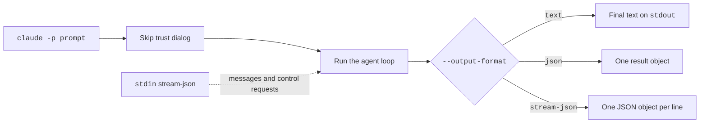

Print mode runs one prompt, prints the answer, and exits.
Use it in scripts, pipes, and CI. It is also the base of the Agent SDK.
Add `-p` (or `--print`) to start it. For example, `claude -p "Summarize README.md" --output-format json` prints one JSON result.

:::warning
Print mode skips the workspace trust dialog.
This also happens when stdout is not a terminal, such as when you pipe or redirect output.
Use it only in folders you trust.
:::

## At a Glance

| Question | Answer |
| --- | --- |
| Can you use it? | ✅ Yes. `claude -p "<prompt>"`, or send the prompt on stdin. |
| Can you change it? | ✅ Yes. Flags set the output and input format, budget, schema, and permission handling. |
| Can you turn it on or off? | `-p` turns it on. `--bare` strips extras. `--no-session-persistence` saves nothing. |
| Where does it live? | Flags on the `claude` command. Sessions still save to `~/.claude/projects/` unless you turn that off. |
| Status | <Documented /> <Undocumented /> |

## Print Mode Flags

Source: [Run Claude Code Programmatically](https://code.claude.com/docs/en/headless), [CLI Reference](https://code.claude.com/docs/en/cli-reference), and `claude --help`.
The full flag list is on [CLI Flags](../../configure/cli/flags.md).

| Flag | Status | What It Does | Notes |
| --- | --- | --- | --- |
| `-p, --print` | <Documented /> | Prints the answer and exits. | Skips the trust dialog. |
| `--output-format <format>` | <Documented /> | Sets the output. | `text` (default), `json` (one result object), or `stream-json` (one JSON object per line, live). |
| `--input-format <format>` | <Documented /> | Sets the input. | `text` (default) or `stream-json` (live input, and control requests). |
| `--include-partial-messages` | <Documented /> | Adds partial message chunks as the answer grows. | Needs `--output-format=stream-json`. Adds `stream_event` lines. |
| `--include-hook-events` | <Documented /> | Adds hook lifecycle events to the stream. | Needs `--output-format=stream-json`. |
| `--forward-subagent-text` | <Documented /> | Adds subagent text and thinking to the stream. | Messages carry `parent_tool_use_id`. Needs `stream-json` output. |
| `--replay-user-messages` | <Documented /> | Sends user messages from stdin back on stdout as an acknowledgment. | Needs both `stream-json` formats. |
| `--json-schema <schema>` | <Documented /> | Checks the final answer against a JSON Schema. | Pass the schema as a JSON string. |
| `--max-budget-usd <amount>` | <Documented /> | Stops at a spend limit in dollars. | Print mode only. |
| `--prompt-suggestions [value]` | <Documented /> | Turns on prompt suggestions. | Print mode sends a `prompt_suggestion` message after each turn. |
| `--permission-prompts <target>` | <Documented /> | Says who answers permission prompts. | `host` (the SDK host or `--permission-prompt-tool`) or `none` (anything that would prompt is denied; the permission mode decides the rest). |
| `--no-session-persistence` | <Documented /> | Saves nothing to disk. | The session cannot be resumed. Print mode only. |
| `--bare` | <Documented /> | Starts with a minimal setup. | Skips hooks, LSP, plugin sync, attribution, auto memory, background prefetches, keychain reads, and `CLAUDE.md` discovery. |
| `--restricted` | <Documented /> | Removes the tools that run code and `WebFetch`, and ignores user, project, and local settings. | Good for untrusted input. |
| `--allowedTools`, `--disallowedTools`, `--tools` | <Documented /> | Choose which tools run without a prompt, which are blocked, and which exist. | See [CLI Flags](../../configure/cli/flags.md). |
| `--fallback-model <model>` | <Documented /> | Names models to try when the main model is overloaded or not available. | See [Models](../../how-it-works/models.md). |
| `--resume`, `--continue`, `--fork-session`, `--session-id` | <Documented /> | Pick, branch, or name the session. | See [Sessions and Storage](../../how-it-works/sessions-and-storage.md). |
| `--mcp-config`, `--strict-mcp-config` | <Documented /> | Load MCP servers for this run. | See [MCP Settings and Policy](../mcp/settings.md#files-and-flags). |

## Example

```bash title="One JSON answer, with a budget and a schema"
claude -p "List the three biggest files in this repo" \
  --output-format json \
  --max-budget-usd 1 \
  --json-schema '{"type":"object","properties":{"files":{"type":"array","items":{"type":"string"}}},"required":["files"]}'
```

```bash title="Watch the answer grow, line by line"
claude -p "Explain this repo" --output-format stream-json --verbose --include-partial-messages \
  | while read -r line; do echo "$line" | jq -r '.type'; done
```

The second command prints a `system` line for `init`, then `stream_event` lines, then one `result` line.

## How It Works



The loop is the same as in interactive mode. See [Agent Loop](../../how-it-works/agent-loop.md).
Permission prompts have no screen to appear on, so a host program (or `--permission-prompts none`) must decide.

## Pages in This Section

| Page | What It Covers |
| --- | --- |
| [Stream JSON Messages](stream-json.md) | Every message type that print mode writes |
| [Control Protocol](control-protocol.md) | Every control request a host can send on the same stream |

## Related Pages

- [CLI Flags](../../configure/cli/flags.md)
- [Transcript Format](../../reference/transcript-format.md)
- [SDK and Automation Env Vars](../../configure/env-vars/sdk-and-automation.md)
