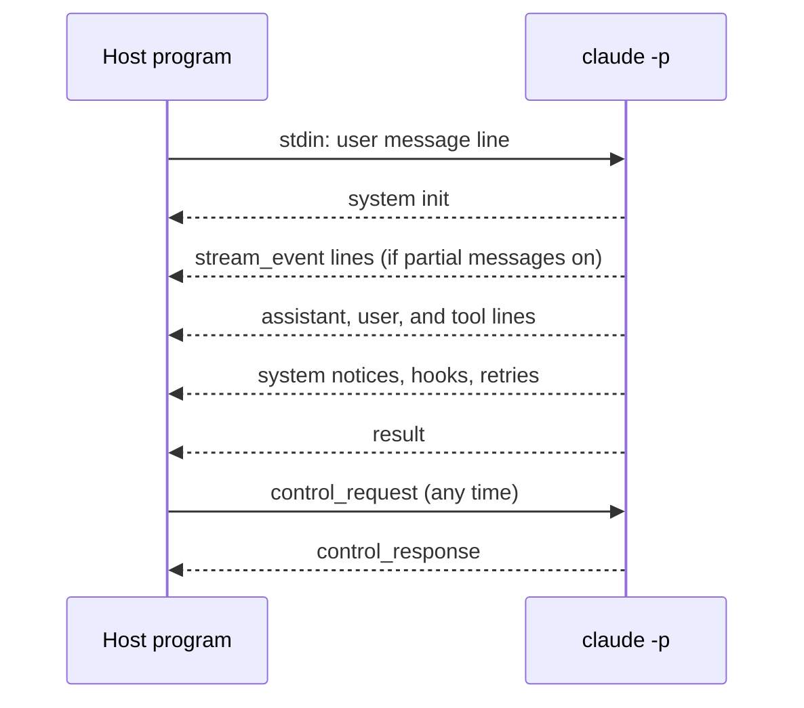

With `--output-format stream-json`, Claude Code writes one JSON object per line to stdout.
With `--input-format stream-json`, you send JSON lines on stdin, and the same channel carries [control requests](control-protocol.md).
For example, `claude -p "Explain this repo" --output-format stream-json --verbose --include-partial-messages` prints a `system` / `init` line, then `stream_event` lines while the answer grows, then a final `result` line.

Flags add more lines: `--include-partial-messages`, `--include-hook-events`, `--forward-subagent-text`, and `--replay-user-messages`. Turn the format on with `--output-format stream-json` and `--input-format stream-json`.

## Message Types

The tables list the message types that the bundled schema of `2.1.311` defines.
Each row has a short form of the schema description. A row without a description says so.
A type has the status <Documented /> when a docs page other than the [changelog](https://code.claude.com/docs/en/changelog) and the Agent SDK pages names it.
Source: [Run Claude Code Programmatically](https://code.claude.com/docs/en/headless), [CLI Reference](https://code.claude.com/docs/en/cli-reference), and the program (the message schema).
A type written as `system` / `init` means `type` is `system` and `subtype` is `init`.

### Documented Types

| `type` / `subtype` | Status | What It Does |
| --- | --- | --- |
| `user` | <Documented /> | A user message, such as a message of a subagent when `--forward-subagent-text` is on. |
| `result` | <Documented /> | The final result of the run. |
| `system` / `init` | <Documented /> | Session data at the start of each turn: session ID, model, working folder, tools, MCP servers, slash commands, and plugins. |
| `stream_event` | <Documented /> | A step of the answer as it grows, only with `--include-partial-messages`. |
| `system` / `compact_boundary` | <Documented /> | Claude Code compacted the conversation here. |
| `system` / `api_retry` | <Documented /> | An API request failed with an error that can be retried, and Claude Code will try again after a wait. |
| `system` / `hook_started` | <Documented /> | A hook started to run. |
| `system` / `hook_progress` | <Documented /> | A hook reported progress. |
| `system` / `hook_response` | <Documented /> | A hook finished with a response. |
| `system` / `plugin_install` | <Documented /> | Progress of a plugin install in print mode, when you set `CLAUDE_CODE_SYNC_PLUGIN_INSTALL`. |
| `system` / `permission_denied` | <Documented /> | Claude Code denied a tool call. The final result lists the denials in `permission_denials`. |
| `prompt_suggestion` | <Documented /> | The predicted next prompt, sent after each turn when prompt suggestions are on. |

### Undocumented Types

Only the program shows these. They can change without notice.

| `type` / `subtype` | Status | What It Does |
| --- | --- | --- |
| `rate_limit_event` | <Undocumented /> | Rate limit information changed. |
| `system` / `status` | <Undocumented /> | No description in the program schema. |
| `system` / `post_turn_summary` | <Undocumented /> | A summary made in the background after each assistant turn. |
| `system` / `task_summary` | <Undocumented /> | A progress line in the middle of a turn. |
| `system` / `session_metadata` | <Undocumented /> | A patch of session data for a local host, such as the list of published artifacts. |
| `system` / `informational` | <Undocumented /> | A text banner: a status line, hook feedback, or the output of a slash command. |
| `system` / `permission_retry` | <Undocumented /> | Tools run again after a change of permission mode allowed commands that Claude Code denied before. |
| `system` / `stop_hook_summary` | <Undocumented /> | Which `Stop` and `SubagentStop` hooks ran at the end of a turn, their output, and whether one stopped the continuation. |
| `system` / `memory_saved` | <Undocumented /> | The memory system wrote to the listed paths. |
| `system` / `agents_killed` | <Undocumented /> | Claude Code stopped background agents, for example on an interrupt. |
| `system` / `instruction_size_warning` | <Undocumented /> | The instruction files of the session are larger than the advised limit. |
| `system` / `away_summary` | <Undocumented /> | A summary of what happened while you were away. |
| `system` / `thinking` | <Undocumented /> | The thinking text itself. |
| `transcript_mirror` | <Undocumented /> | Sent after each successful write of the local transcript. |
| `system` / `mirror_error` | <Undocumented /> | A batch of the transcript mirror failed after 3 tries. |
| `system` / `control_request_progress` | <Undocumented /> | Progress of a long control request, matched by `request_id`. |
| `system` / `model_refusal_fallback` | <Undocumented /> | No description in the program schema. |
| `system` / `model_refusal_no_fallback` | <Undocumented /> | No description in the program schema. |
| `system` / `model_fallback` | <Undocumented /> | No description in the program schema. |
| `system` / `model_consent_fallback` | <Undocumented /> | A check before the request moved the session off the requested model. |
| `system` / `file_snapshot` | <Undocumented /> | A snapshot of the plan and todo files, made for rewind. |
| `system` / `scheduled_task_fire` | <Undocumented /> | A scheduled task (cron) started. |
| `system` / `peer_message_hold` | <Undocumented /> | Claude Code held a message from another session and did not queue it. The line says how the hold ended. |
| `system` / `turn_duration` | <Undocumented /> | The wall-clock time of a turn, with the budget and the number of background jobs. |
| `system` / `api_error` | <Undocumented /> | An API error that can be retried, with the error data and the retry counts. |
| `system` / `local_command_output` | <Undocumented /> | The output of a local slash command, such as `/usage`. |
| `tool_progress` | <Undocumented /> | No description in the program schema. |
| `auth_status` | <Undocumented /> | No description in the program schema. |
| `system` / `files_persisted` | <Undocumented /> | No description in the program schema. |
| `system` / `task_notification` | <Undocumented /> | No description in the program schema. |
| `system` / `task_started` | <Undocumented /> | No description in the program schema. |
| `system` / `task_updated` | <Undocumented /> | No description in the program schema. |
| `system` / `background_tasks_changed` | <Undocumented /> | No description in the program schema. |
| `system` / `feedback_draft_queued` | <Undocumented /> | The `SendFeedback` tool wrote a draft to `~/.claude/feedback/drafts/`. |
| `system` / `session_state_changed` | <Undocumented /> | The state of the session changed. |
| `system` / `session_title_changed` | <Undocumented /> | No description in the program schema. |
| `system` / `worker_shutting_down` | <Undocumented /> | No description in the program schema. |
| `system` / `turn_handoff_available` | <Undocumented /> | Sent once by a cloud worker that accepts the `turn_handoff` control request. It carries what the worker wrote to `external_metadata.turn_handoff`. Since `2.1.311` it can have `requires_rewind_request_id` (see [Fields New in `2.1.311`](#fields-new-in-21311)). |
| `system` / `ui_invalidate` | <Undocumented /> | No description in the program schema. |
| `system` / `ui_log` | <Undocumented /> | A plugin called `$.ui.log(text)`, and the screen adds a dim notice under the name of the plugin. |
| `system` / `ui_toast` | <Undocumented /> | A plugin called `$.ui.toast(text)`, and the screen shows a short note under the prompt. |
| `system` / `ui_status` | <Undocumented /> | A plugin called `$.ui.status(text)`, and the screen pins a line under the prompt. |
| `system` / `ui_scroll` | <Undocumented /> | A plugin scrolled a site that a remote screen draws. |
| `system` / `ui_focus` | <Undocumented /> | A plugin moved the focus ring of a site that a remote screen draws. |
| `system` / `commands_changed` | <Undocumented /> | The full list of slash commands, sent after a change in the middle of a session. |
| `system` / `notification` | <Undocumented /> | A text notification from the loop. |
| `system` / `task_progress` | <Undocumented /> | No description in the program schema. |
| `system` / `thinking_tokens` | <Undocumented /> | A live estimate of the thinking tokens while the thinking text is hidden. |
| `tool_use_summary` | <Undocumented /> | No description in the program schema. |
| `system` / `memory_recall` | <Undocumented /> | No description in the program schema. |
| `system` / `elicitation_complete` | <Undocumented /> | An MCP server reported that a URL-mode elicitation is complete. |
| `system` / `permission_check_status` | <Undocumented /> | No description in the program schema. |
| `system` / `code_change_published` | <Undocumented /> | No description in the program schema. |
| `system` / `vcs_state_changed` | <Undocumented /> | No description in the program schema. |
| `system` / `dev_intent` | <Undocumented /> | No description in the program schema. |
| `system` / `turn_preempted` | <Undocumented /> | No description in the program schema. |
| `system` / `per_turn_effort_changed` | <Undocumented /> | The conversation stopped sending the effort with each turn, because the server refused it. |
| `system` / `file_attachments_missing` | <Undocumented /> | No description in the program schema. |
| `system` / `inherited_asks_settled` | <Undocumented /> | New in `2.1.311`. A cloud worker reports, before its first turn, which asks it inherited and keeps. Any ask stored before this event that it does not name is over. The line has `kept_request_ids`, an array of the request IDs (strings) of the earlier worker's asks that stay answerable. Source: the program (`chunk-7ew55hkc.js:13519`, `chunk-btcwt27x.js:18124`). |
| `system` / `cloud_session_delta` | <Undocumented /> | No description in the program schema. |
| `control_request` | <Undocumented /> | A request of the control protocol, which either side can send on the same stream. |
| `control_response` | <Undocumented /> | The single reply to a `control_request`. |
| `control_cancel_request` | <Undocumented /> | The sender no longer needs the answer to one of its own control requests. |
| `keep_alive` | <Undocumented /> | A heartbeat with no payload. |
| `update_environment_variables` | <Undocumented /> | Updates env vars while the process runs. |

## Capabilities of the `init` Line

The `system` / `init` line can carry a `capabilities` array of strings.
A host reads it to feature-detect, so the host does not need to read the version.
The array is an open set, so ignore each value that you do not know.
Check each capability for exactly the behavior that you use.
An older CLI does not write the array, so treat a missing array as no capabilities.
Read the newest `init` line, because the array can change between lines.
No page of the official docs names these values.
They can change without notice.

| Capability | Status | When It Appears | What It Means |
| --- | --- | --- | --- |
| `interrupt_receipt_v1` | <Undocumented /> | Always. | The success payload of an `interrupt` control response carries `still_queued`. It lists the uuids of async user messages that survive the interrupt. |
| `interrupt_cancel_queued_v1` | <Undocumented /> | Always. | The `interrupt` request honors `cancel_queued: true`. It cancels queued and pending-dispatch commands with the abort, and the response lists them in `cancelled`. Then `still_queued` is empty. A client of a hosted session still lists what it can no longer recall: a send in flight, or the first prompt of the session. |
| `interrupt_send_now_v1` | <Undocumented /> | Always. | The `interrupt` request honors `send_now: true` and `message_uuid`. The response then has a `send_now` field with the value `stopped`, `delivering`, or `nothing_waiting`. A CLI without it handles the request as a plain interrupt. |
| `interrupt_requeue_taken_v1` | <Undocumented /> | Always, except in a cloud-hosted session (see below). | The interrupt response can carry `put_back`. It lists the uuids under `still_queued` that the interrupt returned to the queue after a turn took them. A CLI without it ignores the field. |
| `msg_lifecycle_v1` | <Undocumented /> | Always. | This page gives only the name. The program does not say more. |
| `request_marker_lists_v1` | <Undocumented /> | Always. | This page gives only the name. The program does not say more. |
| `ask_user_question_unanswered_v1` | <Undocumented /> | Always. New in `2.1.312`. | An `AskUserQuestion` answer can set `annotations[question].unanswered` to `skipped`, `replied_in_chat`, or `dismissed`. The tool result echoes it. Send it only to a session that has this value. An older CLI on a strict host refuses the whole answer. A strict host also refuses any other value. |
| `lifecycle_wakeup_source_v1` | <Undocumented /> | When the session installs its command lifecycle forwarder. | A `command_lifecycle` line in state `started` can carry `wakeup_source`. It is `loop_wakeup` for a `ScheduleWakeup` fire, or `schedule_wakeup` for any other scheduler fire. |
| `sdk_mcp_tools_list_changed` | <Undocumented /> | When the server flag `tengu_sdk_mcp_manifests` is on. It is on by default. Except in a cloud-hosted session. | This page gives only the name. The program does not say more. |
| `sdk_mcp_manifests` | <Undocumented /> | Same flag as above, and on a remote transport also when the checks for remote manifests pass. Except in a cloud-hosted session. | The `initialize` request can carry `sdkMcpServerManifests`. The members are handshake results that the host already got from its in-process MCP servers. The CLI uses them to skip the handshake round trips. The response reports what became of each entry in `sdk_mcp_manifests_parked`. |
| `mcp_read_resource_v1` | <Undocumented /> | Unless the lane redacts what it persists. Except in a cloud-hosted session. | A control request reads one `ui://` resource from an MCP server that the CLI connected itself. A host that renders MCP Apps uses it. Treat the reply as untrusted HTML. Render it in a sandbox. |
| `mcp_tool_ui_meta_v1` | <Undocumented /> | Unless the lane redacts what it persists. | A tool entry can carry the MCP Apps members of its `_meta`: `ui` and the flat `ui/resourceUri`. The CLI checks them, limits their size, and withholds every other `_meta` key. |
| `ui_surface_v1` | <Undocumented /> | When the UI features are on and the lane does not redact what it persists. On a remote transport, only for a `remote_cowork` session. | This page gives only the name. The program does not say more. |
| `mcp_call_result_not_for_model_v1` | <Undocumented /> | Unless the lane redacts what it persists. Never on a remote transport. | An MCP tool call can say that a program, not a model, takes the result. The result then holds the server content blocks unchanged. A result over 10485760 characters fails. A CLI without it ignores the member. |
| `task_list_restore_v1` | <Undocumented /> | On a remote transport. | This page gives only the name. The program reads a session field `external.task_list_restore` with `count` and `highest_id`. |
| `task_list_restored_v1` | <Undocumented /> | After the CLI honored a task list restore request at the start of the session. | This page gives only the name. |
| `read_file_as_written_v1` | <Undocumented /> | When the lane does not redact what it persists, no HIPAA policy applies, and a server flag that is off by default is on. | A file read request can take a path copied from a reply of Claude. The session looks for one matching file and answers with `absPath`. Send it only to a session that lists this value. |
| `start_shell_task_v1` | <Undocumented /> | Only on a cloud worker on Linux with a `Bash` tool, and when a server flag is on. Except in a cloud-hosted session. | A request starts a long-running command, such as a dev server, as a background shell task. It is one call of the `Bash` tool. The program marks it `@internal`. |
| `prompts_screened_v1` | <Undocumented /> | While a hook or plugin can change what the transcript records of a typed line. | The CLI says it again when a plugin load or reload changes this. The program marks it `@internal`. |
| `ui_hooked_v1` | <Undocumented /> | When the UI features are on and the session finished its hook registration. | The array can also hold `ui_hooked_v1:<component>` entries for components that hooks can change. This page gives only the names. |
| `register_repo_root_v1` | <Undocumented /> | This page cannot say. The program names it only in the cloud-hosted list below. | This page gives only the name. |
| `queued_notifications` | <Undocumented /> | When the session offers the notification tool, and either the environment has `CLAUDE_CODE_REMOTE` in non-interactive mode or a second check passes. This page does not decode the second check. | The CLI accepts inbound `queued_notification` stream messages and removes them with `ReadNotifications`. The cloud session backend reads this value from the saved `init` event to decide whether it can send them. |
| `third_party_notification_caution` | <Undocumented /> | The program adds it next to `queued_notifications` under a condition on tool descriptions. This page does not decode that condition. | This page gives only the name. |
| `session_notices` | <Undocumented /> | In `auto` mode, on a remote transport, when the environment has `CLAUDE_CODE_REMOTE` and a server flag is on. | This page gives only the name. The program accepts `session_notice` messages with `notice_class`, `from_session_id`, and `content`. |

The program removes six names from the `init` line when this process drives a cloud-hosted session.
These names are `mcp_read_resource_v1`, `sdk_mcp_tools_list_changed`, `sdk_mcp_manifests`, `register_repo_root_v1`, `interrupt_requeue_taken_v1`, and `start_shell_task_v1`.
The same list sits next to the message "MCP server changes are not available in a cloud-hosted session yet".
A real run of this release, in print mode, wrote the first 14 rows in the order of the table.
The capture shows the fifth entry hidden, and the program source shows it is `msg_lifecycle_v1`.

Source: the program. These lines are in `captures/2.1.312/clean/modules/`.
The program builds the array at `chunk-eqtnnadd.js:23527`. The names and the always-on list are at `chunk-51gdrpr2.js:95-131`.
The MCP names are at `chunk-8kqh31e4.js:64`. The UI names are at `chunk-8kqh31e4.js:217` and `:238`.
The notification names are at `chunk-za6y3khz.js:250`. `session_notices` is at `chunk-eqtnnadd.js:2968`.
The gate of `read_file_as_written_v1` is at `chunk-eqtnnadd.js:2874`. The lifecycle forwarder is at `chunk-eqtnnadd.js:32013`.
The task list field is at `chunk-eqtnnadd.js:12828`. The cloud list is at `chunk-x32tgnr9.js:2871` and `chunk-dxg4gme2.js:1514`.
The meanings come from `chunk-b09ckz08.js:14163`, `:14696`, `:9419`, `:16215`, `:16357`, `:17438`, `:17567`, and `:13627`.
The first 14 rows come from `captures/2.1.312/print/request.baseline-a.json`.
The schema describes the array at `schemas/claude-code-stream-json.json:5701`.

## Fields New in `2.1.311`

Each field below is in [`claude-code-stream-json.json`](../../reference/schemas.md) of `2.1.311`, and it was not in `2.1.310`.
The schema marks the `system` and `result` fields as `@internal`, so they can change without notice.

| Field | Status | Where | Type | What It Means |
| --- | --- | --- | --- | --- |
| `cacheCreationEphemeral5mInputTokens` | <Undocumented /> | Each per-model usage entry: `modelUsage` and `model_usage_since_last_result` of a `result` line, and `usage_report.session.model_usage` of an `assistant` line | Integer | Cache writes with a 5-minute lifetime. `cacheCreationInputTokens` already includes them. This field and the 1-hour field can add up to less than `cacheCreationInputTokens`. A response that does not report how long its cache writes live adds to neither field. `costUSD` prices those writes at the 5-minute rate. It counts only turns that ran on versions that record it. The field is absent when no turn ran on such a version. The count is too low when part of the session ran on an older version. |
| `cacheCreationEphemeral1hInputTokens` | <Undocumented /> | Same entries as above | Integer | Cache writes with a 1-hour lifetime, already counted inside `cacheCreationInputTokens`. `costUSD` prices them at the 1-hour rate when the price table of the model has one. A `modelPricing` row of managed settings does not, so its one cache-write rate applies to both lifetimes. |
| `api_error` values `unattended_start_limit` and `unattended_start_unconfirmed` | <Undocumented /> | `assistant` and `result` lines | Two new values of an existing string field | Both describe a cloud session process that starts where an earlier one died and would carry on its unfinished work. `unattended_start_limit`: the session record shows that the allowed number of such starts (a configured number) already happened within 24 hours. No message from a person came in between. So the process sent no request. It ends the turn, so a consumer must not send the same prompt again. `unattended_start_unconfirmed`: the process could not check whether the limit allowed it to start, so it sent no request. It does not end the turn, and a later process may carry it on. |
| `requires_rewind_request_id` | <Undocumented /> | `system` / `turn_handoff_available` | `true` | Present only on a worker that reads the `requires_rewind_request_id` member of a `turn_handoff` [control request](control-protocol.md). A worker without this key ignores the member. |
| `background_color` | <Undocumented /> | Each pane of a `system` / `ui_panes` line | String | What the surface paints under the body of the pane while it is the one shown: a theme key, a raw color, or `transparent` for nothing. When absent, the look of the surface stands. |
| `main_stream_count`, `main_stream_chunk_count`, `main_stream_event_count`, `process_wall_ms_streaming`, `process_cpu_ms_streaming` | <Undocumented /> | `result` line, success | Integer | Streaming counters and times of the process. This page gives only the names and types. |
| `process_start_tuning`, `process_start_purge_delay_ms` | <Undocumented /> | `result` line, success and error | Integer | Start-up tuning data of the process. This page gives only the names and types. |
| `process_garbage_collections` | <Undocumented /> | `result` line, success and error | Object | Has `to_first_message` and `to_first_result`. Each holds the integers `eden`, `full`, `wall_ms`, and `heap_after_mib`. This page gives only the names and types. |

Source: the program (`chunk-7ew55hkc.js:9127` for the cache fields, `chunk-2ht8z368.js:53937` where the two counts add up, `chunk-7ew55hkc.js:11632` and `chunk-2ht8z368.js:96563` for the `api_error` values, `chunk-7ew55hkc.js:13578` and `chunk-143kpxm1.js:895` for `requires_rewind_request_id`, `chunk-7ew55hkc.js:13704` for `background_color`).

## Example

```json skip-lint title="Lines from a short run (shortened)"
{"type":"system","subtype":"init","session_id":"...","model":"...","tools":["Read","Bash"]}
{"type":"stream_event","event":{"type":"content_block_delta"}}
{"type":"result","subtype":"success","is_error":false,"result":"..."}
```

```bash title="Pick out the final result"
claude -p "Say hi" --output-format stream-json --verbose | jq -c 'select(.type=="result")'
```

## How It Works



The `control_request`, `control_response`, `control_cancel_request`, `keep_alive`, and `update_environment_variables` lines share the stream with the messages above.
Mirror lines (`transcript_mirror`) follow each local transcript write. For the file format, see [Transcript Format](../../reference/transcript-format.md).

## Exact Fields

The exact fields: `https://clawdipedia.cc/schemas/claude-code-stream-json.json`, made from the program's own validators. It has a definition for each output and input message type.
It lists every field of this release, so build on the fields it names and look each one up there before you rely on it.

## Related Pages

- [Headless and Print Mode](index.md)
- [Control Protocol](control-protocol.md)
- [CLI Flags](../../configure/cli/flags.md)
