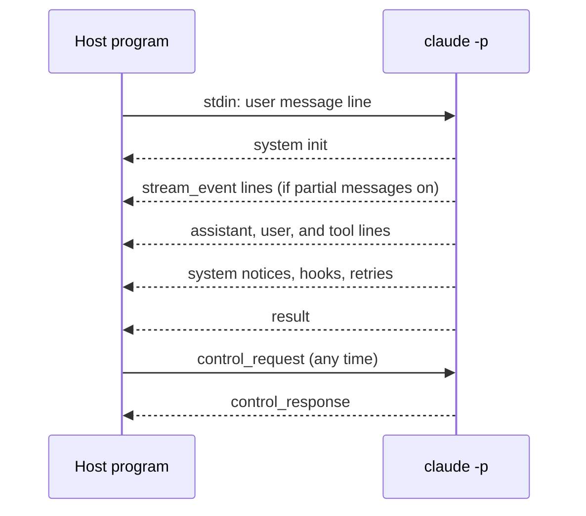

With `--output-format stream-json`, Claude Code writes one JSON object per line to stdout.
With `--input-format stream-json`, you send JSON lines on stdin, and the same channel carries [control requests](control-protocol.md).
For example, `claude -p "Explain this repo" --output-format stream-json --verbose --include-partial-messages` prints a `system` / `init` line, then `stream_event` lines while the answer grows, then a final `result` line.

Flags add more lines: `--include-partial-messages`, `--include-hook-events`, `--forward-subagent-text`, and `--replay-user-messages`. Turn the format on with `--output-format stream-json` and `--input-format stream-json`.

## Message Types

The tables list the message types that the bundled schema of `2.1.303` defines.
Each row has a short form of the schema description. A row without a description says so.
A type is marked <Documented /> when a docs page other than the [changelog](https://code.claude.com/docs/en/changelog) and the Agent SDK pages names it.
Source: [Run Claude Code Programmatically](https://code.claude.com/docs/en/headless), [CLI Reference](https://code.claude.com/docs/en/cli-reference), and the program (the message schema).
A type written as `system` / `init` means `type` is `system` and `subtype` is `init`.

### Documented Types

| `type` / `subtype` | Status | What It Does |
| --- | --- | --- |
| `user` | <Documented /> | A user message, such as a message of a subagent when `--forward-subagent-text` is on. |
| `result` | <Documented /> | The final result of the run. |
| `system` / `init` | <Documented /> | Session data at the start of each turn: session ID, model, working folder, tools, MCP servers, slash commands, and plugins. |
| `stream_event` | <Documented /> | A step of the answer as it grows, only with `--include-partial-messages`. |
| `system` / `compact_boundary` | <Documented /> | The conversation was compacted here. |
| `system` / `api_retry` | <Documented /> | An API request failed with an error that can be retried, and Claude Code will try again after a wait. |
| `system` / `hook_started` | <Documented /> | A hook started to run. |
| `system` / `hook_progress` | <Documented /> | A hook reported progress. |
| `system` / `hook_response` | <Documented /> | A hook finished with a response. |
| `system` / `plugin_install` | <Documented /> | Progress of a plugin install in print mode, when `CLAUDE_CODE_SYNC_PLUGIN_INSTALL` is set. |
| `system` / `permission_denied` | <Documented /> | A tool call was denied, and the final result lists the denials in `permission_denials`. |
| `prompt_suggestion` | <Documented /> | The predicted next prompt, sent after each turn when prompt suggestions are on. |

### Undocumented Types

Only the program shows these. They can change without notice.

| `type` / `subtype` | Status | What It Does |
| --- | --- | --- |
| `rate_limit_event` | <Undocumented /> | Rate limit information changed. |
| `system` / `status` | <Undocumented /> | No description in the program schema. |
| `system` / `post_turn_summary` | <Undocumented /> | A summary made in the background after each assistant turn. |
| `system` / `task_summary` | <Undocumented /> | A progress line in the middle of a turn. |
| `system` / `session_metadata` | <Undocumented /> | A patch of session data for a local host, such as the list of published artifacts. |
| `system` / `informational` | <Undocumented /> | A text banner: a status line, hook feedback, or the output of a slash command. |
| `system` / `permission_retry` | <Undocumented /> | Tools run again after a change of permission mode allowed commands that were denied before. |
| `system` / `stop_hook_summary` | <Undocumented /> | Which `Stop` and `SubagentStop` hooks ran at the end of a turn, their output, and whether one stopped the continuation. |
| `system` / `memory_saved` | <Undocumented /> | The memory system wrote to the listed paths. |
| `system` / `agents_killed` | <Undocumented /> | Background agents were stopped, for example on an interrupt. |
| `system` / `instruction_size_warning` | <Undocumented /> | The instruction files of the session are larger than the advised limit. |
| `system` / `away_summary` | <Undocumented /> | A summary of what happened while you were away. |
| `system` / `thinking` | <Undocumented /> | The thinking text itself. |
| `transcript_mirror` | <Undocumented /> | Sent after each successful write of the local transcript. |
| `system` / `mirror_error` | <Undocumented /> | A batch of the transcript mirror failed after 3 tries. |
| `system` / `control_request_progress` | <Undocumented /> | Progress of a long control request, matched by `request_id`. |
| `system` / `model_refusal_fallback` | <Undocumented /> | No description in the program schema. |
| `system` / `model_refusal_no_fallback` | <Undocumented /> | No description in the program schema. |
| `system` / `model_fallback` | <Undocumented /> | No description in the program schema. |
| `system` / `model_consent_fallback` | <Undocumented /> | A check before the request moved the session off the model that was asked for. |
| `system` / `file_snapshot` | <Undocumented /> | A snapshot of the plan and todo files, made for rewind. |
| `system` / `scheduled_task_fire` | <Undocumented /> | A scheduled task (cron) started. |
| `system` / `peer_message_hold` | <Undocumented /> | A message from another session was held and not queued, and how the hold ended. |
| `system` / `turn_duration` | <Undocumented /> | The wall-clock time of a turn, with the budget and the number of background jobs. |
| `system` / `api_error` | <Undocumented /> | An API error that can be retried, with the error data and the retry counts. |
| `system` / `local_command_output` | <Undocumented /> | The output of a local slash command, such as `/usage`. |
| `tool_progress` | <Undocumented /> | No description in the program schema. |
| `auth_status` | <Undocumented /> | No description in the program schema. |
| `system` / `files_persisted` | <Undocumented /> | No description in the program schema. |
| `system` / `task_notification` | <Undocumented /> | No description in the program schema. |
| `system` / `task_started` | <Undocumented /> | No description in the program schema. |
| `system` / `task_updated` | <Undocumented /> | No description in the program schema. |
| `system` / `background_tasks_changed` | <Undocumented /> | No description in the program schema. |
| `system` / `feedback_draft_queued` | <Undocumented /> | The `SendFeedback` tool wrote a draft to `~/.claude/feedback/drafts/`. |
| `system` / `session_state_changed` | <Undocumented /> | The state of the session changed. |
| `system` / `session_title_changed` | <Undocumented /> | No description in the program schema. |
| `system` / `worker_shutting_down` | <Undocumented /> | No description in the program schema. |
| `system` / `turn_handoff_available` | <Undocumented /> | No description in the program schema. |
| `system` / `ui_invalidate` | <Undocumented /> | No description in the program schema. |
| `system` / `ui_log` | <Undocumented /> | A plugin called `$.ui.log(text)`, and the screen adds a dim notice under the name of the plugin. |
| `system` / `ui_toast` | <Undocumented /> | A plugin called `$.ui.toast(text)`, and the screen shows a short note under the prompt. |
| `system` / `ui_status` | <Undocumented /> | A plugin called `$.ui.status(text)`, and the screen pins a line under the prompt. |
| `system` / `ui_scroll` | <Undocumented /> | A plugin scrolled a site that a remote screen draws. |
| `system` / `ui_focus` | <Undocumented /> | A plugin moved the focus ring of a site that a remote screen draws. |
| `system` / `commands_changed` | <Undocumented /> | The full list of slash commands, sent after a change in the middle of a session. |
| `system` / `notification` | <Undocumented /> | A text notification from the loop. |
| `system` / `task_progress` | <Undocumented /> | No description in the program schema. |
| `system` / `thinking_tokens` | <Undocumented /> | A live estimate of the thinking tokens while the thinking text is hidden. |
| `tool_use_summary` | <Undocumented /> | No description in the program schema. |
| `system` / `memory_recall` | <Undocumented /> | No description in the program schema. |
| `system` / `elicitation_complete` | <Undocumented /> | An MCP server confirmed that a URL-mode elicitation is complete. |
| `system` / `permission_check_status` | <Undocumented /> | No description in the program schema. |
| `system` / `code_change_published` | <Undocumented /> | No description in the program schema. |
| `system` / `vcs_state_changed` | <Undocumented /> | No description in the program schema. |
| `system` / `dev_intent` | <Undocumented /> | No description in the program schema. |
| `system` / `turn_preempted` | <Undocumented /> | No description in the program schema. |
| `system` / `per_turn_effort_changed` | <Undocumented /> | The conversation stopped sending the effort with each turn, because the server refused it. |
| `system` / `file_attachments_missing` | <Undocumented /> | No description in the program schema. |
| `system` / `cloud_session_delta` | <Undocumented /> | No description in the program schema. |
| `control_request` | <Undocumented /> | A request of the control protocol, which either side can send on the same stream. |
| `control_response` | <Undocumented /> | The single reply to a `control_request`. |
| `control_cancel_request` | <Undocumented /> | The sender no longer needs the answer to one of its own control requests. |
| `keep_alive` | <Undocumented /> | A heartbeat with no payload. |
| `update_environment_variables` | <Undocumented /> | Updates env vars while the process runs. |

## Example

```json title="Lines from a short run (shortened)"
{"type":"system","subtype":"init","session_id":"...","model":"...","tools":["Read","Bash"]}
{"type":"stream_event","event":{"type":"content_block_delta"}}
{"type":"result","subtype":"success","is_error":false,"result":"..."}
```

```bash title="Pick out the final result"
claude -p "Say hi" --output-format stream-json --verbose | jq -c 'select(.type=="result")'
```

## How It Works



The `control_request`, `control_response`, `control_cancel_request`, `keep_alive`, and `update_environment_variables` lines share the stream with the messages above.
Mirror lines (`transcript_mirror`) follow each local transcript write. For the file format, see [Transcript Format](../../reference/transcript-format.md).

## Related Pages

- [Headless and Print Mode](index.md)
- [Control Protocol](control-protocol.md)
- [CLI Flags](../../configure/cli/flags.md)
