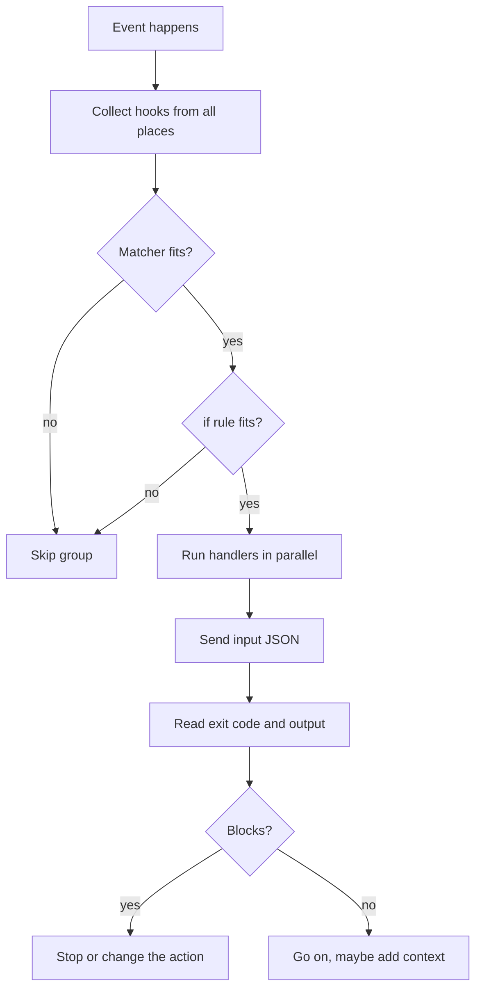

A hook is a small action that Claude Code runs by itself at a fixed point in a session.
The point can be before a tool runs, when you send a prompt, or when the session ends.
A hook can block a risky command, add context, or run a check every time.
A prompt to Claude cannot promise that, but a hook can.

Claude Code `2.1.309` has 33 hook events.
The [official docs](https://code.claude.com/docs/en/hooks) and the program list the same 33 names.

## At a Glance

| Question | Answer |
| --- | --- |
| Can you use it? | ✅ Yes. |
| Can you change it? | ✅ Yes. You write the hooks. |
| Can you turn it on or off? | ✅ Yes. Remove the hook, or set `disableAllHooks` in settings. See [Configuration](configuration.md#settings-keys-and-trust). |
| Where does it live? | Settings files, plugin `hooks/hooks.json`, and skill or subagent frontmatter. |
| Events | 33 |
| Handler types | 5 (`command`, `http`, `mcp_tool`, `prompt`, `agent`) |
| Status | <Documented /> <Undocumented /> <Differs /> <Gated /> |

## Example

This hook blocks every `git push` that Claude tries to run.

```json title=".claude/settings.json"
{
  "hooks": {
    "PreToolUse": [
      {
        "matcher": "Bash",
        "hooks": [
          {
            "type": "command",
            "if": "Bash(git push *)",
            "command": ".claude/hooks/no-push.sh",
            "timeout": 10
          }
        ]
      }
    ]
  }
}
```

```bash title=".claude/hooks/no-push.sh"
#!/bin/bash
echo "Pushing is not allowed in this project." >&2
exit 2
```

Exit code 2 blocks the call. The text on `stderr` goes back to Claude as the reason.

## Configuration Shape

A hook config has three levels.

1. The event name, such as `PreToolUse`.
2. A matcher group. It has an optional `matcher` that picks when the group runs.
3. The `hooks` array. Each entry is a handler that does the work.

The same shape is used in settings files, in a plugin `hooks/hooks.json` (wrapped in a top-level `hooks` key), and in skill and subagent frontmatter.

All matching handlers of an event run in parallel.
If a settings file defines the same handler twice, Claude Code runs it once.
A copy from a plugin or a skill stays separate.

## Where Hooks Are Defined

| Place | Status | What it does | Notes |
| --- | --- | --- | --- |
| `~/.claude/settings.json` | <Documented /> | User hooks for all projects. | Merged with the other levels. Not shared. |
| `.claude/settings.json` | <Documented /> | Project hooks. | Merged. Held back until you accept the workspace trust dialog. Can be committed. |
| `.claude/settings.local.json` | <Documented /> | Local project hooks. | Merged. Not shared. |
| Managed policy settings | <Documented /> | Organization hooks. | `disableAllHooks` set below the managed level cannot turn them off. |
| `--settings '{...}'` flag | <Documented /> | Hooks for one run. | The program calls this source `flagSettings`. It can set `disableAllHooks`. |
| Plugin `hooks/hooks.json` | <Documented /> | Plugin hooks. | Active while the plugin is on. |
| Plugin manifest key `hooks` | <Documented /> | A path, an inline object, or an array. | Merged with `hooks/hooks.json`. See [Plugin Manifest Reference](https://code.claude.com/docs/en/plugins/manifest-reference). |
| Skill frontmatter `hooks` | <Documented /> | Skill hooks. | Registered when the skill runs. Kept for the session. `once` works only here. |
| Subagent frontmatter `hooks` | <Documented /> | Hooks that run only while that subagent runs. | `Stop` becomes `SubagentStop`. Ignored for plugin subagents. See [Subagent Frontmatter](../subagents/frontmatter.md). |
| Mod `on("classic.<Event>")` | <Documented /> | A function hook on a classic event. | The chain is managed hooks, hooks modules, then other settings hooks. See [React to Events](https://code.claude.com/docs/en/plugins/mods/events). |
| SDK callback hooks | <Undocumented /> | Handler type `callback`. | Set by an Agent SDK host. A callback that times out on `PreToolUse` or `UserPromptSubmit` blocks. |

## How It Works

When something happens, Claude Code finds every hook for that event.
It filters them with the matcher and the optional `if` rule.
Then it runs the survivors in parallel and merges their answers.



Each handler gets a JSON description of the event.
A command hook reads it on `stdin`. An HTTP hook gets it as the POST body.
It answers with an exit code, or with exit 0 and a JSON object.
The fields are on [Input and Output](input-and-output.md).

:::note
Hooks that run as JavaScript functions inside Claude Code are called mods.
They are not covered here. See the [Mod API](../mod-api/index.md) section of this site.
:::

## Pages in This Section

| Page | Content |
| --- | --- |
| [Configuration](configuration.md) | Matchers, the `if` filter, timeouts, failure handling, environment variables, settings keys, trust. |
| [Handlers](handlers.md) | The five handler types and their fields. |
| [Events](events.md) | All 33 events, with their input and output fields. |
| [Input and Output](input-and-output.md) | Common input fields, output fields, decisions, exit codes, HTTP replies. |

## Related Pages

- [Configuration](configuration.md): matchers, timeouts, and trust.
- [Agent Loop](../../how-it-works/agent-loop.md): where hooks fit in a turn.
- [Subagent Frontmatter](../subagents/frontmatter.md): the `hooks` key of an agent file.
- [Skill Frontmatter](../skills-and-commands/frontmatter.md): the `hooks` key of a skill.

Source: [Hooks Reference](https://code.claude.com/docs/en/hooks) and the program (the hook schemas and the `HookInput` types).
