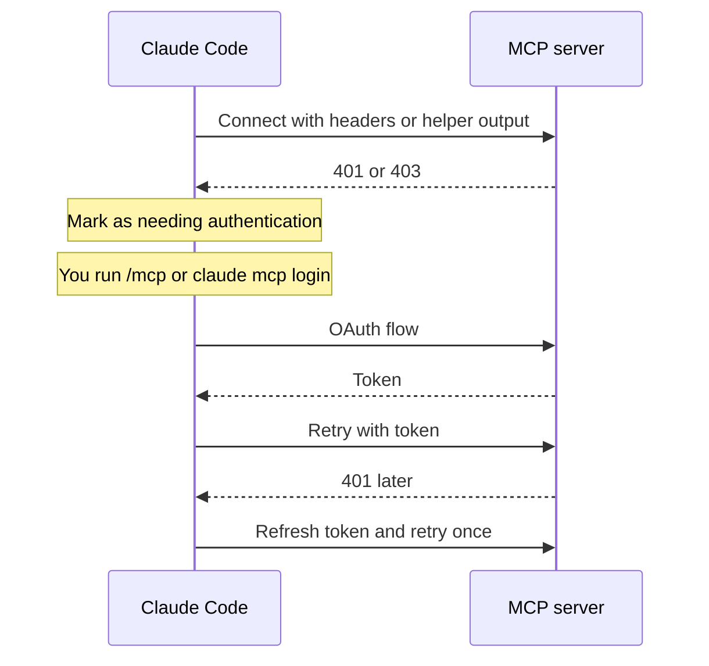

Some MCP servers need you to sign in.
Claude Code supports OAuth, a script that makes headers, and managed sign-in for enterprises.
For example, `/mcp` opens a panel where you start the OAuth sign-in for a server.
This page describes the options only. It does not walk through any account sign-in.

OAuth works for `http` and `sse` servers. Headers work for `http`, `sse`, and `ws` servers. Use the server `oauth` fields, `headers`, `headersHelper`, and env vars to change it. Turn it off with `claude mcp logout`, `Clear authentication` in `/mcp`, `disableClaudeAiConnectors`, or `ENABLE_CLAUDEAI_MCP_SERVERS`. Tokens are in secure storage.

## OAuth Options

Source: [Connect Claude Code to Tools via MCP](https://code.claude.com/docs/en/mcp), [Environment Variables](https://code.claude.com/docs/en/env-vars), and the program for the rows marked <Undocumented /> or <Gated />.

| Item | Status | What It Does | How It Works |
| --- | --- | --- | --- |
| OAuth flow | <Documented /> | Signs in to a remote server. | A `401` or `403` marks a server as needing auth. `/mcp` or `claude mcp login` runs the flow. A `401` on a signed-in server refreshes the token and retries once. |
| `oauth.clientId` | <Documented /> | Gives a pre-configured client ID. | For servers with no dynamic client registration. Claude Code also finds a Client ID Metadata Document (CIMD) on its own. |
| `oauth.callbackPort` | <Documented /> | Fixes the callback port. | The redirect URI is `http://localhost:PORT/callback`. A positive integer. |
| `oauth.authServerMetadataUrl` | <Documented /> | Skips the discovery chain. | Must start with `https://`. The default order is [RFC 9728](https://www.rfc-editor.org/rfc/rfc9728) `/.well-known/oauth-protected-resource`, then [RFC 8414](https://www.rfc-editor.org/rfc/rfc8414) `/.well-known/oauth-authorization-server`. |
| `oauth.scopes` | <Documented /> | Pins the requested scopes. | One space-separated string, at least one character. It beats the scopes in metadata. Claude Code adds `offline_access` if the server advertises it. |
| `oauth.xaa` | <Gated note="CLAUDE_CODE_ENABLE_XAA=1" /> | Enables XAA for the server. | Boolean. Without the gate Claude Code says `Remove 'oauth.xaa'`. |
| `--client-id`, `--client-secret`, `--callback-port` | <Documented /> | Set the OAuth fields when you add a server. | See [MCP Commands](cli.md#flags). The secret is set only at add time. |
| `MCP_CLIENT_SECRET`, `MCP_OAUTH_CALLBACK_PORT` | <Documented /> | Env forms of the secret and port. | The secret skips the prompt. Login and `/mcp` never read it again. |
| `MCP_OAUTH_CLIENT_METADATA_URL` | <Undocumented /> | Overrides the CIMD URL. | The program logs `Using CIMD URL from env`. |
| Token storage | <Documented /> | Keeps tokens. | Tokens are stored securely and refreshed. The client secret is in the macOS keychain or a credentials file. `Clear authentication` in `/mcp` and `claude mcp logout` remove them. |
| v2 runtime checks | <Documented /> | Hardens OAuth. | Fails on an unexpected issuer. Sends credentials only to `https` or loopback token endpoints. |
| Local OAuth refusal | <Documented /> | Handles hosted connectors. | Microsoft 365, Gmail, and Google Calendar hosts need claude.ai. Claude Code shows `is Anthropic-hosted and doesn't support local OAuth`. |
| No OAuth fallback | <Documented /> | Respects your header. | If a configured `Authorization` header (static or from a helper) is rejected, the connection fails. There is no auth prompt. |

## `headersHelper`

A `headersHelper` is a shell command that prints request headers.
Use it for short-lived tokens.

| Item | Status | What It Does | How It Works |
| --- | --- | --- | --- |
| Command | <Documented /> | Prints headers. | A shell command. The output is a JSON object of strings. It times out after 10 s. It overrides static `headers`. It runs on each connect and again after a `401` or `403`. |
| `CLAUDE_CODE_MCP_SERVER_NAME`, `CLAUDE_CODE_MCP_SERVER_URL` | <Documented /> | Tell the helper which server it serves. | Set only for the helper. The URL hides a live credential value as `REDACTED`. |
| `CLAUDE_PLUGIN_ROOT` | <Documented /> | The plugin folder. | Set only for a plugin server. |
| Working folder | <Documented /> | Resolves relative paths. | The plugin folder, the project folder, the primary working folder, or `~/.claude` (user, managed, connector). It depends on where the server is configured. |
| Env scrub | <Documented /> | Hides credential variables. | Project `.mcp.json`, plugin, and project agent servers get no variables with `TOKEN`, `SECRET`, `PASSWORD`, `KEY`, or `AUTH` in the name, plus a fixed list. |
| Trust rule | <Documented /> | Runs the helper late. | Project and local servers run it only after the trust dialog for the folder that declares them. Until then only static `headers` are used. |
| `${user_config.*}` | <Documented /> | Plugin options. | Not allowed. Claude Code reports the server as misconfigured. Before `2.1.207` it substituted them. |
| Policy refusal | <Documented /> | Refuses a plugin helper. | A marketplace entry with `headersHelper` must inline its full manifest with `strict: false`. Otherwise Claude Code refuses to run it. |

## XAA

XAA (SEP-990) signs you in through an enterprise identity provider (IdP).
It is off unless `CLAUDE_CODE_ENABLE_XAA=1` is set.

| Item | Status | What It Does | How It Works |
| --- | --- | --- | --- |
| XAA | <Gated note="CLAUDE_CODE_ENABLE_XAA=1" /> | Signs in through an enterprise IdP. | One IdP connection is shared by all XAA servers. Claude Code swaps a cached IdP `id_token` for a server token. Used by servers with `oauth.xaa`. |
| Gate | <Gated note="CLAUDE_CODE_ENABLE_XAA=1" /> | Turns XAA on. | An env var. |
| Setup | <Gated note="CLAUDE_CODE_ENABLE_XAA=1" /> | Stores the IdP data. | `claude mcp xaa setup` writes `xaaIdp`. The secret comes from `MCP_XAA_IDP_CLIENT_SECRET` and goes to the keychain. |
| Login | <Gated note="CLAUDE_CODE_ENABLE_XAA=1" /> | Caches the IdP token. | `claude mcp xaa login`. Without it Claude Code says `no IdP connection`. |

## Claude.ai Connectors

Connectors are MCP servers that you set up in claude.ai.
Claude Code fetches them only when you use a claude.ai login.

| Item | Status | What It Does | How It Works |
| --- | --- | --- | --- |
| Fetch | <Documented /> | Loads the connectors of your account. | Only with a claude.ai subscription login. Not with an API key, `ANTHROPIC_AUTH_TOKEN`, `apiKeyHelper`, a cloud provider, a profile, or a `setup-token` token. Works in the terminal, VS Code, JetBrains, and the SDK. |
| `ENABLE_CLAUDEAI_MCP_SERVERS` | <Documented /> | Switch for the fetch. | `false` stops it for the shell session. |
| `disableClaudeAiConnectors` | <Documented /> | Switch in settings. | See [MCP Settings and Policy](settings.md#settings-keys). |
| Per-tool controls | <Documented /> | Organization policy on connector tools. | `ask` prompts on each call. `blocked` hides the tool. See `toolPermissions` in [Server Configuration](config.md#server-options). |
| Session token rejected | <Documented /> | A separate state from a connector problem. | Run `/login`, then reconnect. Authorizing the connector again does not help. |
| Cloud and desktop sessions | <Documented /> | Other delivery paths. | A cloud host or the desktop app passes connectors in. `disableClaudeAiConnectors` does not act on them. |

## Example

```json title=".mcp.json: OAuth with a fixed port, and a header helper"
{
  "mcpServers": {
    "crm": {
      "type": "http",
      "url": "https://crm.example.com/mcp",
      "oauth": {
        "clientId": "my-client-id",
        "callbackPort": 8765,
        "scopes": "read write"
      }
    },
    "internal": {
      "type": "http",
      "url": "https://tools.example.com/mcp",
      "headersHelper": "./scripts/mcp-headers.sh"
    }
  }
}
```

The helper script prints `{"Authorization": "Bearer <token>"}` to stdout and exits.

## How It Works



## Errors

Each row is a family of messages. The backticked text is the start that every message in the family shares.

| Start of Message | Status | What It Means | Cases |
| --- | --- | --- | --- |
| `XAA`, `authServerMetadataUrl must`, `Configured auth server metadata`, `HTTP ${…} fetching configured auth server`, `Unexpected auth result`, `Invalid authorization URL`, `No TTY available to prompt for client secret`, `Enter OAuth client secret`, `Unable to build claude.ai connector auth URL`, `Server type "${…}" does not support OAuth`, `No OAuth flow in progress`, `Invalid callback URL`, `MCP OAuth failed`, `OAuth flow completed without`, `No available ports for OAuth redirect`, `clientMetadataUrl must` | <Undocumented /> | An MCP OAuth or XAA (cross-app access) sign-in step failed. | Discovery of protected resource metadata or authorization server metadata failed or did not match, the token endpoint is not HTTPS, the token exchange or jwt-bearer grant failed or returned an unexpected shape, XAA is not enabled (`CLAUDE_CODE_ENABLE_XAA=1`), no IdP connection is configured, or the callback URL does not belong to this sign-in. |

## Related Pages

- [MCP](index.md)
- [MCP Commands](cli.md)
- [MCP Env Vars](env.md)
- [Settings: Authentication](../../configure/settings/auth.md) for the sign-in of Claude Code itself
