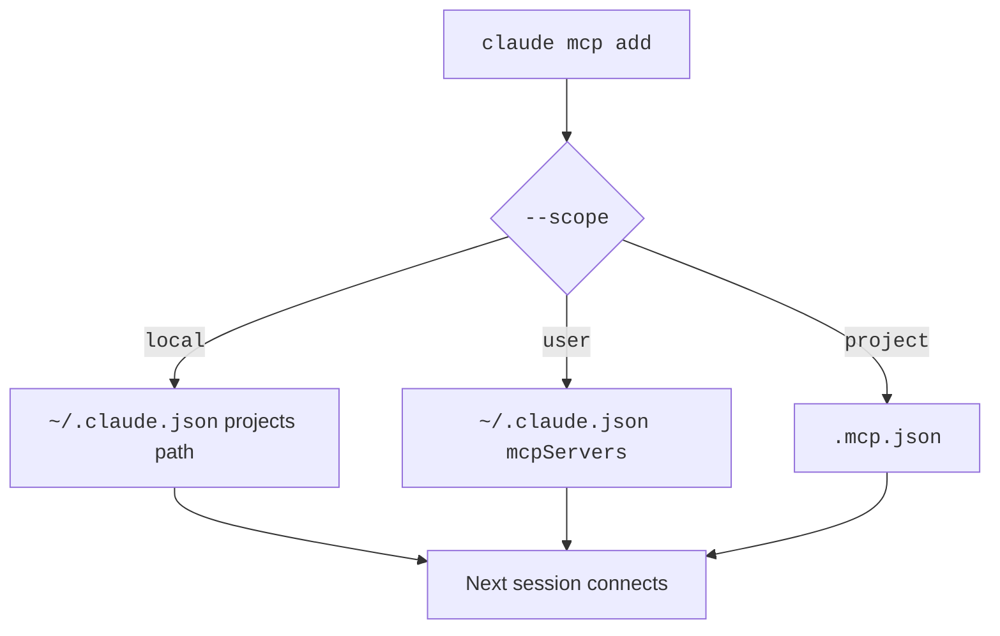

The `claude mcp` command adds, lists, and removes MCP servers from the shell.
Inside a session, the `/mcp` command shows the state of each server.
For example, `claude mcp list` prints each server and tells you if it is connected.

Flags pick the scope, the transport, env vars, headers, and OAuth fields. The commands write to `~/.claude.json` or `.mcp.json`, depending on the scope.

## Subcommands

Source: [Connect Claude Code to Tools via MCP](https://code.claude.com/docs/en/mcp), [Control MCP Server Access for Your Organization](https://code.claude.com/docs/en/managed-mcp), and `claude mcp --help`.

| Command | Status | What It Does | How It Works |
| --- | --- | --- | --- |
| `claude mcp add [options] <name> <commandOrUrl> [args...]` | <Documented /> | Adds a server. | Writes to the scope and prints `Added ...`. Put `--` before a stdio command so its flags are not parsed. A reserved name is rejected. |
| `claude mcp add-json [options] <name> <json>` | <Documented /> | Adds a server from a JSON string. | Accepts `stdio`, `sse`, `http`, and `ws`. The JSON is the entry object, not the `mcpServers` wrapper. |
| `claude mcp add-from-claude-desktop [options]` | <Documented /> | Imports servers from Claude Desktop. | macOS and WSL only. You pick interactively. A name with other characters is rejected. A duplicate gets a suffix such as `server_1`. |
| `claude mcp get <name>` | <Documented /> | Shows one server. | Health-checks approved servers and shows `Issue:` on a failure. An unapproved `.mcp.json` server shows `Pending approval`. A plugin stdio server shows `Command: stdio` and `NAME=[REDACTED]`. |
| `claude mcp list` | <Documented /> | Lists servers. | Shows `Connected`, `Needs authentication`, `Failed to connect`, `Pending approval`, or `Disabled for this project`. Warnings show here. |
| `claude mcp remove [options] <name>` | <Documented /> <Caution note="Deletes stored OAuth tokens and the client registration of a remote server" /> | Removes a server. | Without `--scope` it removes from the scope where the server exists. It deletes stored OAuth tokens and the client registration of a remote server. |
| `claude mcp login [options] <name>` | <Documented /> | Runs OAuth for a server. | Works for `http`, `sse`, and claude.ai connectors. Without a local browser it prints the URL and asks for the redirect URL. |
| `claude mcp logout <name>` | <Documented /> | Clears stored OAuth credentials. | Does not remove the server. |
| `claude mcp reset-project-choices` | <Documented /> | Resets approvals. | Clears every approved and rejected `.mcp.json` server for this project. |
| `claude mcp serve [options]` | <Documented /> | Runs Claude Code as an MCP server. | Over stdio. It prints nothing at start. It offers the Claude Code tools to the client, and the client must ask you to confirm. |
| `claude mcp xaa setup` | <Gated note="CLAUDE_CODE_ENABLE_XAA" /> | Sets the IdP connection for XAA. | Options: `--issuer <url>`, `--client-id <id>`, `--client-secret`, `--callback-port <port>`. Writes `xaaIdp`. The secret comes from `MCP_XAA_IDP_CLIENT_SECRET`. |
| `claude mcp xaa login` | <Gated note="CLAUDE_CODE_ENABLE_XAA" /> | Caches an IdP `id_token`. | Runs the OIDC browser login. Options: `--force` and `--id-token <jwt>` (stores a ready JWT). |

## Flags

| Flag | Status | What It Does | How It Works | Used By |
| --- | --- | --- | --- | --- |
| `-s, --scope <scope>` | <Documented /> | Picks the scope. | `local` (default), `user`, or `project`. On `remove`, the default is the scope where the server exists. | `add`, `add-json`, `add-from-claude-desktop`, `remove` |
| `-t, --transport <transport>` | <Documented /> | Picks the transport. | `stdio` (default), `sse`, or `http`. `ws` is not accepted. | `add` |
| `-e, --env <env...>` | <Documented /> | Sets env vars of a stdio server. | `KEY=value`. Put another option between `--env` and the name. | `add` |
| `-H, --header <header...>` | <Documented /> | Sets headers of a remote server. | `"Name: value"` | `add` |
| `--client-id <clientId>` | <Documented /> | Sets the OAuth client ID. | Only for `http` and `sse`. | `add` |
| `--client-secret` | <Documented /> | Prompts for the OAuth client secret. | Masked input. `MCP_CLIENT_SECRET` skips the prompt. Stored in the keychain (macOS) or a credentials file. Set only when you add the server. | `add`, `add-json` |
| `--callback-port <port>` | <Documented /> | Fixes the OAuth callback port. | For servers with a pre-registered `http://localhost:PORT/callback`. For `xaa setup`, an integer from 1 to 65535. | `add` |
| `--xaa` | <Gated note="CLAUDE_CODE_ENABLE_XAA" /> | Enables XAA for the server. | Hidden unless the gate is set. Needs `xaa setup`, `--client-id`, and `--client-secret`. Without the gate, Claude Code prints `--xaa requires CLAUDE_CODE_ENABLE_XAA=1`. | `add` |
| `--no-browser` | <Documented /> | Prints the authorization URL. | For SSH and headless sessions. You paste the redirect URL back. | `login` |
| `-d, --debug`, `--verbose` | <Documented /> | Debug output, and a verbose override. | None. | `serve` |

## The `/mcp` Command

| Command | Status | What It Does | How It Works |
| --- | --- | --- | --- |
| `/mcp` | <Documented /> | Opens the MCP panel. | Shows status, tool count, `cached` state, and `Issue:`. You can enable, disable, reconnect, authenticate, and clear authentication. |
| `/mcp reconnect all` | <Documented /> | Retries every failed server. | The interactive terminal needs `2.1.284` or later. |
| `/mcp enable\|disable\|reconnect <server>` | <Documented /> | Controls a server without the panel. | Claude Code suggests it when no terminal is attached to a background session. |
| `/mcp__<server>__<prompt>` | <Documented /> | Runs an MCP prompt. | See [MCP Runtime](runtime.md#resources-and-prompts). |

## Example

```bash title="Add, check, and remove a server"
claude mcp add --transport http sentry https://mcp.sentry.dev/mcp
claude mcp add-json weather '{"type":"http","url":"https://example.com/mcp"}' --scope user
claude mcp list
claude mcp get sentry
claude mcp remove weather --scope user
```

## How It Works



## Related Pages

- [MCP](index.md)
- [Server Configuration](config.md)
- [MCP Authentication](auth.md)
- [CLI Subcommands](../../configure/cli/subcommands.md)
