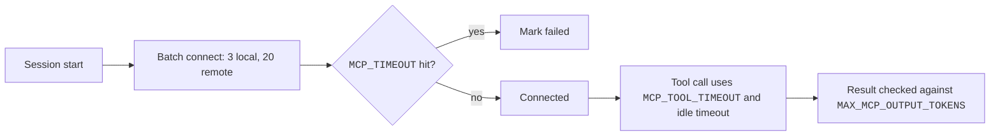

These env vars change how Claude Code starts, times out, and limits MCP servers.
Set them in the shell or in the `env` key of a settings file.
For example, `MCP_TIMEOUT=30000` gives a server 30 seconds to start.

Export the variable, or add it to `env` in a settings file. Some are switches, such as `ENABLE_CLAUDEAI_MCP_SERVERS` and `MCP_CONNECTION_NONBLOCKING`.

## Documented Variables

Source: [Connect Claude Code to Tools via MCP](https://code.claude.com/docs/en/mcp), [Environment Variables](https://code.claude.com/docs/en/env-vars), and [Settings Reference](https://code.claude.com/docs/en/settings-reference).
All env vars of Claude Code are listed on [Plugin and MCP Env Vars](../../configure/env-vars/plugins-and-mcp.md) and the other env var pages.

| Variable | Status | What It Does | How It Works |
| --- | --- | --- | --- |
| `MCP_TIMEOUT` | <Documented /> | Startup timeout of one server. | Milliseconds. Default 30000. |
| `MCP_TOOL_TIMEOUT` | <Documented /> | Timeout of one tool call. | Milliseconds. Default 100000000 (about 28 hours). Values below 1000 become 1 s. The per-server `timeout` wins. Remote servers also have a 60 s per-request timer. |
| `CLAUDE_CODE_MCP_TOOL_IDLE_TIMEOUT` | <Documented /> | Idle timeout of a call. | Milliseconds. Defaults: 300000 (remote) and 1800000 (stdio). `0` turns it off. |
| `MCP_CONNECT_TIMEOUT_MS` | <Documented /> | Wait during blocking startup. | Milliseconds. Default 5000. Applies with `MCP_CONNECTION_NONBLOCKING=0` or `alwaysLoad`. |
| `MCP_CONNECTION_NONBLOCKING` | <Documented /> | Sets whether startup waits for servers. | Startup does not wait by default. `0` waits for servers before the first query. `alwaysLoad` servers still wait. |
| `MCP_SERVER_CONNECTION_BATCH_SIZE` | <Documented /> | Sets how many local servers connect at once. | Default 3 (stdio). |
| `MCP_REMOTE_SERVER_CONNECTION_BATCH_SIZE` | <Documented /> | Sets how many remote servers connect at once. | Default 20 (`http`, `sse`). |
| `CLAUDE_CODE_MCP_STARTUP_WAIT_MS` | <Documented /> | Sets the first-turn wait in non-interactive mode. | Milliseconds. `0` skips the wait. `2.1.274` and later. |
| `MAX_MCP_OUTPUT_TOKENS` | <Documented /> | Token limit of a result. | Default 25000. The warning at 10000 is fixed. |
| `CLAUDE_CODE_MAX_MCP_DESCRIPTION_LENGTH` | <Documented /> | Length limit of descriptions and instructions. | Replaces both defaults (4096 and 16384). `2.1.280` and later. |
| `CLAUDE_CODE_MCP_AUTO_BACKGROUND_MS` | <Documented /> | Delay before a call moves to the background. | Default 120000. `0` turns it off. `2.1.212` and later. |
| `CLAUDE_CODE_DISABLE_BACKGROUND_TASKS` | <Documented /> | Turns off all background tasks. | `1` also turns off MCP auto background. |
| `CLAUDE_AUTO_BACKGROUND_TASKS` | <Documented /> | Allows auto background in `-p`. | Set to `1`. |
| `CLAUDE_CODE_MCP_ALLOWLIST_ENV` | <Documented /> | Gives stdio servers a minimal env. | `1` gives only a safe baseline plus the server `env`. |
| `ENABLE_TOOL_SEARCH` | <Documented /> | Sets the tool search mode. | Not set, `true`, `auto`, `auto:N`, or `false`. See [MCP Runtime](runtime.md#timing-and-recovery). |
| `CLAUDE_CODE_DISABLE_EXPERIMENTAL_BETAS` | <Documented /> | Strips beta fields. | Keeps tool search off. Managed settings can keep it on (`2.1.227` and later). |
| `ENABLE_CLAUDEAI_MCP_SERVERS` | <Documented /> | Controls the fetch of connectors. | `false` stops the fetch. |
| `MCP_DISCOVERY_CACHE` | <Documented /> | Turns the discovery cache on or off. | `1` on, `0` off. Off by default unless a rollout enables it. |
| `MCP_DISCOVERY_CACHE_TTL_S` | <Documented /> | Sets entry age without a refresh. | Default 900. |
| `MCP_DISCOVERY_CACHE_MAX_STALE_S` | <Documented /> | Sets the maximum entry age. | Default 14400, capped at 7 days. |
| `MCP_DISCOVERY_CACHE_STRIKES` | <Documented /> | Sets failed refreshes before an entry is discarded. | Default 1. |
| `MCP_SDK_GENERATION` | <Documented /> | Pins the client runtime. | `v1` or `v2`. Read once per process. `2.1.218` and later. |
| `MCP_PROTOCOL_NEGOTIATION` | <Documented /> | Probes for revision 2026-07-28. | `auto` or `legacy`. v2 runtime only. |
| `MCP_CLIENT_SECRET` | <Documented /> | Gives the OAuth client secret. | Skips the prompt of `--client-secret`. |
| `MCP_OAUTH_CALLBACK_PORT` | <Documented /> | Fixes the OAuth callback port. | Same as `--callback-port`. |
| `CLAUDE_AGENT_SDK_MCP_NO_PREFIX` | <Documented /> | Drops the name prefix. | `1` skips `mcp__<server>__` for SDK servers. |
| `CLAUDE_CODE_REMOTE_MCP_CONFIG` | <Documented /> | Gives the path of the delivered server file. | Read in remote sessions as a copy of `--mcp-config` with scope `dynamic`. |

## Variables Claude Code Sets for Servers

Claude Code puts these in the env of a stdio server or a `headersHelper`.

| Variable | Status | What It Does | How It Works |
| --- | --- | --- | --- |
| `CLAUDE_PROJECT_DIR` | <Documented /> | Gives the project root. | Set in a stdio server env. |
| `CLAUDE_CODE_SESSION_ID`, `CLAUDECODE` | <Documented /> | Mark the session. | Set for stdio servers. The session ID stays as it was at spawn. |
| `CLAUDE_CODE_SUBPROCESS_ENV_SCRUB` | <Documented /> | Strips credentials. | Also applies to stdio servers. You set it. |
| `CLAUDE_CODE_MCP_SERVER_NAME`, `CLAUDE_CODE_MCP_SERVER_URL` | <Documented /> | Tell a `headersHelper` the server. | Set for the helper only. |

## Undocumented Variables

Only the program shows these. They can change without notice.

| Variable | Status | What It Does | How It Works |
| --- | --- | --- | --- |
| `ENABLE_MCP_LARGE_OUTPUT_FILES` | <Undocumented /> | Switch for result files. | `false` truncates instead of saving a file. |
| `CLAUDE_CODE_MCP_APPS_HOST` | <Undocumented /> | Declares MCP Apps support. | `true` adds the `io.modelcontextprotocol/ui` extension to the client capabilities. |
| `CLAUDE_CODE_SKIP_PLUGIN_MCP_SERVERS` | <Undocumented /> | Skips plugin servers. | The log says `(CLAUDE_CODE_SKIP_PLUGIN_MCP_SERVERS is set)`. |
| `CLAUDE_CODE_SKIP_PLUGIN_MCP_SERVERS_EXCEPT` | <Undocumented /> | Exempts plugin servers from the skip. | The log says `exempted via`. |
| `CLAUDE_CODE_ENABLE_REFRESH_MCP_TOOLS` | <Undocumented /> | Adds a refresh tool. | Adds one more tool to the tool list when set. |
| `MCP_TRUNCATION_PROMPT_OVERRIDE` | <Undocumented /> | Picks the truncation prompt. | `legacy` selects the old prompt. Any other value selects the new one. Not set follows a flag. |
| `MCP_OAUTH_CLIENT_METADATA_URL` | <Undocumented /> | Overrides the CIMD URL. | Used as the OAuth client metadata URL. |
| `CLAUDE_CODE_SYNC_PLUGINS_MCP_TIMEOUT_MS` | <Undocumented /> | Timeout of the plugin MCP sync. | Default 10000 ms. |
| `CLAUDE_CODE_MCP_CONNECTOR_PREWAIT_MS` | <Undocumented /> | First-turn wait for connectors. | Used with an `sdkUrl` session. Capped at 2147483647. |
| `CLAUDE_CODE_MCP_PREWAIT_SERVERS`, `CLAUDE_CODE_MCP_PREWAIT_SERVERS_MS` | <Undocumented /> | Name servers to wait for. | Read for a remote worker. |
| `CLAUDE_CODE_MCP_MEMORY_CGROUP` | <Undocumented /> | Sets the memory cap class of MCP processes. | Linked to the Linux tool memory cap. `none` is accepted. |
| `CLAUDE_CODE_TERMINAL_MCP_TOOLS` | <Undocumented /> | Lists MCP tool names. | Comma-separated. A turn that ends with these tool results is checked. |
| `CLAUDE_AGENT_SDK_DISABLE_MCP_MANIFESTS` | <Undocumented /> | Stops SDK manifest capture. | Sets `captureSdkMcpManifests` to false. |
| `CLAUDE_CODE_BRIDGE_MCP_CARRIER` | <Undocumented /> | Marks a bridge MCP carrier. | `1` means child. Another value means descendant. |
| `CLAUDE_CODE_ENABLE_XAA` | <Gated note="Turns XAA on when set to 1" /> | Turns XAA on. | `1`. See [MCP Authentication](auth.md#xaa). |
| `MCP_XAA_IDP_CLIENT_SECRET` | <Gated note="CLAUDE_CODE_ENABLE_XAA" /> | Gives the IdP client secret for XAA. | Read by `claude mcp xaa setup --client-secret`. |

## Example

```bash title="Slow server, big results, no connector fetch"
export MCP_TIMEOUT=60000
export MCP_TOOL_TIMEOUT=300000
export MAX_MCP_OUTPUT_TOKENS=50000
export ENABLE_CLAUDEAI_MCP_SERVERS=false
claude
```

```json title="The same in settings"
{ "env": { "MCP_TIMEOUT": "60000", "MAX_MCP_OUTPUT_TOKENS": "50000" } }
```

## How It Works



## Related Pages

- [MCP Runtime](runtime.md)
- [MCP Authentication](auth.md)
- [Plugin Loading](../plugins/loading.md#env-vars) for plugin env vars
