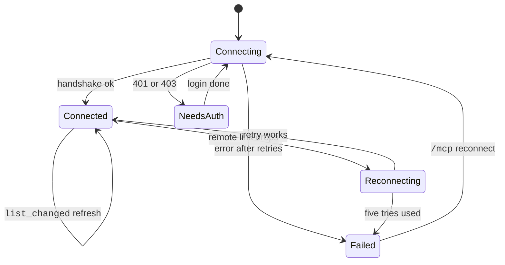

After an MCP server connects, Claude Code adds its tools, resources, and prompts to the session.
The names, the permission rules, and the limits decide what Claude can use and for how long.
A tool from a server is named `mcp__<server>__<tool>`.
For example, `mcp__github__create_issue` is the `create_issue` tool of the `github` server.

This runs by itself once a server connects. Use `permissions.deny` for tools, `ENABLE_TOOL_SEARCH` for deferral, and `CLAUDE_CODE_MCP_AUTO_BACKGROUND_MS` for background moves. Large results are saved under `tool-results`.

## Tools and Names

Source: [Connect Claude Code to Tools via MCP](https://code.claude.com/docs/en/mcp), [Configure Permissions](https://code.claude.com/docs/en/permissions), and the program for rows marked <Undocumented />.

| Item | Status | What It Does | How It Works |
| --- | --- | --- | --- |
| `mcp__<server>__<tool>` | <Documented /> | Names an MCP tool. | Characters outside `A-Z a-z 0-9 _ -` in the server name become `_`. A tool whose full name is over 128 characters is left out. Used in permission rules, hooks, `tools`, and `allowed-tools`. |
| `mcp__plugin_<plugin>_<server>__<tool>` | <Documented /> | Names a plugin server tool. | The server is named `plugin:<plugin>:<server>`. A hook matcher on the bare server key never fires for it. |
| `mcp__github`, `mcp__github__*`, `mcp__*` | <Documented /> | Select tools by server. | The first two match one server. `mcp__*` matches all MCP tools. Used in subagent `tools` and `disallowedTools`. |
| Hook matcher `mcp__memory__.*` | <Documented /> | Matches a server in hooks. | A matcher with only exact-match characters, such as `mcp__memory`, matches no tool. The `.*` is required. |
| `mcp_server` hook input field | <Documented /> | Gives the origin of the server. | An object with `name` and `source` (`plugin`, `sdk`, `user`, `project`, and more). Sent to tool hooks. |
| `mcp_tool` hook type | <Documented /> | Calls an MCP tool as a hook. | The output counts as command stdout. Skipped on `Setup`, and at `SessionStart` before servers connect. |
| `updatedMCPToolOutput` | <Documented /> | Replaces an MCP tool result. | Output of a `PostToolUse` hook. MCP tools only. |
| `ToolSearch` | <Documented /> | Finds deferred MCP tools. | On by default. `permissions.deny: ["ToolSearch"]` turns the tool off. |
| [`WaitForMcpServers`](../../reference/tools/gated-and-other.md) | <Documented /> <Gated note="used when tool search is off" /> | Waits for a connecting server. | Used when tool search is off. With tool search the wait happens inside `ToolSearch`. Works in the main session and subagents. |
| `SearchMcpRegistry`, `SuggestConnectors`, `ListConnectors` | <Undocumented /> | Find and list MCP connectors. | `SearchMcpRegistry` searches the connector registry by keyword. `ListConnectors` lists the connectors of the claude.ai organization. |

## Resources and Prompts

| Item | Status | What It Does | How It Works |
| --- | --- | --- | --- |
| `@server:protocol://path` | <Documented /> | Attaches a resource. | Fetched as an attachment. The `@` menu has fuzzy search. |
| `ListMcpResourcesTool` | <Documented /> | Lists resources of all servers. | The docs say Claude Code has tools to list and read resources but give no names. Each entry has a `server` field. `ui://` entries are hidden. |
| `ReadMcpResourceTool` | <Documented /> | Reads one resource. | Parameters `server` and `uri`, both required. |
| `ReadMcpResourceDirTool` | <Undocumented /> | Lists the children of a directory resource. | Parameters `server` and `uri`. Uses `resources/directory/read`. Not recursive. Only for a server that declares directory support. |
| Old tool names | <Undocumented /> | Map old names to new. | `ListMcpResources`, `ReadMcpResource`, and `ReadMcpResourceDir` map to the `...Tool` names in rules and hooks. |
| `/server:prompt (MCP)` and `/mcp__server__prompt args` | <Documented /> | Runs a server prompt. | Arguments split on whitespace. Results go into the conversation. Needs the prompt capability. |
| MCP Apps resources | <Documented /> | UI pages for a host. | A `ui://` URI, or the media type `text/html` with the profile parameter `mcp-app`. Reading by URI still works. |
| `CLAUDE_CODE_MCP_APPS_HOST` | <Undocumented /> | Declares MCP Apps support. | Adds the extension `io.modelcontextprotocol/ui` with the MIME type to the client capabilities. |

## Elicitation and Channels

Elicitation is a server asking you for input.
A channel is a way for a server to push messages into your session.

| Item | Status | What It Does | How It Works |
| --- | --- | --- | --- |
| Elicitation dialog | <Documented /> | Asks you for input. | `form` mode shows fields. `url` mode asks to open a link. The escaped URL has a cap of about 8000 characters. Claude Code declares `elicitation: {form: {}, url: {}}`. |
| `Elicitation` hook | <Documented /> | Answers a request. | Input: `mcp_server_name`, `message`, `mode`, `url`, `elicitation_id`, `requested_schema`. Output action: `accept` (with `content`), `decline`, or `cancel`. |
| `ElicitationResult` hook | <Documented /> | Observes or overrides the answer. | Input has `action` and `content`. Runs before the answer goes to the server. |
| `claude/channel` capability | <Documented /> | Lets a server push messages. | You opt in with `--channels`. Not registered on a v2 connection that agreed on revision 2026-07-28. |
| `claude/channel/permission` | <Documented /> | Relays permission prompts over a channel. | Notifications `notifications/claude/channel/permission_request` and `.../permission`. |
| `channels` plugin key | <Documented /> | Binds a channel to a plugin server. | Fields `server`, `displayName`, `userConfig`. In `plugin.json`. |

Source: [Channels Reference](https://code.claude.com/docs/en/channels-reference) and [Push Events into a Running Session with Channels](https://code.claude.com/docs/en/channels).

## Limits

| Item | Status | What It Does | How It Works |
| --- | --- | --- | --- |
| Output warning | <Documented /> | Warns on large output. | Fixed at 10000 tokens. |
| `MAX_MCP_OUTPUT_TOKENS` | <Documented /> | Sets the token limit of a result. | Default 25000. Over the limit, Claude Code saves the result to a file in `tool-results` and shows the path. Images stay under this limit. |
| 50000 characters | <Documented /> | File threshold for text. | A successful text result over 50000 characters is saved to a file, whatever the token count. |
| `ENABLE_MCP_LARGE_OUTPUT_FILES` | <Undocumented /> | Switch for the file path. | When `false`, Claude Code truncates instead of saving to a file. |
| `_meta["anthropic/maxResultSizeChars"]` | <Documented /> | Raises the threshold for one tool. | Up to 500000 characters. Text only. Set in the `tools/list` entry. |
| `_meta["anthropic/requiresUserInteraction"]` | <Documented /> | Always asks. | Only JSON `true` counts. It prompts in all modes. `dontAsk` denies. With `--permission-prompt-tool`, an allow becomes a deny. |
| `_meta["anthropic/alwaysLoad"]` | <Documented /> | Loads a tool upfront. | `false` keeps it deferred when the user config sets `alwaysLoad: true` (`2.1.285` and later). |
| Error text | <Documented /> | Shortens long errors. | Over about 11000 characters, the first 5000 and last 5000 stay. For `isError: true` results. |
| 16 MiB response | <Documented /> | Caps one response or message. | HTTP and SSE stop reading. A WebSocket closes the connection. |
| Description limits | <Documented /> | Cuts long text. | 4096 characters for server instructions and an upfront tool. 16384 for a tool found by tool search. `CLAUDE_CODE_MAX_MCP_DESCRIPTION_LENGTH` replaces both. |
| Schema checks | <Documented /> | Drops bad tools. | Excludes a tool with a bad top-level property name or an invalid 2020-12 schema. Flattens a root `anyOf`, `oneOf`, or `allOf`. |

## Timing and Recovery

| Item | Status | What It Does | How It Works |
| --- | --- | --- | --- |
| Auto background | <Documented /> | Moves a long call to a task. | After 120000 ms in the main conversation. Not for subagents, IDE servers, or `-p` unless `CLAUDE_AUTO_BACKGROUND_TASKS=1`. |
| Idle timeout | <Documented /> | Aborts a silent call. | 5 minutes for remote servers, 30 minutes for stdio. `CLAUDE_CODE_MCP_TOOL_IDLE_TIMEOUT` changes it. `0` turns it off. Not for IDE and `sdk` servers. |
| Reconnection | <Documented /> | Retries a dropped remote server. | Five tries with backoff from 1 s. Stdio is not reconnected. The first connect retries 3 times, except `ws` and auth errors. |
| `list_changed` | <Documented /> | Refreshes tools, prompts, and resources. | Interactive sessions refresh all three. `-p` refreshes tools only. A failed refresh keeps the old lists. |
| Stdio shutdown | <Documented /> | Stops a stdio server. | On macOS and Linux: `SIGINT`, then `SIGTERM` after 100 ms, then `SIGKILL` after 400 ms more. |
| `roots/list` | <Documented /> | Tells servers which folders are allowed. | Answers with the launch folder and added folders. |
| Tool search modes | <Documented /> | Controls deferral. | `ENABLE_TOOL_SEARCH`: not set, `true`, `auto`, `auto:N`, or `false`. Since 2.1.304 tool search is on by default behind a custom `ANTHROPIC_BASE_URL`, and a 400 or 422 from the gateway is retried without it. Since 2.1.305 the retry also covers an endpoint or gateway that rejects tool search, and a `ToolSearch` that is disallowed or left out of `--tools` ([v2.1.305 release](https://github.com/anthropics/claude-code/releases/tag/v2.1.305)). After a refusal the program says `Tool search is off for this conversation: the endpoint refused it earlier in this process.` `ENABLE_TOOL_SEARCH=true` overrides a conversation that ran without `ToolSearch`, which stays that way until it is compacted or cleared (the program). |

## Example

```json title="Settings: allow one server's tools, deny another's"
{
  "permissions": {
    "allow": ["mcp__github__*"],
    "deny": ["mcp__untrusted"]
  }
}
```

```json title="Hook matcher for every tool of the memory server"
{
  "hooks": {
    "PreToolUse": [
      {
        "matcher": "mcp__memory__.*",
        "hooks": [{ "type": "command", "command": "./audit.sh" }]
      }
    ]
  }
}
```

## How It Works



## Errors

Rows with a start of a message are families. The backticked text is the start that every message in the family shares.

| Start of Message | Status | What It Means | Cases |
| --- | --- | --- | --- |
| `.mcp.json is malformed (not valid JSON, or mcpServers is not an object)` | <Undocumented /> | Claude Code could not read the project `.mcp.json`. | The file is not valid JSON, or `mcpServers` is not an object. |
| `MCP server "` | <Undocumented /> | A tool call or command named a server that cannot be used. | The server is blocked by managed policy, is disabled (re-enable it with `/mcp`), or was not found. |
| `Server "` | <Undocumented /> | A server operation failed. | The server does not support resources, is not connected, or was not found. The last case lists the available servers. |
| `No MCP server named` | <Undocumented /> | A server name is not in the scope that the command looked in. | The scope is `.mcp.json`, local, or user. |

## Related Pages

- [MCP](index.md)
- [MCP Env Vars](env.md)
- [Plugin Manifest](../plugins/manifest.md) for the `channels` key
- [Agent Loop](../../how-it-works/agent-loop.md) for how tool calls run
