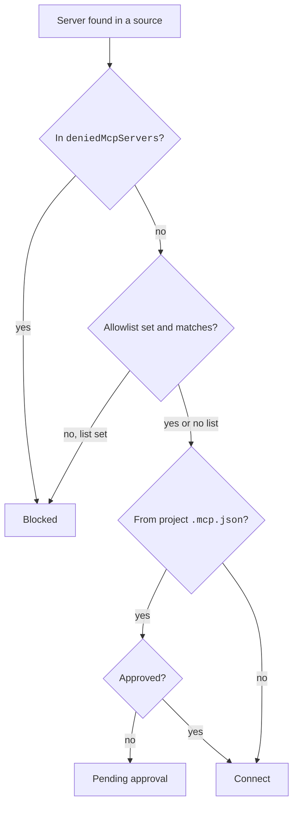

These settings decide which MCP servers may run and which ones a project may use.
Administrators use them for allow lists and deny lists.
For example, `{ "enableAllProjectMcpServers": true }` approves every server in a project `.mcp.json` file.

## At a Glance

| Question | Answer |
| --- | --- |
| Can you use it? | ✅ Yes. Most keys also work in your own settings. |
| Can you change it? | Edit settings files, or use managed settings for organization rules. |
| Can you turn it on or off? | `disabledMcpjsonServers`, `enableAllProjectMcpServers`, `deniedMcpServers`, `--strict-mcp-config`, and `disableClaudeAiConnectors`. |
| Where does it live? | Settings files, `~/.claude.json`, `.mcp.json`, and `managed-mcp.json` |
| Status | <Documented /> <Undocumented /> |

## Settings Keys

Source: [Connect Claude Code to Tools via MCP](https://code.claude.com/docs/en/mcp), [Control MCP Server Access for Your Organization](https://code.claude.com/docs/en/managed-mcp), [Settings Reference](https://code.claude.com/docs/en/settings-reference), and [Channels Reference](https://code.claude.com/docs/en/channels-reference).
The keys with their types are also on [MCP and Channels Settings](../../configure/settings/mcp-and-channels.md).

| Key | Status | What It Does | How It Works | Where |
| --- | --- | --- | --- | --- |
| `enableAllProjectMcpServers` | <Documented /> | Approves all `.mcp.json` servers. | Boolean. Ignored in an untrusted folder when it comes from the checked-in `.claude/settings.json`. | Settings files |
| `enabledMcpjsonServers` | <Documented /> | Lists approved `.mcp.json` servers. | Array of names. Same trust rule. | Settings files |
| `disabledMcpjsonServers` | <Documented /> | Lists rejected `.mcp.json` servers. | Array of names. It blocks in every permission mode and every folder. | Settings files |
| `managedMcpServers` | <Documented /> | Gives servers to every user. | Object keyed by name. Only `http` and `sse`. No `command`, `args`, `env`, or `headersHelper`, no `${VAR}`, and the URL must start with `https://`. Users cannot remove them. `deniedMcpServers` still applies. | Managed only |
| `allowedMcpServers` | <Documented /> | Allowlist of servers users may use. | Array of entries. Each entry has exactly one of `serverName`, `serverCommand` (an exact array), or `serverUrl` (a wildcard pattern such as `https://*.example.com/*`). Not set means allow all. | Settings, mainly managed |
| `deniedMcpServers` | <Documented /> | Denylist of servers. | Same entry shapes. It applies in all scopes, also for the organization. | Settings, mainly managed |
| `allowManagedMcpServersOnly` | <Documented /> | Reads the allowlist from managed settings only. | `deniedMcpServers` still merges from all sources. Users can still add servers, but only the admin allowlist applies. | Managed only |
| `allowAllClaudeAiMcps` | <Documented /> | Lets connectors load beside `managed-mcp.json`. | Off by default, which keeps the lockdown. | Managed only |
| `allowClaudeInChromeWithManagedMcp` | <Documented /> | Lets Claude in Chrome run beside `managed-mcp.json`. | Device managed settings only. `deniedMcpServers` and the organization Chrome setting still block it. | Device managed |
| `disableClaudeAiConnectors` | <Documented /> | Turns off the connectors Claude Code fetches. | `true` in any source wins. It also stops a `claudeai-proxy` server from `--mcp-config`. | Any scope |
| `channelsEnabled` | <Documented /> | Organization opt-in for channel notifications. | Teams and Enterprise: off by default. Console: on by default unless managed settings exist. | Managed |
| `allowedChannelPlugins` | <Documented /> | Organization allowlist of channel plugins. | Replaces the default allowlist. Needs `channelsEnabled: true`. | Managed |
| `xaaIdp` | <Undocumented /> | Stores the IdP connection for XAA. | Object `{ issuer, clientId, callbackPort? }`. Written by `claude mcp xaa setup`. See [MCP Authentication](auth.md#xaa). | User settings |

## State Keys in `~/.claude.json`

These keys sit under `projects["<path>"]`.

| Key | Status | What It Does | How It Works |
| --- | --- | --- | --- |
| `disabledMcpServers` | <Documented /> | A per-project opt-out list. | Covers user, plugin, managed, connector, and default-on built-in servers. A connector uses its display name, such as `claude.ai Slack`. |
| `enabledMcpServers` | <Documented /> | A per-project opt-in list. | Only for built-in servers that default to off, such as `computer-use`. Other entries are ignored. |
| `hasTrustDialogAccepted` | <Documented /> | The workspace trust flag. | `true` lets a `headersHelper` of a project or local server run without the dialog. |

## Files and Flags

| Item | Status | What It Does | How It Works |
| --- | --- | --- | --- |
| `.mcp.json` | <Documented /> | Holds project servers. | At the project root. Interactive sessions ask for approval. `claude -p`, the SDK, and cloud sessions load it without a prompt. |
| `~/.claude.json` | <Documented /> | Holds local and user servers. | Written by `claude mcp add`. |
| `managed-mcp.json` | <Documented /> | A fixed server set from the organization. | Gives the organization exclusive control. Claude Code warns and ignores other sources. Claude in Chrome and connectors stay blocked unless the two `allow` keys above are set. |
| `--mcp-config <configs...>` | <Documented /> | Loads servers from files or strings. | Space-separated. Scope `dynamic`. `headersHelper` runs in the primary working folder. |
| `--strict-mcp-config` | <Documented /> | Uses only the `--mcp-config` servers. | Skips the approval prompt for project servers it does not load (`2.1.246` and later). |
| `--plugin-dir-no-mcp <path>` | <Undocumented /> | Loads an inline plugin without its MCP servers. | Hidden flag. The SDK form is `skipMcpDiscovery`. |
| `--channels <servers...>` | <Documented /> | Registers channel notifications of the listed servers. | Hidden flag. Space-separated names. See [MCP Runtime](runtime.md#elicitation-and-channels). |
| ⚠️ `--dangerously-load-development-channels <servers...>` | <Documented /> | Loads channel servers that are not on the allowlist. | Hidden flag for local channel development. Shows a confirmation dialog. |
| `--setting-sources` | <Documented /> | Excludes project settings. | Keeps a project `.mcp.json` out. |

## Approval Rules

- `claude mcp list` and `claude mcp get` read approvals only from files outside the repository until you trust the folder.
- In an untrusted folder, these sources apply: `~/.claude/settings.json`, managed settings, and `--settings`.
- An untracked `.claude/settings.local.json` applies only in a trusted folder. Before `2.1.207` it always applied.
- In `bypassPermissions` mode, Claude Code skips the project prompt when `skipDangerousModePermissionPrompt` is set in user or managed settings.

## Example

```json title="Managed settings: lock down MCP"
{
  "allowManagedMcpServersOnly": true,
  "allowedMcpServers": [
    { "serverName": "github" },
    { "serverUrl": "https://*.example.com/*" }
  ],
  "deniedMcpServers": [
    { "serverCommand": ["npx", "untrusted-server"] }
  ],
  "disableClaudeAiConnectors": true
}
```

## How It Works



## Related Pages

- [MCP](index.md)
- [Server Configuration](config.md)
- [MCP Commands](cli.md) for `claude mcp reset-project-choices`
- [MCP and Channels Settings](../../configure/settings/mcp-and-channels.md)
