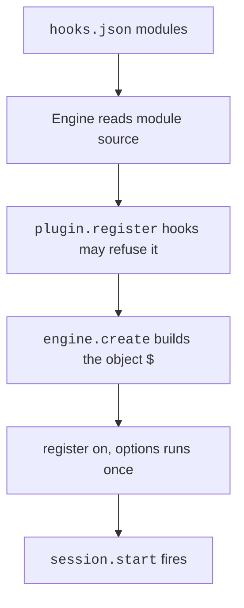

A mod is a plugin whose code runs inside Claude Code.
Claude Code calls the code when an event happens, such as a tool call or a submitted prompt.
The code can watch the event, change it, or answer it.
The object `$` is the Mod API. The type file that Claude Code publishes marks it as early access, so it may change between releases.

These pages cover `2.1.312`. Compared with the `2.1.311` type file, it changes only the comment on the `effort` field of `TurnStepInput`: on a model that takes effort per message, a level stands from one message with input to the next, and a number goes out at once. The `2.1.311` type file, compared with the `2.1.310` one, adds the call `$.prompt.paint` and the event `prompt.paint` (see [Turn and Prompt](./calls/turn-prompt.md)), lets a managed `prepend` hook name `user` in `next.to` (see [Hooks](./events/hooks.md)), and adds `backgroundColor` to a pane (see [UI Types](./types/ui/index.md)). The `2.1.310` type file, compared with the `2.1.309` one, lets an `Image` draw inside tmux and adds the `fix` code to the `$.ui.blit` result (see [UI Types](./types/ui/index.md)). The `2.1.309` type file, compared with the `2.1.308` one, adds `cursor` to `$.prompt.fill` and the `prompt.fill` event, and lets a `turn.step` hook name the model by an alias (see [Turn and Prompt Types](./types/turn-prompt/index.md)). The `2.1.308` type file matched the `2.1.307` one apart from the version in its header. The `2.1.307` type file was compared with the `2.1.306` one. It changes the `tool.check` types: the input carries `approver`, and the result's `decider` is replaced by `plugin`, which the engine sets (see [Tool and Command Config](./calls/tool-command-config.md)). A test's `$.tool.call` takes `agentId` ([Testing](./calls/testing.md)), and a keyed `Markdown` element carries `part` ([UI Types](./types/ui/index.md)). The type file and the program were last compared in full on `2.1.305`. Official pages: [Mods Overview](https://code.claude.com/docs/en/plugins/mods/overview), [Create a Mod](https://code.claude.com/docs/en/plugins/mods/create), [Use the Mods API](https://code.claude.com/docs/en/plugins/mods/api), [React to Events](https://code.claude.com/docs/en/plugins/mods/events), [Draw in the Interface](https://code.claude.com/docs/en/plugins/mods/interface), [Test a Mod](https://code.claude.com/docs/en/plugins/mods/test), [Troubleshoot a Mod](https://code.claude.com/docs/en/plugins/mods/troubleshoot), and [Mods Reference](https://code.claude.com/docs/en/plugins/mods/reference).

## Example

This mod writes each Bash command that Claude runs to the transcript.

```javascript title="hooks/register.js"
export const register = (on) => {
  on("tool.call", { tool: "Bash" }, async ($, e, next) => {
    $.ui.log(`Claude runs: ${e.command}`);
    return next(e);
  });
};
```

## A First Mod

A small mod has three files.

<FileTree>

- `first-mod/`
  - `.claude-plugin/`
    - `plugin.json`
  - `hooks/`
    - `hooks.json`
    - `register.js`

</FileTree>

- `plugin.json` is the manifest of the plugin. It has a `name`, a `version`, and a `description`.
- `hooks.json` holds `{ "modules": ["./register.js"] }`. That key makes the plugin a mod.
- `register.js` is the hooks module. It exports `register`. `register` calls `on` once for each hook.

Load the folder for one session with the flag `--plugin-dir`.

```bash
claude --plugin-dir ./first-mod
```

The docs build the same mod step by step in [Create a Mod](https://code.claude.com/docs/en/plugins/mods/create). You can also describe the mod in a session. Claude then writes it.

## How a Mod Loads



1. The plugin has `hooks/hooks.json` with `modules`. It holds one path, relative to that file. The engine refuses a second entry.
2. The engine reads the source of the module before it loads it. It lists the events, the `$` calls, the env names, and the `$.state` values. `claude plugin validate <dir>` prints that list.
3. The `plugin.register` hooks of the modules admitted before it can refuse the module.
4. The `engine.create` fold builds `$` for the plugin. A step can add a noun.
5. The engine calls `register(on, options)` once. Then `session.start` fires for each loaded mod.
6. After an edit, `/reload-plugins` or the reload of `--plugin-dir` runs the cycle again.

`disableAllHooks` stops installed mods. `--safe-mode` and `--bare` load none.
See [Files, Nouns, and Gates](nouns-and-gates.md#gates-that-stop-mods).

Hooks run in five tiers, from outermost: `prepend`, `user`, `append`, `builtin`, `core`.
Managed plugins in `prependPlugins` and `appendPlugins` take the first and third tier.
The engine itself is `core`.

## Commands for Mod Authors

| Item | Status | What it does |
| --- | --- | --- |
| `claude --plugin-dir <dir>` | <Documented /> | Loads a plugin folder for one session and reloads its module on save. |
| `claude plugin validate <dir>` | <Documented /> | Reads the manifest and the module. Lists the events and `$` calls. `--strict` turns warnings into errors. `--json` prints a report. |
| `claude plugin test [dir]` | <Documented /> | Runs every `*.test.ts` and `*.test.tsx` file. Exits with 1 when a test fails. See [Testing](calls/testing.md). |
| `/plugin` | <Documented /> | Shows a line such as `1 mod active · first-mod` when a mod loaded. |
| `/reload-plugins` | <Documented /> | Reloads the plugins of the session. |
| `claude --debug-file <path>` | <Documented /> | Writes a log with a line for each module that loads or fails. |

If a mod does nothing, run `claude plugin validate` first. Then read the debug log.
The docs list the causes in [Troubleshoot a Mod](https://code.claude.com/docs/en/plugins/mods/troubleshoot).

## How to Read the Mod API Pages

- The Documented badge means a docs page names the item, or the item is in the published type file. The docs call that file "the complete reference".
- The Differs badge means the docs and the type file or the program disagree.
- The Gated badge means a flag or a gate controls the item.
- "Run time" appears in a "Where it can be used" cell. It means in a hook, in a closure that a hook drew, or in a timer callback. It does not mean inside `register`.
- Most calls on `$` are also events with the same name, such as `fs.read`. A hook on that event can pass the call on, refuse it with `{ deny }`, or answer it with `{ value }`.
- Source for these pages: the Mod API type file of the 2.1.312 program, published unchanged as `schemas/claude-code.d.ts`, and the docs pages above.
- For the exact fields of a call, an event, or a type, read the type file. It names every one. See [Check a Field Before You Use It](types/index.md#check-a-field-before-you-use-it).

## Pages of the Mod API

| Page | What is in it |
| --- | --- |
| [Hooks, `on`, and `next`](events/hooks.md) | `register`, `on`, `next`, failure, and budgets. |
| [Event Table Types](types/events.md) | How each event gets its input and result type. |
| [Files, Nouns, and Gates](nouns-and-gates.md) | Manifest keys, the `$` nouns, switches, limits, and built-in mods. |
| [Plugin and Engine](calls/plugin.md) | `$.plugin`, `plugin.register`, `engine.create`, and their types. |
| [UI Methods](ui/ui.md) | `$.ui`: toasts, panes, scroll, focus, clipboard. |
| [UI Events](ui/ui-events.md) | `ui.render`, `ui.press`, and the other interface events. |
| [Surfaces, Elements, and Render Sites](ui/ui-elements.md) | What a mod may draw, where, and with which props. Also JSX and globals. |
| [Model, Audio, and MCP](calls/model-audio-mcp.md) | `$.model`, `$.audio`, `$.mcp`. |
| [Session](calls/session.md) | `$.session` and the `session.*` events. |
| [Turn and Prompt](calls/turn-prompt.md) | `$.turn`, `$.prompt`, `turn.*`, `prompt.*`, `skill.prompt`, `attribution.text`. |
| [Tool, Command, and Config](calls/tool-command-config.md) | `$.tool`, `$.command`, `$.config`. |
| [Agent](calls/agent.md) | `$.agent`, `agent.offer`, `agent.spawn`, and the agent types. |
| [Files, Store, and State](calls/fs-store-state.md) | `$.fs`, `$.store`, `$.state`, and the state helpers. |
| [Clock, HTTP, Process, Env, and Settings](calls/clock-http-process-env-settings.md) | `$.clock`, `$.http`, `$.process`, `$.env`, `$.settings`. |
| [Telemetry](calls/telemetry.md) | `$.telemetry`, `telemetry.log`, `telemetry.mark`. |
| [Classic Events](events/classic-events.md) | The `classic.*` events of the settings hooks. |
| [The `claude-code/testing` Module](calls/testing.md) | `test`, `describe`, `expect`, `mock`, `tier`, `$.ui.mount`. |

The [type pages](types/index.md) hold the detailed shapes of inputs and results.

- [Hook Machinery Types](types/hooks.md)
- [UI Types](types/ui/index.md)
- [Model, Audio, and MCP Types](types/model.md)
- [Session Types](types/session/index.md)
- [Turn and Prompt Types](types/turn-prompt/index.md)
- [Tool, Command, and Config Types](types/tool-command-config/index.md)
- [Files, State, Clock, HTTP, Process, and Settings Types](types/infra/index.md)
- [Classic Event Types](types/classic/index.md)
- [Testing Types](types/testing/index.md)
- [Event Table Types](types/events.md)

## Known Gaps

- The program sets the 50 millisecond limit of a `prompt.edit` hook on the event. The type file does not hold it.
- The rollout flag for installed mods is the server flag `tengu_plugin_hooks_modules`. The program has no local switch for it.
- The value `re-entry` of `next.error.kind` is in the docs and in a program debug string. It is not in the type file.
- The type file says the VS Code extension attaches no surface yet. The docs say it draws from `2.1.299`.
- Many doc comments in the type file name code items without backticks. The tables keep the wording of the type file where it matters.

## Errors

Each row is a family of messages. The backticked text is the start that every message in the family shares.

| Start of Message | Status | What It Means | Cases |
| --- | --- | --- | --- |
| `$.audio.`, `${…}: $.audio.` | <Undocumented /> | A refused `$.audio.play` or `$.audio.speak` call. | The clip is not `{ asset }`, `{ url }` or `{ base64, mime }`. The clip has no source or more than one. The clip has an empty field or is over a byte limit. `asset` is not a path inside the plugin directory. The plugin has no directory or id. An option such as `shouldLoop` or `gain` has the wrong type. Too many plays are going at once. |
| `${…}: $.tool.` | <Undocumented /> | A refused `$.tool.call`, `$.tool.register`, or `$.tool.check` call. | `consent` is not a string, or this session does not accept it. The call produced no result. The name is a reserved MCP server name or the session already has an MCP server of that name. No tool has the name. The session has no built-in tools (`--tools ""`) or runs with `--bare`. |
| `${…}: $.model.` | <Undocumented /> | A refused or failed `$.model.complete` or `$.model.classify` call. | `maxTokens`, `timeoutMs`, or `effort` is out of range (`effort` is one of low, medium, high, xhigh, max). The model is not in the organization allowlist, or `maxTokens` is past what the model can produce. `classify` got fewer than two labels, or the model answered with no text. |
| `${…}: $.ui.` | <Undocumented /> | A refused or failed `$.ui` call. | `$.ui.ask` got options that are not a list, more options than the limit, no question, or got no answer. `$.ui.notify` could not write to the channel. |
| `$.session.`, `${…}: $.session.` | <Undocumented /> | A refused `$.session.append` or `$.session.compact` call. | The process keeps no conversation to append to. Compaction is off in this session (`DISABLE_COMPACT`). Or a turn is running. In that case, call `$.session.compact` from `turn.complete` or later. |
| `${…}: $.store.`, `${…}: store file` | <Undocumented /> | A `$.store` call failed, or a store file is unusable. | A key is over the length limit. The store would be over the size limit. Or the store file is unreadable or malformed (for example the JSON is not an object). |
| `${…}: $.prompt.paint` | <Undocumented /> | A `$.prompt.paint` call was refused. | The argument has no `decorations` array of `{ start, end }` runs, or `text` is not a string while `decorations` is not empty (`chunk-sh93dad2.js:12093`, `2.1.311`). |
| `${…}: $.config.` | <Undocumented /> | A `$.config.set` call named a key that `/config` has no row for. | The text says that `$.config.list` names the keys. |
| `${…}: $.` | <Undocumented /> | A refused or failed call on `$` from a plugin. | The text names the call and the reason. Example reasons: a value that is not JSON data or is over a character limit. A `$.clock` delay that is not a non-negative number of milliseconds. A `$.state` reference that is not `{ plugin, key }`. `$.agent.spawn` without a prompt. A refused `$.mcp.call`. `$.prompt.compose` in a process that composes no system prompt. |
| `$.` | <Undocumented /> | A `$` call failed in the engine. | A `$.telemetry` call names no origin. A caller passed a bad value to `$.skill.prompt`. The environment has no streaming ops from the host. Or the chain has no core at the bottom. |
| `${…}: next` | <Undocumented /> | A refused `next()` or `next.to()` call of a hook. | `next()` passed an argument that the event does not allow. `next.to()` names no tier. Or it names a tier that a dispatch does not continue at (user, append, builtin, core). Or `next.to()` is not available to this plugin. The host refuses `next.to("user")` when no hook of the same module that spells it stands on this dispatch. |
| `${…}: on(` | <Undocumented /> | A refused `on()` registration. | The pattern or matcher is wrong. The hook is not a function. Code registered the same hook twice. Or code called `on()` after `register()` returned. |
| `${…}: registered` | <Undocumented /> | A hook registration does not match what the engine has. | The event is not an event. No loaded plugin provides the call. The call is not an event. Or the scan of the hooks module did not see it. |
| `${…}: engine.create` | <Undocumented /> | An `engine.create` hook returned a wrong value. | It must return `$` with nouns, and it must not change the identity of the plugin. |
| `${…}: hooks module not loaded` | <Undocumented /> | A hooks module did not load. | `next.to` is available to managed plugins only, or a policy or scan reason follows. |
| `${…}: matcher` | <Undocumented /> | A refused hook matcher. | A RegExp has a flag that keeps state, or a nested quantifier. A key is not kept, or is reserved. A string is too long. Or the matcher is not a plain object. |
| `${…}: returned` | <Undocumented /> | A render hook returned a drawing that is not allowed. | It holds a Proxy or a `vm` context (the context since `2.1.310`), a function where plain data goes, an object that is not plain data, or a Client or element that it did not draw. |
| `${…} after register() returned`, `${…} called twice`, `${…} takes a function` | <Undocumented /> | A `.catch` call on a registration broke a rule. | `.catch()` is for `register()`, a registration takes one `.catch`, and the argument is a function `($, e, next)`. |
| `${…}: ${…}:` | <Undocumented /> | A refused or failed call from a plugin. | The text names the call and the reason. A `socketPath` is not absolute, has a NUL byte, or is a network location. A URL is not valid, is not http or https, or has credentials. A request body is over the limit, an auth handle is unknown, there were too many redirects, or no complete answer came in time. |

## Related Pages

- [Plugins](../plugins/index.md)
- [Hooks](../hooks/index.md)
