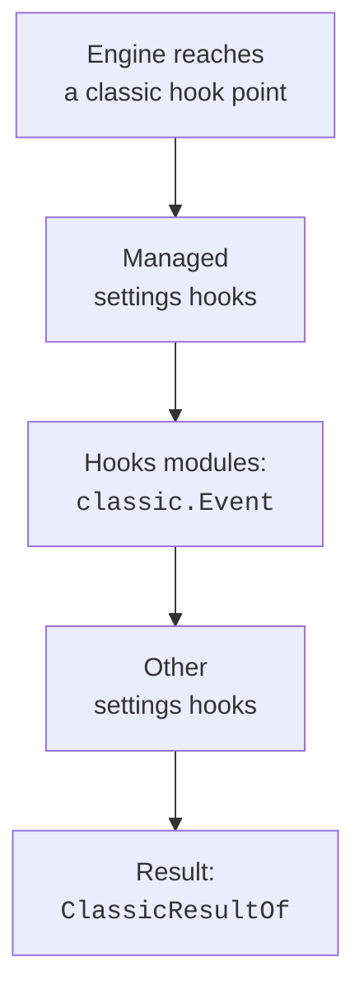

These are the input and result types of the `classic.*` events.
Each input type matches the data that a settings hook of the same name receives on `stdin`.
The result types match the JSON that a settings hook prints.
Use them when you write a mod hook for an event such as `classic.Stop`.

## Pages

| Page | What is in it |
| --- | --- |
| [Classic Result, Config, and Elicitation Types](result-config-elicitation.md) | `BackgroundTaskSummary` to `MessageDisplayHookInput`: the base hook input, the result types, and the config, cwd, directory, elicitation, file, instructions, and message inputs. |
| [Classic Permission, Compact, and Tool Batch Types](permission-compact-batch.md) | `NotificationHookInput` to `PreModelSwitchHookInput`: notification, permission, compact, model switch, tool batch, and post tool use types. |
| [Classic Tool Use, Session, and Task Types](tool-session-task.md) | `PreToolUseDecision` to `WorktreeRemoveHookInput`: pre tool use, session, setup, stop, subagent, task, teammate, prompt, and worktree types. |

## Example

This hook on `classic.Stop` passes the event on without a change. Its `e` is the same data that a `Stop` settings hook reads on `stdin`.

```ts
on("classic.Stop", ($, e, next) => next(e));
```

## How It Works

Every settings hook event has a twin event under `classic`. The twin fires wherever the engine runs the classic hook, even with no settings hook configured.
The chain runs managed settings hooks first, then hooks modules, then the other settings hooks. A managed block ends the chain above every module.



## Types without Fields

These types are aliases, unions, or plain shapes. Each row gives its use and its shape.

| Type | Status | What it is for | Shape and limits |
| --- | --- | --- | --- |
| `ClassicEventName` | <Documented /> | The name of a classic hook event as a function-hooks event: the own name of the settings hook under `classic` (`classic.Stop`, `classic.PreToolUse`). | Alias of `` `classic.${ClassicHookEvent}` ``. Each fires wherever the engine runs the classic hook, even when no settings hook is configured. |
| `ClassicHookEvent` | <Documented /> | The name of a classic hook event: `PreToolUse`, `Stop`, and the rest. | Alias of `HookInput['hook_event_name']`. |
| `ClassicHookInputs` | <Documented /> | What a classic hook receives on stdin for each event, by event name: the Agent SDK's `<Event>HookInput`. | Alias of `{ [I in HookInput as I['hook_event_name']]: I, }`. |
| `ExitReason` | <Documented /> | Why a session ended, as `SessionEndHookInput.reason` reports it. | Alias of `'clear' \| 'resume' \| 'logout' \| 'prompt_input_exit' \| 'other'`. |
| `HookInput` | <Documented /> | Any classic hook input, for code that handles the input of several events. | Alias of the union of every hook input type, such as `PreToolUseHookInput`, `PostToolUseHookInput`, `SessionStartHookInput`, and `StopHookInput`. |
| `PermissionBehavior` | <Documented /> | What a permission rule does: allow, deny, or ask. | Alias of `'allow' \| 'deny' \| 'ask'`. |
| `PermissionMode` | <Documented /> | How tool runs are handled: `default`, `acceptEdits`, `bypassPermissions`, `plan`, `dontAsk`, or `auto`. `bypassPermissions` needs `allowDangerouslySkipPermissions`. | Alias of `'default' \| 'acceptEdits' \| 'bypassPermissions' \| 'plan' \| 'dontAsk' \| 'auto'`. |
| `PermissionUpdateDestination` | <Documented /> | Where a permission update is saved: user, project, or local settings, the session only, or the CLI argument. | Alias of `'userSettings' \| 'projectSettings' \| 'localSettings' \| 'session' \| 'cliArg'`. |
| `PermissionUpdates` | <Documented /> | The permission rules that a PermissionRequest allow may add. It is the shape of the own `permission_suggestions` of the request (the PermissionUpdate list of the SDK). | Alias of `NonNullable<ClassicHookInputs['PermissionRequest']['permission_suggestions']>`. |
| `SDKAssistantMessageError` | <Documented /> | The error that a failed assistant turn can carry, as `StopFailureHookInput.error` reports it. | Alias of 13 error names, from `authentication_failed` and `billing_error` to `rate_limit`, `overloaded`, `model_not_found`, `server_error`, `max_output_tokens`, and `unknown`. |

## Related Pages

- [Mod API Overview](../../index.md)
- [Mod API Types](../index.md)
- [Classic Events](../../events/classic-events.md)
- [Hook Events](../../../hooks/events.md)
- [Hook Input and Output](../../../hooks/input-and-output.md)
