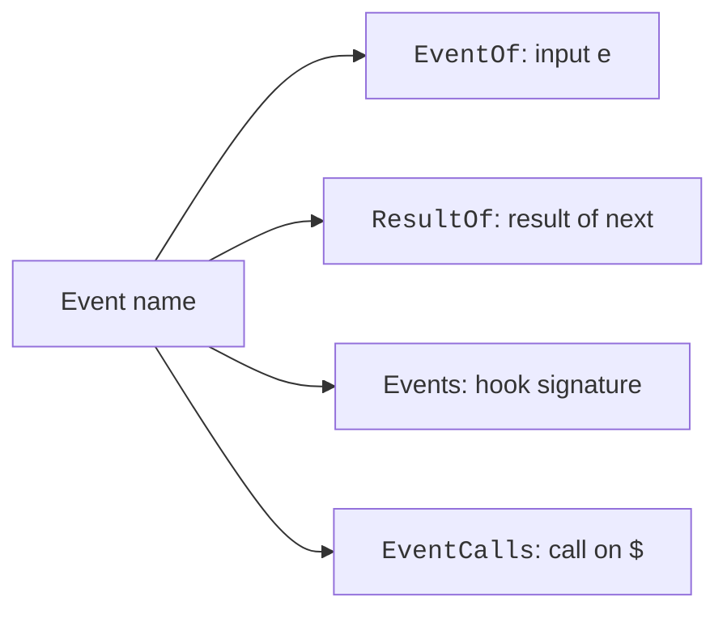

These types map an event name to its input, its result, and its call on `$`.
Your editor uses them to know the shape of `e` and `next` for each event.
For example, `$.fs.read(...)` is both a call and the event `fs.read`, so a hook can answer it.

A plugin adds its own nouns by declaration merging into `EngineInterface`.

Source: the Mod API type file of the 2.1.314 program (`schemas/claude-code.d.ts`). Official page: [Mods Reference](https://code.claude.com/docs/en/plugins/mods/reference).

## Example

These aliases give the input and the result of one event by its name.

```ts
import type { EventName, EventOf, EventResult } from "claude-code";

type ReadInput = EventOf["fs.read"];
type ReadResult = EventResult<"fs.read">;
```

To add your own noun, merge into `EngineInterface`:

```ts title="types.d.ts"
declare module "claude-code" {
  interface EngineInterface {
    voice: { say(text: string): Promise<void> };
  }
}
```

After this, `voice.say` is also an event, and a hook can use `on('voice.say', ...)`.

## How It Works

`EventOf` joins the events the engine defines (`CoreEventOf`) with the methods of the nouns that plugins add (`NounEventOf`). `ResultOf` does the same for results. `Events` turns both into one hook type for each event.



## Types without Fields

These types are aliases, unions, or plain shapes. Each row gives its use and its shape.

| Type | Status | What it is for | Shape and limits |
| --- | --- | --- | --- |
| `AnyEventHook` | <Documented /> | The hook that `on("*", hook)` takes. It runs on every event, including events of plugin nouns that no declaration names. So `e` is `unknown` and `next` is StarNext. | Alias of `($: EngineInterface, e: unknown, next: StarNext) => unknown`. Until `next.is(pattern, e)` narrows `e`, a hook can only pass it on, time it, log it, or fail it. |
| `AnyKeyOf` | <Documented /> | Every key of every variant, index signatures included. | Alias of `I extends unknown ? keyof I : never`. |
| `Chunk` | <Documented /> | What a hook on streaming event `N` yields. It is also what its `next(e)` yields to the hook (see ChunkOf, by name). | Generic alias of `ChunkOf[N]`. |
| `ChunkOf` | <Documented /> | The chunk type of each streaming event, by name. It is what the stream of the event yields. | Object with fields `turn.step`, `process.spawn`. |
| `ChunkRef` | <Documented /> | What every `turn.step` chunk may carry. It is the handle of the engine on the item of its own stream that the engine read the chunk from. A chunk that a hook made has no handle. | Object with the field `ref?`. A hook that passes a chunk on keeps the handle. A hook that spreads a chunk also keeps it. A chunk that a hook builds afresh has none. |
| `CoreEventName` | <Documented /> | The name of an event that the engine defines itself (a key of CoreEventOf). EventName adds the events of the declared plugin nouns. | Alias of `keyof CoreEventOf`. |
| `CoreEventOf` | <Documented /> | The argument of each event that the engine defines itself. It covers the events of its call sites (EngineEventOf), the events of the classic hooks (ClassicEventOf), and the calls on `$`. | Alias of `EngineEventOf & ClassicEventOf & OpEventOf`. |
| `DeclaredEvents` | <Documented /> | The state events of each declared value, in a union of `[plugin, key]` pairs with one variant for each pair (it distributes). So a matcher narrows `e`. | Alias of `Pair extends readonly [ infer P extends keyof PluginState & string, infer K ] ? K extends keyof PluginState[P] & string ? DeclaredEventsOf<P, K> : never : never`. |
| `DeclaredEventsOf` | <Documented /> | `e` of `state.get` and of `state.set` for one declared value. It has the typed reference of the value. For a write, it also has the change, of the declared type. | Object with fields `get`, `set`. |
| `DeclaredPair` | <Documented /> | Every named value that the enabled contracts declare, as one union of `[plugin, key]` pairs. It is `never` while PluginState is empty. | Object with fields `[P in keyof PluginState & string]`. |
| `DeclaredStateChange` | <Documented /> | What a `state.set` on one declared value carries beside its reference. It carries the value to write and the value that stood there, of the declared type. | Object with fields `value`, `previous`, `ifVersion?`. |
| `EngineEventOf` | <Documented /> | The events that the engine raises at its call sites, and `engine.create`. The events of the classic settings hooks are in ClassicEventOf. | Object. One key for each event that hooks can handle. The engine skips a hook that fails, and the next hook runs. So a guard needs a `.catch` to fail closed. |
| `EngineResultOf` | <Documented /> | The results of the events of the engine. | Object. One key for each event. Its value is the result type that a hook for the event may return. |
| `EventCalls` | <Documented /> | The engine's own events as calls on `$`, with one signature each. `$.<noun>.<event>(input)` resolves to its result, or to its stream. | Object with one key for each noun that raises events (`tool`, `command`, `config`, `prompt`, and more). A plugin's call runs the same chain, and the chain skips the calling hook. 10 calls use it, such as `$.session.compact`. |
| `EventName` | <Documented /> | The name of an event: a key of EventOf. It covers the engine's own events (CoreEventName) and the events of the declared plugin nouns (NounEventName). | Alias of `keyof EventOf`. |
| `EventOf` | <Documented /> | The argument of each event, by event name. A hook receives it as `e`, and the call on `$` takes it. It is plain data, frozen to every depth. | Alias of `CoreEventOf & NounEventOf`. The engine's own events plus the methods of the nouns that plugins add. |
| `EventResult` | <Documented /> | The result of event `N`: what its hooks return and what their `next(e)` resolves to. | Generic alias of `ResultOf[N]`. |
| `Events` | <Documented /> | The hook signature of each event, `($, e, next)`, as one mapped type over EventOf. The signature of a streaming event is the generator form (StreamHook). | Object. One hook type for each event. `$` is frozen, `e` is read-only to every depth, and `next` runs the rest of the chain. |
| `KeptEvent` | <Documented /> | What `next` takes in a matched hook. It is the variants of `e` that the matcher can match (KeptMembers), as declared. So a rewrite of a pinned field passes. | Alias of `MatchedNames<P, M> extends infer N extends EventName ? N extends unknown ? KeptMembers<Args<N>, M> : never : never`. |
| `Namespace` | <Documented /> | The prefixes that a glob may name: one or more whole leading segments of an event name (`tool` of `tool.call`). The type derives them and includes plugin nouns. | Generic alias of ``N extends `${infer Head}.${infer Rest}` ? Head \| `${Head}.${Namespace<Rest>}` : never``. |
| `NextResult` | <Documented /> | What `next(e)` resolves to for event `N`: the result of the event. At `engine.create`, the steps beneath return `$` as built so far. | Alias of `N extends 'engine.create' ? EngineInterfaceBuilt : EventResult<N>`. The type of the value that `next` gives back. |
| `NextResultFor` | <Documented /> | What `next(e)` resolves to once `e.tool` is the literal `T`. On `tool.call`, it is the result typed for that tool. On every other event, it is `O` as declared. | Alias of `[ N ] extends ['tool.call'] ? ToolCallResult<T> : O`. `result` is Bash's record after `e.tool === "Bash"`. An un-narrowed `e` names every tool, and `result` stays `unknown`. |
| `NoArgs` | <Documented /> | The argument of a call on `$` that takes nothing (`$.session.cwd()`): an object with no keys. | Alias of `Record<never, never>`. `session.cwd`, `session.root`, `session.model`, `session.turns` and 16 more use it. |
| `NoArgsEvent` | <Documented /> | The events whose argument is exactly NoArgs (`session.cwd`, `() => ...` of a declared plugin noun). Their overloads come last (LateOverload). | Object with fields `[N in EventName]`. |
| `NounEvent` | <Documented /> | The methods of the declared plugin nouns as event rows (NounEventRow). There is one row for each `<noun>.<method>` that is a function. A member that is not a function is no event. | Object with fields `[K in PluginNoun]`. |
| `NounEventName` | <Documented /> | The name of a declared plugin noun's event (`voice.speak`). | Alias of `keyof NounEventOf & string`. |
| `NounEventOf` | <Documented /> | The events of the plugin nouns declared on EngineInterface, by name: the argument of each `<noun>.<method>`. Empty until a plugin declares a noun. | Alias of `{ [E in NounEvent as E['name']]: E['args'], }`. Example: `declare module "claude-code" { interface EngineInterface { voice: Voice } }`. |
| `NounEventResult` | <Documented /> | The result of the event of a declared plugin noun, as its hooks see it: `{ value }` (the answer of the method) or `{ deny }`. | Alias of `ValueOrDeny<NounValueOf[N]>`. |
| `NounEventRow` | <Documented /> | One method of a declared plugin noun as an event row. It has the event name, the argument (the first parameter of the method), and the value (its awaited result). | Object with fields `name`, `args`, `value`. |
| `NounValueOf` | <Documented /> | What the method of each declared plugin noun answers (the `value` of the result of its event), by event name. | Alias of `{ [E in NounEvent as E['name']]: E['value'], }`. |
| `OpEventName` | <Documented /> | The name of a call on `$` that the host serves, as an event. | Alias of `keyof OpEventOf`. |
| `OpEventOf` | <Documented /> | The calls on `$` that the host serves, as events. `e` is the argument of the call as it crosses to the host. Hooks can handle every one by name and by `on("*")`. | Object. One key for each `$` call that is also an event, such as `fs.read` and `session.messages`. A hook can pass it on, rewrite it, refuse it with `{ deny }`, or answer with `{ value }`. |
| `OpEventResult` | <Documented /> | The result of a call on `$`, as the hooks of its event see it: `{ value }` (the answer of the call) or `{ deny }`. | Generic alias of `ValueOrDeny<OpValueOf[N]>`. |
| `OpValueOf` | <Documented /> | What each call on `$` answers (the `value` of the result of its event), by event name. | Object. One key for each `$` call. Its value is the type of the answer of the call. `$.tool.register`, `$.command.register`, and `$.agent.register` use it. |
| `PluginNoun` | <Documented /> | The nouns that a plugin declared on `$` by merging into EngineInterface. It never includes a noun that has the engine's own events (`tool`, `session`, `ui`). | Alias for the names of nouns that plugins add. An identical open call that repeats waits behind the previous one. |
| `ResultOf` | <Documented /> | What the hook of each event returns, and what its `next(e)` resolves to, by event name. | Combines `ResultOf`, `EngineResultOf`, `ClassicResultOf`. Object with fields `[N in OpEventName]`, `[N in NounEventName]`. |
| `StreamingEventName` | <Documented /> | The events that stream. Their hooks are async generators. `next(e)` is the stream of everything beneath, and the result is what it returns. | Alias of `'turn.step' \| 'process.spawn'`. These two events stream their output in pieces. |
| `ValueOrDeny` | <Documented /> | The result of a call on `$`, as the hooks on its event see it. It is `{ value }`, the answer of the call, or `{ deny }`, the reason that the promise of the caller rejects. | Object with fields `value`, `deny?`, `deny`, `value?`. |

## Related Pages

- [Mod API Overview](../index.md)
- [Hooks and the Hook Chain](../events/hooks.md)
- [Mod API Types](index.md)
