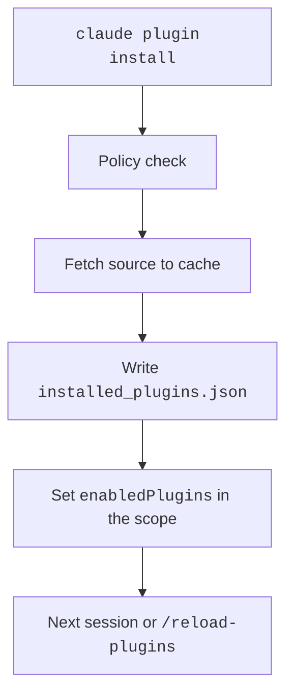

The `claude plugin` command installs, updates, checks, and removes plugins from the shell.
Inside a session, `/plugin` opens a panel and `/reload-plugins` applies changes.
`claude plugins` is an alias of `claude plugin`.
For example, `claude plugin list --json` prints your installs as JSON.

Turn a plugin on or off with `claude plugin enable` and `disable`. Managed `disableSideloadFlags` turns off the session flags. State is in `~/.claude/plugins/` and in `enabledPlugins`.

## Subcommands

`-s` is `--scope`. Scopes are `user`, `project`, and `local`.
The hidden flag `--cowork` works on `install`, `uninstall`, `enable`, `disable`, `update`, `list`, `details`, `configure`, `prune`, `validate`, and `marketplace add`, `list`, `remove`, and `update`. It makes the command use the `cowork_plugins` directory (the program).
Source: [Plugin Commands Reference](https://code.claude.com/docs/en/plugins/cli-reference) and `claude plugin --help`.

| Command | Status | What It Does | Flags and Notes |
| --- | --- | --- | --- |
| `init <name>` (alias `new`) | <Documented /> | Scaffolds `~/.claude/skills/<name>/`. It loads next session as `<name>@skills-dir`. | `--description`, `--author`, `--author-email`, `-f/--force`, `--with` (any of `skills`, `agents`, `hooks`, `mcp`, `lsp`, `output-style`, `channel`) |
| `install <plugin>` (alias `i`) | <Documented /> | Installs a plugin from a marketplace. | `-s/--scope` (default `user`), `--config key=value`, `-y/--yes`, `--accept-command <sha256>`, `--json`, `--marketplace <source>`. The hidden `--replace` switches a plugin installed from another marketplace to this copy. It installs the copy. It moves your plugin settings to the copy. It uninstalls the other plugin. |
| `install --registry <url>` | <Documented /> | Sets the npm registry for `<package>@npm` installs. | Shown in `--help`, but not in the docs table. |
| `uninstall <plugin>` (aliases `remove`, `rm`) | <Documented /> <Caution note="On the last scope it removes options, secrets, and data" /> | Removes the plugin from one scope. | `-s`, `--keep-data`, `--prune`, `-y`, `--json`. On the last scope it removes options, secrets, and data. |
| `enable <plugin>` | <Documented /> | Enables a plugin. | `-s` (auto-detects local, project, then user), `--json` |
| `disable [plugin]` | <Documented /> | Disables a plugin. | `-a/--all`, `-s`, `--json`. Fails if another plugin depends on it. |
| `update <plugin>` | <Documented /> | Updates a plugin. | `-s`, `-y`, `--accept-command`, `--json`. A restart or `/reload-plugins` applies it. |
| `list` | <Documented /> | Lists installs. | `--json`, `--available`, `--data-size [plugin]` |
| `details <name>` | <Documented /> | Shows the component list and projected token cost. | No flags. |
| `configure <plugin>` | <Documented /> | Shows or saves the `userConfig` values. | `--values-stdin`, `--json`. Needs the full plugin id. |
| `prune` (alias `autoremove`) | <Documented /> | Removes automatic dependencies that nothing uses. | `-s`, `--dry-run`, `-y` |
| `validate <path>` | <Documented /> | Checks a plugin, marketplace, or component folder. | `--strict`, `--json`, and since `2.1.305` `--profile <name>`. Also `/plugin validate`. With `--profile directory` the command also exits 1 when the plugin directory (the catalog that plugins are submitted to) would refuse the plugin on a check it runs, or when a check could not be made. `--strict` then treats the directory's warnings as errors. Errors (exit 1) include `README_MISSING` and `README_TRIVIAL` (a README under 40 words), `LICENSE_MISSING` (no `LICENSE` file and no `license` in `plugin.json`), `PATH_TRAVERSAL` (a path that climbs out of the plugin), an MCP or hooks file that is unreadable or invalid, and manifest problems such as an invalid `plugin.json` or a badly formed name. A `hooks/hooks.json` must be a regular file under a size cap. Warnings (they fail only with `--strict`) include `ICON_MISSING` and `ICON_INVALID` (the local check reads only the file type; the fix text says the directory wants a square PNG or JPEG, 512 to 2048 px on each side, under 2 MB, and no SVG or WebP), `PRIVACY_URL_MISSING` (checked only when the plugin connects to a remote MCP server or HTTP hook; set `privacyPolicyUrl` in `plugin.json`), and `ARCHIVE_OS_METADATA_FILE` (a system file such as `.DS_Store`), plus others such as a README that does not render or a name that is not kebab-case. "A check could not be made" includes `plugin.json` listing more than 16 files for MCP servers or for hooks (16 of each are checked) and an MCP or hooks file the checks cannot use, such as one that is not valid JSON. The directory runs more checks than the command does. It needs a plugin folder, not a project's `.claude` folder (the program). |
| `tag [path]` | <Documented /> | Creates the git tag `<name>--v<version>`. | `--push`, `--dry-run`, `-f/--force`, `-m/--message <msg>`, `--remote`. Also `/plugin tag`. |
| `test [dir]` | <Documented /> | Runs the tests of a mod. | Runs every `*.test.ts` and `*.test.tsx` file. |
| `eval [target]` | <Documented /> | Runs eval cases against a plugin. Needs `2.1.269` or later. | Flags: `--case <glob>`, `--tag <tag...>`, `--eval-dir <dir>`, `--model <model>`, `--judge-model <model>` (default `haiku`), `--runs <n>` (default `case.runs ?? 3`), `-j/--concurrency <n>` (1 to 8, default 1), `--threshold <0..1>` (exit 1 when a case scores below it, default `1.0`), `--max-cost-usd <usd>` (no help text), `--ablation <none\|with-without>` (runs a no-plugin baseline arm and reports the score delta), `--allow-tools <tools...>` and `--disallow-tools <tools...>`, `--mocks <record\|off>` (mock stand-ins for MCP servers, from the `mocks/` folder of the eval dir; default `record`) with `--allow-real-servers`, `--scaffold` and `--no-scaffold` (`--scaffold` runs the `scaffold_script` of each case as you, and it is off by default), `--keep-temp`, `--output-dir <dir>`, `--json [path]`, `--report <path>`, `--publish-report` and `--no-publish` (the HTML report goes to claude.ai by default when your account supports it), `--verbose`. Also `--trust-plugin` for CI. |
| `eval init [name]` | <Documented /> | Creates an eval suite. | `--bare`, `-i/--interactive` (the hidden `--interview` is an alias), `--eval-dir` |

:::warning
`claude plugin eval` loads and runs the plugin on your machine, as you.
Run it only for plugins you trust. The sandbox limits a bad plugin. It does not guarantee safety.
:::

## Marketplace Subcommands

| Command | Status | What It Does | Flags and Notes |
| --- | --- | --- | --- |
| `marketplace add <source>` | <Documented /> | Adds a marketplace. | `--scope`, `--sparse <paths...>`, `--claudeai`, `--json`. The hidden `--from-link` adds the marketplace as an install link does. `--resolve-only` (with `--from-link`) adds nothing. It prints one JSON line. The line names the added marketplace that `--from-link` would reuse. The source is `owner/repo[#ref\|@ref]`, a git URL, an https URL, or a path. |
| `marketplace list` | <Documented /> | Lists marketplaces. | `--json` |
| `marketplace remove <name>` (alias `rm`) | <Documented /> | Removes the declaration. | `--scope`, `--json`. On the last scope, it removes the cache. It also uninstalls the plugins from that marketplace. |
| `marketplace update [name]` | <Documented /> | Refreshes marketplaces. | `--json` needs a name. |

## Session Commands

| Command | Status | What It Does | Notes |
| --- | --- | --- | --- |
| `/plugin` (aliases `/plugins`, `/marketplace`) | <Documented /> | Opens the panel with the tabs Discover, Installed, Marketplaces, Stats, and Errors. | Subcommands: `help`, `list [--enabled\|--disabled]`, `install`, `manage`, `stats`, `enable`, `disable`, `uninstall`, `configure`, `validate`, `tag`, `marketplace add\|list\|update\|remove`. Interactive sessions only. |
| `/reload-plugins [--force]` | <Documented /> | Applies pending plugin changes without a restart. | Refuses a change to MCP tools that would break the prompt cache, unless you add `--force`. Works in both modes. |

## Session Flags

| Flag | Status | What It Does | Notes |
| --- | --- | --- | --- |
| `--plugin-dir <path>` | <Documented /> | Loads a folder or `.zip` for this session only. | The id is `<name>@inline`. A folder of plugins loads each child. Repeatable. The env var `CLAUDE_CODE_PLUGIN_DIRS` does the same. |
| `--plugin-url <url>` | <Documented /> | Loads a `.zip` from a URL for this session only. | Repeatable. |
| `--plugin-dir-no-mcp <path>` | <Undocumented /> | Loads an inline plugin without its MCP servers. | Hidden flag. The SDK form is `skipMcpDiscovery`. |

Managed `disableSideloadFlags: true` rejects `--plugin-dir`, `--plugin-url`, `--agents`, and `--mcp-config`.

## Example

```bash title="Install, configure, and update a plugin"
claude plugin marketplace add example/team-tools
claude plugin install deploy-tools@team-tools --scope project --config REGION=eu-west-1
claude plugin details deploy-tools@team-tools
claude plugin disable deploy-tools@team-tools
claude plugin update deploy-tools@team-tools --yes
```

## How It Works



## Errors

Each row is a family of messages. The backticked text is the start that every message in the family shares.

| Start of Message | Status | What It Means | Cases |
| --- | --- | --- | --- |
| `mocks/`, `mocks:`, `mocks is not`, `ambiguous mock server`, `buildRunMockFiles` | <Undocumented /> | `claude plugin eval` refused a `mocks` folder or a mock file. | A folder or file is a symbolic link, is unreadable, or has more entries than the cap. A directory is not named after the server segment of the tool name. A responder file is not named after the tool. A name holds `__`, the tool-name separator. A responder needs `tools: [...]`. `expect:` or `error:` is in the wrong place. Two mocks claim the same server. |
| `case "${…}"`, `case ${…}:`, `case.yaml must be`, `YAML parse failed` | <Undocumented /> | `claude plugin eval` refused a case. | A `plugins` entry resolves outside the containment root or is not loaded. An `add_dirs` entry resolves outside the case directory. `case.yaml` is not a YAML object. `execution.env` has a key that is not an `EVAL_*` key. |
| `focus file` | <Undocumented /> | `claude plugin eval` could not read a focus file. | The file does not exist, is unreadable, or is not a regular file. It has more than one hard link, is over the size limit, or changed during the read. |
| `git metadata file` | <Undocumented /> | `claude plugin eval` refused a git metadata file. | The file is not a plain readable file, is not a regular file, or is larger than the byte limit. |
| `output base`, `output location`, `refusing to write`, `refusing to open through`, `refusing to use`, `append to ${…} made no progress`, `not a directory:`, `no variant directories`, `${…}/ has no result rows` | <Undocumented /> | A report or scaffold step refused to write or read a path. | The path is outside the allowed root or holds a `.` or `..` segment. It is a symbolic link or passes through one. It is not a regular file, has a second hard link, or is not a directory. |
| `Error: ${…} cannot be evaluated`, `Error: ${…} has a recorded install path`, `plugin eval:`, `claude plugin eval can't`, `git on this host did not`, `git ${…}.${…} is too old`, `judge call failed`, `No TTY available`, `results directory`, `${…} case file(s) failed`, `Interrupted — finishing up`, `Terminated — finishing up`, `Note: --scaffold`, `warning: eval result`, `warning: --json result`, `Publishing is unavailable`, `Skipped publishing`, `Publishing report to claude.ai`, `Published:` | <Undocumented /> | `claude plugin eval` could not run, or printed a notice. | The plugin cannot be evaluated where sessions load it. Git is missing or too old. The judge call failed. No TTY is available for the authoring interview. A results directory already existed. Case files failed to load. The run was interrupted. Publishing was unavailable or skipped. The result does not match the schema. |
| `the run created`, `the run made more`, `the run was granted artifact publishing`, `the run's artifact-publish`, `the case's scaffold`, `a corroborated artifact publish`, `the stub publish directory`, `the kept directory`, `the harness is running as root`, `directory modes do not`, `the directory modes`, `the sealed directory`, `home/ or tmp/`, `the operator's home`, `the home, Claude config`, `a cloud credential file`, `the Anthropic profile configs`, `a PATH directory could not`, `the organization policy snapshot`, `A shell tool was granted`, `${…} could not be examined after`, `${…} became a symlink`, `${…} already exists; refusing`, `${…} is a symlink`, `${…} is a directory, not a file`, `${…} could not be opened`, `${…} changed while being opened`, `${…} is not a regular file`, `${…} is hard-linked`, `${…} (this machine's managed settings`, `${…} directory name`, `${…} is on a network (UNC) path`, `${…} was not written by this run`, `${…} already exists and was not written`, `${…} no longer holds`, `${…} is no longer the directory`, `${…} vanished from`, `${…} is ${…} bytes (cap`, `${…} changed while being read`, `${…}/`, `${…} is not a directory`, `case ${…}`, `recording name`, `value nested too deep` | <Undocumented /> | `claude plugin eval` refused to run because a path, folder, or environment failed a safety check. | A file is a symbolic link, is hard-linked, is not a regular file, changed during the read, or is over its cap. A folder is not the one the harness created, has a glob character in its path, or is on a network (UNC) path. Folder modes did not take effect. The harness runs as root. A shell tool was granted, but the sandbox cannot exclude a home or credential path. The run created a name that is reserved for artifact publishes. The run was granted artifact publishing, but the child was not offered the stand-in tool. As a result, the local Artifacts server did not attach. |
| `${…}: frontmatter`, `${…}: unknown frontmatter key`, `${…}: invalid YAML frontmatter`, `${…}: unterminated frontmatter` | <Undocumented /> | A grader or responder file has bad frontmatter. | A key is not known. `type:` is missing (it is one of regex, tool_order, tool_used, file_exists, llm, baseline). The opening `---` has no closing one. The YAML is invalid. |
| `--config expects`, `--config key`, `--config ${…}`, `--config validation failed`, `--config was given`, `Aborted — the command was not run` | <Undocumented /> | `claude plugin install` refused `--config`. | The value is not `KEY=VALUE`. The plugin's `userConfig` does not declare the key, or more than one bundled MCP server declares it. A value is empty, not a number, or not a boolean (use true/false, 1/0, yes/no, on/off). The plugin failed to load after the install. |
| `This plugin has no ${…}`, `Plugin option` | <Undocumented /> | A plugin option has no value or a bad one. | A required value is missing. A value is over 64 KB. A value must be a single line. A value must be true or false. |

## Related Pages

- [Plugins](index.md)
- [Marketplaces](marketplace.md)
- [Plugin Loading](loading.md)
- [CLI Subcommands](../../configure/cli/subcommands.md) and [CLI Flags](../../configure/cli/flags.md) for the other commands
