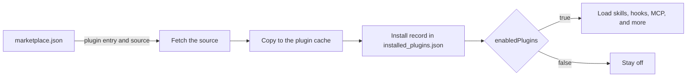

A plugin is a folder that adds skills, agents, hooks, or MCP servers to Claude Code.
A marketplace is a list of plugins that you can install.
For example, `claude plugin install my-plugin@my-marketplace` installs a plugin from a marketplace.
This page gives the big picture. The other pages list every key, command, and path.

## At a Glance

| Question | Answer |
| --- | --- |
| Can you use it? | Yes. Install with `claude plugin install` or the `/plugin` panel. |
| Can you change it? | Yes. Write your own plugin folder and an optional marketplace file. |
| Can you turn it on or off? | `claude plugin enable` and `disable`, or `enabledPlugins` in settings. Managed settings can lock the rules. |
| Where does it live? | `~/.claude/plugins/` for installs. `.claude-plugin/plugin.json` in the plugin folder. |
| Status | <Documented /> <Undocumented /> |

## What a Plugin Holds

A plugin can bundle these parts. Each part has a default folder or file name.

| Part | Status | Default Place | Page |
| --- | --- | --- | --- |
| Skills | <Documented /> | `skills/` | [Manifest](manifest.md#components-and-layout) |
| Commands | <Documented /> | `commands/` | [Manifest](manifest.md#components-and-layout) |
| Agents | <Documented /> | `agents/` | [Manifest](manifest.md#components-and-layout) |
| Hooks | <Documented /> | `hooks/hooks.json` | [Manifest](manifest.md#components-and-layout) |
| MCP servers | <Documented /> | `.mcp.json` | [Manifest](manifest.md#components-and-layout) |
| LSP servers | <Documented /> | `.lsp.json` | [Manifest](manifest.md#components-and-layout) |
| Monitors | <Documented /> | `monitors/monitors.json` | [Manifest](manifest.md#top-level-keys) |
| Output styles | <Documented /> | `output-styles/` | [Manifest](manifest.md#components-and-layout) |
| Workflows and themes | <Documented /> | `workflows/`, `themes/` | [Manifest](manifest.md#components-and-layout) |
| Executables | <Documented /> | `bin/` | [Manifest](manifest.md#components-and-layout) |
| Mods | <Documented /> | `types` key, TypeScript files | [Mod API](../mod-api/index.md) |

## Ids, Scopes, and Special Marketplaces

- A plugin id is `name@marketplace`. The text before `@` is the entry name in the marketplace file.
- The scopes are `user`, `project`, `local`, and `managed`. The enable state of each plugin lives in `enabledPlugins`.
- A plugin skill gets the name `/<plugin>:<skill>`, so two plugins cannot clash.
- Four marketplace names are special and you cannot reuse them.

| Marketplace | Status | Meaning |
| --- | --- | --- |
| `inline` | <Documented /> | Plugins loaded for one session with `--plugin-dir` or `--plugin-url`. Their ids end in `@inline`. |
| `builtin` | <Documented /> | Plugins that ship inside Claude Code. |
| `skills-dir` | <Documented /> | Plugins made by `claude plugin init` in `~/.claude/skills/`. They load on the next session. |
| `synced` | <Documented /> | Plugins synced from your claude.ai account. Turn off with `syncClaudeAiPlugins: false`. |

## Example

This flow creates a plugin, tests it for one session, and installs it from a marketplace.

```bash title="Build, test, and install"
# Create a plugin folder at ~/.claude/skills/my-plugin/
claude plugin init my-plugin --with skills hooks

# Check the files
claude plugin validate ~/.claude/skills/my-plugin

# Try a folder for one session only
claude --plugin-dir ./my-plugin

# Add a marketplace, then install from it
claude plugin marketplace add owner/repo
claude plugin install my-plugin@my-marketplace --scope project
```

## How It Works



Claude Code reads the marketplace, fetches the source of the plugin you pick, and copies it into a cache folder.
It writes an install record. At session start it loads every enabled plugin.
Paths and variables are in [Plugin Loading](loading.md).

## Pages in This Section

| Page | What It Covers |
| --- | --- |
| [Plugin Manifest](manifest.md) | Every `plugin.json` key, `userConfig`, and the folder layout |
| [Marketplaces](marketplace.md) | Every `marketplace.json` key, plugin sources, marketplace sources |
| [Plugin Commands](cli.md) | Every `claude plugin` subcommand, `/plugin`, and session flags |
| [Plugin Loading](loading.md) | Paths, cache, variables, env vars, and enabling |
| [Plugin Settings Keys](../../configure/settings/hooks-and-plugins.md) | Settings keys for plugins and marketplaces |
| [Plugin Env Vars](../../configure/env-vars/plugins-and-mcp.md) | Env vars for plugins and MCP |

## Sources

- [Create Plugins](https://code.claude.com/docs/en/plugins) is the official guide for authors.
- [Plugin Manifest Reference](https://code.claude.com/docs/en/plugins/manifest-reference) describes `plugin.json`.
- Program-only facts come from the program (the bundled manifest schema and the plugin loader).
