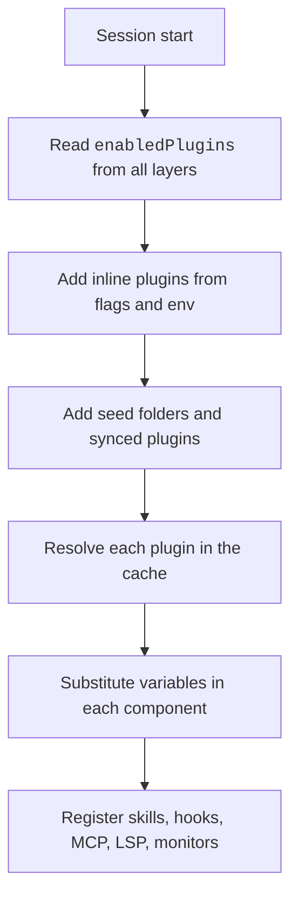

The loader finds plugins. It copies them into a cache. It enables their parts.
This page lists the paths, the variables a plugin can use, and the env vars and settings that change loading.
For example, `${CLAUDE_PLUGIN_ROOT}` in a hook command is the folder of the plugin.

Loading runs automatically at session start. Env vars and settings change the paths, timeouts, and rules. The switches are `enabledPlugins`, `CLAUDE_CODE_PLUGIN_DIRS`, and `syncClaudeAiPlugins`.

## Paths

Source: [Plugin Loading Reference](https://code.claude.com/docs/en/plugins/loading) and the program for the rows marked <Undocumented />.

| Path | Status | What It Is | How It Works |
| --- | --- | --- | --- |
| `~/.claude/plugins/` | <Documented /> | The plugins root. | `CLAUDE_CODE_PLUGIN_CACHE_DIR` sets this parent folder, not the cache itself. |
| `plugins/data/<id>/` | <Documented /> | The folder behind `${CLAUDE_PLUGIN_DATA}`. | First use makes it. It survives updates. In `<id>`, every character other than letters, digits, `_`, and `-` becomes `-`. The last uninstall removes it, unless you use `--keep-data`. |
| `plugins/cache/<marketplace>/<plugin>/<version>/` | <Undocumented /> | One copy of each installed version. | The program parses a cache path with these three parts this way. The program excludes a `.zip` version. |
| `.orphaned_at`, `.in_use`, `.gcs-sha`, `.links_materialized` | <Documented /> | State marker files in a version folder. | Claude Code writes `.orphaned_at` only inside the cache root, and not on a symlinked version. |
| `plugins/installed_plugins.json` | <Undocumented /> | Install records. | Fields: `version`, `installedAt`, `lastUpdated`, `installPath`, `gitCommitSha`, `resolvedVersion`, `auto` (set for a dependency install). |
| `plugins/known_marketplaces.json` | <Undocumented /> | Marketplace records. | Fields: `source`, `installLocation`, `lastUpdated`, `autoUpdate`. Clones live in `plugins/marketplaces/<name>`. |
| Registry files `installed`, `marketplaces`, `flagged`, `catalog`, `inUseSweep` | <Undocumented /> | Named files of the plugin registry. | The names come from a list in the program. |
| `~/.claude/plugins/synced` | <Documented /> | Plugins synced from claude.ai. | The id is `<name>@synced`. Set `syncClaudeAiPlugins: false` to turn it off. |

## Variables

Source: [Plugin Manifest Reference](https://code.claude.com/docs/en/plugins/manifest-reference) and [Plugin Loading Reference](https://code.claude.com/docs/en/plugins/loading).

| Variable | Status | What It Is | Where You Can Use It |
| --- | --- | --- | --- |
| `${CLAUDE_PLUGIN_ROOT}` | <Documented /> | The installed plugin folder. It changes on update. Do not write state there. | Hook `command` and `args`, monitor `command`, MCP stdio `command`, `args`, `env`, MCP remote `url`, `headers`, `headersHelper`, LSP fields, skill and agent text |
| `${CLAUDE_PLUGIN_DATA}` | <Documented /> | The data folder. Claude Code exports it to hooks, MCP stdio servers, and LSP servers. | The same places |
| `${CLAUDE_PROJECT_DIR}` | <Documented /> | The project root. Claude Code exports it to hooks and LSP servers. | The same places |
| `${user_config.KEY}` | <Documented /> | A saved `userConfig` value. | MCP, LSP, exec-form hook `args`, skill and agent text. Not in shell-form hooks, monitor commands, or `headersHelper`. |
| `CLAUDE_PLUGIN_OPTION_<KEY>` | <Documented /> | The same value as an env var, with the key in upper case. | Hooks |

These variables are not in the env of commands the Bash tool runs for Claude.
As of `2.1.309`, that includes a program in a plugin's `bin/` folder, which the Bash tool finds on its `PATH` (probe `print.plugindata.bash-bin`).
In a skill, write the reference as Markdown text instead.

Claude Code saves non-sensitive values in `pluginConfigs` of user settings.
Sensitive values go to the credential store.

## Env Vars

Source: [Environment Variables](https://code.claude.com/docs/en/env-vars) and the program. See also [Plugin and MCP Env Vars](../../configure/env-vars/plugins-and-mcp.md).

| Env Var | Status | What It Does | How It Works |
| --- | --- | --- | --- |
| `CLAUDE_CODE_PLUGIN_DIRS` | <Documented /> | Gives plugin folders for the session. | Like `--plugin-dir`. Separate paths with a colon on Unix and a semicolon on Windows. |
| `CLAUDE_CODE_PLUGIN_GIT_TIMEOUT_MS` | <Documented /> | Sets the git timeout. | Default 120000. |
| `CLAUDE_CODE_PLUGIN_KEEP_MARKETPLACE_ON_FAILURE` | <Documented /> | Keeps the old checkout when a refresh fails. | Set to `1`. |
| `CLAUDE_CODE_PLUGIN_PREFER_HTTPS` | <Documented /> | Clones GitHub shorthand over HTTPS. | Set to `1`. |
| `CLAUDE_CODE_PLUGIN_SEED_DIR` | <Documented /> | Gives read-only seed folders. | Registers marketplaces at start. Uses the plugins already cached there. |
| `CLAUDE_CODE_PLUGIN_DIR_WATCH` | <Documented /> | Reloads a mod when its file changes. | On by default in interactive sessions and off in non-interactive ones. `0` turns it off everywhere. |
| `FORCE_AUTOUPDATE_PLUGINS` | <Documented /> | Updates plugins even when `DISABLE_AUTOUPDATER` is set. | Set to `1`. |
| `CLAUDE_CODE_SYNC_PLUGINS`, `CLAUDE_CODE_SYNC_PLUGIN_INSTALL` and their `_TIMEOUT_MS` forms | <Documented /> | Sync claude.ai plugins in headless runs. | The exact effects are not documented. In print mode, `CLAUDE_CODE_SYNC_PLUGIN_INSTALL` makes the stream carry [`plugin_install`](../headless/stream-json.md) messages. |
| `CLAUDE_CODE_PLUGIN_USE_ZIP_CACHE`, `CLAUDE_CODE_PLUGIN_BINARY_ASSETS`, `CLAUDE_CODE_PLUGIN_ATTRIBUTION`, `CLAUDE_CODE_PLUGIN_ARCHIVE_URL`, `CLAUDE_CODE_PLUGIN_NAME` | <Undocumented /> | Plugin env names found in the program. | Only the names are known. A message in the program mentions "zip cache mode". |
| `CLAUDE_CODE_SKIP_PLUGIN_MCP_SERVERS`, `CLAUDE_CODE_SKIP_PLUGIN_MCP_SERVERS_EXCEPT`, `CLAUDE_CODE_SKIP_PLUGIN_LOCAL_MCP_SERVERS`, `CLAUDE_CODE_SKIP_PLUGIN_MCP_BUNDLES` | <Undocumented /> | Skip plugin MCP servers, exempt some, skip local servers, or skip MCPB bundles. | See [MCP Env Vars](../mcp/env.md#undocumented-variables). |

## Settings Keys

The rows for these keys, with types, scopes, and details, are on [Hooks, Plugins, and Skills Settings](../../configure/settings/hooks-and-plugins.md#keys).

- Turn plugins on or off and store their saved options: [`enabledPlugins`](../../configure/settings/hooks-and-plugins.md#keys) and [`pluginConfigs`](../../configure/settings/hooks-and-plugins.md#keys).
- Lock down customization (managed): [`strictPluginOnlyCustomization`](../../configure/settings/hooks-and-plugins.md#keys), [`disableSideloadFlags`](../../configure/settings/hooks-and-plugins.md#keys), and [`prependPlugins`](../../configure/settings/hooks-and-plugins.md#keys) with [`appendPlugins`](../../configure/settings/hooks-and-plugins.md#keys).
- Channel plugins and trust text (managed): [`allowedChannelPlugins`](../../configure/settings/mcp-and-channels.md#keys) and [`pluginTrustMessage`](../../configure/settings/hooks-and-plugins.md#keys).

Marketplace keys are on the [Marketplaces](marketplace.md#settings-keys) page.

## Example

Seed a locked-down machine so that users need no network for a plugin.

```bash title="Seed folder and a one-session plugin"
export CLAUDE_CODE_PLUGIN_SEED_DIR=/opt/claude/plugin-seed
export CLAUDE_CODE_PLUGIN_GIT_TIMEOUT_MS=60000
claude --plugin-dir ./my-plugin
```

```json title=".claude/settings.local.json"
{ "enabledPlugins": { "deploy-tools@team-tools": false } }
```

## How It Works



## Errors

Each row is a family of messages. The backticked text is the start that every message in the family shares.

| Start of Message | Status | What It Means | Cases |
| --- | --- | --- | --- |
| `Hooks file`, `hooks.json declares`, `hooks: must be`, `hooks: the array form`, `Server ${…} missing required`, `Unsupported plugin type`, `Invalid manifest`, `Invalid JSON in manifest.json`, `Failed to save sensitive config`, `Plugin ${…}:` | <Undocumented /> | The loader could not load a plugin file. | A hooks file cannot be read or is missing. `hooks.json` declares keys outside the `hooks` object. The manifest is not valid. An LSP server entry lacks `command` or `extensionToLanguage`. |
| `claude plugin install`, `${…} This install runs that command`, `${…}'s marketplace changed`, `${…}'s marketplace entry`, `${…} is installed by running a command`, `A top-level entry of the plugin directory`, `The link farm`, `A link in the staged farm`, `The link-farm marker`, `A tool server doesn't run`, `${…}: a tool server doesn't run`, `${…}: your organization's managed settings disable marketplace-declared` | <Undocumented /> | A plugin install that runs a command did not run. | The command has not been reviewed yet. The marketplace changed the command after it was accepted. A tool server never runs it. Managed settings disable marketplace-declared commands (`disableCommandPluginSources`). The plugin directory that the command produced points to a network location or through a link. |

## Related Pages

- [Plugins](index.md)
- [Plugin Manifest](manifest.md)
- [Plugin Commands](cli.md)
- [Hooks, Plugins, and Skills Settings](../../configure/settings/hooks-and-plugins.md)
