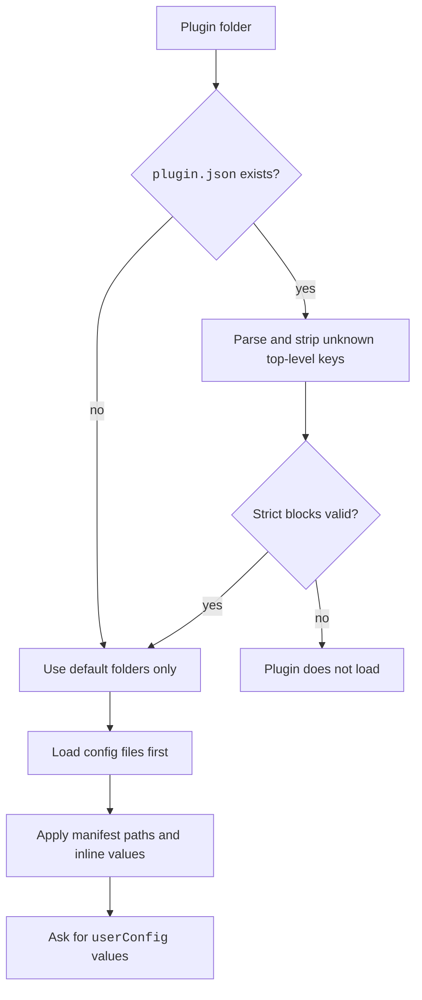

The manifest is the file `.claude-plugin/plugin.json` inside a plugin.
It names the plugin and can point to its parts.
The file is optional, and only `name` is required.
For example, `{ "name": "my-plugin", "version": "1.0.0" }` is a valid manifest.

You write it by hand or start from `claude plugin init`. Run `claude plugin validate` after you edit it. `enabledPlugins` turns the plugin as a whole on or off. A manifest can set `defaultEnabled` for users who set nothing.

## Rules

- An unknown top-level key is stripped. `claude plugin validate` warns about it.
- An unknown key inside `userConfig`, `channels`, `lspServers`, or `monitors` is an error. The plugin does not load.
- A component path starts with `./`, stays inside the plugin folder, and must exist.

Source: [Plugin Manifest Reference](https://code.claude.com/docs/en/plugins/manifest-reference) and the program (the bundled manifest schema).
A marketplace entry can repeat many of these keys. See [Marketplaces](marketplace.md#plugin-entry-keys).

## Top-Level Keys

The last column says where the key may appear: the manifest, a marketplace entry, or both.

| Key | Status | What It Does | How It Works | Where |
| --- | --- | --- | --- | --- |
| `$schema` | <Documented /> | Gives an editor schema URL. | Ignored when the plugin loads. | Manifest |
| `name` | <Documented /> | Sets the plugin id and namespace. | Not empty, no spaces, no control or bidirectional characters. Reserved: names that start with `claude-`, `anthropic-`, `anthropics-`, or `cc-plugin-`, and the names `claude`, `anthropic`, `claude-code`, `claude-mods`. | Both |
| `displayName` | <Documented /> | Sets the name shown in the UI. | The entry value wins. | Both |
| `version` | <Documented /> | Sets the version text. | Must be a string (a number is an error). Any text works, because it is not checked as semver. The validator only warns when it is missing or empty. Users stay on this version until you change it. The manifest value wins over the entry, and `claude plugin validate` warns when they differ. | Both |
| `description`, `homepage`, `repository`, `license`, `keywords` | <Documented /> | Listing data. | `homepage` must be a URL. | Both |
| `author` | <Documented /> | Names the maker. | An object: `name` (required), `email`, `url`. | Both |
| `metadata` | <Documented /> | A free map for your own data. | A value that is not an object is dropped. | Both |
| `icon`, `documentationUrl`, `supportUrl`, `privacyPolicyUrl`, `termsOfServiceUrl` | <Documented /> | Directory listing data. | The program also ignores these names without error: `screenshots`, `classification`, `privacy_policy`, `privacyPolicy`, `support`, `bugs`, `terms_of_service`, `docs`. | Manifest only |
| `defaultEnabled` | <Documented /> | Sets the start state when the user chose nothing. | Default `true`. The entry value wins. `enabledPlugins` always wins. | Both |
| `dependencies` | <Documented /> | Lists plugins that must be enabled too. | Each item is `"name"`, `"name@marketplace"`, or an object. The program also accepts a trailing `@^range` and strips it. | Both |
| `settings` | <Documented /> | Applies settings while the plugin is enabled. | Only `agent` and `subagentStatusLine` take effect. A `settings.json` in the plugin root wins. | Manifest |
| `userConfig` | <Documented /> | Asks the user for values when the plugin is enabled. | See [`userConfig` Option Keys](#userconfig-option-keys). | Manifest |
| `channels` | <Documented /> | Declares message channels. | Items have `server`, `displayName`, and `userConfig`. Strict. | Manifest |
| `types` | <Documented /> | Points to a `.d.ts` file for a mod. | Must end in `.d.ts` and may not contain `..`. | Manifest |
| `skills` | <Documented /> | Adds skill folders. | Adds to `skills/`. The value `"."` means the plugin root. | Manifest |
| `commands` | <Documented /> | Lists command files or a map. | Replaces `commands/`. A map entry has `source` or `content` (exactly one), `description`, `argumentHint`, `model`, and `allowedTools`. | Manifest |
| `agents` | <Documented /> | Lists agent `.md` files. | Replaces `agents/`. Folders are not allowed. | Manifest |
| `hooks` | <Documented /> | Gives hook files or inline hooks. | Merges with `hooks/hooks.json`. A file needs the `"hooks"` wrapper. | Manifest |
| `mcpServers` | <Documented /> | Gives MCP server config. | A path, a `.mcpb` or `.dxt` bundle path or URL, an inline map, or an array. A later name replaces an earlier one. | Manifest |
| `lspServers` | <Documented /> | Gives language server config. | Fields: `command`, `extensionToLanguage`, `args`, `transport`, `env`, `initializationOptions`, `settings`, `workspaceFolder`, `startupTimeout`, `shutdownTimeout`, `requestTimeout`, `restartOnCrash`, `maxRestarts`, `diagnostics`. | Manifest |
| `outputStyles` | <Documented /> | Lists style files or folders. | Replaces `output-styles/`. | Manifest |
| `workflows` | <Documented /> | Lists workflow `.js` files or folders. | Replaces `workflows/`. | Manifest |
| `experimental.themes` | <Documented /> <Experimental /> | Lists theme files or folders. | Replaces `themes/`. A top-level `themes` key still loads and gives a warning. | Manifest |
| `experimental.monitors` | <Documented /> <Experimental /> | Declares background watchers. | Items: `name`, `command`, `description`, `when` (`always` or `on-skill-invoke:<skill>`). Interactive sessions only. | Manifest |
| `experimental.evals` | <Documented /> <Experimental /> | Names the eval folder. | Default `evals/`. Used by `claude plugin eval`. | Manifest |
| `experimental.syntaxHighlighting.hljsLanguages` | <Undocumented /> <Experimental /> | Adds highlight.js languages. | Up to 16 items. `id` matches `^[a-z][a-z0-9_-]*$` (64 characters at most). `remote` is `npm:<pkg>[@ver]` or `github:<owner>/<repo>@<ref>#<path>.js`. `integrity` is an SRI hash with `sha256-`, `sha384-`, or `sha512-`. Strict. | Manifest |
| `binaries` | <Undocumented /> | Lists files fetched into `bin/` at install. | A map of base name to `{ "sha256": <64 hex> }`. At most 64 entries. Names match `^[a-z0-9](?:[a-z0-9._-]*[a-z0-9_-])?$`. The env var `CLAUDE_CODE_PLUGIN_BINARY_ASSETS` also exists. | Manifest |

## `userConfig` Option Keys

Each key under `userConfig` is the name of one option. The name must match `^[A-Za-z_]\w*$`.
Claude Code passes the value to hooks as the env var `CLAUDE_PLUGIN_OPTION_<KEY>`.
The same option shape works inside `channels`.

| Option | Status | What It Does | How It Works |
| --- | --- | --- | --- |
| `type` | <Documented /> | Sets the value type. | `string`, `number`, `boolean`, `directory`, or `file`. |
| `title`, `description` | <Documented /> | Label and help text in the dialog. | Both are required. |
| `required`, `default` | <Documented /> | Say whether an empty value is allowed, and what the start value is. | A default is a string, number, boolean, or array of strings. |
| `multiple`, `sensitive` | <Documented /> | Allow a list, or mark a secret. | A `sensitive` value goes to secure storage, not to settings. |
| `min`, `max` | <Documented /> | Bound a number. | `number` type only. |
| `options` | <Documented /> | Gives fixed choices. | `string` type only, not `multiple`, not `sensitive`. Each choice is 1 to 64 characters. Needs Claude Code `2.1.271` or later. |

## Components and Layout

<FileTree>

- `my-plugin/`
  - `.claude-plugin/`
    - `plugin.json`
  - `skills/` one folder per skill, each with `SKILL.md`
  - `commands/` command files
  - `agents/` agent `.md` files
  - `hooks/`
    - `hooks.json` hooks, inside a `hooks` wrapper
  - `output-styles/`
  - `workflows/`
  - `themes/`
  - `bin/` programs added to the Bash tool `PATH`
  - `.mcp.json` MCP servers
  - `.lsp.json` language servers
  - `monitors/`
    - `monitors.json`
  - `settings.json` plugin settings

</FileTree>

| Item | Status | What It Does | How It Works |
| --- | --- | --- | --- |
| `skills/`, `commands/`, `agents/`, `output-styles/`, `workflows/`, `themes/` | <Documented /> | Default places for components. | A manifest key adds to or replaces the folder, as the table above says. |
| `hooks/hooks.json` | <Documented /> | Holds the plugin hooks. | Keys: `hooks`, and also `modules` (one path to a hooks module) and `description`. The old `surface` key is gone. |
| `.mcp.json`, `.lsp.json`, `monitors/monitors.json`, `settings.json` | <Documented /> | Config files at fixed places. | Claude Code loads these before it reads manifest entries. |
| `bin/` | <Documented /> | Puts programs on the `PATH` of the Bash tool. | claude.ai and Cowork do not install a plugin that has a `bin/` folder. |
| Root `SKILL.md` | <Documented /> | Makes a single-skill plugin. | Used only when there is no `skills/` folder and no `skills` key. |
| Root `CLAUDE.md` | <Documented /> | Not loaded. | `claude plugin validate` warns about it. |

## Example

```json title=".claude-plugin/plugin.json"
{
  "name": "deploy-tools",
  "displayName": "Deploy Tools",
  "version": "1.2.0",
  "description": "Skills and a hook for our deploy flow.",
  "author": { "name": "Platform Team", "email": "platform@example.com" },
  "defaultEnabled": true,
  "userConfig": {
    "REGION": {
      "type": "string",
      "title": "Region",
      "description": "Region to deploy to.",
      "options": ["eu-west-1", "us-east-1"],
      "default": "eu-west-1"
    },
    "API_TOKEN": {
      "type": "string",
      "title": "API Token",
      "description": "Token for the deploy API.",
      "sensitive": true
    }
  },
  "hooks": "./hooks/hooks.json",
  "mcpServers": "./.mcp.json"
}
```

Hooks of this plugin see `CLAUDE_PLUGIN_OPTION_REGION` and `CLAUDE_PLUGIN_OPTION_API_TOKEN` in their env.

## How It Works



## Related Pages

- [Plugins](index.md) for the overview.
- [Marketplaces](marketplace.md) for `marketplace.json` and plugin sources.
- [Plugin Loading](loading.md) for variables such as `${CLAUDE_PLUGIN_ROOT}`.
- [Hooks, Plugins, and Skills Settings](../../configure/settings/hooks-and-plugins.md) for `pluginConfigs` and `enabledPlugins`.
