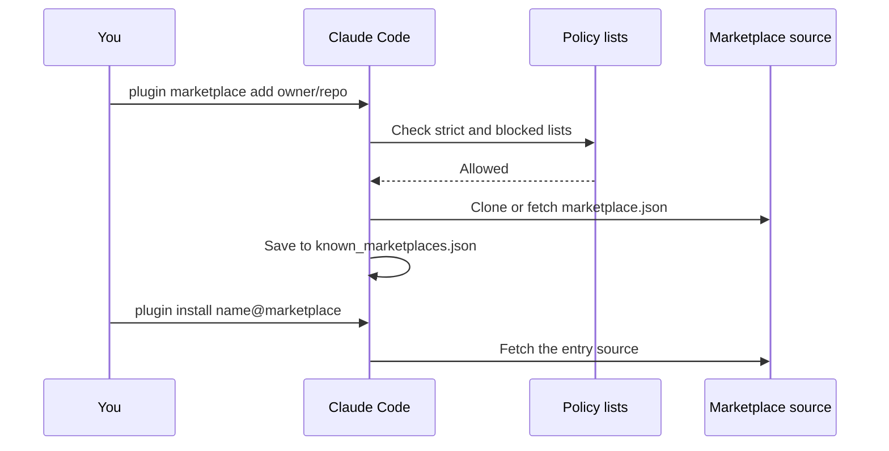

A marketplace is a `marketplace.json` file that lists plugins and where to get them.
A team can host one so that each member installs the same plugins.
For example, `claude plugin marketplace add owner/repo` adds a marketplace from a GitHub repo.

## At a Glance

| Question | Answer |
| --- | --- |
| Can you use it? | ✅ Yes. Add a marketplace, then install plugins from it. |
| Can you change it? | ✅ Yes. Write your own file and host it in git or on a web server. |
| Can you turn it on or off? | Add or remove it with `claude plugin marketplace add` and `remove`. Administrators can allow or block sources with settings. |
| Where does it live? | `.claude-plugin/marketplace.json` in the marketplace. Clones live in `~/.claude/plugins/marketplaces/<name>`. |
| Status | <Documented /> <Undocumented /> |

## Top-Level Keys

File: `.claude-plugin/marketplace.json`. An unknown key is ignored, and `validate` warns about it.
Source: [Marketplace Reference](https://code.claude.com/docs/en/plugins/marketplace-reference) and [Host and Maintain a Marketplace](https://code.claude.com/docs/en/plugins/host-marketplace).

| Key | Status | What It Does | How It Works |
| --- | --- | --- | --- |
| `name` | <Documented /> | Sets the marketplace id. | Letters, digits, `.`, `_`, `-`. Many names are reserved: official names, `inline`, `builtin`, `skills-dir`, `synced`, `npm`, `github`, the `claudeai-` prefix, and JavaScript member names. |
| `owner` | <Documented /> | Names the maintainer. | `name` is required. `email` and `url` are optional. |
| `plugins` | <Documented /> | Lists the plugin entries. | An invalid entry becomes a stub with source `unsupported`. The other entries still load. |
| `$schema`, `description`, `version` | <Documented /> | Info about the marketplace. | `metadata.description` and `metadata.version` work as alternates. |
| `metadata.pluginRoot` | <Documented /> | Sets the base folder for bare source names. | Needs Claude Code `2.1.239` or later. The folder must be inside the marketplace. |
| `forceRemoveDeletedPlugins` | <Documented /> | Uninstalls plugins that you removed from the list. | Boolean. |
| `allowCrossMarketplaceDependenciesOn` | <Documented /> | Names marketplaces that plugin dependencies may come from. | An array of marketplace names. |
| `renames` | <Documented /> | Maps an old plugin name to a new name or `null`. | An append-only map. |

## Plugin Entry Keys

An entry also accepts every [`plugin.json` key](manifest.md#top-level-keys) except the directory listing fields.

| Key | Status | What It Does | How It Works |
| --- | --- | --- | --- |
| `name`, `source` | <Documented /> | Give the id and the place to fetch from. Both are required. | The entry name is what users type before `@`. |
| `category`, `tags` | <Documented /> | Catalog data. | Free text. |
| `strict` | <Documented /> | Says who owns the manifest. | Default `true`. With `false` and a `plugin.json` present, component keys in the entry cause a `conflicting manifests` error. |
| `headers`, `headersHelper` | <Documented /> | Add headers to an archive download. | Needs `2.1.238` or later. `headersHelper` needs `strict: false`. Only for `archive` sources. |
| `defaultEnabled`, `displayName`, `dependencies`, `metadata` | <Documented /> | Work as in the manifest. | Entry values override the manifest for display and `defaultEnabled`. |
| `relevance` | <Documented /> | Says when to suggest the plugin. | `topic` (64 characters) and `signals`: `cli`, `hosts`, `filesRead`, `manifestDeps` (`file` and `pattern`), `cwd`. Each list has a limit of 10 or 20 items. Needs the setting `pluginSuggestionMarketplaces`. |
| 🧪 `experimental` | <Documented /> | Holds component declarations. | `validate` warns when it is not an object. |

## Plugin Sources

The `source` of an entry tells Claude Code where to fetch the plugin.

| Source | Status | Fields | How It Works |
| --- | --- | --- | --- |
| Relative path string | <Documented /> | A folder in the marketplace. | Starts with `./`, no `..`, no backslash. A bare name works only under `metadata.pluginRoot`. |
| `github` | <Documented /> | `repo`, `ref`, `sha` | `sha` is 40 lowercase hex characters. |
| `url` | <Documented /> | `url`, `ref`, `sha` | A git URL. |
| `git-subdir` | <Documented /> | `url`, `path`, `ref`, `sha` | Uses a sparse, partial clone. |
| `npm` | <Documented /> | `package`, `version`, `registry` | Install scripts never run. Git, file, and alias specs are refused. |
| `archive` | <Documented /> | `url`, `sha256` | An HTTPS zip file. Needs `2.1.224` or later. |
| `command` | <Documented /> | `command`, `timeout`, `mode` | The command prints one absolute path (500 characters at most). `timeout` is 1 to 600 seconds, default 60. `mode` is `copy` or `link`. A copy is limited to 256 MiB or 20,000 entries. `link` does not work on Windows. Off with `disableCommandPluginSources`. |
| `unsupported` | <Undocumented /> | None | A placeholder that the parser makes. An author cannot write it. |

## Marketplace Sources

These sources go in `extraKnownMarketplaces`, `strictKnownMarketplaces`, and `blockedMarketplaces`.

| Source | Status | Fields | How It Works |
| --- | --- | --- | --- |
| `github` | <Documented /> | `repo`, `ref`, `path`, `sparsePaths` | The form `owner/*` works only in policy lists. |
| `git` | <Documented /> | `url`, `ref`, `path`, `sparsePaths` | `skipLfs` is accepted and ignored. |
| `url` | <Documented /> | `url`, `headers`, `headersHelper` | Fetches only the JSON file, so plugin entries cannot use relative sources. |
| `file`, `directory` | <Documented /> | `path` | Read in place. |
| `settings` | <Documented /> | `name`, `plugins`, `owner` | An inline catalog in `extraKnownMarketplaces`. Entries need remote sources. |
| `npm` | <Documented /> | `package` | Policy lists parse it, but loading fails with "NPM marketplace sources not yet implemented". |
| `skills-dir`, `hostPattern`, `pathPattern` | <Documented /> | Policy-only values | `skills-dir` keeps skills-directory plugins loading under an allowlist. The patterns are regular expressions. |

## Settings Keys

Source: [Manage Claude Code Plugins for Your Organization](https://code.claude.com/docs/en/plugins/org) and [Settings Reference](https://code.claude.com/docs/en/settings-reference).
The full key list is on [Hooks, Plugins, and Skills Settings](../../configure/settings/hooks-and-plugins.md).

| Key | Status | What It Does | How It Works |
| --- | --- | --- | --- |
| `extraKnownMarketplaces` | <Documented /> | Declares marketplaces. | A map of name to `{ "source": ... }`. Project values apply after you trust the folder. |
| `additionalMarketplaces` | <Documented /> | Alias of `extraKnownMarketplaces`. | If both are set, Claude Code ignores the alias and warns. |
| `strictKnownMarketplaces` | <Documented /> | Allowlist of marketplace sources. | Checked before download. It does not register anything. Managed settings. |
| `allowedMarketplaces` | <Documented /> | Alias of `strictKnownMarketplaces`. | Managed only. |
| `blockedMarketplaces` | <Documented /> | Blocklist of marketplace sources. | Checked before download. Managed settings. |
| `pluginSuggestionMarketplaces` | <Documented /> | Lists marketplaces that may suggest plugins. | Without it, no marketplace suggestion shows. |
| `disableCommandPluginSources` | <Documented /> | Turns off `command` plugin sources. | Managed settings. |

## Example

```json title=".claude-plugin/marketplace.json"
{
  "name": "team-tools",
  "owner": { "name": "Platform Team", "email": "platform@example.com" },
  "metadata": { "pluginRoot": "./plugins" },
  "plugins": [
    { "name": "lint-helper", "source": "lint-helper" },
    {
      "name": "deploy-tools",
      "source": { "source": "github", "repo": "example/deploy-tools", "ref": "v1.2.0" },
      "category": "ops"
    }
  ]
}
```

```json title="Settings: let a project suggest this marketplace"
{
  "extraKnownMarketplaces": {
    "team-tools": { "source": { "source": "github", "repo": "example/team-tools" } }
  }
}
```

## How It Works



Policy lists are checked before any download.
If a marketplace fails to refresh, Claude Code keeps the old checkout only when `CLAUDE_CODE_PLUGIN_KEEP_MARKETPLACE_ON_FAILURE` is `1`.

## Related Pages

- [Plugins](index.md)
- [Plugin Manifest](manifest.md)
- [Plugin Commands](cli.md#marketplace-subcommands)
- [Plugin Loading](loading.md)
