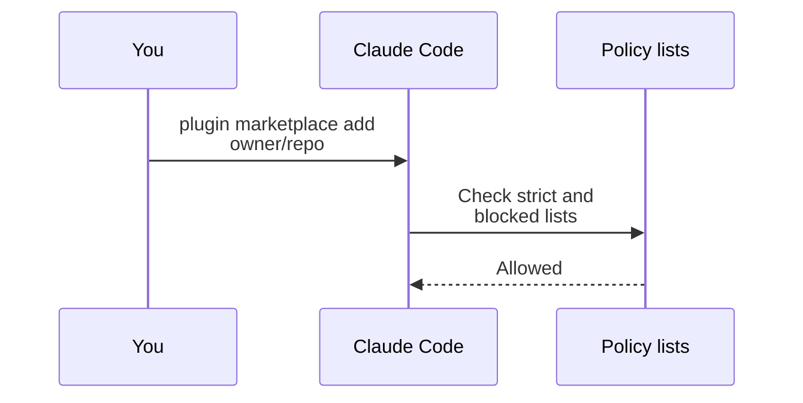
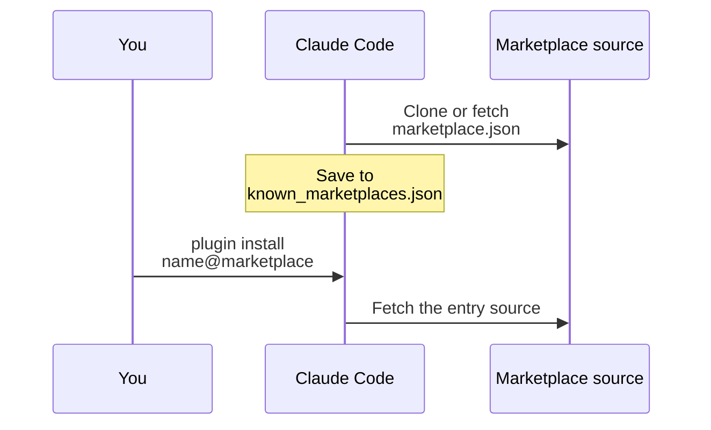

A marketplace is a `marketplace.json` file that lists plugins and where to get them.
A team can host one so that each member installs the same plugins.
For example, `claude plugin marketplace add owner/repo` adds a marketplace from a GitHub repo.

A marketplace is a `.claude-plugin/marketplace.json` file hosted in git or on a web server. Add or remove one with `claude plugin marketplace add` and `remove`. Clones live in `~/.claude/plugins/marketplaces/<name>`. Administrators can allow or block sources with settings.

## Top-Level Keys

File: `.claude-plugin/marketplace.json`. Claude Code ignores an unknown key. `validate` warns about it.
Source: [Marketplace Reference](https://code.claude.com/docs/en/plugins/marketplace-reference) and [Host and Maintain a Marketplace](https://code.claude.com/docs/en/plugins/host-marketplace).

| Key | Status | What It Does | How It Works |
| --- | --- | --- | --- |
| `name` | <Documented /> | Sets the marketplace id. | Letters, digits, `.`, `_`, `-`. Many names are reserved: official names, `inline`, `builtin`, `skills-dir`, `synced`, `npm`, `github`, the `claudeai-` prefix, and JavaScript member names. |
| `owner` | <Documented /> | Names the maintainer. | `name` is required. `email` and `url` are optional. |
| `plugins` | <Documented /> | Lists the plugin entries. | An invalid entry becomes a stub with source `unsupported`. The other entries still load. |
| `$schema`, `description`, `version` | <Documented /> | Info about the marketplace. | `metadata.description` and `metadata.version` work as alternates. |
| `metadata.pluginRoot` | <Documented /> | Sets the base folder for bare source names. | Needs Claude Code `2.1.239` or later. The folder must be inside the marketplace. |
| `forceRemoveDeletedPlugins` | <Documented /> | Uninstalls plugins that you removed from the list. | Boolean. |
| `allowCrossMarketplaceDependenciesOn` | <Documented /> | Names marketplaces that plugin dependencies may come from. | An array of marketplace names. |
| `renames` | <Documented /> | Maps an old plugin name to a new name or `null`. | An append-only map. |

## Plugin Entry Keys

An entry also accepts every [`plugin.json` key](manifest.md#top-level-keys) except the directory listing fields.

| Key | Status | What It Does | How It Works |
| --- | --- | --- | --- |
| `name`, `source` | <Documented /> | Give the id and the place to get the plugin from. Both are required. | The entry name is what users type before `@`. |
| `category`, `tags` | <Documented /> | Catalog data. | Free text. |
| `strict` | <Documented /> | Says who owns the manifest. | Default `true`. With `false` and a `plugin.json` present, component keys in the entry cause a `conflicting manifests` error. |
| `headers`, `headersHelper` | <Documented /> | Add headers to an archive download. | Needs `2.1.238` or later. `headersHelper` needs `strict: false`. Only for `archive` sources. |
| `defaultEnabled`, `displayName`, `dependencies`, `metadata` | <Documented /> | Work as in the manifest. | Entry values override the manifest for display and `defaultEnabled`. |
| `relevance` | <Documented /> | Says when to suggest the plugin. | `topic` (64 characters) and `signals`: `cli`, `hosts`, `filesRead`, `manifestDeps` (`file` and `pattern`), `cwd`. Each list has a limit of 10 or 20 items. Needs the setting `pluginSuggestionMarketplaces`. |
| `experimental` | <Documented /> <Experimental /> | Holds component declarations. | `validate` warns when it is not an object. |

## Plugin Sources

The `source` of an entry tells Claude Code where to get the plugin.

| Source | Status | Fields | How It Works |
| --- | --- | --- | --- |
| Relative path string | <Documented /> | A folder in the marketplace. | Starts with `./`, no `..`, no backslash. A bare name works only under `metadata.pluginRoot`. |
| `github` | <Documented /> | `repo`, `ref`, `sha` | `sha` is 40 lowercase hex characters. |
| `url` | <Documented /> | `url`, `ref`, `sha` | A git URL. |
| `git-subdir` | <Documented /> | `url`, `path`, `ref`, `sha` | Uses a sparse, partial clone. |
| `npm` | <Documented /> | `package`, `version`, `registry` | Install scripts never run. Claude Code refuses git, file, and alias specs. |
| `archive` | <Documented /> | `url`, `sha256` | An HTTPS zip file. Needs `2.1.224` or later. |
| `command` | <Documented /> | `command`, `timeout`, `mode` | The command prints one absolute path (500 characters at most). `timeout` is 1 to 600 seconds, default 60. `mode` is `copy` or `link`. A copy is limited to 256 MiB or 20,000 entries. `link` does not work on Windows. `disableCommandPluginSources` disables it. |
| `unsupported` | <Undocumented /> | None | A placeholder that the parser makes. An author cannot write it. |

## Marketplace Sources

These sources go in `extraKnownMarketplaces`, `strictKnownMarketplaces`, and `blockedMarketplaces`.

| Source | Status | Fields | How It Works |
| --- | --- | --- | --- |
| `github` | <Documented /> | `repo`, `ref`, `path`, `sparsePaths` | The form `owner/*` works only in policy lists. |
| `git` | <Documented /> | `url`, `ref`, `path`, `sparsePaths` | Claude Code accepts `skipLfs` and ignores it. |
| `url` | <Documented /> | `url`, `headers`, `headersHelper` | Gets only the JSON file, so plugin entries cannot use relative sources. |
| `file`, `directory` | <Documented /> | `path` | Read in place. |
| `settings` | <Documented /> | `name`, `plugins`, `owner` | An inline catalog in `extraKnownMarketplaces`. Entries need remote sources. |
| `npm` | <Documented /> | `package` | Policy lists parse it, but loading fails with "NPM marketplace sources not yet implemented". |
| `skills-dir`, `hostPattern`, `pathPattern` | <Documented /> | Policy-only values | `skills-dir` keeps skills-directory plugins loading under an allowlist. The patterns are regular expressions. |

## Plugin Digests

The `pluginDigests` field sits in an entry of `extraKnownMarketplaces` (and its alias `additionalMarketplaces`). The settings schema marks it as managed settings only. Source: the settings schema and the program (`chunk-h3fwwdey.js:134`, `chunk-2ht8z368.js:43946`, `2.1.311`).

| Field | Status | What It Does | How It Works |
| --- | --- | --- | --- |
| `pluginDigests` | <Documented /> <ManagedOnly /> | Lists, by plugin name, the digests of the releases of a plugin that your organization delivers with its own tier. | Type: object of arrays of strings. A plugin that is enabled and listed in `prependPlugins` or `appendPlugins` loads its hooks module only from a folder that proves one of its digests. The plugin then takes its place in that tier. Any other copy does not load. |

- A digest is `sha256-` and the base64 SHA-256 of the folder. The hash covers every regular file, in UTF-16 code unit order of its path. For each file, the hash takes `f PATH`, a NUL byte, the byte length, a NUL byte, and the bytes. Paths use `/`. At the root, the hash leaves out `.git`, `.in_use`, `.orphaned_at`, `.claude-plugin-link`, and `.links_materialized`.
- The plugin keeps its manifest at `.claude-plugin/plugin.json` and names one module in `hooks/hooks.json`.
- A string of any other form, or a list that is empty or of any other shape, matches no folder. A symbolic link, or a surface module, proves nothing.
- A proved plugin ships bundled with no install step. The digest covers the whole folder, `node_modules` included. A checkout whose line endings were converted proves nothing.
- Claude Code reads the folder with a limit of 4096 files and 32 MiB in all. One file may hold at most 32 MiB (`chunk-2ht8z368.js:43865`, `43890`, `43943`). A name that is not UTF-8, a file that is not regular, or a file that changed during the read refuses the folder.
- When a plugin is refused, Claude Code warns that the plugin "is not treated as the organization's, and does not load", with the reason (`chunk-2ht8z368.js:44009`).
- A line that the program builds for a `pluginDigests` key reads "code from your organization will run" (`chunk-z1xn9dp7.js:10388`). No source states where Claude Code displays it.

## Settings Keys

Source: [Manage Claude Code Plugins for Your Organization](https://code.claude.com/docs/en/plugins/org) and [Settings Reference](https://code.claude.com/docs/en/settings-reference).

The rows for these keys, with types, scopes, and details, are on [Hooks, Plugins, and Skills Settings](../../configure/settings/hooks-and-plugins.md#keys).

- Declare marketplaces: [`extraKnownMarketplaces`](../../configure/settings/hooks-and-plugins.md#keys) and its alias [`additionalMarketplaces`](../../configure/settings/hooks-and-plugins.md#keys).
- Allow or block sources (managed): [`strictKnownMarketplaces`](../../configure/settings/hooks-and-plugins.md#keys) and its alias [`allowedMarketplaces`](../../configure/settings/hooks-and-plugins.md#keys), and [`blockedMarketplaces`](../../configure/settings/hooks-and-plugins.md#keys).
- Suggest plugins: [`pluginSuggestionMarketplaces`](../../configure/settings/hooks-and-plugins.md#keys).
- Disable `command` plugin sources (managed): [`disableCommandPluginSources`](../../configure/settings/hooks-and-plugins.md#keys).

## Example

```json title=".claude-plugin/marketplace.json"
{
  "name": "team-tools",
  "owner": { "name": "Platform Team", "email": "platform@example.com" },
  "metadata": { "pluginRoot": "./plugins" },
  "plugins": [
    { "name": "lint-helper", "source": "lint-helper" },
    {
      "name": "deploy-tools",
      "source": {
        "source": "github",
        "repo": "example/deploy-tools",
        "ref": "v1.2.0"
      },
      "category": "ops"
    }
  ]
}
```

```json title="Settings: let a project suggest this marketplace"
{
  "extraKnownMarketplaces": {
    "team-tools": {
      "source": { "source": "github", "repo": "example/team-tools" }
    }
  }
}
```

## How It Works



Then Claude Code downloads the marketplace. It saves the marketplace. Later, `plugin install` gets the plugin from that marketplace.



Claude Code checks policy lists before any download.
If a marketplace fails to refresh, Claude Code keeps the old checkout only when `CLAUDE_CODE_PLUGIN_KEEP_MARKETPLACE_ON_FAILURE` is `1`.

## Errors

Each row is a family of messages. The backticked text is the start that every message in the family shares.

| Start of Message | Status | What It Means | Cases |
| --- | --- | --- | --- |
| `Plugin source command` | <Undocumented /> | A plugin source command did not give a plugin directory. | The command could not start, reached its timeout, was killed, or exited with an error code. It printed nothing, printed more than one line, printed too much, or printed a path that is not absolute. The path was a network location, the working directory or a parent of it, or a directory with no plugin content. |
| `Plugin archive` | <Undocumented /> | Claude Code did not install a plugin archive. | The archive held no plugin files or no plugin content at its root. It lacked the component paths its entry declares, or declared unsafe ones. The sha256 check failed. A redirect left the allowed URLs. The archive was too large. |
| `${…} changed while it was read`, `${…} is not UTF-8`, `${…} is over the size a folder may hold`, `a name under ${…} is not UTF-8`, `it holds more than ${…} bytes`, `it holds more than ${…} files`, `this platform cannot open a file without following it`, `a plugin was placed with no declaration` | <Undocumented /> | Claude Code could not read the folder of a plugin with `pluginDigests` to compute its digest, or could not place its tier. | A file changed during the read, is over 32 MiB, or is not UTF-8 where Claude Code reads its text. A name is not UTF-8. The folder holds more than 4096 files or more than 32 MiB. The platform cannot open a file without following links. The plugin has no declaration for its tier. See [Plugin Digests](#plugin-digests). |
| `Plugin directory` | <Undocumented /> | A plugin directory was not loaded or installed. | The directory does not exist, was removed or replaced while it loaded, has too many entries, or is too large. |
| `Marketplace` | <Undocumented /> | A marketplace was refused, not found, or not refreshed. | Enterprise policy blocks it. It was registered from an untrusted source. It has a corrupted `installLocation`, or has a name that is not a plain directory name. A seed-managed marketplace does not auto-update. A name that is not registered gets a list of the available marketplaces. |
| `The plugin archive` | <Undocumented /> | A plugin archive from claude.ai was not installed. | The archive has no plugin content at its root, carries a git repository layout, or is not a safe, well-formed zip. This claude.ai login has no plugin access yet. |
| `claude.ai marketplace`, `claude.ai marketplaces`, `claude.ai hosts`, `A marketplace named`, `That claude.ai marketplace`, `Sign in to claude.ai to add a marketplace`, `This plugin is listed on claude.ai`, `"${…}" is not a name a claude.ai-hosted`, `"${…}" is hosted on claude.ai` | <Undocumented /> | A marketplace that claude.ai hosts could not be added, listed, or used. | The registry is not a JSON object. The session cannot save it. The name is not allowed or is already added. The user is not signed in to claude.ai. Several marketplaces share the name. The organization policy blocks it. The plugin cannot be installed. |
| `Cannot add marketplace`, `Can't use the marketplace name`, `Cannot fetch this marketplace`, `Cannot fetch marketplace` | <Undocumented /> | A marketplace could not be added or downloaded. | The name is reserved (for claude.ai or the built-in marketplace) or Claude Code cannot install plugins from a marketplace with that name. The folder that the marketplace would use belongs to another registered marketplace. |
| `Failed to clean up`, `Could not connect to ${…}. Please check`, `Request timed out while downloading marketplace`, `HTTP ${…} error while downloading marketplace`, `Failed to download marketplace`, `Failed to write marketplace`, `Failed to finalize marketplace`, `Failed to save marketplace`, `Failed to read cached marketplace`, `Failed to load marketplace`, `Invalid marketplace config`, `Invalid response format from plugin catalog`, `NPM marketplace sources`, `Unsupported marketplace source type`, `Unhandled outcome of a read` | <Undocumented /> | A marketplace download, cache, or write step failed. | The server could not be reached. The request reached its timeout. The HTTP status was an error. A cache, staging, backup, catalog, or manifest write failed. The text adds the technical details. |
| `Auto-update`, `${…} is built in and not declared`, `${…} is blocked by your organization`, `The ${…} isn't available in this session`, `The list of installed plugins`, `${…} Nothing was deleted`, `${…}Could not turn off` | <Undocumented /> | A marketplace setting or removal could not be applied. | A settings source sets auto-update, and you cannot change that source here. A built-in marketplace is not declared in any settings scope (omit `--scope`). You turned on the built-in `Anthropic Directory` marketplace from `/plugin` or `claude plugin marketplace add`, and your organization blocks it (the message of your organization follows) or this session does not have it (the program). The installed plugins list could not be read. |
| `Plugin "${…}" was not installed`, `"${…}" was not installed`, `Cannot install ${…}`, `Cannot install plugins to managed scope`, `Plugin ${…} not found`, `Built-in plugin ${…} not found`, `Plugin "${…}" declares a headersHelper`, `Plugin "${…}" fetches its archive`, `This plugin's headersHelper`, `This plugin source uses mode`, `This plugin's marketplace entry`, `This plugin uses a source type`, `Plugin source directory not found`, `Plugin path is not a directory`, `Plugin tree at`, `Invalid scope` | <Undocumented /> | A plugin was not installed or loaded. | The marketplace listing names no repository or an address that is too long. The entry is invalid. The source type is not supported. The scope is invalid or managed. The plugin is not found in the marketplace. An option is not set. |
| `Could not ${…} ${…}`, `Could not install dependencies for`, `Could not publish`, `Could not archive`, `Could not prepare`, `Could not re-screen`, `Could not vouch`, `Could not link`, `Could not empty`, `Refusing to copy`, `Failed to list the staged`, `Failed to list plugin cache dir`, `Failed to copy plugin`, `The installed copy of this plugin version`, `Refusing to extract a plugin archive`, `Path traversal detected`, `the plugin cache folder` | <Undocumented /> | A plugin could not be placed in the plugin cache. | A link sits at the archive or cache path and could not be removed. Another session uses the entry. The staged tree was replaced before the step. A folder was swapped during the copy. A file became something other than a regular file during a plugin copy (`Refusing to copy ${…}: it is no longer a regular file (swapped during the copy).`). The storage layer refused the folder. The `/import` skill copy uses the same start for `Refusing to copy ${…}: it is no longer a regular file.` and can also stop with `a write made no progress; copy stopped`. Then the message adds that a partial copy may remain and that you can remove the folder and run the import again (the program). Most texts end with: retry the load or the install. |
| `Invalid sha`, `SHA pin verification failed`, `Invalid GitHub repository format`, `git-subdir plugin source`, `Invalid ref`, `Subdirectory`, `Source path does not exist`, `Invalid git URL`, `Invalid ssh git URL`, `Refusing git URL`, `Unsupported git URL protocol`, `Unsupported git source type`, `github-ssh source`, `${…} The retry over SSH failed too`, `git ${…} failed`, `git fetch failed`, `Could not read remote.origin.url`, `Could not correct remote.origin.url`, `Could not determine repository directory`, `Invalid target branch` | <Undocumented /> | A git source of a plugin or marketplace was refused or failed. | A pinned `sha` is not a full commit hash. The pin check failed. The repository or ref is not valid. A subdirectory is missing or passes through a symbolic link. The git URL is not allowed (control characters, `%00`, brackets, a backslash, a bad scheme). A git command failed. |
| `its ${…} is in an old format`, `its package.json`, `its bun.lock`, `its bun.lockb`, `its ${…}`, `it patches its dependencies`, `${…} is not a package in node_modules`, `${…} has`, `${…} is not a registry package`, `${…} is a folder link`, `${…} is not an object`, `${…} is not a package path`, `could not confirm where the plugin's folder is`, `the plugin's folder was moved`, `the package manager finished`, `a directory moved while`, `an entry that is no file`, `"${…}" was not fetched`, `latest pointer returned empty body` | <Undocumented /> | Claude Code did not get a plugin with an npm source, because its lockfile or package list failed a check. | The lockfile is in an old format or is not valid JSON. It lists different dependencies from `package.json`. It sets overrides or patches that the install does not apply. It names a package that is not a registry package at an exact version, or that has no integrity hash. The npm registry is not a valid address or is unencrypted. |

## Related Pages

- [Plugins](index.md)
- [Plugin Manifest](manifest.md)
- [Plugin Commands](cli.md#marketplace-subcommands)
- [Plugin Loading](loading.md)
