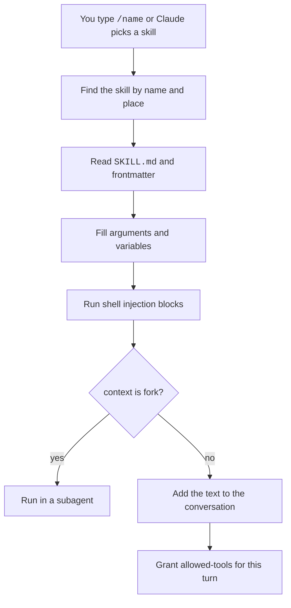

A skill is a folder with a `SKILL.md` file. It teaches Claude how to do one task.
A slash command is a short action that you type, such as `/compact` or `/model`.
A skill also gives you a slash command. For example, `.claude/skills/deploy/SKILL.md` gives you `/deploy`.
The older `.claude/commands/` folder still works and acts like a skill.

## At a Glance

| Question | Answer |
| --- | --- |
| Can you use it? | ✅ Yes. Type `/` to see the list. |
| Can you change it? | ✅ Yes. Write your own skills and commands. Built-in commands are fixed. |
| Can you turn it on or off? | `skillOverrides`, `disableBundledSkills`, `disableSkillShellExecution`, `--disable-slash-commands`, and the `disable-model-invocation` and `user-invocable` keys. |
| Where does it live? | `~/.claude/skills/`, `.claude/skills/`, plugins, managed folders, and `.claude/commands/`. |
| Status | <Documented /> <Undocumented /> <Differs /> <Gated /> |

## Example

This skill makes a `/summarize-diff` command. Only you can start it.

```text title=".claude/skills/summarize-diff/SKILL.md"
---
description: Summarize the uncommitted changes in plain words.
argument-hint: "[focus]"
disable-model-invocation: true
allowed-tools: Bash(git diff *)
---

Run `git diff` and summarize the changes.
Focus on: $ARGUMENTS
```

Type `/summarize-diff tests` in the prompt. `$ARGUMENTS` becomes `tests`.

## Skill Locations

When two skills share a name, the one in the higher place wins.

| Place | Status | What it holds | Notes |
| --- | --- | --- | --- |
| Enterprise `<managed dir>/.claude/skills/<name>/SKILL.md` | <Documented /> | Skills for all users on a machine. | Wins over personal and project skills of the same name. |
| Personal `~/.claude/skills/<name>/SKILL.md` | <Documented /> | Skills for all your projects. | Wins over project skills. |
| Project `.claude/skills/<name>/SKILL.md` | <Documented /> | Skills for one repository. | Loaded from the start folder and each parent up to the repository root. A linked worktree with no `.claude/skills` uses the main checkout (2.1.277 or later). |
| Nested `.claude/skills/` below the start folder | <Documented /> | Skills for a sub-project. | Loads when Claude first reads or edits a file there, or after `/add-dir <subdir>`. On a clash the nested skill is `/apps/web:deploy`. |
| `--add-dir` or `/add-dir` folder | <Documented /> | Skills, `commands/`, and `agents/` of another folder. | `permissions.additionalDirectories` grants file access only and loads none of these. Needs the `project` setting source. |
| Plugin `skills/<name>/SKILL.md` | <Documented /> | Skills of a plugin. | The command name is `/<plugin>:<skill>`. A plugin root `SKILL.md` with no `skills/` folder loads as one skill. |
| Synced skills `~/.claude/skills/synced/` | <Documented /> | Skills turned on in your claude.ai account. | Downloaded in the background (2.1.273 or later). Checked about every 10 minutes while active and every 40 minutes while idle. Never uploaded. The name `anthropic-skills` is reserved. Needs a claude.ai sign-in. Not in bare mode or `--safe-mode`. |
| Trash `~/.claude/skills/.trash/` | <Documented /> | Removed synced skills. | A sweep deletes entries, after 30 days by default. |
| `<name>@skills-dir` plugin | <Documented /> | A plugin made by `claude plugin init` in `~/.claude/skills/<name>/`. | Loads with no install step. The marketplace name `skills-dir` is reserved. |
| MCP-served skill | <Undocumented /> | A skill that an MCP server serves. | Supporting files are read through MCP resources. The origin tag is `mcp`. |
| Skill `loadedFrom` values | <Undocumented /> | Internal origin tags. | Found: `skills`, `commands_DEPRECATED`, `plugin`, `bundled`, `syncedSkills`, `mcp`, `memoryStore`. |

## Name Resolution

| Rule | Status | What it does | Notes |
| --- | --- | --- | --- |
| Clash order | <Documented /> | Picks the skill that `/name` runs. | Enterprise, then personal, then project. A skill replaces a bundled skill or a built-in command of the same name, but not its aliases. A skill wins over a `.claude/commands/` file. |
| Name from layout | <Documented /> | Sets the command name. | `.claude/commands/frontend/component.md` is `/frontend:component`. Frontmatter `name` sets the name of a skill folder. A plugin `name` sets the last part. |
| Refused characters | <Documented /> | Protects the `/` menu. | Refused: zero-width, control, private-use, bidirectional, odd blank characters, `<`, and `>`. The debug log tag is `[names]`. |
| Name length | <Undocumented /> | Caps a frontmatter `name`. | A name over 256 characters is ignored with a warning. |

## Custom Commands

| Item | Status | What it does | Notes |
| --- | --- | --- | --- |
| `.claude/commands/<name>.md` and `~/.claude/commands/` | <Documented /> | The old form of a skill. | Accepts the same frontmatter except `name` and `paths`. Subfolders become `:` parts. |
| Plugin `commands` map | <Documented /> | Commands from a plugin manifest. | Keys: `source` or `content`, `description`, `argumentHint`, `model`, `allowedTools`. |

## Loading and Controls

| Item | Status | What it does | Notes |
| --- | --- | --- | --- |
| Live change detection | <Documented /> | Reloads `SKILL.md` text when it changes. | Not in bare mode. A new top-level skills folder needs `/reload-skills`. Changes to `hooks/`, `.mcp.json`, `agents/`, and `output-styles/` need `/reload-plugins`. |
| Skill listing budget | <Documented /> | Caps how much skill text goes into context. | 1 percent of the window (`skillListingBudgetFraction`). Each entry is cut at 1,536 characters (`skillListingMaxDescChars`). The env var `SLASH_COMMAND_TOOL_CHAR_BUDGET` sets a fixed count. |
| `--disable-slash-commands` | <Documented /> | Turns off all skills and commands. | A CLI flag. Its help text is "Disable all skills and commands" since `2.1.304`. |
| Setting `skillOverrides` | <Documented /> | Sets the visibility of each skill. | Values: `on`, `name-only`, `user-invocable-only`, `off`. Plugin skills are not affected. |
| Setting `disableBundledSkills` | <Documented /> | Removes bundled skills. | Same as `CLAUDE_CODE_DISABLE_BUNDLED_SKILLS=1`. Built-in commands stay. See [Bundled Skills](bundled-skills.md#controls). |
| Setting `disableSkillShellExecution` | <Documented /> | Turns off `` !`cmd` `` injection. | See [Substitutions](substitutions.md#shell-injection). |
| `CLAUDE_CODE_DISABLE_POLICY_SKILLS`, `CLAUDE_CODE_DISABLE_CLAUDE_API_SKILL`, `CLAUDE_CODE_DISABLE_CLAUDE_CODE_SKILL`, `CLAUDE_CODE_SKILL_PROPOSALS`, `CLAUDE_CODE_SKILL_ATTRIBUTION` | <Documented /> | Skill-related environment variables. | See [Environment Variables](../../configure/env-vars/index.md). The effects were not checked one by one. |

## How It Works



Only the skill description sits in context until the skill runs.
After that the full text stays in the conversation.
See [Substitutions](substitutions.md#invocation-control) for what compaction keeps.

## Pages in This Section

| Page | Content |
| --- | --- |
| [Skill Frontmatter](frontmatter.md) | Every `SKILL.md` key. |
| [Substitutions](substitutions.md) | `$ARGUMENTS`, variables, shell injection, and who can invoke a skill. |
| [Bundled Skills](bundled-skills.md) | Skills that ship inside Claude Code. |
| [Slash Commands](slash-commands.md) | Every built-in slash command. |

## Related Pages

- [Hooks](../hooks/index.md): skills can carry hooks in frontmatter.
- [Subagent Runtime](../subagents/runtime.md): `context: fork` runs a skill in a subagent.
- [Subagent Frontmatter](../subagents/frontmatter.md): the `skills` key preloads skills into an agent.
- [Environment Variables](../../configure/env-vars/index.md): the full variable list.

Source: [Extend Claude with Skills](https://code.claude.com/docs/en/skills), [Settings Reference](https://code.claude.com/docs/en/settings-reference), and the program (the skill loader and the `loadedFrom` tags).
