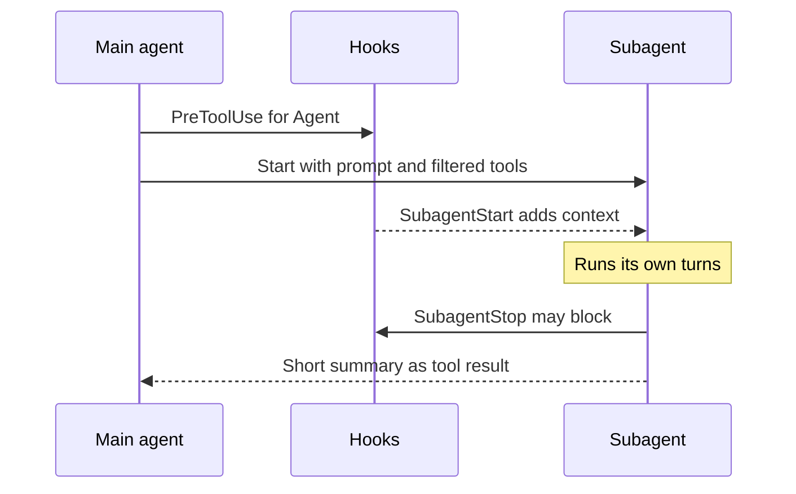

A subagent is a separate Claude run with its own context window, prompt, tools, and model.
It does a side task, such as a long search, and returns only a short summary, so your main conversation stays clean.
For example, Claude can send a code search to the `Explore` subagent and get back only the answer.

## At a Glance

| Question | Answer |
| --- | --- |
| Can you use it? | ✅ Yes. Claude starts subagents with the `Agent` tool. You can also name one with `@`, or run one as the main session with `--agent`. |
| Can you change it? | ✅ Yes. Write agent files, or pass `--agents` JSON. |
| Can you turn it on or off? | Deny `Agent` or `Agent(name)` in `permissions.deny`. Env vars and settings in [Subagent Runtime](runtime.md#limits-and-switches) set limits. |
| Where does it live? | `.claude/agents/`, `~/.claude/agents/`, plugins, managed settings, or `--agents`. |
| Status | <Documented /> <Undocumented /> <Differs /> <Gated /> |

## Example

An agent file for a read-only code reviewer.

```text title=".claude/agents/reviewer.md"
---
name: reviewer
description: Reviews code for bugs and style problems. Use after code changes.
tools: Read, Grep, Glob
model: sonnet
maxTurns: 20
---

You are a careful code reviewer.
Read the changed files and report bugs, with file and line.
Do not edit files.
```

Claude can now send review work to `reviewer`. You can also write `@reviewer check the last commit`.

## Overview

| Item | Status | What it does | Notes |
| --- | --- | --- | --- |
| Agent file | <Documented /> | A Markdown file with YAML frontmatter and a prompt body. | The body is the system prompt. Keys are on [Subagent Frontmatter](frontmatter.md). |
| `Agent` tool | <Documented /> | Starts a subagent, a fork, or a teammate. | The tool lives in the main session and in subagents. |
| `--agent` flag and `agent` setting | <Documented /> | Runs an agent as the main session. | `initialPrompt` applies. `Agent(type)` in `tools` limits which types it can start. |
| `@` mention | <Documented /> | Invokes a subagent by name. | Interactive only. The docs explain this under explicit invocation. |
| `permissions.deny` with `Agent(name)` | <Documented /> | Disables one agent type. | `Agent(fork)` blocks forks. Deny `Agent` to stop all delegation. `Task(...)` is an alias. |
| `Task` alias | <Documented /> | The old name of `Agent` (before 2.1.63). | Works in rules and agent files. |
| `/subtask` | <Documented /> | Starts a fork by hand (2.1.212). | On 2.1.161 to 2.1.211 the command was `/fork`. |
| Description cost | <Documented /> | Subagent descriptions count toward context. | At startup the interactive screen warns `Agent descriptions are over the 15,000-token limit` when the `name: description` text of all non-built-in agents is over 15,000 tokens. Source: the program (not shown in `-p`). |

## Agent Locations and Priority

If the same name appears in two places, the higher priority wins.

| Priority | Place | Status | Notes |
| --- | --- | --- | --- |
| 1 (highest) | Managed settings | <Documented /> | Pushed by an administrator. |
| 2 | `--agents` JSON | <Documented /> | This session only. Not saved. |
| 3 | `.claude/agents/` | <Documented /> | Found by walking up from the working folder. The closest definition wins. `--add-dir` folders also load. |
| 4 | `~/.claude/agents/` | <Documented /> | Scanned deep into subfolders. The `name` is the identity, not the path. |
| 5 (lowest) | Plugin `agents/` | <Documented /> | Subfolders become part of `plugin:folder:file`. |

## How It Works



The subagent loads its own prompt, the task message, and the project `CLAUDE.md` files.
It returns a summary. The main conversation never sees the subagent's own steps.
See [Subagent Runtime](runtime.md) for the details, and [Agent Loop](../../how-it-works/agent-loop.md) for the loop it runs.

## Pages in This Section

| Page | Content |
| --- | --- |
| [Subagent Frontmatter](frontmatter.md) | Every key of an agent file and of `--agents` JSON. |
| [Subagent Runtime](runtime.md) | Built-in agents, tool filters, forks, background runs, depth limits, and teams. |

## Related Pages

- [Hooks](../hooks/events.md#agent-and-task-events): `SubagentStart`, `SubagentStop`, and task events.
- [Skills and Commands](../skills-and-commands/index.md): skills can run in a fork or be preloaded.
- [Environment Variables for Agents and Teams](../../configure/env-vars/agents-and-teams.md): the full list of variables.

Source: [Create Custom Subagents](https://code.claude.com/docs/en/sub-agents), [Environment Variables](https://code.claude.com/docs/en/env-vars), and the program.
