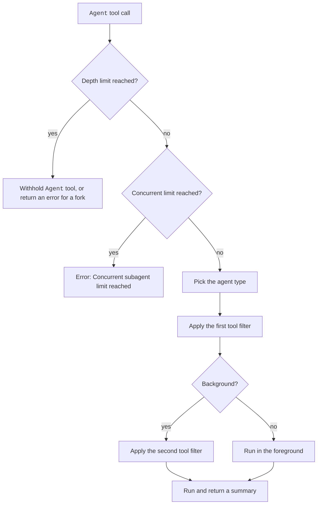

Claude Code ships a few built-in agents, and a set of rules limits every subagent.
The rules cover tool filters, forks, background runs, depth limits, and agent teams.
For example, a subagent cannot start another one past the depth limit, which is 3 by default.
A fork is a subagent that inherits the whole conversation and shares the prompt cache with its parent.

Your own agent file replaces a built-in one of the same name. Limits come from env vars and settings. The switches are `CLAUDE_CODE_FORK_SUBAGENT`, `CLAUDE_CODE_DISABLE_BACKGROUND_TASKS`, `CLAUDE_CODE_DISABLE_EXPLORE_PLAN_AGENTS`, and `CLAUDE_AGENT_SDK_DISABLE_BUILTIN_AGENTS`.

## Example

Limit nesting to one level. Run every subagent in the foreground.

```bash
export CLAUDE_CODE_MAX_SUBAGENT_SPAWN_DEPTH=1
export CLAUDE_CODE_DISABLE_BACKGROUND_TASKS=1
claude
```

## Built-In Agents

The program lists 14 names. Six are in the docs. The rest are internal or are not agents.

| Agent | Status | What it does | Notes |
| --- | --- | --- | --- |
| `Explore` | <Documented /> | A fast read-only search agent. | Uses the main model, with `omitClaudeMd` and no git status. Denies `Agent`, `Edit`, `Write`, `NotebookEdit`, and two more internal tools. A user agent named `Explore` overrides it. `CLAUDE_CODE_DISABLE_EXPLORE_PLAN_AGENTS=1` removes it (2.1.198). |
| `Plan` | <Documented /> | A research agent for plan mode. | Model `inherit`. The same `disallowedTools` as `Explore`. `omitClaudeMd` is true. |
| `general-purpose` | <Documented /> | A capable agent for multi-step work. | `tools:["*"]`. Model: `CLAUDE_CODE_SUBAGENT_MODEL` or the main model. The default when you omit `subagent_type`. `CLAUDE_AGENT_SDK_DISABLE_BUILTIN_AGENTS=1` removes it in `-p`. |
| `claude` | <Documented /> | A catch-all agent with every tool. | `tools:["*"]`, `appendSystemPrompt` true, no model of its own. Also the default agent for a dispatched background session. |
| `statusline-setup` | <Documented /> | Configures the status line for `/statusline`. | Tools `Read` and `Edit`. Model `sonnet`. Color `orange`. Interactive. |
| `claude-code-guide` | <Documented /> | Answers questions about Claude Code. | Model `haiku` (checked: the interactive screen sent `claude-haiku-5-5`). Mode `dontAsk`. Tools `Bash`, `Read`, `WebFetch`, `WebSearch`. The prompt also lists your custom skills, agents, MCP servers, plugin skills, and the names of your settings keys. Claude Code leaves it out when `CLAUDE_CODE_ENTRYPOINT` is `sdk-ts`, `sdk-py`, or `sdk-cli` (a `-p` run reports `sdk-cli`). So it exists only in the interactive CLI. Prompt text: [Subagent, Claude Code Guide](../../prompts/agents/subagent-claude-code-guide.md). |
| `fork` | <Documented /> | A fork of the main conversation. | Inherits the system prompt, tools, model, and history. Cannot start a fork. At the depth limit it keeps `Agent`, but the tool returns an error. Needs fork mode. Since `2.1.307`, forks started together are each told which launch is their own, so they are less likely to start each other's work ([release notes](https://github.com/anthropics/claude-code/releases/tag/v2.1.307)). In the interactive screen the `Agent` tool accepted `fork` (`Fork started`) with no extra setting in the probe run; the switch was not looked for. |
| `workflow-subagent` | <Undocumented /> | The agent that `Workflow` scripts use. | `Workflow` scripts start their agents with this type. The model is `CLAUDE_CODE_WORKFLOW_SUBAGENT_MODEL` if set (and not `inherit`), then `CLAUDE_CODE_SUBAGENT_MODEL`, then the main model. Both win over a `model` option in `agent()`. The prompt tells the agent that its final text goes back to the script as a string. You cannot start it with the `Agent` tool, in `-p` or in the interactive screen (`Agent type 'workflow-subagent' not found`). Source: the program and [Probes](../../reference/probes.md#subagents-and-hooks). |
| `comment-thread-analyst` | <Undocumented /> | Analyzes artifact comment threads. | One tool. Model `inherit`. `maxTurns` 6. `omitClaudeMd` true. Only the artifact comment pipeline starts it (the definition says it is not for direct spawning). It is not in the agent list in any entry point. |
| `web-fetch` | <Undocumented /> <Gated note="CLAUDE_CODE_WEB_FETCH_AGENT" /> | Fetches URLs for a caller. | Prompt "web-reading specialist". `maxTurns` 15. Color `blue`. `omitClaudeMd` true. Model `haiku` or `inherit`, by a flag (a probe run inherited the main model). The agent exists only when `CLAUDE_CODE_WEB_FETCH_AGENT` is on (or its server flag). With default settings the interactive screen also answers `Agent type 'web-fetch' not found`. Then the main session loses its own `WebFetch` tool and calls this agent instead. The agent has only `WebFetch`. It is off when you set `CLAUDE_CODE_SIMPLE` or `CLAUDE_CODE_DISABLE_WEB_FETCH`. Source: the program and [Probes](../../reference/probes.md#subagents-and-hooks). |

:::note
In `-p` and the SDK entry points the spawnable built-in types are `claude`, `Explore`, `general-purpose`, `Plan`, and `statusline-setup`, plus `web-fetch` when it is on. In the interactive screen with default settings the list is `claude`, `claude-code-guide`, `Explore`, `general-purpose`, `Plan`, and `statusline-setup`, plus `fork`. `comment-thread-analyst` and `workflow-subagent` are not spawnable with `Agent` in either place (`Agent type '...' not found`). The artifact comment pipeline starts `comment-thread-analyst`, and `Workflow` scripts start `workflow-subagent`.
The names `worker`, `renewal`, `killed`, `decorations`, and `main-session` also appear in the program. They are not spawnable agent types as far as anyone read.
See [Probes](../../reference/probes.md#subagents-and-hooks).
:::

## Tools and Context of a Subagent

| Rule | Status | What it does | Notes |
| --- | --- | --- | --- |
| First filter | <Documented /> | Removes tools from every subagent. | Removed: `Agent` at the depth limit (not for a fork), `AskUserQuestion`, `EndConversation`, `EnterPlanMode`, `ExitPlanMode` (kept in `plan` mode), `ScheduleWakeup`, `WaitForMcpServers`, `Workflow`. Forks skip both filters. |
| Second filter | <Documented /> | The built-in tools that a background subagent keeps. | File and search tools, shell tools, web tools, `TodoWrite`, `Skill`, `ToolSearch`, the worktree tools, `Monitor`, `TaskStop`, `SendMessage`, `Artifact`, `SubagentHandback`, and every MCP tool. |
| Foreground or background | <Documented /> | How Claude Code places a start. | A teammate start and `CLAUDE_CODE_DISABLE_BACKGROUND_TASKS=1` run in the foreground. Fork mode and `background: true` run in the background. Otherwise the default is background, and `Ctrl+B` backgrounds a running task. |
| Resume | <Documented /> | Continues a finished subagent. | Use `SendMessage` with the name or agent ID. A per-call `model` also applies on resume (2.1.211). |
| Initial context | <Documented /> | What a non-fork subagent loads. | The agent prompt, the task message, `CLAUDE.md` files (unless `omitClaudeMd`), git status (not for `Explore` and `Plan`), preloaded skills, and a roster of siblings with `SendMessage`. No output style and no auto memory. |

## Limits and Switches

| Item | Status | What it does | Notes |
| --- | --- | --- | --- |
| `CLAUDE_CODE_MAX_SUBAGENT_SPAWN_DEPTH` | <Documented /> | Layers of nesting below the main session. | Default 3. At the limit `Agent` is withheld, except from a fork. `1` turns nesting off. Earlier defaults: 5 (2.1.172), 1 (2.1.217). |
| `CLAUDE_CODE_MAX_CONCURRENT_SUBAGENTS` | <Documented /> | The most subagents running at once. | Default 20. The error is `Concurrent subagent limit reached`. Ultracode sessions are exempt. Resumes and `/subtask` forks take a slot but are not blocked. |
| `CLAUDE_CODE_FORK_SUBAGENT` | <Documented /> | Fork mode. | On in interactive sessions (since 2.1.232), off in `-p` and the SDK. `1` forces on, `0` forces off. In fork mode every subagent runs in the background, and `Agent` has no `run_in_background`. |
| `CLAUDE_CODE_DISABLE_BACKGROUND_TASKS` | <Documented /> | Runs all subagents in the foreground. | Set `1`. Also removes `run_in_background`. |
| `CLAUDE_ASYNC_AGENT_STALL_TIMEOUT_MS` | <Documented /> | The stall timeout. | Default 600000. |
| `CLAUDE_CODE_FORWARD_SUBAGENT_TEXT` and `--forward-subagent-text` | <Documented /> | Sends subagent text in `stream-json`. | Print mode only. |
| `CLAUDE_CODE_SUBAGENT_MODEL`, `CLAUDE_CODE_SUBAGENT_MODEL_FORCE` | <Documented /> | The default model, and forcing it. | See `model` on [Subagent Frontmatter](frontmatter.md). |
| `CLAUDE_CODE_SUBAGENT_PROMPT_CACHE_TTL`, `subagentPromptCacheTtl` | <Documented /> | The cache TTL for subagent requests. | `5m` or `1h`. Frontmatter `experimental.cacheTtl` is the third source. See [Request and Cache](../../how-it-works/request-and-cache.md). |
| `CLAUDE_CODE_ENABLE_APPEND_SUBAGENT_PROMPT`, `CLAUDE_CODE_MEMORY_SUBAGENT_APPEND`, `CLAUDE_CODE_SUBAGENT_PROMPT_SNAPSHOT`, `CLAUDE_CODE_SUBAGENT_CACHE_EVICT`, `CLAUDE_CODE_SUBAGENT_CONFIG_WARNING` | <Undocumented /> | Other subagent variables in the program. | `--append-subagent-system-prompt <text>` (or `--append-subagent-system-prompt-file <file>`, print mode only, hidden) adds text to the end of every subagent system prompt. It turns on `CLAUDE_CODE_ENABLE_APPEND_SUBAGENT_PROMPT`, and the variable alone changes nothing. Using both flags gives an error. `CLAUDE_CODE_SUBAGENT_CONFIG_WARNING` turns the startup notice that your config asks for subagents on (`1`) or off (`0`). `CLAUDE_CODE_SUBAGENT_CACHE_EVICT` adds the `prompt-caching-evict-2026-05-12` beta to a subagent's last request, on a first-party login. `CLAUDE_CODE_SUBAGENT_PROMPT_SNAPSHOT` and `CLAUDE_CODE_MEMORY_SUBAGENT_APPEND` showed no change in print mode. Source: the program and [Probes](../../reference/probes.md#subagents-and-hooks). |
| Settings `agent`, `teammateMode`, `subagentStatusLine` | <Documented /> | `agent` sets the main-session agent. `teammateMode` picks the teammate display. `subagentStatusLine` sets a status line for subagents. | `teammateMode` takes `auto`, `tmux`, `iterm2`, or `in-process` (source: the program). |

All variables are also listed on [Environment Variables for Agents and Teams](../../configure/env-vars/agents-and-teams.md).

## Agent Teams

An agent team is a group of Claude sessions that work as teammates.

| Item | Status | What it does | Notes |
| --- | --- | --- | --- |
| Agent teams | <Gated note="Set CLAUDE_CODE_EXPERIMENTAL_AGENT_TEAMS=1." /> <Experimental /> | Several sessions work as teammates. | A named subagent started in an interactive team session starts as a teammate. `team_name` and `mode` on `Agent` are deprecated. Claude Code ignores them. |
| Teammate tools | <Gated note="Same switch as agent teams." /> | Extra tools for a teammate. | Teammates keep `TaskCreate`, `TaskGet`, `TaskList`, `TaskUpdate`, `CronCreate`, `CronDelete`, `CronList`. `SendMessage` routes by name, `main`, or agent ID. |
| `TeammateIdle` hook | <Documented /> | Runs when a teammate is about to go idle. | Exit 2 or `continue:false` keeps it working. See [Hook Events](../hooks/agent-events.md#teammateidle). |
| `TaskCreated`, `TaskCompleted` hooks | <Documented /> | Task lifecycle events. | `TaskCompleted` also fires when a teammate finishes its turn. |
| `agent.spawn` mod event | <Documented /> | Fires before a subagent or teammate starts. | `e.isTeammate` is true for a teammate. `next({...e, model})` sets the model. See [Plugin Mods Reference](https://code.claude.com/docs/en/plugins/mods/reference). |
| `CLAUDE_CODE_TEAM_TEARDOWN_PARK_TIMEOUT_MS` | <Documented /> | The wait at exit for team teardown. | 1000 to 60000 ms in print mode. |

## How It Works



## Related Pages

- [Subagents](index.md): where agent files live.
- [Subagent Frontmatter](frontmatter.md): the keys of an agent file.
- [Hook Events](../hooks/agent-events.md#agent-and-task-events): the agent and task events.
- [Environment Variables for Agents and Teams](../../configure/env-vars/agents-and-teams.md): the full variable list.
- [Agents and Tasks Tools](../../reference/tools/agents-and-tasks.md) for `Agent`.

Source: [Create Custom Subagents](https://code.claude.com/docs/en/sub-agents), [Environment Variables](https://code.claude.com/docs/en/env-vars), [Hooks Reference](https://code.claude.com/docs/en/hooks), and the program (the agent definitions and the `Agent` tool schema).
