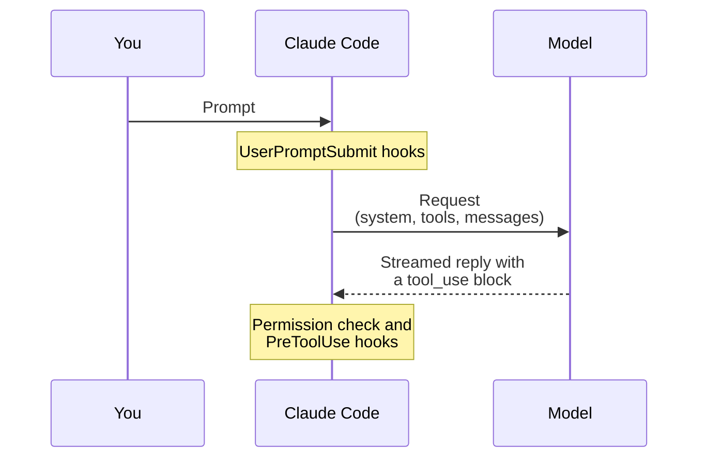
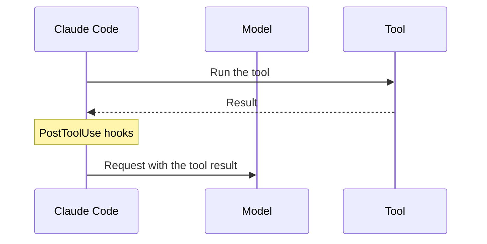
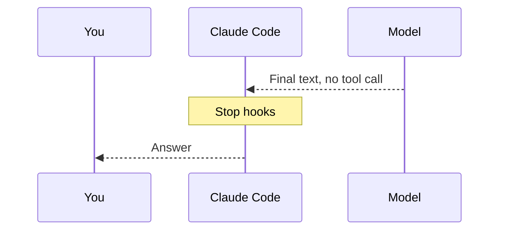
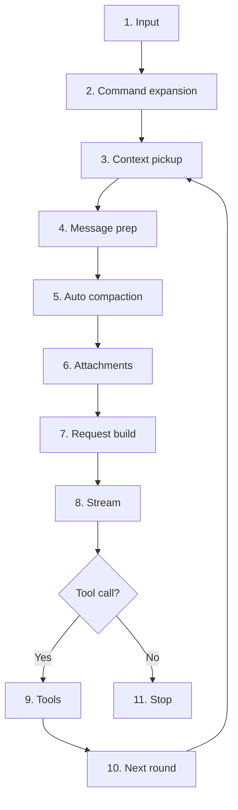
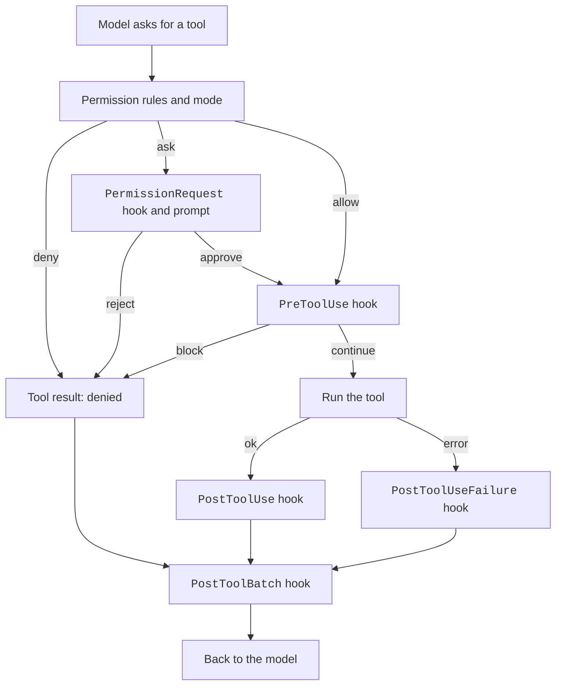
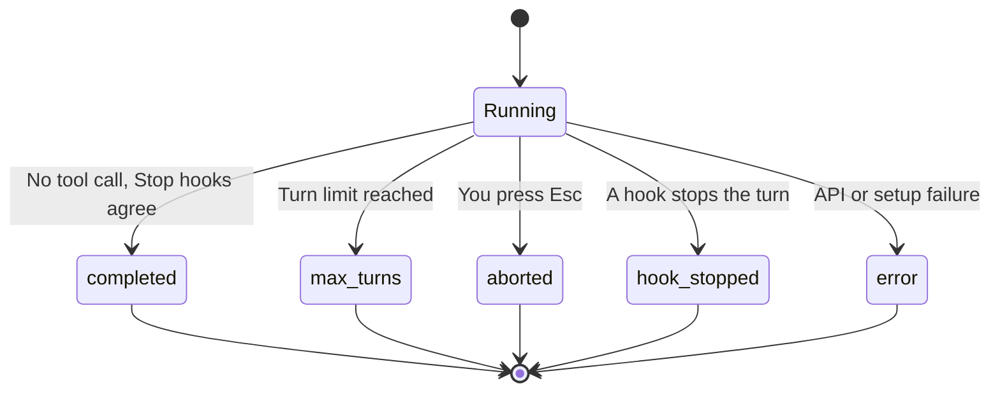

A turn is everything that happens from your prompt to the final answer.
Inside a turn, the model asks for tools, Claude Code runs them, and the model reads the results.
This repeats until the model answers without a tool call.
This page walks through each stage and shows where you can step in.

## The Turn at a Glance



Then Claude Code runs the tool and sends the result back to the model.



The turn ends when the model answers without a tool call.



## The Stages

Sources: [Hooks Reference: Hook Lifecycle](https://code.claude.com/docs/en/hooks#hook-lifecycle) and [Mods Reference](https://code.claude.com/docs/en/plugins/mods/reference#events) for the events. Source: the program for the rest.



| Stage | Status | What happens | Where you can act |
| --- | --- | --- | --- |
| 1. Input | <Documented /> | Claude Code reads your text. A message you type during a turn joins at a safe point. | `UserPromptSubmit` hook, `prompt.submit` mod event |
| 2. Command expansion | <Documented /> | A slash command or skill name turns into a prompt. | `UserPromptExpansion` hook |
| 3. Context pickup | <Documented /> | Claude Code adds nested memory, `@` mentions, and file-change notes. | `InstructionsLoaded` hook, `prompt.mention` and `prompt.attachment` mod events |
| 4. Message prep | <Undocumented /> | Large tool results become references. Claude Code looks up the facts of the model. | `PreModelSwitch` and `PostModelSwitch` hooks |
| 5. Auto compaction | <Documented /> | Claude Code compacts the conversation if it is over the threshold. See [Context and Compaction](context-and-compaction.md). | `PreCompact` and `PostCompact` hooks |
| 6. Attachments | <Undocumented /> | Claude Code adds reminders and notes about the mode. | `prompt.attachment` mod event |
| 7. Request build | <Documented /> | Claude Code builds the `system`, `tools`, and `messages` parts. See [Request and Cache](request-and-cache.md). | `prompt.section`, `prompt.compose`, and `tool.describe` mod events |
| 8. Stream | <Documented /> | Claude Code sends the request and reads the events, with retries and fallbacks. See [Models](models.md). | `MessageDisplay` hook |
| 9. Tools | <Documented /> | Each tool call passes the permission check and then runs. | Tool hooks (next section) |
| 10. Next round | <Undocumented /> | The tool results join the messages, and the loop starts again at stage 3. | `PostToolBatch` hook |
| 11. Stop | <Documented /> | With no tool call, the `Stop` hooks run. A hook that blocks sends its reason back to the model. | `Stop` and `StopFailure` hooks |

The mod events `turn.start`, `turn.step`, and `turn.complete` wrap the whole turn.
See the [Mod API](../extend/mod-api/index.md) pages in Extend.

## The Tool Stage

Sources: [Hooks Reference](https://code.claude.com/docs/en/hooks) and [Environment Variables](https://code.claude.com/docs/en/env-vars).



| Step | Status | What happens |
| --- | --- | --- |
| Permission check | <Documented /> | Your rules and the permission mode decide to allow, ask, or deny. See Permission Flow in this section. |
| `PreToolUse` hook | <Documented /> | The hook can block or change the call. |
| `PermissionRequest` hook | <Documented /> | The hook runs when a decision is needed. |
| Run | <Documented /> | Read-only tools and subagents run in parallel, up to `CLAUDE_CODE_MAX_TOOL_USE_CONCURRENCY` (default 10). Other tools run one after another. |
| `PostToolUse` and `PostToolUseFailure` hooks | <Documented /> | They run after each call. |
| `PostToolBatch` hook | <Documented /> | It runs after a batch of parallel calls and before the next model call. It can stop the loop. |

## Recovery Inside the Loop

The loop does not fail on every error. It tries to fix the problem and go on.

| Case | Status | What Claude Code does |
| --- | --- | --- |
| The output stops at `max_tokens` | <Undocumented /> | It adds a nudge message and asks again, a limited number of times. |
| The response is cut off | <Undocumented /> | It does the same. |
| A `tool_use` block has no valid call | <Undocumented /> | It drops the reply and asks once more. Then it ends with a message that the tool call could not be parsed. |
| The model sends only thinking | <Undocumented /> | It sends one nudge. |
| A safety refusal | <Documented /> | It runs again on the fallback model of that category. See [Models](models.md#fallback). |
| The context is too long | <Documented /> | It lowers `max_tokens` or compacts. |
| Autocompact refills 3 times in a row | <Documented /> | It ends the turn with an error that starts `Autocompact is thrashing`. See [Troubleshooting](https://code.claude.com/docs/en/troubleshooting) in the official docs. |
| A `Stop` hook blocks | <Documented /> | It feeds the reason back. After `CLAUDE_CODE_STOP_HOOK_BLOCK_CAP` blocks in a row (default 8), it ends the turn. |
| `--max-turns` is reached | <Documented /> | It ends the run. See the [CLI Reference](https://code.claude.com/docs/en/cli-reference) in the official docs. |

## How a Turn Ends

The loop returns a `reason`, and Claude Code records it in telemetry.
The chat does not show it.
A result message of the Agent SDK and of `--output-format stream-json` carries it as `terminal_reason`.
All reasons are <Undocumented />, because only the Agent SDK pages name some of them.



| `reason` | Meaning |
| --- | --- |
| `completed` | The turn ended in the normal way. |
| `max_turns` | The turn limit was reached. |
| `aborted_streaming`, `aborted_tools` | You stopped the turn (for example with `Esc`) while the model streamed or tools ran. |
| `hook_stopped`, `stop_hook_prevented` | A hook stopped the turn. |
| `tool_deferred` | A hook deferred a tool call. |
| `tool_deferred_unavailable` | A deferred tool call could not be resumed. |
| `background_requested` | The turn moved to a background session. |
| `blocking_limit` | The context hit the blocked level. See [Context and Compaction](context-and-compaction.md#when-compaction-runs). |
| `rapid_refill_breaker` | Autocompact refilled the context too fast. |
| `model_error`, `api_error`, `image_error` | The API or an image failed. |
| `malformed_tool_use_exhausted` | The model sent a tool call that could not be parsed, and the retries failed too. Since `2.1.307` Claude Code retries the call up to twice ([release notes](https://github.com/anthropics/claude-code/releases/tag/v2.1.307)). Before, the turn ended after two bad calls in a row. |
| `prompt_too_long` | The prompt did not fit the context window. |
| `budget_exhausted` | The budget for the run was used up. |
| `structured_output_retry_exhausted` | The model did not give valid structured output after the allowed retries. |
| `turn_setup_failed` | Claude Code failed to set up the turn. |

## What You Can Change

| Goal | How |
| --- | --- |
| Check or edit every prompt before it runs | A `UserPromptSubmit` hook. |
| Block or rewrite a tool call | A `PreToolUse` hook or a permission rule. |
| Force the model to keep working | A `Stop` hook that blocks. Mind `CLAUDE_CODE_STOP_HOOK_BLOCK_CAP`. |
| Limit tool parallelism | Set `CLAUDE_CODE_MAX_TOOL_USE_CONCURRENCY`. |
| Limit the number of turns | Use `--max-turns` in print mode. |
| Rewrite a part of the system prompt | A mod listening to `prompt.section` or `prompt.compose`. See [The System Prompt](system-prompt.md). |
| Change the compaction point | See [Context and Compaction](context-and-compaction.md#controls). |

## Example

This hook in `.claude/settings.json` runs a script before every `Bash` call.
If the script exits with code 2, the call is blocked and the reason goes back to the model.

```json title=".claude/settings.json"
{
  "hooks": {
    "PreToolUse": [
      {
        "matcher": "Bash",
        "hooks": [
          { "type": "command", "command": ".claude/hooks/check-bash.sh" }
        ]
      }
    ]
  }
}
```

## Related Pages

- [Architecture](architecture.md)
- [Request and Cache](request-and-cache.md)
- [Context and Compaction](context-and-compaction.md)
- [Hooks](../extend/hooks/index.md), [Tools](../reference/tools/index.md), [Subagents](../extend/subagents/index.md), and [Mod API](../extend/mod-api/index.md) pages in Extend and Reference.
