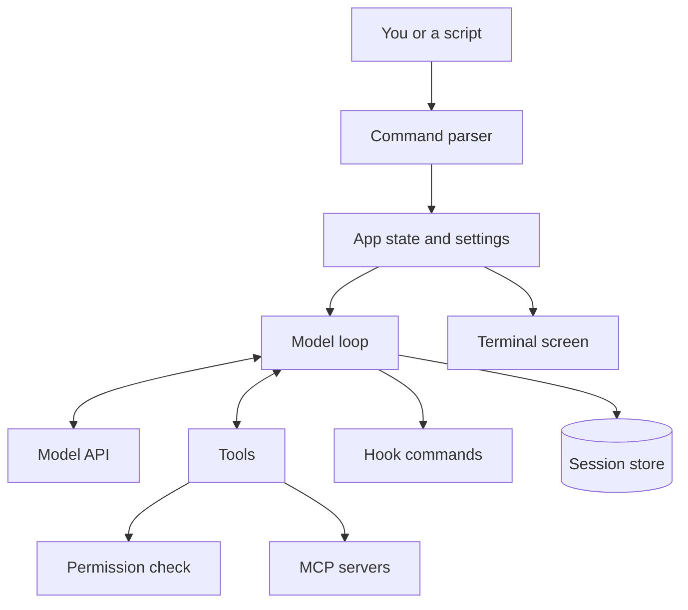
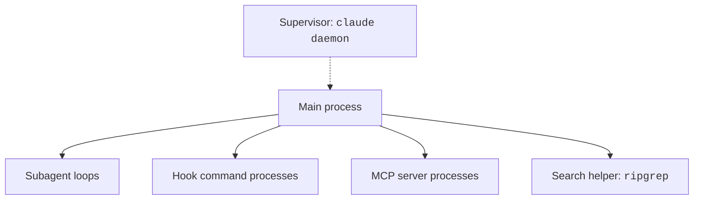
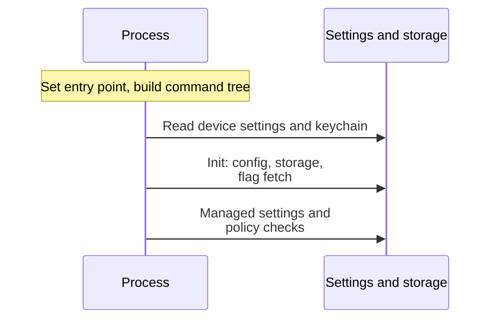
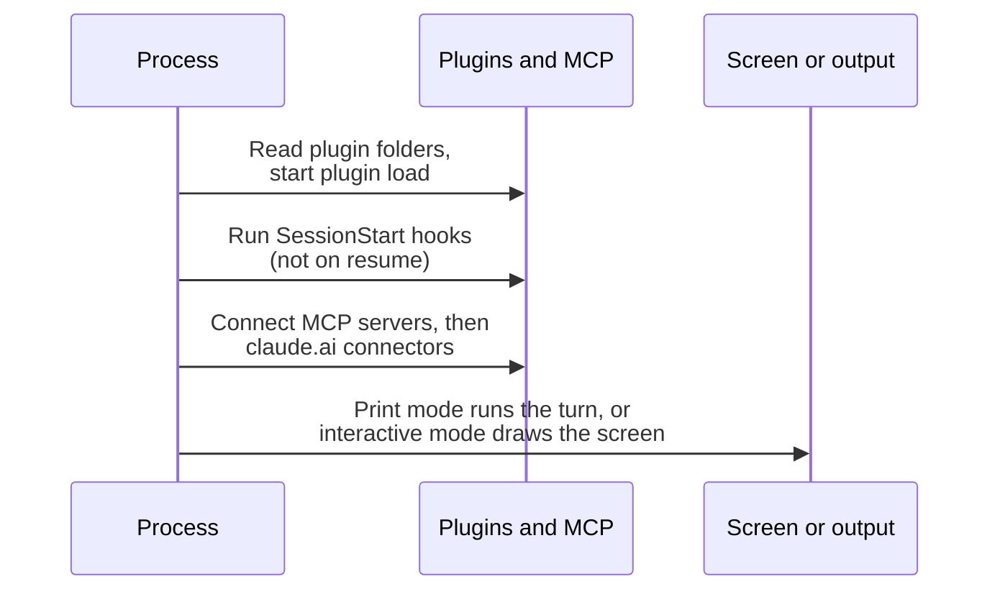

Claude Code is one program that runs a loop.
You give it a task. It asks a model what to do. It runs tools. It repeats until the task is done.
Settings, hooks, plugins, skills, MCP servers, and subagents are layers around this loop. You can change each of them.
This page shows the pieces, the processes, and the order of the startup.

## The Big Picture



Source: [How Claude Code Works](https://code.claude.com/docs/en/how-claude-code-works).

| Piece | Status | What it is |
| --- | --- | --- |
| Native binary | <Documented /> | One program file for each version. It lives in `~/.local/share/claude/versions/`. A launcher at `~/.local/bin/claude` points to it. See [Advanced Setup](https://code.claude.com/docs/en/setup) in the official docs. |
| Bundled code | <Undocumented /> | The program carries its JavaScript inside the file and runs it with the Bun runtime. |
| Command parser | <Undocumented /> | The `commander` library builds the tree of commands and flags. |
| Terminal screen | <Undocumented /> | A React-based renderer draws the chat with `ink-box` and `ink-text` elements. |
| Model loop | <Documented /> | Gather context, act, check the result, and repeat. See [The Agent Loop](agent-loop.md). |
| Tools | <Documented /> | File, search, shell, web, and agent tools. |
| Extensions | <Documented /> | Hooks, skills, plugins, MCP, subagents, and mods. |
| Feature flags | <Undocumented /> | The program asks a flag service (GrowthBook) which experiments are on for you. You cannot set them. |
| Telemetry | <Documented /> | OpenTelemetry export is off until you set it up. See [Monitoring](https://code.claude.com/docs/en/monitoring-usage) in the official docs. |
| Session store | <Documented /> | Transcripts live under `~/.claude/projects`. See [Sessions and Storage](sessions-and-storage.md). |

## Where It Runs

The [official docs](https://code.claude.com/docs/en/how-claude-code-works#environments-and-interfaces) list these places: the terminal, the desktop app, IDE extensions, `claude.ai/code`, Remote Control, Slack, and CI.
All of them run the same loop.
The code can run on your machine, in the cloud, or on your machine under remote control.
Source: [How Claude Code Works: Environments and Interfaces](https://code.claude.com/docs/en/how-claude-code-works#environments-and-interfaces).

The environment variable `CLAUDE_CODE_ENTRYPOINT` names the host.
The program sets it when the host did not.
The official [Monitoring](https://code.claude.com/docs/en/monitoring-usage) page shows some of the values as `app.entrypoint`.

| Value | Status | Set when |
| --- | --- | --- |
| `cli` | <Documented /> | You start `claude` in a terminal. |
| `sdk-cli` | <Documented /> | You use print mode (`-p`). |
| `sdk-ts`, `sdk-py`, `claude-vscode` | <Documented /> | An SDK or the VS Code extension starts the program. |
| `mcp` | <Undocumented /> | You run `claude mcp serve`. |
| `claude-code-github-action` | <Undocumented /> | The env var `CLAUDE_CODE_ACTION` is set. |
| `local-agent`, `claude-desktop`, `remote` | <Undocumented /> | A host app sets it. |

## Processes



| Process | Status | Role |
| --- | --- | --- |
| Main process | <Documented /> | One for each interactive or print session. |
| Supervisor (`claude daemon`) | <Documented /> | Runs background sessions so they continue after you close the terminal. See [Manage Multiple Agents with Agent View](https://code.claude.com/docs/en/agent-view) in the official docs. |
| Subagent | <Documented /> | A separate loop with its own context window. |
| Hook command | <Documented /> | A child process for each command hook. |
| MCP server | <Documented /> | A child process or a remote connection. |
| Search helper | <Documented /> | A bundled `ripgrep`, unless `USE_BUILTIN_RIPGREP=0`. See [Environment Variables](https://code.claude.com/docs/en/env-vars) in the official docs. |

The supervisor starts on demand and exits when the last client leaves.
Its files are `~/.claude/daemon.json` and `~/.claude/daemon.log`.

## Startup Steps

The order below comes from the program (the bundled code).
It runs before your first prompt, so a slow step here makes every start slow.



Then the process loads plugins and servers and starts the turn or the screen.



| Step | Status | What happens |
| --- | --- | --- |
| Start | <Undocumented /> | The process sets its entry point and builds the command tree. |
| Device settings | <Undocumented /> | Reads device-management settings and the keychain at the same time. |
| Project root | <Undocumented /> | Checks `--project-config-root`, which must be an absolute local folder. |
| Init | <Undocumented /> | Loads config. Opens storage. Starts the feature flag fetch and the fetch of managed settings. |
| Client data | <Undocumented /> | Loads a signed configuration document if you set `--client-data-url` or `CLAUDE_CODE_CLIENT_DATA_URL`. |
| Log sinks | <Undocumented /> | Sets the process title to `claude` and starts the log and telemetry sinks. |
| Plugin folders | <Undocumented /> | Reads `--plugin-dir`, `--plugin-dir-no-mcp`, and `--plugin-url`. |
| Migrations | <Undocumented /> | Runs settings migrations. |
| Managed settings | <Undocumented /> | Reads policy settings and refuses a version below the minimum. |
| Plugin early start | <Undocumented /> | Starts plugin install and load early. |
| Main action | <Undocumented /> | Starts telemetry. Starts `SessionStart` hooks (not on resume). Checks forced login. Builds the app state. |
| MCP connect | <Undocumented /> | Connects MCP servers, then the `claude.ai` connectors. |
| Print mode | <Undocumented /> | Runs the turn and writes the output. |
| Interactive mode | <Undocumented /> | Draws the screen and waits for input. |

`SessionStart` and `Setup` hooks run before the session MCP servers are ready.
So an `mcp_tool` hook cannot run in them. See the [Hooks Reference](https://code.claude.com/docs/en/hooks) in the official docs.

## What You Can Change at Startup

| Goal | How |
| --- | --- |
| See how long each startup step takes | Set `CLAUDE_CODE_PROFILE_STARTUP`. The log shows timings such as `[+12.3ms]`. <Undocumented /> |
| Read the startup log | Run `claude --debug`. |
| Load a plugin from a folder | Use `--plugin-dir`, or `--plugin-dir-no-mcp` to skip its MCP servers. |
| Use a different project config root | Use `--project-config-root` with an absolute path. |
| Skip the bundled search helper | Set `USE_BUILTIN_RIPGREP=0`. |
| Move `~/.claude` | Set `CLAUDE_CONFIG_DIR`. |

## Example

You run `claude --debug` in a project folder.
The log shows the settings files it read, the plugins it loaded, and each MCP server it connected.
Then the screen opens and waits for you.

```bash
CLAUDE_CODE_PROFILE_STARTUP=1 claude --debug
```

## Related Pages

- [The Agent Loop](agent-loop.md) for what happens after startup.
- [Request and Cache](request-and-cache.md) for what one model call holds.
- [Sessions and Storage](sessions-and-storage.md) for the files on disk.
- The [CLI](../configure/cli/index.md), [Settings](../configure/settings/index.md), and [Hooks](../extend/hooks/index.md) pages in Configure and Extend.
