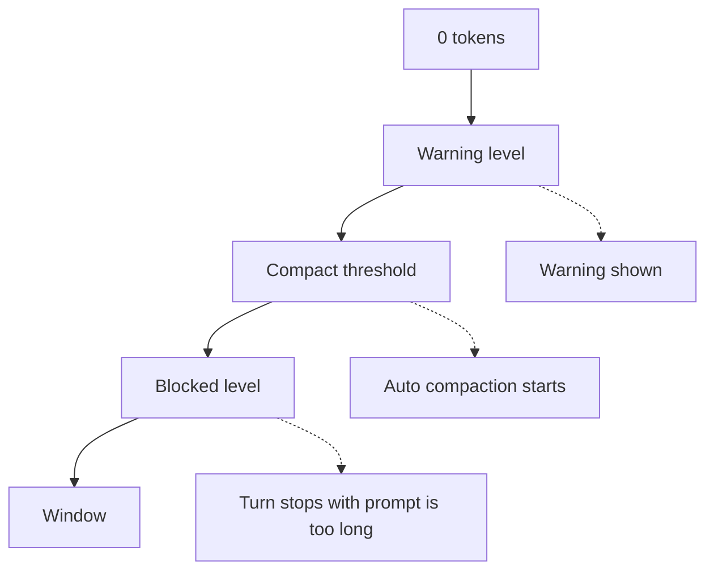
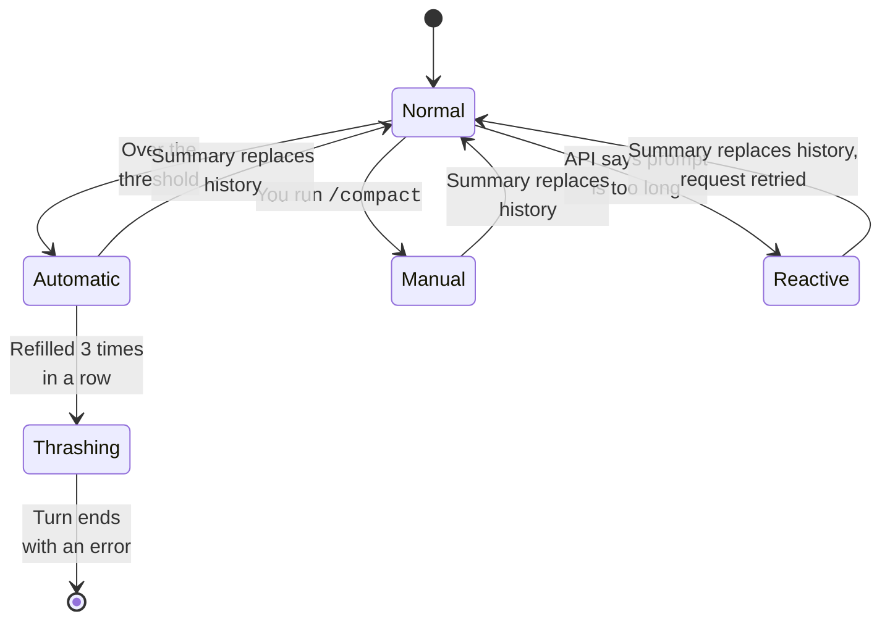

The context window is the amount of text the model can read at one time.
When a session gets close to the limit, Claude Code compacts it:
it asks the model for a summary and goes on from the summary.
You can set when this happens, and you can say what the summary must keep.

## What Fills the Context

Sources: [How Claude Code Works: The Context Window](https://code.claude.com/docs/en/how-claude-code-works#the-context-window) and [Explore the Context Window](https://code.claude.com/docs/en/context-window).

| Content | Status | Note |
| --- | --- | --- |
| System prompt and tool names | <Documented /> | MCP tool schemas stay deferred until a tool search loads them. |
| `CLAUDE.md`, rules, and auto memory | <Documented /> | The first 200 lines or 25 KB of `MEMORY.md` load. |
| Skill descriptions | <Documented /> | The body of a skill loads only when the skill runs. |
| Messages, tool results, and file reads | <Documented /> | This is the part that grows. |
| Attachments that Claude Code adds | <Undocumented /> | A transcript of 2.1.305 from a stub run shows types such as `total_tokens_reminder`, `output_style`, `nested_memory`, and `skill_listing`. Transcripts of 2.1.305 from a real machine also showed `queued_command`, `edited_text_file`, `deferred_tools_record`, `mcp_instructions_delta`, `credential_org`, and `silent_turn_reminder`. |

The mod event `prompt.attachment` can rewrite or drop one attachment.
For measured token counts of an empty session and ways to shrink it, see [Context Budget](context-budget.md).

## When Compaction Runs

Let `window` be the window of the model, or the window you set.
Let `out` be the smaller of the model output limit and `20000`.



| Level | Status | Formula | Example for a 1,000,000 window |
| --- | --- | --- | --- |
| Effective window | <Undocumented /> | `window - out` | 980,000 |
| Compact threshold | <Documented /> | `effective - 13000` | 967,000, which the docs call "about 967K" |
| Warning | <Undocumented /> | `threshold - 20000` | 947,000 |
| Blocked | <Undocumented /> | `window - out - 3000` | 977,000 |
| Percent override | <Documented /> | The smaller of `effective * pct / 100` and `effective - 13000` | `CLAUDE_AUTOCOMPACT_PCT_OVERRIDE` sets `pct` from 1 to 100 |

At the blocked level, Claude Code stops the turn with a "prompt is too long" error, unless it can recover by compacting.
`CLAUDE_CODE_BLOCKING_LIMIT_OVERRIDE` (<Undocumented />) replaces the blocked level.

Claude Code finds the window in this order:

1. `CLAUDE_CODE_AUTO_COMPACT_WINDOW`
2. The setting `autoCompactWindow` (for one model in `modelSettings`)
3. Client data from the server
4. An experiment
5. The default of the model

The accepted window is from 100K to 1M tokens.
Sources: [Model Configuration: Context Window and Auto-Compaction](https://code.claude.com/docs/en/model-config#context-window-and-auto-compaction) and the program.

## Controls

Sources: [Model Configuration: Set the Auto-Compact Window](https://code.claude.com/docs/en/model-config#set-the-auto-compact-window) and [Environment Variables](https://code.claude.com/docs/en/env-vars).

| Item | Status | Effect |
| --- | --- | --- |
| `/compact [focus]` | <Documented /> | Compacts now. `DISABLE_COMPACT` removes it. |
| `/autocompact <size\|auto>` | <Documented /> | Saves the window for the current model. |
| `--autocompact <auto\|tokens>` | <Documented /> | Sets the window for one launch. |
| `autoCompactWindow`, `autoCompactEnabled` | <Documented /> | Settings. `autoCompactWindow` also works in the frontmatter of a subagent. |
| `CLAUDE_CODE_AUTO_COMPACT_WINDOW` | <Documented /> | Sets the window. It wins over the command, the flag, and the setting. Accepts `k` and `M` suffixes since 2.1.304. |
| `CLAUDE_AUTOCOMPACT_PCT_OVERRIDE` | <Documented /> | Sets the percent of the effective window. |
| `DISABLE_AUTO_COMPACT`, `DISABLE_COMPACT` | <Documented /> | Turn off automatic compaction, or all compaction. |
| `CLAUDE_CODE_MAX_CONTEXT_TOKENS` | <Documented /> | Sets the window for a model ID that Claude Code does not know. |
| `CLAUDE_CODE_DISABLE_UNKNOWN_MODEL_WINDOW_ENFORCEMENT` | <Documented /> | Compacts only after the API says the prompt is too long. |
| `CLAUDE_CODE_DISABLE_1M_CONTEXT` | <Documented /> | Turns off the 1M choice. |
| `idleCompaction`, `CLAUDE_CODE_IDLE_COMPACT_MIN_TOKENS` | <Documented /> | Compact a conversation that is idle. |
| `/rewind`, then Summarize from here or up to here | <Documented /> | Compacts one part of the conversation. |
| `/clear` | <Documented /> | Starts with an empty context. |
| `PreCompact`, `PostCompact` hooks | <Documented /> | Run around a compaction. The `trigger` field is `auto` or `manual`. |

## Kinds of Compaction



| Kind | Status | How it works |
| --- | --- | --- |
| Automatic | <Documented /> | It starts at the compact threshold. The hooks `PreCompact` and `PostCompact` get `trigger: auto`. |
| Manual | <Documented /> | It starts with `/compact`. The trigger is `manual`. |
| Reactive | <Undocumented /> | The API refuses a request as too long, and Claude Code compacts and tries again. |
| Precomputed | <Undocumented /> | A summary made ahead of time replaces the conversation. |
| Larger-model retry | <Undocumented /> | A compaction that fails can try again on a model with a larger window. |
| Server side | <Undocumented /> | The beta `context-management-2025-06-27` lets the API edit the context. |

Auto compaction stops with an error when the context refills within 3 turns of the last compaction, 3 times in a row.
The message starts `Autocompact is thrashing`.
Sources: [How Claude Code Works: When Context Fills Up](https://code.claude.com/docs/en/how-claude-code-works#when-context-fills-up) and [Troubleshooting](https://code.claude.com/docs/en/troubleshooting).

## The Summary Prompt

The compaction request asks the model for a summary in `<summary>` tags with nine parts.
Source: the program (<Undocumented />).

1. Primary Request and Intent
2. Key Technical Concepts
3. Files and Code Sections
4. Errors and Fixes
5. Problem Solving
6. All User Messages
7. Pending Tasks
8. Current Work
9. Optional Next Step

The prompt has a short form ("in 2000 words or fewer"), a form that asks for an `<analysis>` first, and a form that covers only the recent messages.
The request uses the thinking setting of the session (v2.1.198 or later).
See the captured [compaction prompt](../prompts/compact.md).

## What Survives

Source: [Explore the Context Window: What Survives Compaction](https://code.claude.com/docs/en/context-window#what-survives-compaction).

| Content | Status | After compaction |
| --- | --- | --- |
| System prompt and output style | <Documented /> | They still apply. |
| Root `CLAUDE.md`, unscoped rules, and auto memory | <Documented /> | Claude Code reads them again from disk. |
| The plan from plan mode | <Documented /> | Claude Code reads it again from disk. |
| Rules with `paths:` and nested `CLAUDE.md` files | <Documented /> | They load again when needed. |
| Files that were read or edited | <Documented /> | Up to five are read again, newest first. A file over 5,000 tokens comes back as a path. |
| Skills that ran | <Documented /> | Each keeps 5,000 tokens, up to 25,000 in total. The oldest go first. |
| Background commands and subagents | <Documented /> | They keep running. |
| `SessionStart` hooks with the `compact` matcher | <Documented /> | They run again. |

## Example

Your session is long and you start a new task.
Run `/compact focus on the auth bug fix` to keep what matters.
Or compact earlier next time by setting a smaller window.

```bash
claude --autocompact 500000
```

```json title="~/.claude/settings.json"
{
  "autoCompactWindow": 500000
}
```

## Related Pages

- [Sessions and Storage](sessions-and-storage.md)
- [Request and Cache](request-and-cache.md)
- [Models](models.md)
- [The Agent Loop](agent-loop.md)
- [Hooks](../extend/hooks/index.md) and [Settings](../configure/settings/index.md) pages in Extend and Configure.
