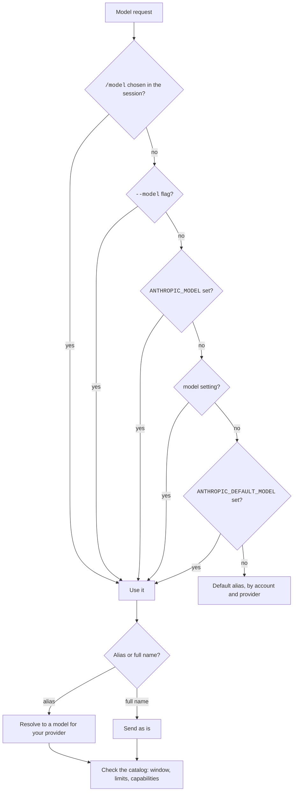
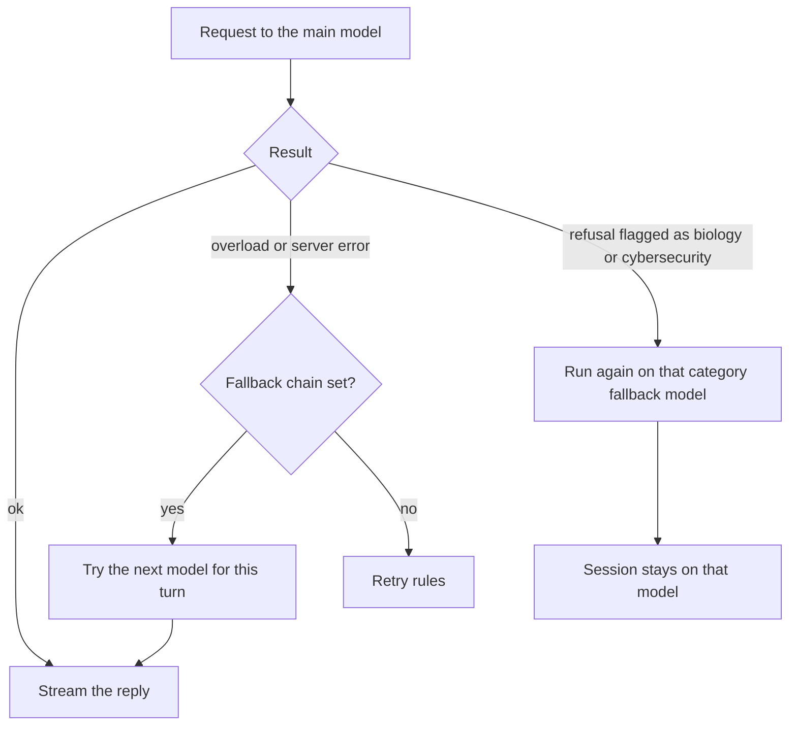

A model is the Claude version that answers you.
Effort is how hard the model thinks before it answers.
An API call is one request to the model server.
This page explains how Claude Code chooses each of these and what happens when a call fails.
The full list of models, aliases, and providers is on [Models and Providers](../configure/models-and-providers.md).

## Choosing the Model

Sources: [Model Configuration](https://code.claude.com/docs/en/model-config) and [Hooks Reference](https://code.claude.com/docs/en/hooks).



The items that set the model (flags, environment variables, settings, aliases such as `default`, `opusplan`, and `best`, the `[1m]` suffix, and the switch hooks) are listed in [Choose a Model](../configure/models-and-providers.md#choose-a-model) and [Aliases](../configure/models-and-providers.md#aliases).

A switch of the model is a cache miss. See [Request and Cache](request-and-cache.md#what-breaks-the-cache).

## Effort

The effort levels are `low`, `medium`, `high`, `xhigh`, and `max`.
A level that the model does not accept runs as the highest accepted level below it.
Source: [Model Configuration](https://code.claude.com/docs/en/model-config).

The flags, variables, settings, request field, and default level for each model are in [Effort](../configure/models-and-providers.md#effort).

## Thinking

Sources: [Model Configuration](https://code.claude.com/docs/en/model-config) and [Environment Variables](https://code.claude.com/docs/en/env-vars).

The thinking flags, variables, and settings are in [Thinking](../configure/models-and-providers.md#thinking).

`MAX_THINKING_TOKENS` cannot turn thinking off on Opus 5.5, Sonnet 5.5, Haiku 5.5, and the Fable models.
`CLAUDE_CODE_DISABLE_ADAPTIVE_THINKING` has no effect on newer models.

## Capabilities

The model catalog gives each model a list of capability flags.
The code tests a flag to switch a feature on for that model.
The flag list, with what each flag does and how many models have it, is in [Capabilities](../configure/models-and-providers.md#capabilities).
The flags `effort`, `max_effort`, `xhigh_effort`, and `adaptive_thinking` say which effort levels and which thinking mode a model accepts.
The betas `per-turn-control-2026-07-01` and `timing-2026-09-09` match the flags `per_turn_effort` and `per_turn_timing`.

## Fallback



- A fallback chain (`--fallback-model`, `fallbackModel`) holds at most three models.
  It covers overload and server errors, and not auth, billing, rate-limit, request-size, or transport errors.
  The switch lasts for the current turn, and the next turn tries the main model first.
  Source: [Model Configuration: Fallback Model Chains](https://code.claude.com/docs/en/model-config#fallback-model-chains).
- Content-based fallback applies to the Fable models, Opus 5.5, Sonnet 5.5, and Opus 5.
  A request that is flagged as biology or cybersecurity runs again on the fallback model of that category.
  The session then stays on that model.
  Source: [Model Configuration: Automatic Model Fallback](https://code.claude.com/docs/en/model-config#automatic-model-fallback).
- `CLAUDE_CODE_NO_MODEL_FALLBACK` forbids the substitution of a model (<Undocumented />, a message in the program names it).

## Retries and Timeouts

Sources: [Error Reference: Automatic Retries](https://code.claude.com/docs/en/errors#automatic-retries) and [Environment Variables](https://code.claude.com/docs/en/env-vars).

The variables, with their defaults, are in [Fallback and Retries](../configure/models-and-providers.md#fallback-and-retries).

When a request is too long for the context, Claude Code tries again with a smaller `max_tokens`, and it compacts when that is not enough.
The loop also recovers from a stop at `max_tokens` and from a bad tool call. See [The Agent Loop](agent-loop.md#recovery-inside-the-loop).

## Example

Run one hard task with a stronger model and more thinking.
Make a script fail sooner by lowering the retry count.

```bash
claude --model opus --effort high
CLAUDE_CODE_MAX_RETRIES=3 claude -p "summarize this repo"
```

## Related Pages

- [Models and Providers](../configure/models-and-providers.md)
- [Request and Cache](request-and-cache.md)
- [Context and Compaction](context-and-compaction.md)
- [Settings](../configure/settings/index.md) and [Environment Variable](../configure/env-vars/index.md) pages in Configure.
