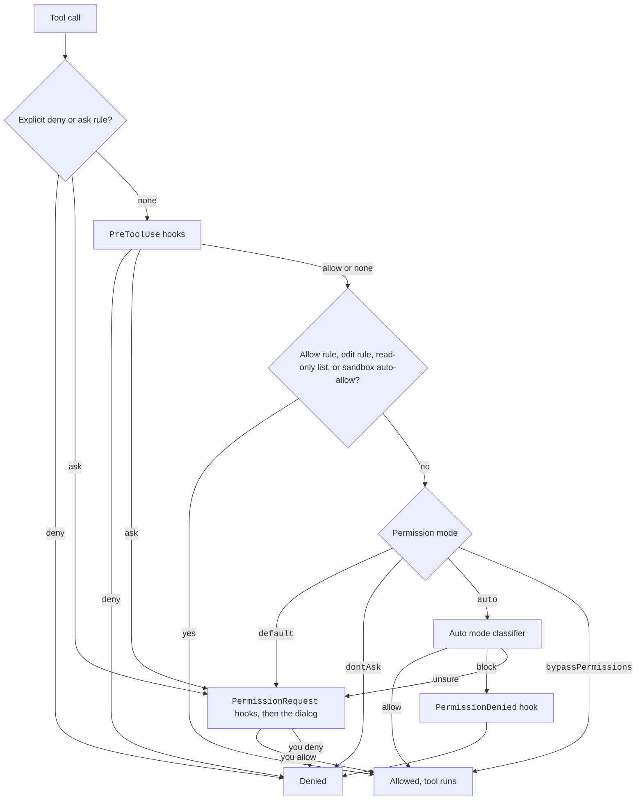

Before a tool runs, Claude Code decides one of three things: allow it, ask you, or deny it.
Several parts take a turn: rules, hooks, the permission mode, safety checks, and sometimes a classifier model.
This page shows the order and where you can step in.

## Example

You set `deny: ["Bash(git push:*)"]` and `allow: ["Bash(bun test)"]`, and you run in `default` mode.

1. Claude asks to run `git push origin main`. The `deny` rule matches, so the call is denied. No prompt shows.
2. Claude asks to run `bun test`. No deny or ask rule matches. The `allow` rule matches, so it runs.
3. Claude asks to run `rm -rf build`. No rule matches. The mode is `default`, so you get a prompt.

## The Order of Checks

Official pages: [Configure Permissions](https://code.claude.com/docs/en/permissions) and [Choose a Permission Mode](https://code.claude.com/docs/en/permission-modes).
The docs do not give the full order. The steps below follow the program, so treat the exact order as unstable.

### Step by Step

1. **Explicit `deny` and `ask` rules** apply first, before workspace trust. Source: the official [Settings Reference](https://code.claude.com/docs/en/settings-reference).
2. **`PreToolUse` hooks** can allow, deny, or ask. A hook `allow` does not override a `deny` or `ask` rule. Source: the program (`types-2.1.304.d.ts` and the text `hook allows approve the command`).
3. **Allow sources** let the call run: `allow` rules, the rules of `acceptEdits`, and read-only command lists.
   Program texts: `Read-only command is allowed` and `Auto-allowed with sandbox (autoAllowBashIfSandboxed enabled)`.
4. **The mode decides the rest.** `default` prompts. `dontAsk` denies. `auto` asks the classifier. `bypassPermissions` allows. The other modes follow the rules on [Permission Modes](../configure/permissions/modes.md).
5. **A prompt runs `PermissionRequest` hooks first.** Then the dialog shows.
   `Notification` hooks fire for unanswered requests in SDK hosts. `CLAUDE_CODE_DISABLE_PERMISSION_PROMPT_NOTIFY_HOOKS=1` stops that.
6. **An auto mode denial fires `PermissionDenied`.** The hook can ask for a retry.

A safety check covers `rm -r` on a mounted drive, the folder that holds mounted drives (`/Volumes`, `/media`, WSL `/mnt/c`), or a top-level file or folder of a drive. Since 2.1.304 the program says it "requires explicit approval and cannot be auto-allowed by permission rules". `CLAUDE_CODE_DISABLE_MOUNTED_DRIVE_RM_PROMPT` turns this prompt off ([Tools and Bash](../configure/env-vars/tools-and-bash.md)).

Built-in safety checks, called circuit breakers, can also force a prompt. Some are immune to `bypassPermissions`. See [Permission Modes](../configure/permissions/modes.md#safety-checks). The diagram leaves them out because the program does not show where they run.

The working folders matter too.
A path outside the working folders gets the reason `workingDir` (`Path is outside allowed working directories`).
`permissions.blockReadsOutsideWorkingDirectories: true` refuses reads outside the working folders in every mode.

## What You Can Change at Each Step

| Step | What you change |
| --- | --- |
| Rules | `permissions.allow`, `ask`, `deny`; see [Permission Rules](../configure/permissions/rules.md). |
| Hooks | `PreToolUse`, `PermissionRequest`, and `PermissionDenied` hooks; see the [Hooks](../extend/hooks/index.md) pages. |
| Safety checks | Mostly fixed. `blockReadsOutsideWorkingDirectories`, `--restricted`, and `isolatePeerMachines` switch some on. |
| Mode | `permissions.defaultMode` and `--permission-mode`; see [Permission Modes](../configure/permissions/modes.md). |
| Sandbox | `sandbox.*` keys; see [Sandbox](../configure/permissions/sandbox.md). |
| Classifier | The `autoMode` setting; see [Auto Mode](../configure/permissions/auto-mode.md). |

## Where It Sits in a Turn

The check runs in the tool stage of every turn.
See [The Agent Loop](agent-loop.md) for the stages around it and [Architecture](architecture.md) for the pieces.

## Related Pages

- [Permissions Overview](../configure/permissions/index.md)
- [Permission Modes](../configure/permissions/modes.md)
- [Permission Rules](../configure/permissions/rules.md)
- [Sandbox](../configure/permissions/sandbox.md)
- [Auto Mode](../configure/permissions/auto-mode.md)
- [Captured Plan Mode Prompt](../prompts/mode-plan.md)
