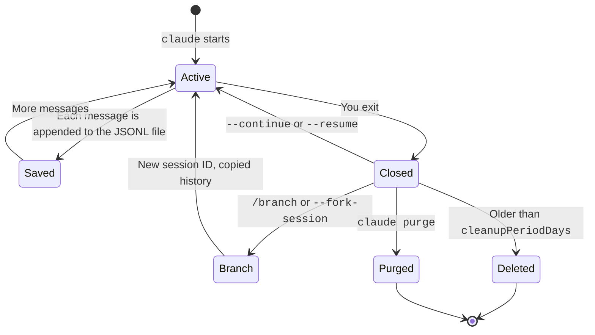

A session is one saved conversation.
Claude Code writes it to a file on your disk as you work.
You can leave and come back to continue. You can also branch the conversation to try another path.
This page covers the flags, the files, and the cleanup rules. The line format is on the [Transcript Format](../reference/transcript-format.md) page.

## The Life of a Session



## Resume and Branch

Source: [Manage Sessions](https://code.claude.com/docs/en/sessions).

| Item | Status | What it does |
| --- | --- | --- |
| `claude --continue`, `-c` | <Documented /> | Reopens the newest session of the current folder. |
| `claude --resume [value]`, `-r` | <Documented /> | Opens the picker, or resumes by session ID, name, or transcript path. |
| `claude --from-pr [value]` | <Documented /> | Opens a picker with the sessions that link to a pull request. |
| `claude --fork-session` | <Documented /> | With `--resume` or `--continue`, copies the history to a new session ID. |
| `/branch [name]` | <Documented /> | Copies the conversation and switches to the copy. The "allow for this session" grants carry over. |
| `--session-id <uuid>` | <Documented /> | Uses a UUID that you give for a new session. |
| `-n`, `--name <name>` | <Documented /> | Names the session in the picker and the terminal title. |
| `--no-session-persistence` | <Documented /> | Writes nothing. Print mode only. |
| `--resume-session-at <message id>` | <Undocumented /> | A hidden flag that resumes only up to one message. |
| `--reply-on-resume` | <Undocumented /> | A hidden flag that asks the model to reply at once when the transcript ends with a user message. |
| `--rewind-files <user-message-id>` | <Undocumented /> | A hidden flag that restores the files to the state at a message. Then Claude Code exits. It needs `--resume`. |
| `claude attach`, `logs`, `stop`, `rm`, `respawn` | <Documented /> | Control background sessions. |
| `CLAUDE_CODE_RESUME_INTERRUPTED_TURN` | <Documented /> | Resumes a turn that a crash cut off. |

A resumed session restores the history, the model, the agent, the permission mode, an active goal, and scheduled tasks.
It does not restore the values of `--mcp-config`, `--settings`, `--plugin-dir`, `--fallback-model`, or `--add-dir`. Pass them again.
If you resume one session in two terminals, the messages mix in one transcript.

## Where Files Live

Source: [Explore the .claude Directory: Application Data](https://code.claude.com/docs/en/claude-directory#application-data).
`CLAUDE_CONFIG_DIR` moves `~/.claude`.
The `<project>` name is the folder path with every character other than a letter or a digit changed to `-`.
Claude Code cuts a name over 200 characters. It adds a hash.
`CLAUDE_CODE_PROJECT_DIR_NAME` sets the name by hand. It needs `CLAUDE_CONFIG_DIR`.

<FileTree>

- `~/.claude/`
  - `projects/`
    - `<project>/`
      - `<session>.jsonl` transcript
      - `<session>.orphaned-<time>-<id>.jsonl` set aside, not in the picker
      - `<session>.jsonl.superseded-<time>` set aside, not in the picker
      - `<session>/`
        - `subagents/` subagent transcripts
        - `tool-results/` large tool outputs and MCP images
      - `memory/` auto memory (never cleaned)
  - `file-history/<session>/` snapshots before edits
  - `plans/`
  - `debug/`
  - `paste-cache/`
  - `uploads/<session>/`
  - `dev-mods/<session>/`
  - `session-env/`
  - `tasks/`
  - `shell-snapshots/`
  - `backups/` keeps 5 copies of `~/.claude.json`
  - `sessions/` one small file per running session
  - `history.jsonl` every prompt you typed
  - `stats-cache.json`
  - `remote-settings.json`
  - `policy-limits.json`
  - `cache/`
    - `changelog.md`
  - `.credentials.json`
  - `agent-memory/`
  - `jobs/`
  - `daemon/`
  - `settings.json`
  - `plugins/`
  - `skills/`
  - `agents/`
  - `CLAUDE.md`

</FileTree>

The last column shows whether Claude Code deletes the item after `cleanupPeriodDays`.

| Path under `~/.claude/` | Status | Content | Cleaned |
| --- | --- | --- | --- |
| `projects/<project>/<session>.jsonl` | <Documented /> | The transcript. | ✅ |
| `projects/<project>/<session>/subagents/` | <Documented /> | The transcripts of subagents. | ✅ |
| `projects/<project>/<session>/tool-results/` | <Documented /> | Large tool outputs and MCP images. | ✅ |
| `projects/<project>/memory/` | <Documented /> | Auto memory. | ❌ |
| `*.orphaned-<time>-<id>.jsonl`, `*.jsonl.superseded-<time>` | <Documented /> | Transcripts that Claude Code set aside. | ✅ |
| `file-history/<session>/` | <Documented /> | Snapshots from before edits, with the 100 newest checkpoints. | ✅ |
| `plans/`, `debug/`, `paste-cache/`, `uploads/<session>/`, `dev-mods/<session>/`, `session-env/` | <Documented /> | Plan files, debug logs, pastes, uploads, mods that Claude wrote, and session data. | ✅ |
| `tasks/`, `shell-snapshots/`, `backups/` | <Documented /> | Task lists, shell setup, and copies of `~/.claude.json` (Claude Code keeps 5). | ✅ |
| `sessions/` | <Documented /> | One small file for each running session, deleted at exit. | ❌ |
| `history.jsonl` | <Documented /> | Every prompt you typed. | ❌ |
| `stats-cache.json`, `remote-settings.json`, `policy-limits.json`, `cache/changelog.md` | <Documented /> | Usage totals, cached organization settings, organization limits, and the [changelog](https://code.claude.com/docs/en/changelog). | ❌ |
| `.credentials.json`, `agent-memory/`, `jobs/`, `daemon/` | <Documented /> | Files that you should keep. | ❌ |
| `settings.json`, `plugins/`, `skills/`, `agents/`, `CLAUDE.md` | <Documented /> | Your configuration. | ❌ |
| `state/` | <Undocumented /> | Holds `settings-review.json`, the staged settings changes that you review with `/settings-review`. Each entry has the file path, hashes, the proposed content, and the tool and session that staged it. It also holds `unattended-serving-consent.json`. A write there by Claude is denied with the text "Staged Claude Code settings changes". The retention sweep drops staged entries and `unattended-serving-runs` files older than `cleanupPeriodDays`. | ✅ |
| `seed-admin/` | <Undocumented /> | The root for temp folders `claude-seed-admin-<pid>-...` (mode 0700). They hold the private git directories of cloud-session uploads. Its own sweep removes folders older than one hour, not `cleanupPeriodDays`. Claude cannot write there. It is refused inside a git work tree. | ❌ |
| `bridge-spawn/` | <Undocumented /> | The root folder (mode 0700) for sessions started over the bridge. Its own cleanup removes entries older than one day, not `cleanupPeriodDays`. The sandbox rules allow it. | ❌ |
| `cache/model-catalog/` | <Undocumented /> | `masked-ids.json` is a saved list of model IDs (version 1, at most 131072 bytes) that the served model catalog masks. The program reads it at startup. The program keeps a file it cannot parse as `masked-ids.unparseable.json`. The folder also holds cached catalog `.json` files. The retention sweep removes those after `cleanupPeriodDays`. It keeps `masked-ids.json` and the floor marks file. | ✅ |
| `mods/`, `downloads/` | <Undocumented /> | The program has no `mods/` path in the config folder (it uses `dev-mods/`, listed above). `mods` is the name of the mod folder inside a plugin. `downloads/` is only in the program's list of known folders. No code writes it. The retention sweep does not touch either name. | ❌ |

`~/.claude.json`, next to the folder, holds app state, the sign-in, and personal MCP servers.
The default retention is 30 days, and the minimum is 1.
The scratchpad of a session is in the temp folder (`/private/tmp/claude-<uid>/<project>/<session-id>/scratchpad/` on macOS). `claude purge` does not touch it.

:::warning
The files are plain text and are not encrypted.
A secret that a tool prints goes into the transcript.
Lower `cleanupPeriodDays` or set `CLAUDE_CODE_SKIP_PROMPT_HISTORY` if that matters to you.
:::

## Controls

| Item | Status | Effect |
| --- | --- | --- |
| `cleanupPeriodDays`, `desktopSessionCleanupPeriodDays` | <Documented /> | Set how long Claude Code keeps files. |
| `CLAUDE_CODE_SKIP_PROMPT_HISTORY` | <Documented /> | Writes no transcript and no history in any mode. |
| `CLAUDE_CODE_TRANSCRIPT_LOCAL_GC` | <Documented /> | Limits the transcript size of `-p` and SDK sessions. |
| `CLAUDE_CONFIG_DIR` | <Documented /> | Moves `~/.claude` to another folder. |
| `CLAUDE_CODE_PROJECT_DIR_NAME` | <Documented /> | Sets the `<project>` folder name by hand. Needs `CLAUDE_CONFIG_DIR`. |
| `claude purge [path]` | <Documented /> | Deletes the transcripts, tasks, file history, and config entry of a project. Flags: `--all`, `--dry-run`, `-i`, `-y`. |
| `/export` | <Documented /> | Exports a conversation. Use it, not the JSONL file, for scripts. |

## Example

You close the terminal in the middle of a task.
The next day you run `claude --continue` in the same folder.
The conversation, the model, and the permission mode come back.

```bash
claude --continue
claude --resume my-feature --fork-session
claude purge --dry-run
```

## Errors

Each row is a family of messages. The backticked text is the start that every message in the family shares. A row marked `Various` gathers the messages of one feature that do not share one start.

| Start of Message | Status | What It Means | Cases |
| --- | --- | --- | --- |
| Various | <Undocumented /> | **Self-hosted runner and orchestrator.** A self-hosted runner or orchestrator flag, environment value, or hook was refused. | A flag or `SELF_HOSTED_RUNNER_*` variable is out of range or not one of the listed values. A flag was renamed. `--configure-git` could not prepare its artifacts. A hook is missing or not executable. A proxy authorization source is empty, too long, or unreadable. The environment secret is missing. |
| Various | <Undocumented /> | **Remote Control and cloud sessions.** Remote Control, a cloud session, or `--teleport` failed or was refused. | The user is not signed in with claude.ai. The policy `disableRemoteControl` is set. The base URL uses HTTP. A cloud session reached its timeout, waits for input that nothing here can give, or lost its connection. `claude --teleport` was run from the wrong checkout. |
| Various | <Undocumented /> | **Transcripts and storage.** A transcript, session record, or storage backend could not be read or written. | A transcript file is too large, is not valid JSON, or holds no messages. A diskless session has no file to write to. A storage read, write, stat, or delete failed. |

## Related Pages

- [Transcript Format](../reference/transcript-format.md)
- [Context and Compaction](context-and-compaction.md)
- [Architecture](architecture.md)
- [CLI](../configure/cli/index.md) and [Environment Variable](../configure/env-vars/index.md) pages in Configure.
