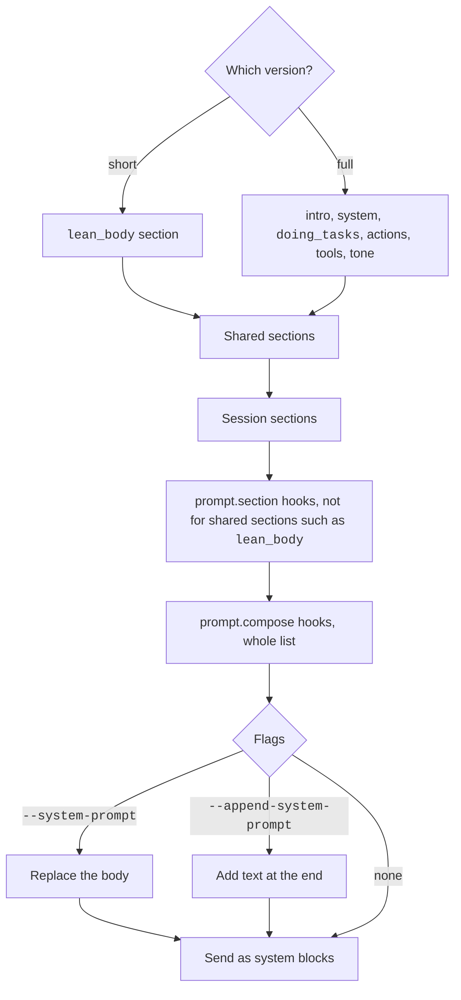
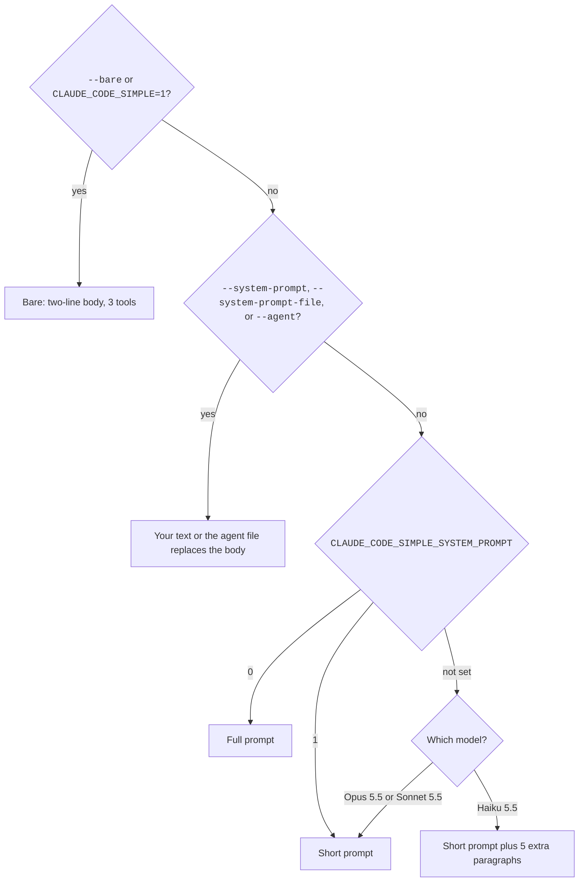

The system prompt is the text that Claude Code sends to the model before your first message.
It tells the model how to behave and what the session looks like.
You can add to it, replace it, or switch to a shorter version.
This page explains how the prompt is built. The exact captured texts are on the [Captured System Prompts](../prompts/index.md) page.

## Ways to Change It

Sources: [CLI Reference](https://code.claude.com/docs/en/cli-reference), [Output Styles](https://code.claude.com/docs/en/output-styles), and [Environment Variables](https://code.claude.com/docs/en/env-vars).

| Item | Status | What it does |
| --- | --- | --- |
| `--system-prompt <text>` | <Documented /> | Replaces the whole default prompt. |
| `--system-prompt-file <file>` | <Documented /> | Replaces the prompt with the text of a file. Hidden in `claude --help`. |
| `--append-system-prompt <text>` | <Documented /> | Adds text to the end of the prompt. |
| `--append-system-prompt-file <file>` | <Documented /> | Adds the text of a file to the end. Hidden in `claude --help`. |
| `--append-subagent-system-prompt`, `--append-subagent-system-prompt-file` | <Documented /> | Add text to every subagent prompt, in print mode only. Hidden in `claude --help`. |
| `--system-prompt-snapshot on\|off` | <Documented /> | `on` records the prompt on the first request and reuses it. `off` rebuilds it for every request. Needs v2.1.257 or later. |
| `--exclude-dynamic-system-prompt-sections` | <Documented /> | Moves the working folder, the environment, the memory paths, and the git status into the first user message. |
| `__SYSTEM_PROMPT_DYNAMIC_BOUNDARY__` | <Documented /> | A line in replacement text. Text above it stays cached. Text below it can change. Needs v2.1.275 or later. |
| `CLAUDE_CODE_SIMPLE_SYSTEM_PROMPT` | <Documented /> | `0` chooses the full prompt. `1` chooses the short prompt. See [Short or Full Prompt](#short-or-full-prompt). |
| `CLAUDE_CODE_SIMPLE` and `--bare` | <Documented /> | Use a minimal prompt. See [Bare Mode](#bare-mode). |
| Output style | <Documented /> | Adds style text. The frontmatter key `keep-coding-instructions` keeps the coding section. |
| `prompt.section` and `prompt.compose` | <Documented /> <Differs note="prompt.section does not fire for shared sections such as lean_body" /> | Mod events that rewrite one section or the whole list. See the [Mod API](../extend/mod-api/index.md) pages in Extend. |

## How Claude Code Builds It



Claude Code makes a list of sections.
Each section has a name and a text, or no text when its condition is false.
A `shared` section is the same for every user of a model.
A `session` section can change with the session.
Claude Code sends the `shared` sections first, so that the shared part can stay in the cache.

The request has three `system` blocks:
the attribution line, the identity line, and the body.
See [Request and Cache](request-and-cache.md#system-blocks-and-cache-markers) for the cache markers.

## Short or Full Prompt

A model gets the short prompt (one `lean_body` section, about 5.7k characters) or the full prompt (six longer sections, about 26.9k characters).
The official docs and the real request captures agree here. Only the old wiki was wrong.
Captures of 2.1.311 show the following. See [Captured System Prompts](../prompts/index.md) for the texts.



| Case | Result | Status |
| --- | --- | --- |
| Opus 5.5, Sonnet 5.5 by default | The short prompt. | <Documented /> |
| Haiku 5.5 by default | The short prompt plus 5 extra paragraphs (about 2.8k characters). | <Undocumented /> |
| `CLAUDE_CODE_SIMPLE_SYSTEM_PROMPT=0` | The full prompt. This is the only way to get it on these models. | <Documented /> |
| `CLAUDE_CODE_SIMPLE_SYSTEM_PROMPT=1` | The short prompt. On the three 5.5 models it changes nothing, because they already get it. | <Documented /> |

### Names That Claude Code Does Not Recognize

Since `2.1.312`, a model name that Claude Code does not recognize gets the short prompt, and `CLAUDE_CODE_SIMPLE_SYSTEM_PROMPT=0` keeps the full prompt.
This covers custom deployment names and inference profile ARNs. The test in the program has no check for the provider.
The program decides in this order:

1. `CLAUDE_CODE_SIMPLE_SYSTEM_PROMPT` set to a true value gives the short prompt. A false value, such as `0`, gives the full prompt.
2. If the variable is not set, a name that is not a known one gives the short prompt. A known name has `claude-3-` or `haiku` or `sonnet` in it, or is `claude-opus-4-0`, `-4-1`, `-4-5`, `-4-6`, or `-4-7`. A server-side catalog flag `lean_prompt` for the model comes first.
3. For a known name, the gate `tengu_velvet_tide` gives the short prompt when on. Otherwise the server setting `simple_system_prompt` for the model decides.

The program now canonicalizes the name for this test with the option `deterministic`. The option skips the lookup that turns an `application-inference-profile` ARN into the model behind it. So an ARN no longer counts as the Sonnet or Haiku model that it fronts, unless `modelOverrides` maps it.
Source: the program (`chunk-9wgj206m.js` lines 334 to 363, `chunk-3xe0k172.js` lines 24698 to 24717, and `chunk-rww18cjm.js` of `2.1.311`, where the same test used no `deterministic` option).

## Prompt by Model

We ran the default prompt for every model in the program's catalog, plus names that end in `-eap` and an unknown name (see [Probes](../reference/probes.md#static-and-print-probes)). The stub accepted every name. The real API may refuse retired models.

The models with the catalog flag `lean_prompt` get the short prompt: Haiku 5.5, Sonnet 5.5, Opus 4.8, Opus 5, Opus 5.5, Fable 5, Fable 5.1, and Mythos 5.1. `claude-mythos-5` has no such flag, but a name rule gives it the short prompt, as it does for a name that ends in `-eap` and for an unknown name. Older models, and `claude-sonnet-5`, get the full prompt. Some models add sections to the short prompt, which follow the flags `opus_5_prompt_bundle`, `opus_5_5_prompt_bundle`, `fable_5_mitigations`, and `fable_5_1_prompt_bundle`.

| Model | Prompt | System Characters |
| --- | --- | --- |
| `claude-opus-5-5`, `claude-sonnet-5-5`, and their `-eap` names | Short | 5,699 |
| `claude-haiku-5-5` | Short plus 5 paragraphs on effort and turns | 8,491 |
| `claude-opus-4-8` | Short, with one different bullet in a system reminder | 5,641 |
| `claude-opus-5` | Short plus "Delivering work" and "Corrections" sections and a line to not use agents or workflows unless asked | 9,079 |
| `claude-fable-5` | Short plus "Communicating with the user", a comment rule, an identity paragraph, and an autonomy block | 9,992 |
| `claude-fable-5-1` | Short plus "Delivering work", "Writing for the user", an identity paragraph, and an autonomy block | 11,771 |
| `claude-mythos-5` | Short plus "Communicating with the user" and an autonomy block | 9,414 |
| `claude-mythos-5-1` | Like Fable 5.1 | 11,084 |
| Unknown name | Short, without the `total_tokens` line | 5,648 |
| `claude-sonnet-5` | Full, with one different `TaskCreate` bullet | 26,944 |
| `claude-haiku-4-5`, `claude-3-5-haiku`, `claude-3-5-sonnet`, `claude-3-7-sonnet`, `claude-sonnet-4-0`, `claude-sonnet-4-5`, `claude-sonnet-4-6`, `claude-opus-4-5`, `claude-opus-4-6`, `claude-opus-4-7` | Full | 27,046 |
| `claude-opus-4-0`, `claude-opus-4-1` | Claude Code silently changes the request model to `claude-opus-5-5`, so they get the short prompt | 5,699 |

The 3.5 and 3.7 Haiku and Sonnet models also get 25 tools and not 12, because they have no tool search. In `2.1.309` it was 24, before `Monitor` joined the tool list (probe `print.models.matrix`). The captures cover only Opus 5.5, Sonnet 5.5, Haiku 5.5, and the full prompt. The other models have no capture page.

The [official docs](https://code.claude.com/docs/en/env-vars) say that Haiku 4.5, Sonnet 5, Opus 4.7, and earlier models get the full prompt, and newer models get the short one.
The captures match this for Sonnet 5.5, Opus 5.5, and Haiku 5.5. The old wiki said Sonnet gets the full prompt, and that is wrong.

Captured texts: [lean prompt](../prompts/defaults/default-lean.md), [Sonnet 5.5](../prompts/defaults/default-sonnet.md), [Haiku 5.5](../prompts/defaults/default-haiku.md), and the [full prompt](../prompts/defaults/full-prompt.md).

## Where Each Part Goes in the Request

Not everything the model reads as instructions is in `system`.
The captures show this split.

| Part | Where it goes | Status |
| --- | --- | --- |
| Billing header line | `system[0]` | <Undocumented /> |
| Identity line | `system[1]` | <Undocumented /> |
| Rules, memory section, appended text | `system[2]` (the body) | <Undocumented /> |
| Environment details, skills list, agent types, output style text, the date | A `system`-role entry in `messages[]` | <Undocumented /> |
| Git status, `CLAUDE.md` files, the git attribution reminder | The first user message | <Undocumented /> |

The identity line is `You are a Claude agent, built on Anthropic's Claude Agent SDK.` in print mode.
With `--append-system-prompt`, print mode sends `You are Claude Code, Anthropic's official CLI for Claude, running within the Claude Agent SDK.`
The interactive line is `You are Claude Code, Anthropic's official CLI for Claude.` The program picks it when the session is interactive, and it also picks it for Google Cloud Agent Platform (Vertex) sessions.

## What Each Flag Does in the Captures

| Flag or setting | Captured effect | Status |
| --- | --- | --- |
| `--system-prompt`, `--system-prompt-file`, `--agent` | Replace only the body (`system[2]`). The identity line stays. | <Documented /> |
| `--append-system-prompt` | Adds text to the end of the body and changes the identity line. | <Documented /> |
| `--exclude-dynamic-system-prompt-sections` | Moves Memory into the first user message. Drops Session-specific guidance and the fast-mode sentence. | <Documented /> |
| Output style with `keep-coding-instructions: false` | Removes "Doing tasks" from the full prompt only. It does nothing to the short prompt. | <Documented /> |
| `--permission-mode plan` | Adds about 4.8k characters to the environment message. | <Documented /> |
| `--permission-mode acceptEdits`, `dontAsk`, `--brief` | Do not change the text. | <Undocumented /> |

## Sections

No official docs page lists the sections, so every row below is <Undocumented /> unless the row says otherwise.
The names matter because a `prompt.compose` hook sees all of them, and a `prompt.section` hook sees only the session sections.

### Shared Sections

These come first. Claude Code uses either the short row or the full rows.
From 2.1.302 to 2.1.307, no shared section (`lean_body`, `intro`, `tone`, `doing_tasks`, `memory_static`, and the others) fires `prompt.section`, so a `prompt.section` hook does not see them.
Only a `prompt.compose` hook sees them.

| Section | Status | When | Content |
| --- | --- | --- | --- |
| `lean_body` | <Undocumented /> | Short prompt | A list of harness rules: markdown output, permission modes, hooks as user feedback, and dedicated tools first. |
| `intro` | <Undocumented /> | Full prompt | Who the agent is and whom it works for. |
| `system` | <Undocumented /> | Full prompt | Output is shown to the user, tool results can hold prompt injection, and old messages get compressed. |
| `doing_tasks` | <Undocumented /> | Full prompt, and the output style is none or has `keep-coding-instructions: true` | Do only what the task needs, add no extra features, and write few comments. |
| `actions` | <Undocumented /> | Full prompt | Confirm actions that are hard to undo. |
| `tools` | <Undocumented /> | Full prompt | Use dedicated tools before `Bash`, and call independent tools in parallel. |
| `tone` | <Undocumented /> | Full prompt | No emojis, short answers, and `file_path:line_number` references. |
| `memory_static` | <Undocumented /> | Only with `--exclude-dynamic-system-prompt-sections` | The memory text, moved to the shared part. |

### Session Sections

They follow in this order. A section that has no text is left out. Session sections, such as `memory`, do fire `prompt.section`.

| Section | Status | When | Content |
| --- | --- | --- | --- |
| `communication` | <Undocumented /> | Always | How to write for the user, with text that depends on the model. |
| `pronouns` | <Undocumented /> | Always | Use `they/them` when pronouns are not stated. |
| `action_caution` | <Undocumented /> | Short prompt | Confirm actions that reach outside the session or are hard to undo. |
| `fable_identity` | <Undocumented /> | A Fable model, or the model in `ANTHROPIC_DEFAULT_FABLE_MODEL` | A paragraph about Fable 5.1 or Fable 5 and Mythos. |
| `tool_param_json` | <Gated note="An experiment, or a tool strictness setting" /> | An experiment, or a tool strictness setting | One sentence: object and array values are one JSON value. |
| `session_guidance` | <Undocumented /> | When any of its items applies | The `! <command>` tip, the `Agent` tool and forks, skills by `/name`, and `ultrareview`. |
| `memory` | <Undocumented /> | Not with `--exclude-dynamic-system-prompt-sections` | Instructions for auto memory. |
| `surface:<kind>`, `system_messages` | <Gated note="An experiment form of the prompt" /> | An experiment form of the prompt | Where Claude Code runs, such as `desktop`, `vscode`, `web`, or `terminal`. |
| `env_info_simple` | <Undocumented /> | Normally | The latest model IDs, where Claude Code runs, and a note about `/fast`. |
| `env_info_static` | <Undocumented /> | With `--exclude-dynamic-system-prompt-sections` | The same text, without data of the machine. |
| `bg-session` | <Gated note="CLAUDE_CODE_SESSION_KIND=bg and CLAUDE_JOB_DIR set" /> | `CLAUDE_CODE_SESSION_KIND=bg` and `CLAUDE_JOB_DIR` set | Rules for background jobs: use `$CLAUDE_JOB_DIR/tmp`, use `EnterWorktree`, and end with a report. |
| `context_management` | <Undocumented /> | Always | Old context gets summarized, so do not wrap up early. |
| `brief` | <Undocumented /> | `--brief`, or the `SendUserMessage` tool | Rules for that tool. |
| `focus_mode` | <Undocumented /> | The view mode is focus | The user sees only the final message. |
| `act_dont_rederive` | <Gated note="CLAUDE_CODE_ACT_DONT_REDERIVE, or an experiment that is on by default" /> | `CLAUDE_CODE_ACT_DONT_REDERIVE`, or an experiment that is on by default | Act when you have enough information. |
| `delivering_work_max` | <Gated note="CLAUDE_CODE_BISON_CAIRN, or an experiment for some models" /> | `CLAUDE_CODE_BISON_CAIRN`, or an experiment for some models | Do the full scope of the work. |
| `overcorrection` | <Gated note="CLAUDE_CODE_LARCH_CISTERN, or an experiment" /> | `CLAUDE_CODE_LARCH_CISTERN`, or an experiment | Correct yourself only when it matters. |
| `subagent_steer_delegation` | <Gated note="The Agent tool exists and an experiment arm is on" /> | The `Agent` tool exists and an experiment arm is on | Steers when to delegate. |
| `opus5_reduced_delegation` | <Gated note="Opus 5 prompt bundle, with an experiment that is on by default" /> | Opus 5 prompt bundle, with an experiment that is on by default | Do not use the `Agent` tool, workflows, or deep research unless asked. |
| `heron_brook`, `brook_heron` | <Gated note="An experiment, or Haiku 5.5 early-stopping guidance" /> | An experiment, or Haiku 5.5 early-stopping guidance | Text that the server sets. |
| `willow_tern` | <Gated note="CLAUDE_CODE_WILLOW_TERN, or an experiment" /> | `CLAUDE_CODE_WILLOW_TERN`, or an experiment | Rules for writing to the user. |
| `autonomy_append` | <Gated note="Mythos 5, a Fable 5 mitigation model, or CLAUDE_CODE_AMBER_ASTROLABE" /> | Mythos 5, a Fable 5 mitigation model, or `CLAUDE_CODE_AMBER_ASTROLABE` | Work without asking in the middle of a task. |
| `endconv_deferred_hint` | <Gated note="The EndConversation tool exists" /> | The `EndConversation` tool exists | A hint for that tool. |
| `total_tokens` | <Gated note="Mode comes from CLAUDE_CODE_TOTAL_TOKENS_REMINDER" /> | Not with `CLAUDE_CODE_DISABLE_ATTACHMENTS` or `CLAUDE_CODE_SIMPLE`, and the mode comes from `CLAUDE_CODE_TOTAL_TOKENS_REMINDER` | A reminder of the token budget. |
| `user_pays` | <Gated note="An experiment that is off by default" /> | An experiment that is off by default | The user pays for each token. |

Experiments come from GrowthBook, a flag service that Anthropic runs.
You cannot set an experiment, but the env vars in the table switch some of the sections.

## Bare Mode

`--bare` and `CLAUDE_CODE_SIMPLE=1` give the same result: a two-line body (`CWD: <path>` and `Date: <date>`), 3 tools, and an empty environment message.
Source: [Run Claude Code Programmatically: Start Faster with Bare Mode](https://code.claude.com/docs/en/headless#start-faster-with-bare-mode) for the flag. The body comes from the captures (<Undocumented />).
See the captured [bare mode prompt](../prompts/defaults/bare.md) and [simple mode env var](../prompts/defaults/simple-env.md).

## Subagent Prompt

A subagent gets its own agent text plus short notes.
The default agent text starts with `You are an agent for Claude Code, Anthropic's official CLI for Claude.`
The notes say to share absolute paths, to avoid emojis, to avoid a colon before tool calls, and not to write report files.
Source: the program (<Undocumented />).
See the captured prompts for [general-purpose](../prompts/agents/subagent-general-purpose.md), [explore](../prompts/agents/subagent-explore.md), [plan](../prompts/agents/subagent-plan.md), and [custom](../prompts/agents/subagent-custom.md) subagents.

## Example

You want the model to follow one more rule, and you want a mod to remove the memory section.

```bash
claude --append-system-prompt "Always use TypeScript"
```

Claude Code adds the text to the end of the default prompt.
A mod can hook `prompt.section` with `{ name: "memory" }` and return `{ text: null }` to drop the memory section.

## Related Pages

- [Captured System Prompts](../prompts/index.md)
- [Request and Cache](request-and-cache.md)
- [Models](models.md)
- [Output Styles](../configure/output-styles.md) and [Mod API](../extend/mod-api/index.md) pages in Configure and Extend.
