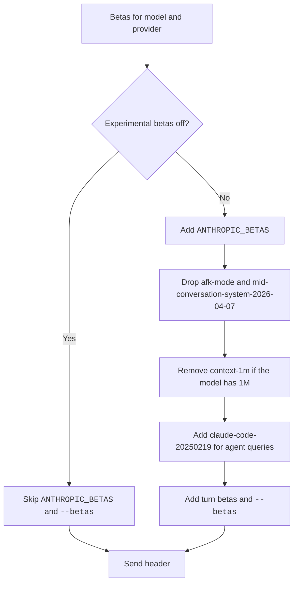

A beta is an early API feature that a request switches on with a value in the `anthropic-beta` header.
Claude Code keeps a list of these values and sends the ones that fit the model and the provider.
If a proxy rejects a request with a beta error, set `CLAUDE_CODE_DISABLE_EXPERIMENTAL_BETAS=1` to stop the pre-release values.

`ANTHROPIC_BETAS` adds values (comma list), and so does the `--betas` flag. `CLAUDE_CODE_DISABLE_EXPERIMENTAL_BETAS=1` turns off the experimental betas. `DISABLE_INTERLEAVED_THINKING` turns off one. The betas go in the `anthropic-beta` header, or in the `betas` field of the body on Bedrock.

## About the List

Claude Code joins the active values into the `anthropic-beta` header (or into the `betas` field of the body on Bedrock).
A row is <Documented /> when a docs page other than the [changelog](https://code.claude.com/docs/en/changelog) and the Agent SDK pages names the value. Few values have that.
Source: [Environment Variables](https://code.claude.com/docs/en/env-vars) for `ANTHROPIC_BETAS` and `CLAUDE_CODE_DISABLE_EXPERIMENTAL_BETAS`, and the program for the rest.

## How Claude Code Builds the List

Claude Code takes these steps for each request.

1. It adds the betas that fit the model and the provider.
2. It adds the values of `ANTHROPIC_BETAS`, a comma list, unless the experimental betas are off.
   It drops a value that has `afk-mode`, and it skips `mid-conversation-system-2026-04-07`, because that feature is generally available.
3. It removes `context-1m-2025-08-07` when the model has the 1M window already.
4. For an agent query, it adds `claude-code-20250219` if the list lacks it.
5. It adds the betas that depend on the turn, and then the values of the flag `--betas`.
   On a third-party provider it keeps only the allowed values of `--betas`.

`CLAUDE_CODE_DISABLE_EXPERIMENTAL_BETAS` or a HIPAA policy turns the experimental betas off.
Then Claude Code ignores `ANTHROPIC_BETAS` and `--betas`, and it leaves out the betas that only the Anthropic API takes.



## Registry

The Registry Name column is the internal name of the value in the program.

| Header Value | Status | Registry Name | When Claude Code Sends It |
| --- | --- | --- | --- |
| `claude-code-20250219` | <Undocumented /> | `claude_code` | For every model whose name has no `haiku`, and for agent queries. |
| `oauth-2025-04-20` | <Undocumented /> | `oauth_auth` | When you sign in with a subscription (OAuth). |
| `interleaved-thinking-2025-05-14` | <Documented /> | `interleaved_thinking` | For each model except `claude-3-*`, unless `DISABLE_INTERLEAVED_THINKING` is set. The docs name it as `interleaved-thinking`. |
| `context-1m-2025-08-07` | <Undocumented /> | `long_context` | When the model name has the `[1m]` suffix, also for a model with a 1M window. Never without the suffix (see [Probes](../probes.md)). |
| `context-management-2025-06-27` | <Undocumented /> | `context_management` | On the Anthropic API, on Anthropic-run clouds, and on Foundry, for each model except `claude-3-*`. |
| `structured-outputs-2025-12-15` | <Undocumented /> | `structured_outputs` | On the Anthropic API for a model that supports it, behind an experiment. |
| `web-search-2025-03-05` | <Undocumented /> | `web_search` | On Vertex for models with web search there, and on Foundry. |
| `advanced-tool-use-2025-11-20` | <Undocumented /> | `tool_search` | With tool search, as a second header value. |
| `tool-search-tool-2025-10-19` | <Undocumented /> | `tool_search` | With tool search. On Bedrock it goes in the body instead. |
| `effort-2025-11-24` | <Undocumented /> | `effort` | The program lists it, and no source states when it is sent. |
| `task-budgets-2026-03-13` | <Undocumented /> | `task_budgets` | The program lists it, and no source states when it is sent. |
| `prompt-caching-scope-2026-01-05` | <Undocumented /> | `prompt_caching_scope` | On the Anthropic API and Anthropic-run clouds, and when MCP tools are in the tool list. Since `2.1.307` it is not sent behind a custom `ANTHROPIC_BASE_URL` gateway or on Foundry ([release notes](https://github.com/anthropics/claude-code/releases/tag/v2.1.307)). |
| `prompt-caching-evict-2026-05-12` | <Undocumented /> | `prompt_caching_evict` | When a message has the `evict_on_complete` cache control. |
| `cache-keepalive-2026-09-03` | <Undocumented /> | `cache_keepalive` | When the keep-alive switch is on. It needs a subscriber login (see [Probes](../probes.md)). |
| `extended-cache-ttl-2025-04-11` | <Documented /> | `extended_cache_ttl` | When the cache time is `1h` on the Anthropic API. The docs name it as `extended-cache-ttl`. |
| `fast-mode-2026-02-01` | <Undocumented /> | `speed` | The program lists it, and no source states when it is sent. |
| `redact-thinking-2026-02-12` | <Undocumented /> | `redact_thinking` | On the Anthropic API when interleaved thinking is on and the session is interactive. |
| `thinking-resumption-2026-07-17` | <Undocumented /> | `thinking_resumption` | The program lists it, and no source states when it is sent. |
| `thinking-token-count-2026-05-13` | <Undocumented /> | `thinking_token_count` | With interleaved thinking on the Anthropic API, and on Bedrock and Mantle for some models. |
| `afk-mode-2026-01-31` | <Undocumented /> | `afk_mode` | For auto mode. |
| `advisor-tool-2026-03-01` | <Undocumented /> | `advisor_tool` | The program lists it, and no source states when it is sent. |
| `cache-diagnosis-2026-04-07` | <Undocumented /> | `cache_diagnosis` | The program lists it, and no source states when it is sent. |
| `context-hint-2026-04-09` | <Undocumented /> | `context_hint` | The program lists it, and no source states when it is sent. |
| `mcp-servers-2025-12-04` | <Undocumented /> | `mcp_servers` | The program lists it, and no source states when it is sent. |
| `files-api-2025-04-14` | <Undocumented /> | `files_api` | The program lists it, and no source states when it is sent. |
| `environments-2025-11-01` | <Undocumented /> | `environments` | The program lists it, and no source states when it is sent. |
| `ccr-byoc-2025-07-29` | <Documented /> | `ccr_byoc` | The program lists it, and no source states when it is sent. The docs name it in [Self-Hosted Environments Testing](https://code.claude.com/docs/en/self-hosted-environments-testing). |
| `per-turn-control-2026-07-01` | <Undocumented /> | `per_message_effort` | For models that take the effort with each message. |
| `timing-2026-09-09` | <Undocumented /> | `per_turn_timing` | When the time goes with each message. |
| `mid-conversation-tool-changes-2026-07-01` | <Undocumented /> | `mid_conv_tool_change` | For models that allow tool changes in the middle of a conversation. |
| `inline-tools-2026-09-15` | <Undocumented /> | `inline_tools` | With the previous value, when a second check passes. `CLAUDE_CODE_INLINE_TOOLS=1` also adds it (see [Probes](../probes.md)). |
| `server-side-fallback-2026-06-01` | <Undocumented /> | `server_side_fallback` | The program lists it, and no source states when it is sent. |
| `server-side-fallback-2026-07-01` | <Undocumented /> | `server_side_fallback_category` | The program lists it, and no source states when it is sent. |
| `fallback-credit-2026-06-01` | <Undocumented /> | `fallback_credit` | The program lists it, and no source states when it is sent. |
| `auto-mode-classifier-2026-07-16` | <Undocumented /> | `auto_mode_classifier` | The program lists it, and no source states when it is sent. |
| `dangerous-tool-use-2026-09-03` | <Undocumented /> | `dangerous_tool_use` | The program lists it, and no source states when it is sent. |
| `thinking-display-updates-2026-08-18` | <Undocumented /> | `thinking_display_updates` | The program lists it, and no source states when it is sent. |
| `thinking-binding-controls-2026-08-01` | <Undocumented /> | `thinking_binding_controls` | The program lists it, and no source states when it is sent. |
| `message-threads-2026-08-12` | <Undocumented /> | `message_threads` | The program lists it, and no source states when it is sent. |
| `mid-conversation-system-clear-at-2026-08-21` | <Undocumented /> | `mid_conversation_system_clear_at` | For the wire shape that keeps reminders. |

The registry also holds two internal switches, `x-cc-internal-mid-conv-cache-promotion` and `x-cc-internal-mid-conv-cache-promotion-ok`.
They are <Undocumented />, and Claude Code does not send them as header values.

## Other Beta Values in the Program

These values belong to the embedded Anthropic SDK client or to the provider code.
Claude Code does not put them in the model request. All of them are <Undocumented />.

| Value | Where It Is Used |
| --- | --- |
| `managed-agents-2026-04-01` | The endpoints `/v1/agents`, `/v1/sessions`, and `/v1/environments`. |
| `dreaming-2026-04-21` | The endpoint `/v1/dreams`. |
| `user-profiles-2026-08-18` | The endpoint `/v1/user_profiles`. |
| `agent-memory-2026-07-22` | The endpoint `/v1/memory_stores`. |
| `message-batches-2024-09-24` | The batch endpoint. |
| `token-counting-2024-11-01` | The endpoint `/v1/messages/count_tokens`. |
| `mcp-tunnels-2026-06-22` | The endpoint `/v1/tunnels`. |
| `oidc-federation-2026-04-01` | The federation endpoints. |
| `ccr-triggers-2026-01-30` | The endpoint `/v1/code/triggers`. |
| `bedrock-2023-05-31` | The `anthropic_version` of the Bedrock body. |
| `vertex-2023-10-16` | The `anthropic_version` of the Vertex body. |

## Observed Request

A transcript of `2.1.305` records each request in an `api-request` line. In a stub run with an API key, that line held 10 betas, from `claude-code-20250219` to `thinking-display-updates-2026-08-18`.
On `2.1.307` the same stub run held 9 betas: `prompt-caching-scope-2026-01-05` is gone, because the stub is a custom `ANTHROPIC_BASE_URL` (probe `print.transcripts.lines`).
On a local machine, the `api-request` lines of `2.1.305` held 19 betas (with `claude-sonnet-5-5` and with `claude-opus-5-5`) or 20 betas (with `claude-opus-5-5` only, which added `extended-cache-ttl-2025-04-11`).
The list ran from `claude-code-20250219` and `oauth-2025-04-20` to `message-threads-2026-08-12`.
This is one observation and not a rule. See [Transcript Format](../transcript-format.md).

On `2.1.306` we compared the first request with tools (the main request) of `claude -p "Reply with 'OK'."` with a subscription login (`CLAUDE_CODE_OAUTH_TOKEN`) and with a fake API key. Each side sent one `/v1/messages` request. The body had the same keys, the same tool names, and 4 system blocks. The login sent 15 betas, and the key sent 13. The two only the login sent were `oauth-2025-04-20` and `extended-cache-ttl-2025-04-11`. The default model differed: `claude-sonnet-5-5` with the login and `claude-opus-5-5` with the key. See [Probes](../probes.md#live-login-probes).

## Example

Add a beta by hand, then turn all experimental betas off for a proxy that rejects them.

```bash title="Betas from the shell"
# Add one value to the header
ANTHROPIC_BETAS="files-api-2025-04-14" claude -p "hi"

# Stop the experimental values (also ignores ANTHROPIC_BETAS and --betas)
CLAUDE_CODE_DISABLE_EXPERIMENTAL_BETAS=1 claude -p "hi"
```

## Related Pages

- [Endpoints and Headers](endpoints.md)
- [Request and Cache](../../how-it-works/request-and-cache.md)
- [Probes](../probes.md)
- [Environment Variables](../../configure/env-vars/index.md)
