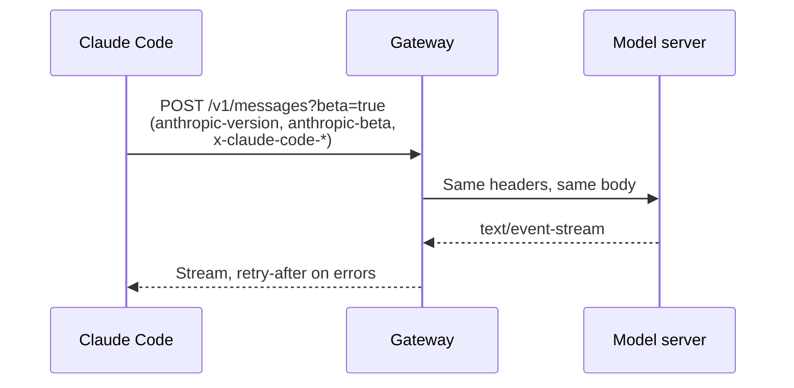

An endpoint is a URL path on a server, and a header is a named value that a request carries.
Claude Code calls the model server and a few account servers, and it adds headers to each request.
If you run Claude Code behind a proxy, the proxy must pass `anthropic-version` and `anthropic-beta` on without a change.

Base URL variables pick the server, and `ANTHROPIC_CUSTOM_HEADERS` adds headers. The switches are `CLAUDE_CODE_GATEWAY_HINT_HEADERS`, `CLAUDE_CODE_ATTRIBUTION_HEADER=0`, and `CLAUDE_CODE_ENABLE_GATEWAY_MODEL_DISCOVERY=1`. The model list is cached in `~/.claude/cache/gateway-models.json`.

## Model Endpoints

Source: [Gateway Compatibility Guide](https://code.claude.com/docs/en/llm-gateway-protocol), and [Probes](../probes.md) for `cache_touch`.

| Path | Status | What It Does |
| --- | --- | --- |
| `/v1/messages?beta=true` | <Documented /> | Sends the model request. |
| `/v1/messages/count_tokens` | <Documented /> | Counts tokens. Without it, Claude Code estimates from the number of characters. |
| `/v1/messages/cache_touch` | <Undocumented /> | Claude Code calls it every 30 seconds (10 to 120) to keep the prompt cache warm. It needs a subscriber login and the `cache-keepalive-2026-09-03` beta. |
| `/v1/models` | <Documented /> | Lists the models for the `/model` picker, only with `CLAUDE_CODE_ENABLE_GATEWAY_MODEL_DISCOVERY=1`. |
| `HEAD /api/hello` | <Documented /> | Warms up the connection. Claude Code skips it when an HTTP proxy or a client certificate is set. |
| `/model/{model}/invoke` and `/model/{model}/invoke-with-response-stream` | <Documented /> | The Amazon Bedrock format, chosen with `ANTHROPIC_BEDROCK_BASE_URL`. |
| `:rawPredict` and `:streamRawPredict` | <Documented /> | The Google Cloud Agent Platform format, chosen with `ANTHROPIC_VERTEX_BASE_URL`. |

## Account and Service Endpoints

These paths are strings in the program. The docs do not describe them, except the OpenTelemetry row.
The Use column comes from the code that calls each path.

| Path | Status | Use |
| --- | --- | --- |
| `/v1/oauth/token`, `/api/oauth/profile`, `/api/oauth/usage`, `/api/oauth/account/settings` | <Undocumented /> | `/v1/oauth/token` is the OAuth token URL. `/api/oauth/profile` returns the sign-in profile and organization. `/api/oauth/usage` returns plan usage (the `/usage` data). `/api/oauth/account/settings` is read and patched for the `grove_enabled` choice and for artifact pins. |
| `/api/oauth/account/settings?opt_in_only_if_unset=grove_enabled` | <Undocumented /> | The program sends a `PATCH` with the body `{ "grove_enabled": true }` when you accept the opt-in in the Grove notice. It reads `grove_enabled` back from the reply when that value is a boolean. The program does not state what the query parameter does. |
| `/api/claude_code/policy_limits` | <Undocumented /> | The limits of your organization, cached in `policy-limits.json`. |
| `/api/claude_code/organizations/metrics_enabled`, `/api/claude_code/notification/preferences`, `/api/claude_code/skills` | <Undocumented /> | The metrics opt-out check (`metrics_logging_enabled`), the notification preferences, and the skill health data, which is fetched only when the server flag `tengu_skills_dashboard_enabled` is on. |
| `/api/event_logging/v2/batch` | <Undocumented /> | Event logging by Anthropic. |
| `/v1/metrics`, `/v1/logs`, `/v1/traces` | <Documented /> | OpenTelemetry export. See [Monitoring](https://code.claude.com/docs/en/monitoring-usage). |
| `/api/claude_cli_feedback`, `/api/claude_code_shared_session_transcripts` | <Undocumented /> | Feedback and shared transcripts. |
| `/v1/code/sessions`, `/v1/code/triggers`, `/v1/code/github/*`, `/v1/code/agent-proxy` | <Undocumented /> | Cloud sessions, routines (`/v1/code/triggers`), GitHub pull request and review comment helpers, and the relay that the agent proxy uses. |
| `/v1/ultrareview/quota`, `/v1/ultrareview/preflight` | <Undocumented /> | The quota check and the preflight check for an ultrareview cloud run. |
| `/api/model_selector/{id}`, `/api/organization/claude_code_first_token_date` | <Undocumented /> | Model picker data, and a one-time fetch of the date of first use that is kept as `claudeCodeFirstTokenDate`. |
| `/api/ws/speech_to_text/voice_stream` | <Undocumented /> | Voice dictation. |
| `/api/frame/*`, `/v1/design/*` | <Undocumented /> | Artifact frames (`/api/frame/*`, through the agent proxy) and Claude Design MCP servers (`/v1/design/*`). |

The program also holds an Anthropic SDK client with paths such as `/v1/agents`, `/v1/skills`, `/v1/vaults`, and `/v1/organizations/*`.
They belong to the SDK code, and the Claude Code loop does not call them.
The program names these hosts: `code.claude.com`, `claude.ai`, `claude.com`, `api.anthropic.com`, `platform.claude.com`, `www.anthropic.com`, `support.claude.com`, `downloads.claude.ai`, and `mcp-proxy.anthropic.com`.

## Sign-In and Account Paths

These paths are strings in the program. No source states their rules, so the Use column comes from the code that calls each path.
Where the code does not show the purpose, the row says so.

| Path | Status | Use |
| --- | --- | --- |
| `/api/claude_cli/bootstrap` | <Undocumented /> | A startup fetch with a 5 second timeout. Claude Code skips it on third-party providers. |
| `/api/claude_code/settings` | <Undocumented /> | The URL that the remote managed settings are read from. |
| `/api/claude_code/metrics` | <Undocumented /> | The target of the first-party metrics exporter, with a 5 second timeout. |
| `/api/claude_cli_profile` | <Undocumented /> | Reads a profile with an API key and the account UUID. |
| `/api/claude_code_grove`, `/api/oauth/account/grove_notice_viewed` | <Undocumented /> | The Grove notice. The first path returns the config with a `grove_enabled` flag. The second is named for the notice-viewed event. |
| `/api/claude_code_penguin_mode` | <Undocumented /> | The fast mode status of your organization. Claude Code emits `orgFastModeChange` when it changes. |
| `/api/auth/trusted_devices` | <Undocumented /> | Enrolls the device with your OAuth token. The body holds a display name such as `Claude Code on` and the host. |
| `/api/oauth/validate` | <Undocumented /> | Part of the Claude in Chrome check. The OAuth token needs a scope that this path accepts (`user:profile`, `user:office`, or `user:ccr_inference`), or Claude Code turns the feature off. |
| `/api/oauth/claude_cli/create_api_key`, `/api/oauth/claude_cli/roles`, `https://api.anthropic.com/api/oauth/claude_cli/create_api_key`, `https://api.anthropic.com/api/oauth/claude_cli/roles` | <Undocumented /> | The `API_KEY_URL` and `ROLES_URL` of the OAuth config. |
| `/api/oauth/organizations/${…}`, `/api/oauth/organizations/${…}/code/repos/${…}/${…}`, `/api/oauth/organizations/${…}/code/repos/resync`, `/api/oauth/organizations/${…}/sync/github/auth` | <Undocumented /> | Organization paths for the GitHub app. `/code/repos/<owner>/<repo>` checks whether the app is installed, `/code/repos/resync` asks the server to resync that status, and `/sync/github/auth` checks whether the GitHub token is synced by web setup. Other calls also use the first path as a prefix. |
| `/api/organizations/${…}/reset_rate_limits` | <Undocumented /> | Posts a rate limit reset claim for your OAuth organization. |
| `/api/oauth/file_upload`, `/api/oauth/files/${…}/content${…}` | <Undocumented /> | File upload with your OAuth token (scope `user:file_upload`), and file content. In `2.1.312` the content URL ends with `?model_copy=inference_highres` when the caller asks for the model copy of the file, and with nothing otherwise (`chunk-6jvss743.js:2015`). |
| `/api/oauth/cri`, `https://api.anthropic.com/api/oauth/cri` | <Undocumented /> | The base of an issuer for `cri+jwt` tokens (ES256), with its keys at `/jwks.json` below it. No source states what it is for. |
| `/api/oauth/local_pairing` | <Undocumented /> | The issuer for local pairing. Claude Code builds `/attest` and `/jwks.json` below it. |
| `/v1/oauth/hello` | <Undocumented /> | The startup preflight checks `/api/hello` on the API host and `/v1/oauth/hello` on the OAuth host, with a 10 second timeout. |

## OAuth URLs and Hosts

The URLs below are part of the production OAuth config in the program. `CLAUDE_CODE_CUSTOM_OAUTH_URL` changes them.

| URL | Status | Use |
| --- | --- | --- |
| `https://platform.claude.com/oauth/authorize` | <Undocumented /> | The Console sign-in page (`CONSOLE_AUTHORIZE_URL`). |
| `https://claude.com/cai/oauth/authorize` | <Undocumented /> | The claude.ai sign-in page (`CLAUDE_AI_AUTHORIZE_URL`). |
| `https://platform.claude.com/v1/oauth/token` | <Undocumented /> | The token URL (`TOKEN_URL`). |
| `https://platform.claude.com/oauth/code/callback` | <Undocumented /> | The redirect for the manual code flow (`MANUAL_REDIRECT_URL`). |
| `https://platform.claude.com/oauth/code/success?app=claude-code`, `https://platform.claude.com/buy_credits?returnUrl=/oauth/code/success%3Fapp%3Dclaude-code` | <Undocumented /> | The success pages (`CLAUDEAI_SUCCESS_URL` and `CONSOLE_SUCCESS_URL`) where the local callback server sends the browser. |
| `https://claude.ai/oauth/claude-code-client-metadata` | <Undocumented /> | Held next to the OAuth config. No source states its use. |
| `https://api.anthropic.com`, `https://claude.ai`, `https://mcp-proxy.anthropic.com` | <Undocumented /> | `BASE_API_URL`, `CLAUDE_AI_ORIGIN`, and `MCP_PROXY_URL`. |

## MCP Paths

| Path | Status | Use |
| --- | --- | --- |
| `/v1/mcp_servers?limit=1000` | <Undocumented /> | Lists your claude.ai MCP connectors. It needs the `user:mcp_servers` scope, and Claude Code adds `include_additional_installs=true`. |
| `/v1/mcp/{server_id}`, `/v1/toolbox/shttp/mcp/{server_id}` | <Undocumented /> | The `MCP_PROXY_PATH` on `https://mcp-proxy.anthropic.com`, and the one of the local OAuth config at `http://localhost:8205`. |
| `/api/organizations/${…}/mcp/start-auth/${…}?product_surface=${…}` | <Undocumented /> | A claude.ai URL that starts the sign-in of a connector. `product_surface` is the entrypoint, such as `cli`. |
| `/api/directory/servers?${…}`, `/api/directory/plugins` | <Undocumented /> | `servers` is read without credentials, with a 5 second timeout, in pages of 500, and Claude Code keeps the URLs of the remote servers. `plugins` is a constant, and no source states its use. |
| `/v1/pages/mcp`, `/api/artifacts/mcp`, `/v1/code/mcp/ccr-artifacts`, `/v1/code/mcp/hearthbot`, `/v1/claudeai-agents/mcp` | <Undocumented /> | Paths of built-in MCP servers that the program holds as constants. It names the servers `Claude_Pages`, `Claude_Docs`, and `claude-artifacts`. No source states the use of each path. |
| `https://platform.claude.com/docs/mcp` | <Undocumented /> | The `docs` HTTP MCP server of the built-in plugin `cc-plugin-claude-platform` (`chunk-j1r347qy.js:183`). It is for building with the Claude API. The plugin is available only when a server-side gate is on and the other checks of the program pass (`chunk-j1r347qy.js:160`). |
| `https://microsoft365.mcp.claude.com/mcp` | <Undocumented /> | The URL of the managed MCP preset "Microsoft 365" (name `m365`, HTTP transport). |

## Flags, Environments, and Files

| Path | Status | Use |
| --- | --- | --- |
| `/api/features/${…}`, `/api/eval/${…}`, `/api/eval-authed/${…}`, `https://api.anthropic.com/` | <Undocumented /> | The GrowthBook client that delivers the `tengu_*` gates. It reads the feature list, evaluates remotely, and evaluates with your auth headers (it falls back to `/api/eval` on an error). `${…}` is the client key, and `https://api.anthropic.com/` is the host. `DISABLE_GROWTHBOOK` turns the fetch off. |
| `/v1/environments/bridge`, `/v1/environments/bridge/${…}`, `/v1/environments/bridge/${…}/offline`, `/v1/environments/${…}/bridge/reconnect` | <Undocumented /> | The bridge client of Remote Control. `POST /v1/environments/bridge` registers the environment. The other paths are named for the environment, going offline, and reconnecting. |
| `/v1/environments/${…}/work/poll`, `/v1/environments/${…}/work/${…}/ack`, `/v1/environments/${…}/work/${…}/heartbeat`, `/v1/environments/${…}/work/${…}/stop` | <Undocumented /> | Work item calls of the same bridge client, named for polling, acknowledging, heartbeat, and stop. |
| `/v1/environment_providers`, `/v1/environment_providers/cloud/create` | <Undocumented /> | `cloud/create` posts a new cloud environment of kind `anthropic_cloud` with the description "Default - trusted network access". |
| `/v1/sessions`, `/v1/sessions/${…}`, `/v1/sessions/${…}${…}`, `/v1/sessions/${…}/archive`, `/v1/sessions/${…}/events` | <Undocumented /> | Session paths without `beta=true`. Claude Code posts events to `/v1/sessions/<id>/events`, and to `/v1/code/sessions/<id>/events` for a cloud session. |
| `/v1/files`, `/v1/files/${…}`, `/v1/files/${…}/content` | <Undocumented /> | Files API paths without `beta=true`. Both Claude Code and the SDK client hold them. |
| `/v1/filestore/fs/listDirectory`, `/v1/filestore/fs/readFile` | <Undocumented /> | File store calls. `readFile` posts a `filesystem_id` and a `path` with a JWT, and stops after 60 seconds without bytes. |
| `/v1/code/local/memory/mounts`, `/v1/code/local/memory/credential` | <Undocumented /> | Organization memory stores. The program caches the discovery answer in `org-memory-discovery.json`. |

## Hosts and Downloads

| URL | Status | Use |
| --- | --- | --- |
| `https://downloads.claude.ai/claude-code-releases` | <Undocumented /> | The base URL for release downloads, next to the update errors (`update_apply_*`). |
| `https://downloads.claude.ai/claude-code-releases/plugins/claude-plugins-official` | <Undocumented /> | Where the program fetches the official plugin marketplace. It is cached under `marketplaces/claude-plugins-official/`. |
| `https://downloads.claude.ai/model-catalog/v1/catalog.json`, `https://downloads.claude.ai/model-catalog/v1/schema.json` | <Undocumented /> | The signed model catalog (the signature is a `.raw-sig.json` file, key `claude-code-release-signing-key`), and the `$schema` of its entries. |
| `https://anthropic.com/claude-code/plugin.schema.json` | <Undocumented /> | The URL of the plugin manifest schema, by its name. |
| `https://code.claude.com/docs/en/claude_code_docs_map.md`, `https://platform.claude.com/llms.txt`, `https://claude.com/docs/llms.txt`, `https://claude.com/docs/claude-tag/overview.md` | <Undocumented /> | Doc sources that the program holds next to the `claude-code-guide` agent. |
| `https://status.claude.com` | <Undocumented /> | Named next to the "Repeated 529 Overloaded errors" message. |

## Request Headers

Source: [Gateway Compatibility Guide](https://code.claude.com/docs/en/llm-gateway-protocol#request-headers). Header names are not case-sensitive.

| Header | Status | Meaning |
| --- | --- | --- |
| `Authorization`, `x-api-key` | <Documented /> | The credential. |
| `anthropic-version` | <Documented /> | The API version, `2023-06-01`. |
| `anthropic-beta` | <Documented /> | The list of beta values. See [Betas](betas.md). |
| `x-claude-code-session-id` | <Documented /> | One value for each session. |
| `x-claude-code-agent-id`, `x-claude-code-parent-agent-id` | <Documented /> | The subagent that sent the request, and its parent. |
| `x-claude-code-request-class` | <Documented /> | The kind of request: `main`, `subagent`, `workflow`, `compaction`, or `auxiliary`. |
| `x-claude-code-agent-type` | <Documented /> | The kind of agent: `Explore`, `Plan`, `general-purpose`, `custom`, `teammate`, or `fork`. |
| `x-claude-code-compaction`, `x-claude-code-context-compacted` | <Documented /> | Marks a compaction request, and the first request after one. |
| `x-claude-code-prev-tool-durations` | <Documented /> | The run time of the last tool batch, such as `Bash=742;Read=9`, with at most 32 entries and 4 KB. |
| `x-claude-code-prompt-id` | <Documented /> | A random UUID for the user prompt, from `2.1.283`. |
| `anthropic-workspace-id` | <Documented /> | Needed on Claude Platform on AWS. |
| `ANTHROPIC_CUSTOM_HEADERS` | <Documented /> | An env var for extra headers, one `Name: value` on each line. It is not a header itself. |
| `x-app`, `anthropic-client-platform`, `X-Stainless-*`, `X-Trusted-Device-Token`, `x-organization-uuid` | <Undocumented /> | Names in the program. No source states their rules. |

The hint headers (`x-claude-code-request-class` and the next four rows) go out on a direct connection to the Anthropic API.
On a custom base URL they need `CLAUDE_CODE_GATEWAY_HINT_HEADERS=1`. Setting it to `0` stops them everywhere.

## Response Headers Claude Code Reads

| Header | Status | Use |
| --- | --- | --- |
| `retry-after` | <Documented /> | A number of seconds. A value above 60 stops the retries unless `CLAUDE_CODE_RETRY_WATCHDOG` is set. |
| `x-should-retry` | <Documented /> | `true` or `false`. It is one input to the retry decision. |
| `anthropic-ratelimit-unified-*` | <Documented /> | Plan usage and limits for `claude.ai` sign-ins. |
| `content-type` | <Documented /> | `text/event-stream`, or `application/vnd.amazon.eventstream` on Bedrock. |

## Attribution Block

The first block of `system` is a text line that starts with `x-anthropic-billing-header:`.
The docs say the block holds the client version and a fingerprint of the conversation ([Gateway Compatibility Guide](https://code.claude.com/docs/en/llm-gateway-protocol#system-prompt-attribution-block)).
The field names below come from the program.

| Field | Status | Meaning |
| --- | --- | --- |
| `cc_version` | <Undocumented /> | The client version. |
| `cc_entrypoint` | <Undocumented /> | Where Claude Code runs, such as `cli`, `sdk-cli`, or `claude-vscode`. |
| `cc_workload`, `cc_is_subagent` | <Undocumented /> | The workload tag (`--workload`), and a flag for subagents. |
| `cc_prev_req`, `cc_prompt_id`, `cc_turn_origin`, `cc_prompt_index`, `cc_turn_index` | <Undocumented /> | Request and turn tracking, only on the Anthropic API. |
| `cc_gateway`, `cc_project`, `cc_project_src` | <Undocumented /> | Tags for the gateway and the project. |

`CLAUDE_CODE_ATTRIBUTION_HEADER=0` removes the block.
The `api.anthropic.com` server strips it when it is the first and only block of its entry.

## Example

Keep the hint headers on a custom gateway and read them there.

```bash title="Send hint headers to a gateway"
export ANTHROPIC_BASE_URL=https://gateway.example.com
export CLAUDE_CODE_GATEWAY_HINT_HEADERS=1
claude -p "hi"
```

The gateway then sees `x-claude-code-request-class: main` and the other hint headers on each request.

## How It Works



## Related Pages

- [Betas](betas.md)
- [Request and Cache](../../how-it-works/request-and-cache.md)
- [Environment Variables](../../configure/env-vars/index.md)
- [Gateway Compatibility Guide](https://code.claude.com/docs/en/llm-gateway-protocol)
