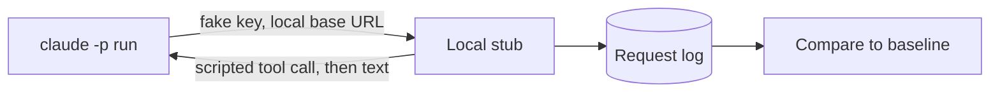

A probe is a small test that runs Claude Code `2.1.303` and checks what one setting changes.
The probes ran against a local stub of the Messages API, so they cost nothing and sent no data to Anthropic.
They show which environment variables and settings have an effect that you can see.

## At a Glance

| Question | Answer |
| --- | --- |
| Can you use it? | Yes. You can repeat any probe with the method below. |
| Can you change it? | Not applicable. This page records results. |
| Can you turn it on or off? | Each row names the env var or flag that was set. |
| Where does it live? | Results only. The tools to repeat them are in the repo. |
| Status | <Undocumented /> <Differs /> |

## How We Probed

1. We ran the unmodified `2.1.303` program with `claude -p "hi" --output-format stream-json --verbose`.
2. We gave each run a fresh config folder, a fresh home folder, a fake API key, and a base URL that points to the local stub.
3. We turned off telemetry and other optional traffic. We pointed the proxy settings to a closed port, so a stray request to `api.anthropic.com` fails.
4. The stub answered `POST /v1/messages` as a stream or as JSON. It sent one scripted tool call and then plain text. It wrote the method, path, headers, and body of each request to a log.
5. We made two baselines. The first was a plain run. The second ran a `Bash` tool call with command hooks on five events and a local plugin with a skill, a hook, and an MCP server. Two repeat runs of each baseline were identical after we removed ids, paths, and times.
6. We set each of 166 variables to `1` in both baselines, which gave 332 runs. We compared headers, betas, the system prompt, tools, body fields, output events, files in the config folder, the hook log, and the environment names that hooks saw.
7. Some names got extra runs: auto mode with a `Bash` call, `--brief`, `--resume`, and the plugin variables with a plugin.

Every request carried the fake key, and the only path called was `/v1/messages?beta=true`.



## Results

Of the 166 variables, 11 had an effect that we could see. The rest had none.
No visible effect in print mode does not prove that a variable does nothing.
Many variables work only in other modes, in remote sessions, or with a login.
This page lists only the rows with an effect or a difference. The rows with no visible effect are left out.

### Effects and Differences

An item is <Differs /> when the result differs from the docs.

| Name | What We Set | Status | What We Saw |
| --- | --- | --- | --- |
| `--model X[1m]` | model flag | <Undocumented /> | `context-1m-2025-08-07` is added for `sonnet[1m]`, `opus[1m]`, and every `claude-*[1m]` tried, also for models with a native 1M window. Without `[1m]` it is never sent. |
| hook `type: "script"` | settings | <Differs /> | Rejected at load with `Unknown hook type "script"; entry ignored`. No script ran. A `PreToolUse` entry also disables the whole settings file it sits in. |
| `CLAUDE_CODE_AMBER_ASTROLABE` | `1` | <Undocumented /> | Adds an "operating autonomously" block to the system prompt (do not ask "Shall I...?", finish the work before ending the turn). |
| `CLAUDE_CODE_BASALT_COVE` | `1` | <Undocumented /> | Adds a "Communicating with the user" section and a code-comment rule to the system prompt. |
| `CLAUDE_CODE_HUMBLE_HAMMOCK` | `1` | <Undocumented /> | Adds `wire_tool_inputs` (raw `tool_use.input`) to the assistant event when a tool runs. |
| `CLAUDE_CODE_INLINE_TOOLS` | `1` | <Undocumented /> | Adds the beta `inline-tools-2026-09-15` to `anthropic-beta`. |
| `CLAUDE_CODE_LANTERN_PRISM` | `1` | <Undocumented /> | Adds the `skill-doctor` skill to the `init` event. |
| `CLAUDE_CODE_LARCH_CISTERN` | `1` | <Undocumented /> | Adds a "Corrections" section to the system prompt (avoid excessive self-correction). |
| `CLAUDE_CODE_PLUGIN_DIRS` | `1` | <Undocumented /> | Loads the plugin dir like `--plugin-dir` (same `plugins` list in `init`). |
| `CLAUDE_CODE_SIMULATE_PROXY_USAGE` | `1` | <Undocumented /> | Removes the whole `anthropic-beta` header and the `thinking.display` field. |
| `CLAUDE_CODE_SKIP_PLUGIN_MCP_SERVERS` | `1` | <Undocumented /> | Plugin MCP servers are not started. `mcp_servers` is empty and the tool list shrinks. |
| `CLAUDE_CODE_SYNC_PLUGIN_INSTALL` | `1` | <Undocumented /> | Emits `plugin_install` events (`started`, `completed`) in stream-json. |
| `CLAUDE_CODE_USE_COWORK_PLUGINS` | `1` | <Undocumented /> | User settings come from `cowork_settings.json` and plugins from `cowork_plugins`, so the hooks in `settings.json` did not run. |

## Request Details

- `cc_version=2.1.303.914`: the suffix `914` stayed the same in all runs.
- `/v1/messages/cache_touch`: never called. The program sends it only when the response has `anthropic-cache-keepalive: active` for a request with the `cache-keepalive-2026-09-03` beta.
  That beta needs a 1-hour cache TTL for a subscriber login, `allow_cache_keepalive`, and a server-side flag.
  The body is `{"request_id": ...}`. Touches repeat every 30 s by default (10 to 120).
  The stub with the response header and a flag override did not start it, because the probe had no subscriber login.
- `context-1m-2025-08-07`: added by a `[1m]` suffix, also on models with a native 1M window. Not sent without the suffix.
  The default model in this setup was `claude-opus-5-5` and it did not send the beta.
- Base betas in the plain run: `claude-code-20250219`, `interleaved-thinking-2025-05-14`, `thinking-token-count-2026-05-13`, `context-management-2025-06-27`, `prompt-caching-scope-2026-01-05`, `per-turn-control-2026-07-01`, `mid-conversation-tool-changes-2026-07-01`, `effort-2025-11-24`, `thinking-display-updates-2026-08-18`.
  A first-party connection adds `advanced-tool-use-2025-11-20`, `thinking-binding-controls-2026-08-01`, and `cache-diagnosis-2026-04-07`.

## Auto Mode

With `--permission-mode auto` and a `Bash` call, the stub got classifier requests with `xml_s1` and `xml_s2` stages.
The debug log says `server_no_result` and falls back to billed local classifier requests.
Neither classifier variable changed that.

## What We Did Not Probe

- Chrome variables need the extension.
- Remote, CCR, and cloud variables need a remote session.
- Subscriber-only paths such as `cache_touch` need a login.

## Example

Repeat the `[1m]` probe by hand against any stub or proxy that logs request headers.

```bash title="Check the 1M beta"
ANTHROPIC_BASE_URL=http://127.0.0.1:8787 \
ANTHROPIC_API_KEY=sk-ant-fake-probe \
claude -p "hi" --model "sonnet[1m]" --output-format stream-json --verbose
```

Look for `context-1m-2025-08-07` in the `anthropic-beta` header. Run it again without `[1m]` and the value is gone.

## How It Works

The harness reads an env var at start or at the point of use. A probe sets one variable, runs the same short session, and compares every output to the baseline.
A change in a header, the system prompt, the tool list, or an event is an effect. A run with no change shows nothing in print mode, but the variable can still matter in another mode.

## Related Pages

- [API Betas](api/betas.md)
- [API Endpoints and Headers](api/endpoints.md)
- [Environment Variables](../configure/env-vars/index.md)
- [Hooks](../extend/hooks/index.md)
- [Request and Cache](../how-it-works/request-and-cache.md)
