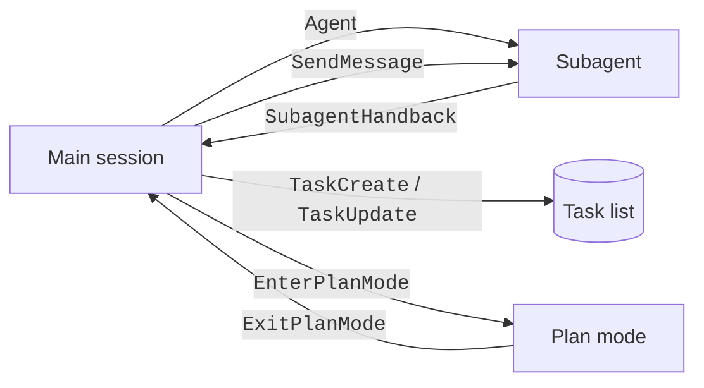

These tools start subagents, send messages, track tasks, schedule work, and control plan mode and worktrees.
Claude uses them to split a large job into parts.
For example, `Agent` starts a subagent with its own context, and `TaskCreate` adds a step to the task list.
The Yes and No columns are explained on [Tools](index.md#how-to-read-the-tool-tables).

You see subagents, tasks, and plans in the interface. Turn tasks off with `CLAUDE_CODE_ENABLE_TASKS=0` (Claude uses `TodoWrite` instead), turn workflows off with `CLAUDE_CODE_DISABLE_WORKFLOWS=1`, or add a deny rule. The task, cron, plan, and agent-listing tools need a gate.

## Tools

Source: [Tools Reference](https://code.claude.com/docs/en/tools-reference), [Configure Permissions](https://code.claude.com/docs/en/permissions), [Create Custom Subagents](https://code.claude.com/docs/en/sub-agents), and the program.

| Tool | Status | What It Does | How It Works | Available In | Read-Only | Parallel | Deferred |
| --- | --- | --- | --- | --- | --- | --- | --- |
| `Agent` | <Documented /> | Starts a subagent (alias `Task`). | See [Agent Parameters](#agent-parameters). | Main session and subagents until the depth limit. At the limit only a fork keeps it. | ✅ | ✅ | ❌ |
| `SubagentHandback` | <Documented /> | A subagent returns its final report to its caller. | `message` (string, required). `alwaysLoad` is true. Offered only to a subagent that reports through it. | Subagents | ❌ | ❌ | ❌ |
| `SendMessage` | <Documented /> | Sends a message to a teammate, a named subagent, `main`, or a background agent. | `to` (string, required), `summary` (string, optional label), `message` (string, required). In a build with `notify_when_idle`, that boolean field asks for one idle notice. | Main session and subagents. | ✅ | ❌ | ✅ |
| `ListAgents` | <Documented /> <Gated note="cross-session messaging must be on" /> | Lists agents that `SendMessage` can reach. | `channel` and `q` (strings, optional, "not available in this build"). Alias `ListPeers`. Not kept in background subagents. | Main session and foreground subagents. | ✅ | ✅ | ❌ |
| `Skill` | <Documented /> | Runs a skill or slash command. | `skill` (string, required), `args` (string, optional). | Main session and subagents. Kept in background subagents. | ❌ | ❌ | ❌ |
| `TodoWrite` | <Documented /> <Gated note="CLAUDE_CODE_ENABLE_TASKS=0 or a server flag" /> | Writes the session checklist (legacy). | `CLAUDE_CODE_ENABLE_TASKS=0` selects `TodoWrite` over the Task tools. | Main session and subagents. Kept in background subagents. | ❌ | ❌ | ✅ |
| `TaskCreate` | <Documented /> <Gated note="default on models in the task tool list" /> | Creates a task. | `subject` (string, required), `description` (string, required), `activeForm` (string, optional), `metadata` (object, optional). | Main session. Teammates keep it. Other subagents do not. | ❌ | ❌ | ✅ |
| `TaskGet` | <Documented /> <Gated note="hidden server-side flag" /> | Reads a task. | `taskId` (string, required). | Same as `TaskCreate`. | ✅ | ❌ | ✅ |
| `TaskUpdate` | <Documented /> <Gated note="same gate as TaskCreate" /> | Updates or deletes a task. | `taskId` (required), `subject`, `description`, `activeForm`, `status` (a task status or `deleted`), `addBlocks`, `addBlockedBy` (string arrays), `owner`, `metadata` (a null value deletes a key). | Same as `TaskCreate`. | ❌ | ❌ | ✅ |
| `TaskList` | <Documented /> <Gated note="hidden server-side flag" /> | Lists tasks. | No parameters. | Same as `TaskCreate`. | ✅ | ❌ | ✅ |
| `CronCreate` | <Documented /> <Gated note="hidden server-side flag" /> | Schedules a prompt (recurring or once). | `cron` (5-field string, local time, required), `prompt` (string, required), `recurring` (boolean, default true, expires after a set number of days), `durable` (boolean, optional). | Main session. Teammates keep it. | ❌ | ❌ | ✅ |
| `CronDelete` | <Documented /> <Gated note="hidden server-side flag" /> | Cancels a cron job. | `id` (string, required). | Same as `CronCreate`. | ❌ | ❌ | ✅ |
| `CronList` | <Documented /> <Gated note="hidden server-side flag" /> | Lists cron jobs. | No parameters. | Same as `CronCreate`. | ✅ | ❌ | ❌ |
| `ScheduleWakeup` | <Documented /> <Gated note="dynamic /loop" /> | Schedules the next turn of a dynamic `/loop`. | `delaySeconds` (number, clamped to 60 to 3600), `reason`, `prompt`, `stop` (boolean), `noop` (boolean). All are optional, but the first three are required unless `stop` is true. | Main session. | ❌ | ❌ | ❌ |
| `Workflow` | <Documented /> <Gated note="off with CLAUDE_CODE_DISABLE_WORKFLOWS=1" /> | Runs a JavaScript workflow that orchestrates subagents. | `script`, `name`, `scriptPath`, `args`, `resumeFromRunId`. `description` and `title` are ignored. Alias `RunWorkflow`. Removed from subagents. | Main session. | ❌ | ❌ | ❌ |
| `EnterWorktree` | <Documented /> | Creates a git worktree and switches into it. | `name` (string, optional) or `path` (string, optional, an existing worktree). Not both. Not deferred when `CLAUDE_CODE_SESSION_KIND` is `bg`. Refused from a subagent with a cwd override. | Main session and subagents. Kept in background subagents. | ❌ | ❌ | ✅ |
| `ExitWorktree` | <Documented /> | Leaves the worktree. | `action` (`keep` or `remove`, required), `discard_changes` (boolean, needed for `remove` when there are changes). Refused from a subagent with a cwd override. | Main session and subagents. Kept in background subagents. | ❌ | ❌ | ✅ |
| `EnterPlanMode` | <Documented /> <Gated note="internal enable check" /> | Switches to plan mode. | No parameters. Gives a validation error from an agent. Removed from subagents. | Main session only. | ✅ | ❌ | ✅ |
| `ExitPlanMode` | <Documented /> <Gated note="internal enable check" /> | Presents the plan and leaves plan mode. | `allowedPrompts` (deprecated, unused). A subagent keeps it only when its `permissionMode` is `plan`. | Main session. | ❌ | ❌ | ✅ |
| `AskUserQuestion` | <Documented /> | Asks the user 1 to 4 multiple-choice questions. | Removed from every subagent. | Main session. | ✅ | ❌ | ❌ |
| `ProposeGoal` | <Undocumented /> <Gated note="hidden server-side flag" /> | Proposes a goal condition for user approval. | `condition` (string, required), `ask_user` (boolean, default true). | Main session. | ✅ | ❌ | ✅ |
| `ReportFindings` | <Documented /> | Reports code-review findings as a list. | `level` (`low`, `medium`, `high`, `xhigh`, `max`, optional), `findings` (array of at most 32, required). Used only when review instructions ask for it. | Main session. | ✅ | ✅ | ❌ |

## `Agent` Parameters

Source: the program (the `Agent` input schema).

| Parameter | What It Does | Required |
| --- | --- | --- |
| `description` | A short (3-5 word) description of the task. | ✅ |
| `prompt` | The task for the agent. | ✅ |
| `subagent_type` | Type of agent to use. | ❌ |
| `model` | `sonnet`, `opus`, `haiku`, or `fable`. Overrides the agent definition. | ❌ |
| `effort` | Reasoning effort for this agent. Omitted in some sessions. Also takes `lower` and `higher` when `CLAUDE_CODE_SNAPPY_PELICAN` is on (or a hidden server flag is on) and no model override is set. Ignored for forks, remote isolation, and teammates. | ❌ |
| `run_in_background` | Agents run in the background by default. `false` waits for the result. | ❌ |
| `name` | Name that makes the agent addressable by `SendMessage` while it runs. | ❌ |
| `isolation` | `worktree` for a temporary git worktree, or `remote` for a cloud environment. | ❌ |
| `cwd` | Absolute path to run in. Not with `isolation: "worktree"`. Offered only in some sessions. | ❌ |
| `team_name` | Deprecated and ignored. | ❌ |
| `mode` | Deprecated and ignored. | ❌ |

`Agent` was `Task` before `2.1.63`. `Task(...)` still works as an alias in rules and agent files ([Create Custom Subagents](https://code.claude.com/docs/en/sub-agents)).

## Example

Stop Claude from running workflows, and use the old checklist tool.

```json title=".claude/settings.json"
{
  "env": {
    "CLAUDE_CODE_DISABLE_WORKFLOWS": "1",
    "CLAUDE_CODE_ENABLE_TASKS": "0"
  }
}
```

## How It Works



A subagent gets a smaller tool list than the main session. For example, `AskUserQuestion` and `EnterPlanMode` are removed from every subagent.
See [Subagent Runtime](../../extend/subagents/runtime.md) for the full rules.

## Errors

Each row is a family of messages. The backticked text is the start that every message in the family shares.

| Start of Message | Status | What It Means | Cases |
| --- | --- | --- | --- |
| `Cannot enter worktree` | <Undocumented /> | `EnterWorktree` with `path` refused the worktree. | The worktree belongs to another running session (locked), does not exist, is a network path, is marked prunable by git, is not a registered or linked worktree, is the current directory, or is not under the worktrees that Claude Code manages. |
| `Orphaned worktree dir` | <Undocumented /> | Claude Code left a leftover worktree directory alone. | It will not self-heal when `git remote`, `rev-list`, or `rev-parse` fails, or when the branch has unpushed commits. |
| `WorktreeCreate hook failed` | <Undocumented /> | A `WorktreeCreate` hook did not give a worktree. | The hook errored, was configured but did not run (workspace not trusted or matcher mismatch), or returned no worktree path. |

## Related Pages

- [Tools](index.md)
- [Subagents](../../extend/subagents/index.md)
- [Subagent Frontmatter](../../extend/subagents/frontmatter.md)
- [Tools Reference](https://code.claude.com/docs/en/tools-reference)
