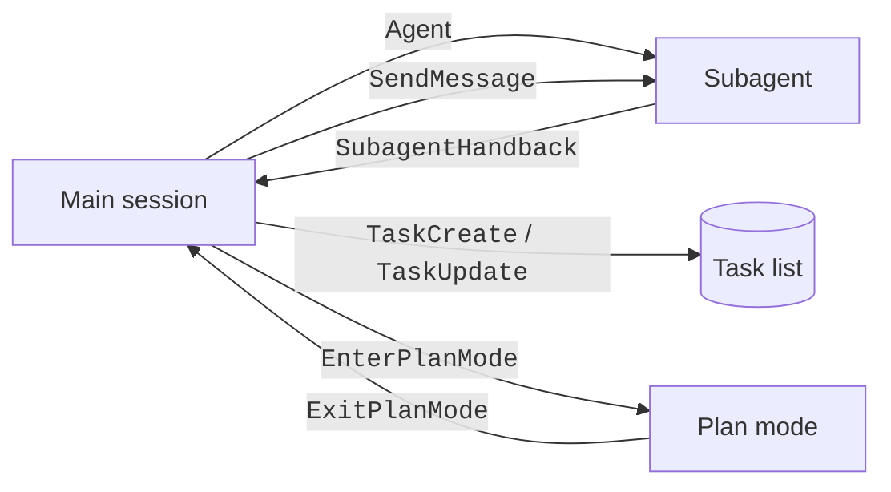

These tools start subagents, send messages, track tasks, schedule work, and control plan mode and worktrees.
Claude uses them to split a large job into parts.
For example, `Agent` starts a subagent with its own context, and `TaskCreate` adds a step to the task list.
[Tools](index.md#how-to-read-the-tool-tables) explains the Yes and No columns.

You see subagents, tasks, and plans in the interface. You can turn tasks off with `CLAUDE_CODE_ENABLE_TASKS=0`. Claude uses `TodoWrite` instead. You can turn workflows off with `CLAUDE_CODE_DISABLE_WORKFLOWS=1`. You can also add a deny rule. The task, cron, plan, and agent-listing tools need a gate.

## Tools

Source: [Tools Reference](https://code.claude.com/docs/en/tools-reference), [Configure Permissions](https://code.claude.com/docs/en/permissions), [Create Custom Subagents](https://code.claude.com/docs/en/sub-agents), and the program.

| Tool | Status | What It Does | How It Works | Available In | Read-Only | Parallel | Deferred |
| --- | --- | --- | --- | --- | --- | --- | --- |
| `Agent` | <Documented /> | Starts a subagent (alias `Task`). | See [Agent Parameters](#agent-parameters). | Main session and subagents until the depth limit. At the limit only a fork keeps it. | ✅ | ✅ | ❌ |
| `SubagentHandback` | <Documented /> | A subagent returns its final report to its caller. | `message` (string, required). `alwaysLoad` is true. Claude Code offers it only to a subagent that reports through it. | Subagents | ❌ | ❌ | ❌ |
| `SendMessage` | <Documented /> | Sends a message to a teammate, a named subagent, `main`, or a background agent. | `to` (string, required), `summary` (string, optional label), `message` (string, required). In a build with `notify_when_idle`, that boolean field asks for one idle notice. | Main session and subagents. | ✅ | ❌ | ✅ |
| `ListAgents` | <Documented /> <Gated note="cross-session messaging must be on" /> | Lists agents that `SendMessage` can reach. | `channel` and `q` (strings, optional, "not available in this build"). Alias `ListPeers`. Not kept in background subagents. | Main session and foreground subagents. | ✅ | ✅ | ❌ |
| `Skill` | <Documented /> | Runs a skill or slash command. | `skill` (string, required), `args` (string, optional). | Main session and subagents. Kept in background subagents. | ❌ | ❌ | ❌ |
| `TodoWrite` | <Documented /> <Gated note="CLAUDE_CODE_ENABLE_TASKS=0, and a model test" /> | Writes the session checklist (legacy). | `CLAUDE_CODE_ENABLE_TASKS=0` selects `TodoWrite` over the Task tools. | Main session and subagents. Kept in background subagents. | ❌ | ❌ | ✅ |
| `TaskCreate` | <Documented /> <Gated note="CLAUDE_CODE_ENABLE_TASKS is not 0, and a model test" /> | Creates a task. | `subject` (string, required), `description` (string, required), `activeForm` (string, optional), `metadata` (object, optional). | Main session. Teammates keep it. Other subagents do not. | ❌ | ❌ | ✅ |
| `TaskGet` | <Documented /> <Gated note="hidden server-side flag" /> | Reads a task. | `taskId` (string, required). | Same as `TaskCreate`. | ✅ | ❌ | ✅ |
| `TaskUpdate` | <Documented /> <Gated note="same gate as TaskCreate" /> | Updates or deletes a task. | `taskId` (required), `subject`, `description`, `activeForm`, `status` (a task status or `deleted`), `addBlocks`, `addBlockedBy` (string arrays), `owner`, `metadata` (a null value deletes a key). | Same as `TaskCreate`. | ❌ | ❌ | ✅ |
| `TaskList` | <Documented /> <Gated note="hidden server-side flag" /> | Lists tasks. | No parameters. | Same as `TaskCreate`. | ✅ | ❌ | ✅ |
| `CronCreate` | <Documented /> <Gated note="hidden server-side flag" /> | Schedules a prompt (recurring or once). | `cron` (5-field string, local time, required), `prompt` (string, required), `recurring` (boolean, default true, expires after a set number of days), `durable` (boolean, optional). | Main session. Teammates keep it. | ❌ | ❌ | ✅ |
| `CronDelete` | <Documented /> <Gated note="hidden server-side flag" /> | Cancels a cron job. | `id` (string, required). | Same as `CronCreate`. | ❌ | ❌ | ✅ |
| `CronList` | <Documented /> <Gated note="hidden server-side flag" /> | Lists cron jobs. | No parameters. | Same as `CronCreate`. | ✅ | ❌ | ❌ |
| `ScheduleWakeup` | <Documented /> <Gated note="dynamic /loop" /> | Schedules the next turn of a dynamic `/loop`. | `delaySeconds` (number, clamped to 60 to 3600), `reason`, `prompt`, `stop` (boolean), `noop` (boolean). All are optional, but the first three are required unless `stop` is true. | Main session. | ❌ | ❌ | ❌ |
| `Workflow` | <Documented /> <Gated note="off with CLAUDE_CODE_DISABLE_WORKFLOWS=1" /> | Runs a JavaScript workflow that orchestrates subagents. | `script`, `name`, `scriptPath`, `args`, `resumeFromRunId`. `description` and `title` are ignored. Alias `RunWorkflow`. Removed from subagents. | Main session. | ❌ | ❌ | ❌ |
| `EnterWorktree` | <Documented /> | Creates a git worktree and switches into it. | `name` (string, optional) or `path` (string, optional, an existing worktree). Not both. Not deferred when `CLAUDE_CODE_SESSION_KIND` is `bg`. Refused from a subagent with a cwd override. | Main session and subagents. Kept in background subagents. | ❌ | ❌ | ✅ |
| `ExitWorktree` | <Documented /> | Leaves the worktree. | `action` (`keep` or `remove`, required), `discard_changes` (boolean, needed for `remove` when there are changes). Refused from a subagent with a cwd override. | Main session and subagents. Kept in background subagents. | ❌ | ❌ | ✅ |
| `EnterPlanMode` | <Documented /> <Gated note="non-interactive runs need a permission prompt tool" /> | Switches to plan mode. | No parameters. Gives a validation error from an agent. Removed from subagents. | Main session only. | ✅ | ❌ | ✅ |
| `ExitPlanMode` | <Documented /> <Gated note="non-interactive runs need a permission prompt tool" /> | Presents the plan and leaves plan mode. | `allowedPrompts` (deprecated, unused). A subagent keeps it only when its `permissionMode` is `plan`. | Main session. | ❌ | ❌ | ✅ |
| `AskUserQuestion` | <Documented /> <Gated note="non-interactive runs need a permission prompt tool" /> | Asks the user 1 to 4 multiple-choice questions. | Removed from every subagent. The answer to a question can set `annotations[question].unanswered` to `skipped`, `replied_in_chat`, or `dismissed`. The tool result echoes it. The model does not see it. Send it only to a session whose `init` line lists `ask_user_question_unanswered_v1`. See [Capabilities of the `init` Line](../../extend/headless/stream-json.md#capabilities-of-the-init-line). | Main session. | ✅ | ❌ | ❌ |
| `ProposeGoal` | <Undocumented /> <Gated note="hidden server-side flag" /> | Proposes a goal condition for user approval. | `condition` (string, required), `ask_user` (boolean, default true). | Main session. | ✅ | ❌ | ✅ |
| `ReportFindings` | <Documented /> | Reports code-review findings as a list. | `level` (`low`, `medium`, `high`, `xhigh`, `max`, optional), `findings` (array of at most 32, required). Used only when review instructions ask for it. | Main session. | ✅ | ✅ | ❌ |

## `Agent` Parameters

Source: the program (the `Agent` input schema).

| Parameter | What It Does | Required |
| --- | --- | --- |
| `description` | A short (3-5 word) description of the task. | ✅ |
| `prompt` | The task for the agent. | ✅ |
| `subagent_type` | Type of agent to use. | ❌ |
| `model` | `sonnet`, `opus`, `haiku`, or `fable`. Overrides the agent definition. | ❌ |
| `effort` | Reasoning effort for this agent. Omitted in some sessions. Also takes `lower` and `higher` when `CLAUDE_CODE_SNAPPY_PELICAN` is on (or a hidden server flag is on) and no model override is set. Ignored for forks, remote isolation, and teammates. | ❌ |
| `run_in_background` | Agents run in the background by default. `false` waits for the result. | ❌ |
| `name` | Name that makes the agent addressable by `SendMessage` while it runs. | ❌ |
| `isolation` | `worktree` for a temporary git worktree, or `remote` for a cloud environment. | ❌ |
| `cwd` | Absolute path to run in. Not with `isolation: "worktree"`. Offered only in some sessions. | ❌ |
| `team_name` | Deprecated and ignored. | ❌ |
| `mode` | Deprecated and ignored. | ❌ |

`Agent` was `Task` before `2.1.63`. `Task(...)` still works as an alias in rules and agent files ([Create Custom Subagents](https://code.claude.com/docs/en/sub-agents)).

## Result Fields New in `2.1.311`

Two result fields are new in `2.1.311`. Source: `AgentResult` and `SkillResult` in [`claude-code-tools.json`](../schemas.md), and the program.

| Field | Status | Tool and Result | Type | What It Means |
| --- | --- | --- | --- | --- |
| `toolsUsed` | <Undocumented /> | `Agent`, the completed result | Array of strings | A list of tool names that the program builds from the messages of the subagent. The program leaves the field out when the list is empty (`chunk-hc20vcf0.js:8021`, `chunk-hc20vcf0.js:8286`). `Skill` turns the same list into `toolsUsedLine`. |
| `toolsUsedLine` | <Undocumented /> | `Skill`, the forked result | String | The line that the `tool_result` text opens with. It names the tools that the subagent called and that the requests of this conversation did not yet name. The program leaves the field out when there is no such tool (`chunk-sr9nzxgx.js:587`, `chunk-sr9nzxgx.js:1265`). |

The program builds the list only while the server flag `tengu_silly_shore` is on (default on). When it is off, the list is empty (`chunk-35qty13k.js:101`, `chunk-2ht8z368.js:12649`).

## Enable Tests

Source: the program (`chunk-qd604jgh.js` and `chunk-8z3t1tjj.js` of `2.1.316`). Each tool object has an `isEnabled` function. Claude Code leaves the tool out of the request when it answers no.

| Tools | Test | Result |
| --- | --- | --- |
| `ExitPlanMode`, `AskUserQuestion` | One shared test. The run is not interactive and channels are allowed. | Off |
| | The run is not interactive and no permission prompt tool is named (the name is empty or `none`). | Off |
| | Anything else. An interactive session is always on. | On |
| `EnterPlanMode` | It calls the `ExitPlanMode` test. | Same as `ExitPlanMode` |
| `TodoWrite` | `CLAUDE_CODE_ENABLE_TASKS` is `false`, and the model test below passes. | On |
| `TaskCreate`, `TaskGet`, `TaskUpdate`, `TaskList` | `CLAUDE_CODE_ENABLE_TASKS` is not `false`, and the model test below passes. | On |

- A non-interactive run is `claude -p` or an SDK run. So a plain `claude -p` run has none of the three tools. Adding `--permission-prompt-tool <name>` turns them on, unless channels are allowed.
- The model test passes when any of these holds: a launch test passes (one is a host option that opts in to the todo tools); the main-loop model is not known yet; the model name holds `application-inference-profile`; the model is one of `claude-3-opus`, `claude-3-sonnet`, `claude-3-haiku`, `claude-3-5-sonnet`, `claude-3-5-haiku`, `claude-3-7-sonnet`, `claude-opus-4-0`, `claude-opus-4-1`, `claude-opus-4-5`, `claude-opus-4-6`, `claude-opus-4-7`, `claude-sonnet-4-0`, `claude-sonnet-4-5`, `claude-sonnet-4-6`, or `claude-haiku-4-5`; or `CLAUDE_CODE_ENABLE_TODO_TOOLS` is `true`.
- The probe `print.request.baseline-a` on `2.1.316` (Opus 5.5, `-p`) sends 12 tools. None of `TodoWrite`, `TaskCreate`, `AskUserQuestion`, or `EnterPlanMode` is among them. `Glob` and `Grep` are not among them either, because `Bash` is.
- `CLAUDE_CODE_ENABLE_TASKS=0` switches the Task tools off and `TodoWrite` on. Any other value does the reverse. The two families never run together.

## Example

Stop Claude from running workflows. Use the old checklist tool.

```json title=".claude/settings.json"
{
  "env": {
    "CLAUDE_CODE_DISABLE_WORKFLOWS": "1",
    "CLAUDE_CODE_ENABLE_TASKS": "0"
  }
}
```

## How It Works



A subagent gets a smaller tool list than the main session. For example, Claude Code removes `AskUserQuestion` and `EnterPlanMode` from every subagent.
See [Subagent Runtime](../../extend/subagents/runtime.md) for the full rules.

## Errors

Each row is a family of messages. The backticked text is the start that every message in the family shares. A row marked `Various` gathers the messages of one feature that do not share one start.

| Start of Message | Status | What It Means | Cases |
| --- | --- | --- | --- |
| `Cannot enter worktree` | <Undocumented /> | `EnterWorktree` with `path` refused the worktree. | The worktree belongs to another running session (locked). The worktree does not exist. It is a network path. Git marks it prunable. It is not a registered or linked worktree. It is the current directory. It is not under the worktrees that Claude Code manages. |
| `Orphaned worktree dir` | <Undocumented /> | Claude Code left a leftover worktree directory alone. | It will not self-heal when `git remote`, `rev-list`, or `rev-parse` fails. It will also not self-heal when the branch has unpushed commits. |
| `WorktreeCreate hook failed` | <Undocumented /> | A `WorktreeCreate` hook did not give a worktree. | The hook errored. A configured hook did not run (workspace not trusted or matcher mismatch). The hook returned no worktree path. |
| Various | <Undocumented /> | **ProposeGoal.** `ProposeGoal` refused a goal proposal. | It cannot be used in agent contexts. The goal condition is empty or too long once canonicalized for display. It cannot clear a goal (use `/goal clear`). No interactive session can render the prompt. A proposal already awaits the user's decision. |
| Various | <Undocumented /> | **Workflow.** A `Workflow` run or workflow script was refused. | A script uses syntax that workflow scripts do not support (`with`, `import()`, `await using`, a reserved identifier, a `meta` statement with spread or computed keys). A `workflow()`, `agent()`, `parallel()`, or `pipeline()` call got wrong arguments. A named workflow does not exist. A permission rule denies `agentType`. A run was killed or was restored from the journal. A run hides its script and cannot be resumed. |
| Various | <Undocumented /> | **Task tools.** A task, notification, or worktree tool call was refused. | A subagent called `ReadNotifications`. A task is not running, or another agent owns it. A task type or parameter is missing or not supported. `EnterWorktree` needs `path` or would give no write access. The session is already in a worktree. |
| Various | <Undocumented /> | **Plan mode.** `ExitPlanMode` or `EnterPlanMode` was refused. | The approval arrived without the plan. No plan file was found. The request to the lead could not be written. An agent context used `EnterPlanMode`. |
| Various | <Undocumented /> | **Worktree creation.** A worktree could not be created or reused. | A leftover worktree folder points to another location. A branch is already checked out elsewhere or already exists. The worktree already exists and cannot be reused. Workspace trust was not accepted yet (run `claude` once in the directory). A `WorktreeCreate` hook emitted a path that cannot be verified. |

## Related Pages

- [Tools](index.md)
- [Subagents](../../extend/subagents/index.md)
- [Subagent Frontmatter](../../extend/subagents/frontmatter.md)
- [Tools Reference](https://code.claude.com/docs/en/tools-reference)
