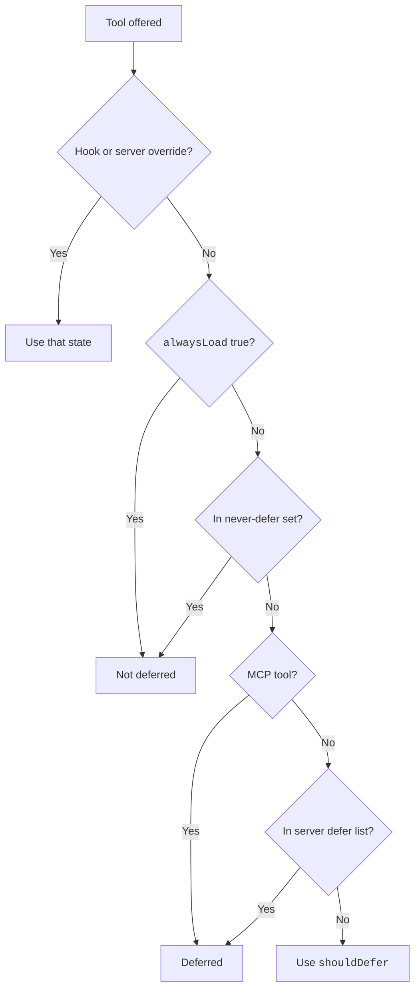

A tool is an action that Claude can take, such as reading a file or running a shell command.
Each tool has input fields and a few flags that tell Claude Code how to treat it.
For example, `Grep` is read-only and safe to run in parallel, so Claude Code can run many searches at once.
This page covers the shared rules. The other pages list every tool and every parameter.

## Tool Pages

| Page | What It Covers |
| --- | --- |
| [Files, Search, and Memory](files.md) | `Read`, `Write`, `Edit`, `NotebookEdit`, `Glob`, `Grep`, `LSP`, memory tools |
| [Shell, Web, and Background Tasks](shell-and-web.md) | `Bash`, `PowerShell`, `Monitor`, `WebFetch`, `WebSearch`, `TaskStop`, `GetTask` |
| [Agents, Tasks, and Planning](agents-and-tasks.md) | `Agent`, `SendMessage`, task tools, cron, `Workflow`, worktrees, plan mode, `AskUserQuestion` |
| [Gated and Surface-Specific Tools](gated-and-other.md) | Onboarding, design, connectors, self-hosted runner, notifications, `StructuredOutput`, MCP resource tools |

## How to Read the Tool Tables

The inventory for `2.1.305` lists 70 tools. The program holds a few more, such as `Agent`, `Monitor`, `ToolSearch`, `ScheduleWakeup`, and `StructuredOutput`.
Each tool table has three Yes or No columns.

| Column | Yes Means | No Means |
| --- | --- | --- |
| Read-Only | The tool changes nothing. So Claude Code can skip some prompts for it. | The tool can change things, or the program sets no flag. |
| Parallel | Claude Code can run several calls of the tool at once. | Calls run one after the other, or the program sets no flag. |
| Deferred | The tool is not loaded at the start. Claude finds it with `ToolSearch` first. | The tool is loaded at the start. |

A tool with no flag in its definition shows No for Read-Only and Parallel.
`Bash` and `PowerShell` also show No for both, because the result depends on the command.

## Common Properties

Source: the program (the tool definitions).

| Property | Values | What It Means |
| --- | --- | --- |
| `backgrounding` | `never`, `self`, `detach` | `self` means the tool backgrounds itself (`Bash`, `PowerShell`, `Agent`). `detach` applies to `WebFetch` and `WebSearch`. |
| `maxResultSizeChars` | 100000 for most tools, 20000 for `Grep`, unbounded for `Read` | The largest result the tool sends back. |
| `strict` | true for `Write`, `Edit`, `Read`, `Grep`, `Bash`, `PowerShell`, `TodoWrite`, `ReportFindings` | The tool schema is strict. |
| `isEnabled` | A function that answers yes or no each time Claude Code builds the tool list | A tool that answers no is not sent. Examples: [the plan mode and task tests](agents-and-tasks.md#enable-tests) and [the plugin and skill gate](gated-and-other.md#shared-enable-gate). |
| MCP tool name | `mcp__<server>__<tool>` | How a tool from an MCP server is named. See [MCP](../../extend/mcp/index.md). |

## `ToolSearch`

`ToolSearch` loads the full schema of a deferred tool, so that Claude can call it.
For example, the query `select:Read,Edit,Grep` fetches those three tools by name.
Source: [Tools Reference](https://code.claude.com/docs/en/tools-reference), [Create Custom Subagents](https://code.claude.com/docs/en/sub-agents), and the program.

| Item | Status | What It Does | How It Works |
| --- | --- | --- | --- |
| `ToolSearch` | <Documented /> | Loads the full schema of deferred tools. | `query` (string, required) and `max_results` (int, optional, default 5). The result lists `matches`, `total_deferred_tools`, `pending_mcp_servers`, and `failed_mcp_servers`. Works in the main session and in subagents. |
| `max_results` | <Differs /> | An old `2.1.296` capture showed it as required. | In `2.1.305` it is optional with the default `5`. |
| Query `select:A,B` | <Undocumented /> | Fetches the named tools. | The prompt gives `select:Read,Edit,Grep`. A tool that is already loaded returns a note. |
| Query keywords | <Undocumented /> | Searches by keyword and returns up to `max_results` matches. | The prompt gives `notebook jupyter`. |
| Query `+term rest` | <Undocumented /> | Requires `term` in the tool name and ranks by the rest. | The prompt gives `+slack send`. |
| Pending MCP servers | <Documented /> | A search can wait for MCP servers that are still connecting. | Name the server as `mcp__server` in the query. |
| Placeholder tool | <Undocumented /> | A dummy tool keeps deferred loading active. | The text tells Claude never to call it. |
| Deny rule | <Documented /> | `permissions.deny` with `ToolSearch` turns tool search off. | Claude then uses `WaitForMcpServers`. |
| Failed servers note | <Documented /> | A no-match result names the servers that failed. | `failed_mcp_servers` carries `name`, `errorCode`, and `error`. |

## Deferral Rules

Claude Code checks these rules in order. They decide whether a tool is deferred.

1. A hook or a server-side override can set the state first.
2. A tool with `alwaysLoad` set to `true` is not deferred.
3. A tool in the never-defer set is not deferred.
   The set holds `ToolSearch`, `StructuredOutput`, `Agent` when fork mode is on, the brief tool, `EnterWorktree` in a `bg` session, and `PushNotification` for a `remote_trigger` entry point.
   A server-side list can add more built-in tools.
4. An MCP tool is deferred.
5. A tool in a server-side defer list is deferred.
6. Otherwise the `shouldDefer` value of the tool decides.



### Switches for Tool Search

Source: [Connect Claude Code to Tools via MCP](https://code.claude.com/docs/en/mcp) and [Environment Variables](https://code.claude.com/docs/en/env-vars). Set them in the shell or in `env` in settings.

| Item | Status | What It Does | How It Works |
| --- | --- | --- | --- |
| `ENABLE_TOOL_SEARCH` unset | <Documented /> | MCP tools are deferred. | Since `2.1.304` this also holds behind a custom `ANTHROPIC_BASE_URL`. If the gateway answers 400 or 422, Claude Code retries the request without tool search. Source: the program and the [release notes](https://github.com/anthropics/claude-code/releases/tag/v2.1.304). |
| `ENABLE_TOOL_SEARCH=true` | <Documented /> | MCP tools stay deferred, also on a proxy host. | - |
| `ENABLE_TOOL_SEARCH=auto` and `auto:N` | <Documented /> | Tools load at the start while their definitions fit in N percent of the window. | The default is 10. `auto:0` acts like `true`. `auto:100` acts like `false`. N stays between 0 and 100. |
| `ENABLE_TOOL_SEARCH=false` | <Documented /> | Every MCP tool loads at the start. | - |
| `ENABLE_TOOL_SEARCH=force` | <Documented /> <Gated note="needs a first-party provider" /> | Forces tool search on, also when betas are off. | Needs a first-party provider. |
| `alwaysLoad` | <Documented /> | Exempts a tool or a whole server from deferral. | Set it on the server in `.mcp.json` or plugin MCP config. An MCP tool sets it from `_meta` key `anthropic/alwaysLoad`. |
| Server-side never-defer list | <Undocumented /> <Gated note="hidden server-side flag" /> | Names built-in tools that must never be deferred. | The default is an empty list. You cannot set it. |
| Server-side defer list | <Undocumented /> <Gated note="hidden server-side flag" /> | Defers `ReportFindings`, `Workflow`, and `ShareOnboardingGuide`. | You cannot set it. |

### Which Built-In Tools Are Deferred

- Deferred: `WebFetch`, `WebSearch`, `NotebookEdit`, `TodoWrite`, `LSP`, `Monitor`, `EnterPlanMode`, `ExitPlanMode`, `EnterWorktree`, `ExitWorktree`, `TaskCreate`, `TaskGet`, `TaskUpdate`, `TaskList`, `TaskStop`, `SendMessage`, `SendFile`, `CronCreate`, `CronDelete`, `CronList`, `PushNotification`, `RemoteTrigger`, `EndConversation`, `ProposeGoal`, `FetchInboxMessage`, `PublishPlugin`, `OfferChromeSetup`, `DesignSync`, `SearchMcpRegistry`, `SuggestConnectors`, `ListConnectors`, the three MCP resource tools, and the nine self-hosted runner tools.
- A runtime check decides: `SuggestPluginInstall`, `SuggestSkills`, `SendUserFile`.
- Not deferred: `Read`, `Write`, `Edit`, `Glob`, `Grep`, `Bash`, `PowerShell`, `Agent`, `Skill`, `AskUserQuestion`, `ListAgents`, `Workflow`, `ReportFindings`, `ToolSearch`, `StructuredOutput`, `SubagentHandback`, `ScheduleWakeup`, `memory_*`, and the rest of the gated tools.
- The old capture of `2.1.296` lacked `Glob` and `Grep`. In `2.1.305` they are not deferred.
- From `2.1.306` to `2.1.311`, our `-p` stub runs offered neither `Glob` nor `Grep`, not even behind `ToolSearch`. In this build, the `Bash` tool runs `find` and `grep` as the embedded `bfs` and `ugrep`, and the prompts point Claude to them (the program).
- In the `2.1.305` capture, the main prompt lists 12 tools (the site's captures use a local stub as `ANTHROPIC_BASE_URL`, and tool search is on behind a custom base URL, so it is not 20 as before). `CronCreate`, `CronDelete`, `CronList`, `EnterWorktree`, `ExitWorktree`, `NotebookEdit`, `SendMessage`, `TaskStop`, `WebFetch`, and `WebSearch` sit behind `ToolSearch`. See [Tools per Variant](../../prompts/tools/tools-per-variant.md).

## Example

Hide web tools from Claude. Keep MCP tools loaded at the start when they are small.

```json title=".claude/settings.json"
{
  "permissions": {
    "deny": ["WebFetch", "WebSearch"]
  },
  "env": {
    "ENABLE_TOOL_SEARCH": "auto:10"
  }
}
```

## How It Works

Claude Code builds the tool list for each request. A deferred tool appears only as a name. So the request stays small.
When Claude needs a deferred tool, it calls `ToolSearch`. Claude Code then loads the full schema. Then Claude calls the tool.
Permission rules run when a tool is called, not when it is listed.

## Exact Fields

The exact fields are in this schema: `https://clawdipedia.cc/schemas/claude-code-tools.json`. It is made from each built-in tool's own input and output validator. It has an `<Tool>Input` and an `<Tool>Result` definition for each tool the program could export. Its `description` names the few it lacks.
It lists every field of this release. Build on the fields it names. Look each one up there before you rely on it.

## Related Pages

- [Tools Reference](https://code.claude.com/docs/en/tools-reference) is the official page for the built-in tools.
- [Permission Rules](../../configure/permissions/rules.md) explains allow, ask, and deny rules for tools.
- [MCP](../../extend/mcp/index.md) covers tools that MCP servers add.
- [Subagents](../../extend/subagents/index.md) covers the tools that a subagent keeps.
- [Environment Variables for Tools and Bash](../../configure/env-vars/tools-and-bash.md)
