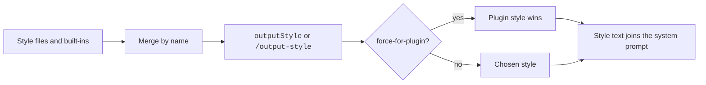

# Output Styles


An output style changes the role, tone, and format of Claude's answers in a session.
You pick one with `/output-style`, and it applies from the next message.
An output style is an instruction, so nothing enforces it.
For project facts, use [Memory and Rules](https://xsyetopz.github.io/claude-code-docs/configure/memory-and-rules.md). For actions that must always happen, use hooks.

## At a Glance

| Question | Answer |
| --- | --- |
| Can you use it? | ✅ Yes. Run `/output-style`, or pick one in `/config`. |
| Can you change it? | ✅ Yes. Set `outputStyle`, or write your own Markdown file. |
| Can you turn it on or off? | Pick `default`, or remove `outputStyle`. `CLAUDE_CODE_SAFE_MODE=1` skips all styles. |
| Where does it live? | `~/.claude/output-styles/`, `.claude/output-styles/`, managed settings, and plugins. |
| Status | [Documented] [Undocumented] |

## Example

```markdown title=".claude/output-styles/terse-reviewer.md"
---
name: Terse Reviewer
description: Short code review notes
keep-coding-instructions: true
---
Review the change. List problems as short bullets, worst first.
Skip praise and recaps.
```

```json title=".claude/settings.json"
{ "outputStyle": "Terse Reviewer" }
```

Restart `claude` so it finds the new file. Then Claude answers as a terse reviewer and still keeps its coding instructions.

## Built-In Styles

Each non-default style keeps the standard coding instructions and adds its own.
Source: the program sets `keepCodingInstructions: true` and `source: "built-in"` for the four styles.
Official page: [Output Styles](https://code.claude.com/docs/en/output-styles).
The captured prompts are on these pages: [Proactive](https://xsyetopz.github.io/claude-code-docs/prompts/style-proactive.md), [Concise](https://xsyetopz.github.io/claude-code-docs/prompts/style-concise.md), [Explanatory](https://xsyetopz.github.io/claude-code-docs/prompts/style-explanatory.md), and [Learning](https://xsyetopz.github.io/claude-code-docs/prompts/style-learning.md).

| Item | Status | What it does | How it works | Where to set it |
| --- | --- | --- | --- | --- |
| `default` | [Documented] | No style instructions | The standard system prompt for software engineering. It shows in the `/output-style` list | All sessions |
| `Proactive` | [Documented] | Starts work at once and assumes on routine choices | No plan mode unless asked. It checks in the chat before it deletes data or changes shared systems. It does not change the permission mode | All sessions |
| `Concise` | [Documented] | Leads with the result, no preamble, narration, or recap | Simple answers take one to three sentences. Full length stays for requested detail and safety content. Needs `2.1.237`. The bundle gives it a `turnReminder` | All sessions |
| `Explanatory` | [Documented] | Adds `Insight` blocks | Two or three points per block, not written into files | All sessions |
| `Learning` | [Documented] | `Insight` blocks plus `TODO(human)` tasks | Claude asks you to write 2 to 10 lines when it generates 20 or more lines with a design choice. It then stops and waits | All sessions |

## The `outputStyle` Setting and Switching

| Item | Status | What it does | How it works | Where to set it |
| --- | --- | --- | --- | --- |
| `outputStyle` | [Documented] | Names the active style | The value is case-sensitive: `Explanatory` works and `explanatory` gives Default. No value means Default. A project file wins over user settings | Any settings scope |
| `/output-style <style>` | [Documented] | Switches the style | Saves to `.claude/settings.local.json`. No argument lists the styles. Ignores case. Works in print mode and the SDK. Needs `2.1.269` for remote lists | Interactive, print |
| `/config` Output style | [Documented] | Menu picker | Saves to local settings | Terminal |
| Switch in a session | [Documented] | New style applies from the next message | Before `2.1.251` it needed `/clear`. Prompt caching costs the first message | All sessions |
| Custom style over Remote Control | [Undocumented] | Not selectable | The bundle text says to pick one in the session itself | Remote Control |
| `CLAUDE_CODE_SIMPLE_SYSTEM_PROMPT` | [Documented] | Chooses the full or short system prompt | `0` selects the full prompt. `keep-coding-instructions` has no effect on the short prompt | Env |
| Safe mode | [Documented] | Styles do not load | `CLAUDE_CODE_SAFE_MODE=1` skips output styles | Env |

## Locations and Precedence

| Item | Status | What it does | How it works | Where to set it |
| --- | --- | --- | --- | --- |
| `~/.claude/output-styles/*.md` | [Documented] | User styles | The file name is the style name unless `name` is set | User |
| `.claude/output-styles/*.md` | [Documented] | Project styles | Every such directory between the working directory and the repository root loads. The closest one wins for a name | Project |
| Managed `.claude/output-styles` | [Documented] | Policy styles | Inside the managed settings directory | Managed |
| Plugin `output-styles/` | [Documented] | Plugin styles | See Plugins | Plugin |
| `outputStylesPath`, `outputStylesPaths` | [Undocumented] | Manifest key for style files or directories | When set, the `output-styles/` directory is not auto-loaded | Plugin manifest |
| Merge order | [Undocumented] | For the same name the later source wins | The order in the bundle is built-in, one more list (inferred: plugin styles), user, project, then policy | All |
| File reading | [Documented] | Styles load when Claude Code starts | A new file needs a restart in the terminal | Terminal |

## Frontmatter Keys

All keys are optional. A misspelled key is ignored. Bad YAML loads the style under its file name with no fields.

| Item | Status | What it does | How it works | Where to set it |
| --- | --- | --- | --- | --- |
| `name` | [Documented] | Style name in the picker | Default is the file name | Style file |
| `description` | [Documented] | Text in the picker | String | Style file |
| `keep-coding-instructions` | [Documented] | Keeps the built-in software engineering section | Default `false`. Works only on the full system prompt | Style file |
| `force-for-plugin` | [Documented] | Applies the style when the plugin is enabled | Overrides `outputStyle`. The first loaded plugin wins and a warning names the others. On a non-plugin style the key is ignored with a warning | Plugin styles |

Captured prompts for custom styles: [Custom Style](https://xsyetopz.github.io/claude-code-docs/prompts/style-custom.md), [Custom Style on the Full Prompt](https://xsyetopz.github.io/claude-code-docs/prompts/style-custom-full.md), and [Custom Style with Keep Coding Instructions](https://xsyetopz.github.io/claude-code-docs/prompts/style-custom-keep.md).

## How It Works

- The active style text goes with every request. Source: the official [Output Styles](https://code.claude.com/docs/en/output-styles) page.
- A style applies to the main thread and to a fork. Other subagents use their own system prompt. Source: the same page.
- The style name shows in the status line field `output_style.name`. See [Status Line](https://xsyetopz.github.io/claude-code-docs/configure/status-line.md).
- The SDK init message can report `outputStyle` as `null` or as `{ name, isKeepingCodingInstructions }`. Source: the program string `no { outputStyle } (null, or { name, isKeepingCodingInstructions })`.



> **Not Verified:** The full text of each built-in style prompt (see the captures linked above). How `force-for-plugin` ranks against an `outputStyle` set by managed settings.

## Related Pages

- [Memory and Rules](https://xsyetopz.github.io/claude-code-docs/configure/memory-and-rules.md)
- [Status Line](https://xsyetopz.github.io/claude-code-docs/configure/status-line.md)
- [The System Prompt](https://xsyetopz.github.io/claude-code-docs/how-it-works/system-prompt.md)
- [Captured Prompts](https://xsyetopz.github.io/claude-code-docs/prompts.md)
