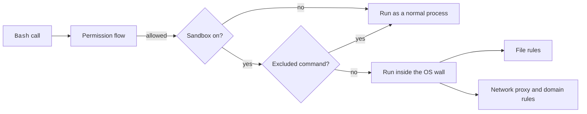

# Sandbox


The sandbox runs `Bash` commands inside a wall that the operating system enforces.
It limits which files a command can write and which hosts it can reach, even when a permission rule allows the command.
Permission rules decide whether a call runs. The sandbox limits what the call can touch once it runs.

## At a Glance

| Question | Answer |
| --- | --- |
| Can you use it? | ✅ Yes, on macOS, Linux, and WSL. Set `sandbox.enabled` to `true`. |
| Can you change it? | ✅ Yes. Edit the `sandbox` key in a settings file. |
| Can you turn it on or off? | `sandbox.enabled`. It is `false` by default. Without its dependencies, a warning shows and commands run unsandboxed. |
| Where does it live? | The `sandbox` key of any settings scope. Some keys work only in managed or user settings. |
| Status | [Documented] [Undocumented] [Gated] |

## Example

```json title="~/.claude/settings.json"
{
  "sandbox": {
    "enabled": true,
    "failIfUnavailable": true,
    "network": {
      "allowedDomains": ["github.com", "*.npmjs.org"]
    },
    "filesystem": {
      "allowWrite": ["~/.cache/build"],
      "denyRead": ["~/.ssh"]
    }
  }
}
```

`Bash` runs in the sandbox, reaches only those two hosts, can also write to the cache folder, and cannot read `~/.ssh`.
Claude Code exits at startup if the sandbox cannot start.

## Core Keys

Official pages: [Configure the Sandboxed Bash Tool](https://code.claude.com/docs/en/sandboxing) and [Settings Reference](https://code.claude.com/docs/en/settings-reference).

| Key | Status | What it does | How it works | Scope |
| --- | --- | --- | --- | --- |
| `sandbox.enabled` | [Documented] | Runs `Bash` in the sandbox | Default `false`. Without dependencies, a warning shows and commands run unsandboxed | Each scope |
| `sandbox.failIfUnavailable` | [Documented] | Exit at startup if the sandbox cannot start | Default `false`. For managed hard gates | Each scope |
| `sandbox.autoAllowBashIfSandboxed` | [Documented] | Auto-allows sandboxed commands | Reason text `Auto-allowed with sandbox`. Default `true` per the `filesystem.disabled` text | Each scope |
| `sandbox.allowUnsandboxedCommands` | [Documented] | Lets a call use `dangerouslyDisableSandbox` | Default `true`. When `false`, the parameter is ignored. A `false` from managed, `--settings`, or user settings holds | Each scope |
| `sandbox.excludedCommands` | [Documented] | Patterns that run outside the sandbox | `Bash` rule syntax. A convenience, not a boundary: the permission flow still applies. Only managed, `--settings`, and user entries count | Merged |
| `sandbox.ignoreViolations` | [Documented] | Map of command patterns (`*` for all) to paths whose violations are not reported | Merged across scopes | Each scope |
| `sandbox.enableWeakerNestedSandbox` | [Documented] | Linux: no fresh `/proc` mount | For hosts like unprivileged Docker. Reduces security. Default `false` | Each scope |
| `sandbox.enableWeakerNetworkIsolation` | [Documented] | macOS: allow `com.apple.trustd.agent` | For Go tools with a MITM proxy. Reduces security. Default `false` | Each scope |
| `sandbox.allowAppleEvents` | [Documented] | macOS: allow Apple Events | Needed for `open` and `osascript`. Removes code-execution isolation. Default `false` | User, managed, `--settings` |
| `sandbox.ripgrep.command`, `sandbox.ripgrep.args` | [Undocumented] | Custom `rg` for bundled ripgrep support | Strings | User, managed, `--settings` |
| `sandbox.bwrapPath` | [Documented] | Linux and WSL: path to `bwrap` | Absolute path. Overrides `PATH` detection | Managed only |
| `sandbox.socatPath` | [Documented] | Linux and WSL: path to `socat` | Absolute path | Managed only |

## Network Keys

| Key | Status | What it does | How it works | Scope |
| --- | --- | --- | --- | --- |
| `sandbox.network.allowedDomains` | [Documented] | Domains reachable without a prompt | Wildcards like `*.example.com`. Merged with `WebFetch(domain:...)` allow rules | Merged |
| `sandbox.network.deniedDomains` | [Documented] | Domains always blocked | Wins over `allowedDomains`. Merged from all scopes | Merged |
| `sandbox.network.allowManagedDomainsOnly` | [Documented] | Only managed domains count | Denied domains still come from all scopes | Managed only |
| `sandbox.network.strictAllowlist` | [Documented] | Deny hosts not in `allowedDomains` without a prompt | Not for in-process tools like `WebFetch`. `WebFetch` rules leave the allowlist | User, managed, `--settings` |
| `sandbox.network.allowUnixSockets` | [Documented] | macOS: socket paths to allow | Ignored on Linux | Merged |
| `sandbox.network.allowAllUnixSockets` | [Documented] | Allow all Unix sockets | Both platforms | Each scope |
| `sandbox.network.allowLocalBinding` | [Documented] | macOS: bind to localhost ports | Boolean | Each scope |
| `sandbox.network.allowMachLookup` | [Documented] | macOS: extra XPC or Mach names | Trailing `*` prefix match. For iOS Simulator or Playwright | Merged |
| `sandbox.network.httpProxyPort`, `sandbox.network.socksProxyPort` | [Documented] | Use your own proxy | Local TCP port | Each scope |
| `sandbox.network.tlsTerminate.caCertPath`, `.caKeyPath` | [Gated: Marked EXPERIMENTAL in the settings schema] | Experimental TLS termination | Lets the filter see HTTPS bodies. Omit both for an ephemeral CA. Gate: marked `[EXPERIMENTAL]` | User, managed, `--settings` |

## Filesystem Keys

| Key | Status | What it does | How it works | Scope |
| --- | --- | --- | --- | --- |
| `sandbox.filesystem.allowWrite` | [Documented] | Extra writable paths | Repo-committed entries are limited to trusted tiers | Merged |
| `sandbox.filesystem.denyWrite` | [Documented] | Paths denied for writes | - | Merged |
| `sandbox.filesystem.denyRead` | [Documented] | Paths denied for reads | - | Merged |
| `sandbox.filesystem.allowRead` | [Documented] | Re-allows reads inside `denyRead` | Wins over `denyRead` | Merged |
| `sandbox.filesystem.allowManagedReadPathsOnly` | [Documented] | Only managed `allowRead` paths | Boolean | Managed |
| `sandbox.filesystem.disabled` | [Documented] | Skip filesystem isolation | macOS and Linux and WSL only. Network and seccomp stay. Ignored on native Windows. Pinned to managed when managed sets filesystem rules | User, managed, `--settings` |

## Credential Keys

These keys hide secrets from commands. A command sees a placeholder, and the proxy swaps in the real value only for the hosts you name.

| Key | Status | What it does | How it works | Scope |
| --- | --- | --- | --- | --- |
| `sandbox.credentials.files[]` | [Documented] | Protects credential files or directories | Fields `path`, `mode` (`deny` or `mask`), `extract`, `onExtractNoMatch` (`warn`, `deny`, `error`), `decode` (`jwt`), `maskClaims`, `maskDuplicates`, `injectHosts`. | Merged |
| `sandbox.credentials.envVars[]` | [Documented] | Protects environment variables | Fields `name`, `mode`, `extract`, `onExtractNoMatch`, `decode`, `maskClaims`, `injectHosts`. `extract` and `decode` cannot combine | Merged |
| `sandbox.credentials.allowPlaintextInject` | [Documented] | Sentinel swap on the plain HTTP path | Default `false` | User, managed, `--settings` |
| `sandbox.credentials.awsPairs` | [Documented] | Groups masked env vars into AWS pairs for SigV4 re-signing | The standard AWS trio pairs by itself | User, managed, `--settings` |
| `sandbox.credentials.sigv4` | [Documented] | Policy for SigV4 shapes the proxy cannot re-sign | `deny` (default) or `passthrough` | User, managed, `--settings` |

## Environment Variables

Source: the program. See also [Environment Variables](https://xsyetopz.github.io/claude-code-docs/configure/env-vars.md).

| Variable | Status | What it does | How it works | Scope |
| --- | --- | --- | --- | --- |
| `CLAUDE_CODE_BASH_SANDBOX_SHOW_INDICATOR` | [Undocumented] | Shows `SandboxedBash` as the tool name | Truthy value, for sandboxed calls | Env |
| `IS_SANDBOX` | [Undocumented] | Marks a host that is already a sandbox | Skips the sandbox gate when truthy | Env |
| `CLAUDE_CODE_SANDBOXED` | [Undocumented] | Treats the folder as trusted | Skips the trust dialog check | Env |
| `CLAUDE_CODE_SANDBOX_LEAVE_PARENT_FOLDERS_ALONE` | [Undocumented] | Windows: skip the parent-folder grants | Boolean | Env |
| `CLAUDE_CODE_SANDBOX_LEAVE_DENIES_TO_SRT_WIN` | [Undocumented] | Windows: leave the deny lists to `sandbox-runtime` | Boolean | Env |

## Other Behavior

- The `Bash` tool takes `dangerouslyDisableSandbox: true`. The tool prompt tells the model to use it only after a violation that blocks the task. `sandbox.allowUnsandboxedCommands: false` ignores it.
- A call with `allowed_domains` goes to the [auto mode](https://xsyetopz.github.io/claude-code-docs/configure/permissions/auto-mode.md) classifier. Allow rules do not approve those hosts.
- The sandbox creates empty placeholder files such as `.mcp.json` in places where none exists.
- Linux ignores glob patterns in `Edit` and `Read` rules for the sandbox, and shows a warning.

Source for all four: the program prompt and warning texts.

## How It Works



With `sandbox.autoAllowBashIfSandboxed` on, a sandboxed command skips the prompt.
See [Permission Flow](https://xsyetopz.github.io/claude-code-docs/how-it-works/permission-flow.md).

## Related Pages

- [Permission Rules](https://xsyetopz.github.io/claude-code-docs/configure/permissions/rules.md)
- [Permission Modes](https://xsyetopz.github.io/claude-code-docs/configure/permissions/modes.md)
- [Auto Mode](https://xsyetopz.github.io/claude-code-docs/configure/permissions/auto-mode.md)
