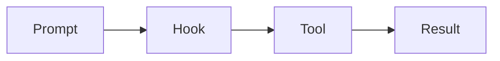

# Style Guide


This guide tells you how to write a page for this site.
Follow it so every page looks and reads the same.
Run `bun run verify` before you open a pull request. It runs the type check, the format check, the code lint, markdownlint, the docs check, the schema check, and the build. Git hooks run on every commit, and commitlint checks the message.

## Core Rules

1. Write only what a reader can use, change, or turn on and off.
2. Rewrite sources in your own words. Do not copy.
3. Never invent a fact. If you cannot check it, leave it out or put it in a Not Verified box.
4. Use only the emojis that this guide allows (see Table Marks). Use badges for provenance.
5. Do not use Anthropic or Claude logos, or any wording that says the site is official.

## Simple English

Write like Simple English Wikipedia.

- Use common words. Say "use", not "utilize".
- Keep sentences short. Aim for under 20 words.
- Put one idea in each sentence.
- Explain each term the first time it appears.
- Use active voice and present tense.
- Speak to the reader as "you".

| Avoid | Write |
| --- | --- |
| The configuration is subsequently persisted to disk by the harness. | Claude Code saves the setting to a file. |
| One may leverage the flag to facilitate non-interactive invocation. | Use the flag to run without a prompt. |
| Hooks get triggered, whereupon the matcher is evaluated. | A hook runs. Then Claude Code checks the matcher. |

## Title Case

Use Chicago-style Title Case for every heading, page title, and sidebar label.

- Capitalize the first and last word.
- Capitalize nouns, verbs, adjectives, adverbs, and pronouns.
- Keep articles, short conjunctions, and prepositions lowercase: `a`, `an`, `the`, `and`, `but`, `or`, `for`, `in`, `of`, `on`, `to`, `with`, `from`, `at`, `by`.
- Words in inline code keep their exact spelling.

| Wrong | Right |
| --- | --- |
| How to configure the status line | How to Configure the Status Line |
| Skills And Commands | Skills and Commands |
| Setting Up `settings.json` | Setting Up `settings.json` |

The check script flags lowercase words that are not on the small-word list.
It skips text in code spans.

## Front Matter

Every page needs these keys.

```yaml
---
title: Status Line
description: Show your own text under the prompt, and every JSON field the command receives.
sidebar_position: 7
---
```

- `title` is in Title Case. Do not add an H1. The title is the H1.
- `description` is one sentence. It shows in search results.
- `sidebar_position` sets the order inside the folder.

## Page Layout

A surface page has this order.

1. A 2 to 4 sentence intro.
2. An At a Glance table, only on a section's index page or on a standalone page with no section folder. Subpages do not repeat it.
3. Item tables, grouped by topic.
4. An Example section with a real config or command.
5. Related pages and sources.

### At a Glance Template

```markdown
## At a Glance

| Question | Answer |
| --- | --- |
| Can you use it? | ✅ Yes. Run `claude --example`. |
| Can you change it? | Edit `~/.claude/settings.json`. |
| Can you turn it on or off? | Set `exampleEnabled` to `false`. |
| Where does it live? | `~/.claude/settings.json` (user scope) |
| Status | <Documented /> |
```

### Item Table Template

```markdown
| Item | Status | What it does | Default | Where to set it |
| --- | --- | --- | --- | --- |
| `exampleEnabled` | <Documented /> | Turns the example on. | `true` | `settings.json` |
| `EXAMPLE_FLAG` | <Undocumented /> <Gated note="server gate" /> | Shows the example panel. | Off | Environment variable |
```

Every table of items has a `Status` column with one or more badges.

## Badges

The badge components are global. Do not import them.

| Component | Use it when |
| --- | --- |
| `<Documented />` | An official docs page names the item. |
| `<Undocumented />` | Only the program shows the item. |
| `<Differs />` | The docs and the program disagree. Say how in the row. |
| `<Gated />` | The item works only behind a flag or server gate. Say which. |

`Gated` and `Differs` take an optional `note` shown as a tooltip.

```mdx
<Gated note="CLAUDE_CODE_EXAMPLE=1" />
<Differs note="Docs say 30 seconds, the program uses 60." />
```

You can place several badges in one cell. Separate them with a space.

## The Leave-Out Rule

List only items a user can use. Leave out these items.

- Items that are removed or do nothing.
- Items used only in tests.
- Items for Anthropic staff, such as those behind `USER_TYPE=ant`.

Keep a gated item only if a user can turn it on or it is live for some accounts. Mark it [Gated].

## Inline Code

Put every code item in backticks: commands, flags, paths, keys, environment variables, tool names, and literal values.
Write `--print`, not --print. Write `~/.claude/settings.json`, not the plain path.

## Visuals

### Mermaid

Use `flowchart`, `sequenceDiagram`, or `stateDiagram-v2`. Keep labels short.

````markdown

````

### File Trees

Do not draw trees with box characters. Wrap a nested list in the `<FileTree>` component.
Write one item on each line. Give a folder a trailing `/`, and put a short note after the name.

````markdown
<FileTree>

- `~/.claude/`
  - `settings.json` your settings
  - `skills/`
    - `my-skill/`
      - `SKILL.md`

</FileTree>
````

It looks like this.

- `~/.claude/`
  - `settings.json` your settings
  - `skills/`
    - `my-skill/`
      - `SKILL.md`

### Table Marks

Use these marks in a table cell that is a yes, no, or unknown answer, such as an At a Glance answer or a boolean column.

| Mark | Meaning | Write |
| --- | --- | --- |
| ✅ | Yes | `✅`, or `✅ Yes. <detail>` when text follows |
| ❌ | No | `❌`, or `❌ No. <detail>` when text follows |
| ❓ | Unknown or not stated | `❓` |

- Do not use a mark where Yes or No is part of a value, such as a default that is literally "no".
- Never put a mark in a heading, a sidebar label, or link text.
- For a short clarification, put `\*` after the mark (`✅\*`) and write `\* The note.` right after the table. Use `\*\*` for a second note.
- `bun run check:docs` rejects every emoji that is not on the allow-list in `tools/check-docs.ts`.

### Name Markers

Put one of these before the item name in a table cell, or at the start of a note, followed by a space.
Each has one meaning, and a provenance badge stays the primary status.

| Mark | Meaning | Use it when |
| --- | --- | --- |
| 🔒 | Managed only | The schema has `x-managed-only: true` for the key |
| 🧪 | Experimental | The key name has `EXPERIMENTAL` or `experimental`, or the program or the vendor pages call it experimental or beta |
| ⛔ | Deprecated | The program or the vendor pages call it deprecated, and the row names the replacement |
| ⚠️ | Caution | It deletes data, skips a safety check or permission, or sends data off the machine. Use it sparingly. Long warnings stay admonitions |

- Never put a name marker in a heading, a sidebar label, link text, or code.
- Never invent a status. Cite the source in the row or the page.
- `🧪` does not replace `<Gated />`. Use it only where "experimental" is the stated status.
- Screen readers say "locked", "test tube", "no entry", and "warning". The row text must say the meaning in words too.

### Admonitions

Use `:::tip`, `:::note`, `:::warning`, and `:::danger`. Add a title in brackets if it helps.

```markdown
:::note[Not Verified]
We have not checked this on the newest release.
:::
```

### Code Examples

Give a code block a language and, when useful, a title.

````markdown
```json title="~/.claude/settings.json"
{
  "model": "sonnet"
}
```
````

Every surface page has at least one worked example.

## MDX Gotchas

Pages are MDX, not plain Markdown. These characters break the build when they sit in prose.

| Problem | Fix |
| --- | --- |
| `{` or `}` in text | Put a backslash before it, or put the text in backticks. |
| `<` in text, such as `<cwd>` | Put it in backticks, or write `&lt;`. |
| `\|` in a table code cell | Write `\|`. |
| A bare URL with angle brackets | Use a normal link: `[Title](https://example.com)`. |
| An import in a page | Not needed. Badges are global. |

Lines inside code fences are safe.

## Links

- Link to other pages with a relative file path: `[Hooks](../extend/hooks/index.md)`.
- Name official pages by their Title Case page names, and link each one to its URL: `[Hooks Reference](https://code.claude.com/docs/en/hooks)`. Add `#anchor` when you name a section. Link the changelog, GitHub, and other outside sources the same way. "The program" stays plain text.
- The build fails on a broken link or anchor. Fix it, do not remove it.

## Sources

Every fact needs a source.

- Official docs: link to the page.
- The program: write "Source: the program" and name the string, key, or type in inline code.
- Probe results: link to the Probes page.

Put anything you could not check in a `:::note[Not Verified]` box, or leave it out.

## Checks

| Command | What it does |
| --- | --- |
| `bun run lint` | Runs markdownlint on `docs/**/*.{md,mdx}`. |
| `bun run check:docs` | Finds emojis that are not allowed, unlinked sources, missing front matter, and Title Case errors. It prints `file:line`. |
| `bun run build` | Builds the site. Broken links and anchors fail the build. |
| `bun run verify` | Runs every check above, the type check, the format and code lint, the schema check, and the build. |
