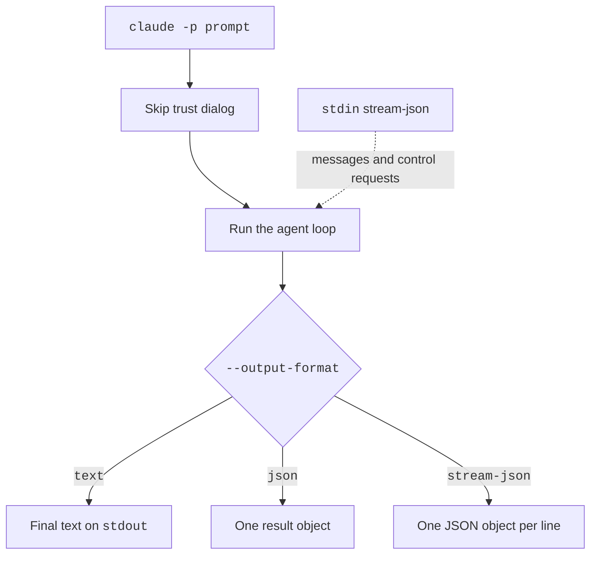

# Headless and Print Mode


Print mode runs one prompt, prints the answer, and exits.
Use it in scripts, pipes, and CI. It is also the base of the Agent SDK.
Add `-p` (or `--print`) to start it. For example, `claude -p "Summarize README.md" --output-format json` prints one JSON result.

> **Warning:** Print mode skips the workspace trust dialog.
> This also happens when stdout is not a terminal, such as when you pipe or redirect output.
> Use it only in folders you trust.

## At a Glance

| Question | Answer |
| --- | --- |
| Can you use it? | ✅ Yes. `claude -p "<prompt>"`, or send the prompt on stdin. |
| Can you change it? | ✅ Yes. Flags set the output and input format, budget, schema, and permission handling. |
| Can you turn it on or off? | `-p` turns it on. `--bare` strips extras. `--no-session-persistence` saves nothing. |
| Where does it live? | Flags on the `claude` command. Sessions still save to `~/.claude/projects/` unless you turn that off. |
| Status | [Documented] [Undocumented] |

## Print Mode Flags

Source: [Run Claude Code Programmatically](https://code.claude.com/docs/en/headless), [CLI Reference](https://code.claude.com/docs/en/cli-reference), and `claude --help`.
These flags have their rows, with status and details, on [CLI Flags](https://xsyetopz.github.io/claude-code-docs/configure/cli/flags.md).

- Output and input: `-p, --print`, `--output-format`, `--input-format`, `--include-partial-messages`, `--include-hook-events`, `--forward-subagent-text`, and `--replay-user-messages`.
- Checks and limits: `--json-schema` and `--max-budget-usd`.
- Prompts and permissions: `--prompt-suggestions` and `--permission-prompts`.
- Lean runs: `--no-session-persistence`, `--bare`, and `--restricted`.
- Tools, models, sessions, and MCP: `--allowedTools`, `--disallowedTools`, `--tools` (see [CLI Flags](https://xsyetopz.github.io/claude-code-docs/configure/cli/flags.md)), `--fallback-model` (see [Models](https://xsyetopz.github.io/claude-code-docs/how-it-works/models.md)), `--resume`, `--continue`, `--fork-session`, `--session-id` (see [Sessions and Storage](https://xsyetopz.github.io/claude-code-docs/how-it-works/sessions-and-storage.md)), and `--mcp-config` with `--strict-mcp-config` (see [MCP Settings and Policy](https://xsyetopz.github.io/claude-code-docs/extend/mcp/settings.md#files-and-flags)).

## Example

```bash title="One JSON answer, with a budget and a schema"
claude -p "List the three biggest files in this repo" \
  --output-format json \
  --max-budget-usd 1 \
  --json-schema '{"type":"object","properties":{"files":{"type":"array","items":{"type":"string"}}},"required":["files"]}'
```

```bash title="Watch the answer grow, line by line"
claude -p "Explain this repo" --output-format stream-json --verbose --include-partial-messages \
  | while read -r line; do echo "$line" | jq -r '.type'; done
```

The second command prints a `system` line for `init`, then `stream_event` lines, then one `result` line.

## How It Works



The loop is the same as in interactive mode. See [Agent Loop](https://xsyetopz.github.io/claude-code-docs/how-it-works/agent-loop.md).
Permission prompts have no screen to appear on, so a host program (or `--permission-prompts none`) must decide.

## Pages in This Section

| Page | What It Covers |
| --- | --- |
| [Stream JSON Messages](https://xsyetopz.github.io/claude-code-docs/extend/headless/stream-json.md) | Every message type that print mode writes |
| [Control Protocol](https://xsyetopz.github.io/claude-code-docs/extend/headless/control-protocol.md) | Every control request a host can send on the same stream |

## Related Pages

- [CLI Flags](https://xsyetopz.github.io/claude-code-docs/configure/cli/flags.md)
- [Transcript Format](https://xsyetopz.github.io/claude-code-docs/reference/transcript-format.md)
- [SDK and Automation Env Vars](https://xsyetopz.github.io/claude-code-docs/configure/env-vars/sdk-and-automation.md)
