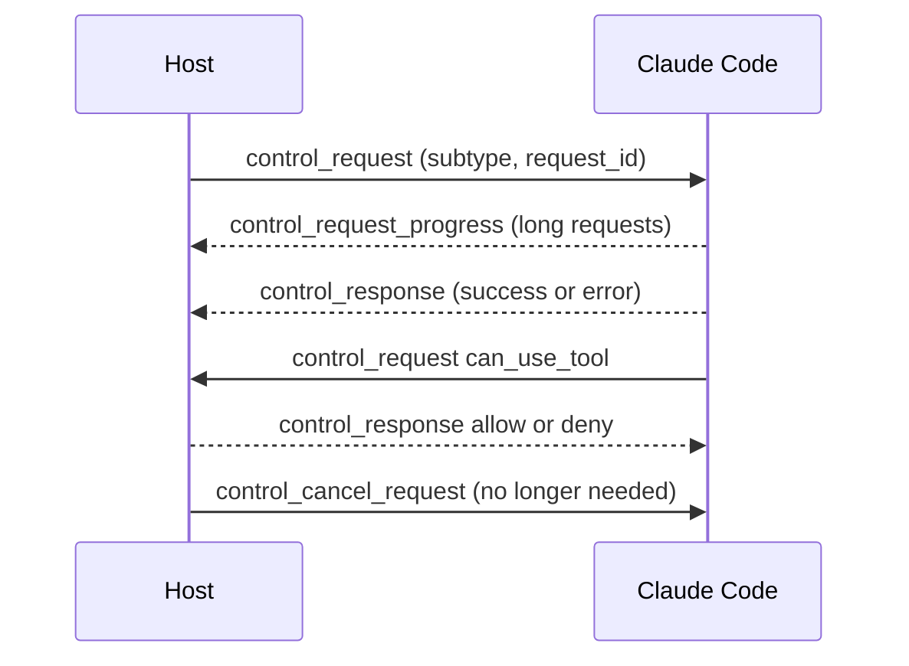

# Control Protocol


Control requests let a host program steer a running Claude Code process.
They travel on the same JSON line channel as the [stream messages](https://xsyetopz.github.io/claude-code-docs/extend/headless/stream-json.md).
The Agent SDK uses them, for example to change the model or to answer a permission question.
A host sends a line with `type` set to `control_request` and `request.subtype` set to `set_model`. Claude Code answers with a `control_response` line.

The protocol is on whenever you start `claude -p --input-format stream-json --output-format stream-json`. You write requests to stdin and read answers on stdout. You choose which requests to send.

## Subtypes

The schema does not mark the direction of each request.
Only the Agent SDK pages describe most of them, and no other docs page does, so every row is marked [Undocumented].
Source: the program (the bundled schema of `2.1.304`).

| `subtype` | Status | What It Does |
| --- | --- | --- |
| `initialize` | [Undocumented] | Starts the SDK session with hooks, MCP servers, and agent settings. |
| `interrupt` | [Undocumented] | Stops the turn that runs now. |
| `can_use_tool` | [Undocumented] | Asks for permission to use a tool with the given input. |
| `set_permission_mode` | [Undocumented] | Sets the permission mode. |
| `set_model` | [Undocumented] | Sets the model for the next turns. |
| `set_max_thinking_tokens` | [Undocumented] | No description in the program schema. |
| `rename_session` | [Undocumented] | Sets the title of the session. |
| `set_color` | [Undocumented] | No description in the program schema. |
| `mcp_status` | [Undocumented] | Asks for the state of all MCP server connections. |
| `file_suggestions` | [Undocumented] | Asks for `@` file suggestions for a partial path. |
| `get_context_usage` | [Undocumented] | Asks for the use of the context window by category. |
| `get_session_cost` | [Undocumented] | Asks for the cost summary that `/usage` prints in print mode. |
| `list_models` | [Undocumented] | Asks for the models that the worker lets you choose. |
| `get_usage` | [Undocumented] | Asks for the data of `/usage`, with plan limits when they are known. |
| `get_status` | [Undocumented] | Asks for the rows of the `/status` screen as text. |
| `export_conversation` | [Undocumented] | Asks for the conversation as the text that `/export` writes. |
| `get_memory_dialog` | [Undocumented] | Asks for the rows and switches of the `/memory` dialog. |
| `get_skills_dialog` | [Undocumented] | Asks for the rows of the `/skills` menu. |
| `get_chrome_dialog` | [Undocumented] | Asks for the state of the `/chrome` dialog. |
| `get_chrome_browsers` | [Undocumented] | Asks for the browsers that are connected to Claude in Chrome. |
| `select_chrome_browser` | [Undocumented] | Switches Claude in Chrome to the browser that you name. |
| `get_sandbox_dialog` | [Undocumented] | Asks for the state of the `/sandbox` dialog. |
| `get_binary_version` | [Undocumented] | Asks for the version of the binary. |
| `mcp_call` | [Undocumented] | Calls an MCP tool without a model turn. |
| `rewind_files` | [Undocumented] | Undoes the file changes made since a user message. |
| `cancel_async_message` | [Undocumented] | Removes a waiting async user message from the queue. |
| `read_file` | [Undocumented] | Reads a file of the session, for a remote sidebar viewer. |
| `list_directory` | [Undocumented] | No description in the program schema. |
| `get_workspace_diff` | [Undocumented] | Asks for the git diff of the workspace. |
| `get_plan` | [Undocumented] | Reads the current plan of plan mode. |
| `seed_read_state` | [Undocumented] | Seeds the cache of read files with a path and a time. |
| `hook_callback` | [Undocumented] | Delivers a hook callback with its input. |
| `register_device_hooks` | [Undocumented] | Registers the hooks of a device with the worker. |
| `upload_device_hook_template` | [Undocumented] | Sends a hook template before the device hooks register. |
| `remote_tools_announce` | [Undocumented] | A cloud client says which tools it serves. |
| `remote_tool_call` | [Undocumented] | Forwards one step of a tool call to the attached machine. |
| `remote_plumbing_call` | [Undocumented] | Calls a plumbing tool on the attached machine. |
| `remote_tools_probe` | [Undocumented] | Checks that an announced machine is still alive. |
| `remote_tools_reannounce` | [Undocumented] | A new worker asks the client to announce its tools again. |
| `turn_handoff` | [Undocumented] | No description in the program schema. |
| `mcp_message` | [Undocumented] | Carries one MCP message for an MCP server that the SDK hosts. |
| `mcp_set_servers` | [Undocumented] | Replaces the set of MCP servers that the host manages. |
| `reload_plugins` | [Undocumented] | Reloads plugins from disk. |
| `reload_skills` | [Undocumented] | Reloads skills from disk. |
| `reload_output_styles` | [Undocumented] | Reads the output style folders again. |
| `register_repo_root` | [Undocumented] | Adds a folder as a working folder root, and can reload `CLAUDE.md`, skills, and plugins. |
| `set_cwd` | [Undocumented] | Moves the session to a new working folder, like `/cd`. |
| `claim_session` | [Undocumented] | No description in the program schema. |
| `mcp_reconnect` | [Undocumented] | Reconnects an MCP server that failed. |
| `mcp_toggle` | [Undocumented] | Turns an MCP server on or off. |
| `mcp_read_resource` | [Undocumented] | No description in the program schema. |
| `set_mcp_permission_mode_override` | [Undocumented] | Sets or clears the permission mode of one MCP server. |
| `set_chrome_browser_hints` | [Undocumented] | Tells the session which Claude in Chrome browser to prefer. |
| `set_prompt_suggestions_paused` | [Undocumented] | Pauses or resumes prompt suggestions. |
| `stop_task` | [Undocumented] | Stops a running task. |
| `background_tasks` | [Undocumented] | No description in the program schema. |
| `get_task_output` | [Undocumented] | Reads the last 8 KiB of the output of a background task. |
| `apply_flag_settings` | [Undocumented] | Merges settings into the flag settings layer. |
| `get_settings` | [Undocumented] | Returns the merged settings and the settings of each source. |
| `update_settings` | [Undocumented] | Writes settings through the writer of Claude Code. |
| `get_hooks_listing` | [Undocumented] | Returns the hooks that the read-only `/hooks` menu shows. |
| `list_permission_rules` | [Undocumented] | Returns the permission rules and workspace folders that `/permissions` lists. |
| `elicitation` | [Undocumented] | Asks the SDK consumer to handle an MCP elicitation. |
| `request_user_dialog` | [Undocumented] | Asks the SDK consumer to show a dialog and return the choice. |
| `submit_feedback` | [Undocumented] | Sends a `/feedback` report with the transcript and a cleaned error log. |
| `remote_control_work_secret` | [Undocumented] | Asks the host for a fresh work secret for Remote Control. |
| `oauth_token_refresh` | [Undocumented] | Asks the host for a fresh OAuth token after a `401` error. |
| `host_auth_token_refresh` | [Undocumented] | Asks the host for a fresh provider credential after a credential failure. |
| `message_rated` | [Undocumented] | Records a thumbs up or down for a message. |
| `ui_attach` | [Undocumented] | A remote screen joins the session. |
| `ui_detach` | [Undocumented] | A remote screen leaves the session. |
| `ui_render` | [Undocumented] | No description in the program schema. |
| `ui_press` | [Undocumented] | A press on a button or link that a plugin drew for a remote screen. |
| `ui_client_module` | [Undocumented] | Asks for the screen modules of a plugin. |
| `ui_input` | [Undocumented] | A change in an input that a plugin drew for a remote screen. |
| `ui_select` | [Undocumented] | A pick in a select that a plugin drew for a remote screen. |
| `ui_panes` | [Undocumented] | Asks for the list of open panes. |
| `ui_pane_show` | [Undocumented] | The person chose which open pane the screen shows. |
| `ui_pane_focus` | [Undocumented] | The keyboard moved between the prompt box and a pane. |
| `ui_close` | [Undocumented] | The person closed a pane on a remote screen. |
| `ui_scroll` | [Undocumented] | The person scrolled a site that a remote screen draws. |
| `ui_focus` | [Undocumented] | The keyboard moved in a site that a remote screen draws. |
| `ui_copy` | [Undocumented] | No description in the program schema. |
| `ui_prompt_read` | [Undocumented] | A plugin reads the draft and cursor of the prompt box. |
| `ui_prompt_fill` | [Undocumented] | A plugin puts text in the prompt box as a draft. |
| `ui_prompt_suggest` | [Undocumented] | A plugin or the engine shows a suggestion in the prompt box. |
| `ui_read_selection` | [Undocumented] | No description in the program schema. |
| `ui_prompt_edit` | [Undocumented] | An edit in the prompt box of a remote screen. |
| `ui_prompt_autocomplete` | [Undocumented] | A remote prompt box asks what the plugins add to its autocomplete list. |
| `success` | [Undocumented] | The request was handled. |
| `error` | [Undocumented] | The request failed or was refused. |

Some requests go from Claude Code to the host, such as `can_use_tool`, `elicitation`, `hook_callback`, `request_user_dialog`, and the token refresh requests.
The host must answer them or the turn waits.

## Example

```json skip-lint title="Change the model, then read the reply"
{"type":"control_request","request_id":"req-1","request":{"subtype":"set_model","model":"sonnet"}}
```

```json skip-lint title="Reply from Claude Code"
{"type":"control_response","response":{"subtype":"success","request_id":"req-1"}}
```

The `set_model` request has a `model` field. A success reply has `subtype: "success"` and the `request_id`.
An error reply has `subtype: "error"`, the `request_id`, an `error` text, and sometimes an `error_code`.
Source: the program (strings of the request and response builders). The fields of the other subtypes are not listed here.

We ran both examples on `2.1.304` with `claude -p --input-format stream-json --output-format stream-json --verbose` (see [Probes](https://xsyetopz.github.io/claude-code-docs/reference/probes.md#static-and-print-probes)). The reply matches.
The `request_id` is any text you pick, and the reply repeats it.
`set_model` takes an alias such as `sonnet` or a full model ID. It replies `success` even for a name the API does not know, so the error shows up on the next request.
A reply can come before the first `system` `init` line, because `init` appears only after the first user message.

```json skip-lint title="Ask for the version"
{"type":"control_request","request_id":"req-2","request":{"subtype":"get_binary_version"}}
```

```json skip-lint title="Reply"
{"type":"control_response","response":{"subtype":"success","request_id":"req-2","response":{"version":"2.1.304","buildTime":"2026-10-19T18:11:48Z"}}}
```

```json skip-lint title="A request that fails"
{"type":"control_request","request_id":"req-3","request":{"subtype":"set_permission_mode","mode":"nonsense"}}
```

```json skip-lint title="Error reply"
{"type":"control_response","response":{"subtype":"error","request_id":"req-3","error":"Cannot set permission mode: must be one of acceptEdits, auto, bypassPermissions, default, dontAsk, plan","error_code":"invalid_mode"}}
```

An unknown subtype gives `"error":"Unsupported control request subtype: <name>"` with no `error_code`.

## How It Works



Each reply is a single `control_response` that matches the `request_id`.
A sender can cancel its own request with `control_cancel_request`.
Long requests send `control_request_progress` lines first.

## Related Pages

- [Headless and Print Mode](https://xsyetopz.github.io/claude-code-docs/extend/headless.md)
- [Stream JSON Messages](https://xsyetopz.github.io/claude-code-docs/extend/headless/stream-json.md)
- [MCP Runtime](https://xsyetopz.github.io/claude-code-docs/extend/mcp/runtime.md) for the MCP requests (`mcp_status`, `mcp_call`, `mcp_toggle`)
