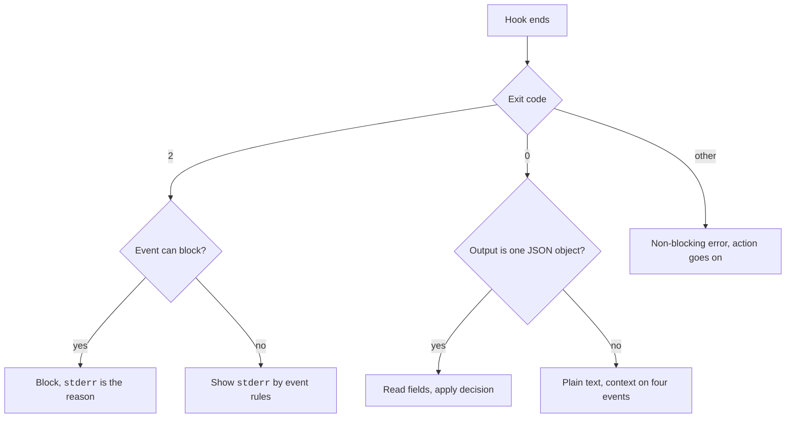

# Hook Input and Output


Each hook gets a JSON description of what happened. It answers with an exit code, or with exit 0 and a JSON object.
The answer tells Claude Code to go on, to block, or to add context.
For example, exit code 2 with a message on `stderr` blocks a `PreToolUse` call and tells Claude why.

You control the answer your hook gives, not the input. Each event decides which fields it reads.

## Example

A command hook reads the input, then answers with JSON to ask you before running `terraform apply`.

```bash title=".claude/hooks/ask-terraform.sh"
#!/bin/bash
input=$(cat)
cmd=$(jq -r '.tool_input.command // ""' <<<"$input")
if [[ "$cmd" == terraform\ apply* ]]; then
  cat <<'JSON'
{
  "hookSpecificOutput": {
    "hookEventName": "PreToolUse",
    "permissionDecision": "ask",
    "permissionDecisionReason": "terraform apply changes real infrastructure"
  }
}
JSON
fi
exit 0
```

The script exits 0 and prints one JSON object. Claude Code reads it and shows a permission prompt.

## Common Input Fields

A command hook reads this JSON on `stdin`. An HTTP hook gets it as the POST body.

| Field | Status | What it holds | Notes |
| --- | --- | --- | --- |
| `session_id` | [Documented] | The session identifier. | A string. |
| `transcript_path` | [Documented] | The path to the conversation JSONL file. | Written async, so it can lag. On `Stop`, use `last_assistant_message`. See [Transcript Format](https://xsyetopz.github.io/claude-code-docs/reference/transcript-format.md). |
| `cwd` | [Documented] | The working directory when the hook runs. | Follows `cd` and worktrees. |
| `prompt_id` | [Documented] | The UUID of the prompt in progress. | Equals `prompt.id` in OpenTelemetry events. Absent before the first input. |
| `scratchpad_dir` | [Differs: In the docs and the program string list, but missing from BaseHookInput in the type file.] | The session scratchpad folder. | Needs 2.1.257. Sent on most events. |
| `permission_mode` | [Documented] | `default`, `plan`, `acceptEdits`, `auto`, `dontAsk`, or `bypassPermissions`. | Manual mode is sent as `default`. Not on every event. |
| `effort` | [Documented] | An object `{level}` with `low`, `medium`, `high`, `xhigh`, or `max`. | Only in tool-use context, and only when the model supports effort. Sent on tool events, `Stop`, and `SubagentStop`. |
| `hook_event_name` | [Documented] | The name of the event. | In the type file it is a literal on each event type, not on `BaseHookInput`. |
| `agent_id` | [Documented] | The subagent or in-process teammate that the hook fires in. | Absent on the main thread. On task and teammate events it names the actor (2.1.290). |
| `agent_type` | [Documented] | The agent name. | Set in a subagent, or on the main thread with `--agent`. |
| `mcp_server` | [Documented] | An object `{name, source}` for an MCP tool. | Needs 2.1.274. `source` is an open set: `sdk`, `plugin`, `user`, `project`, `local`, `dynamic`, `managed`, `enterprise`, `claudeai`, `agent`. |

## Universal Output Fields

A hook prints one JSON object to `stdout` and exits 0.
Every event accepts these keys. Some events drop them, and [Events](https://xsyetopz.github.io/claude-code-docs/extend/hooks/events.md) says which.

| Field | Status | What it does | Notes |
| --- | --- | --- | --- |
| `continue` | [Documented] | `false` stops Claude after the hook. | Beats event decisions. Ignored by `TaskCreated`, and by `TaskCompleted` when it comes from `TaskUpdate`. |
| `stopReason` | [Documented] | The message to show when `continue` is `false`. | Stays in the conversation. |
| `systemMessage` | [Documented] | A warning for you. | Some events drop it or send it somewhere else. |
| `terminalSequence` | [Documented] | An escape sequence that Claude Code writes for you. | Allowed: OSC `0`, `1`, `2`, `9`, `99`, `777`, and BEL. Interactive mode only. Works on events that drop other fields. Not for `WorktreeCreate` command hooks. |
| `decision` | [Differs: Docs: only block. Program enum: approve or block for any event. On PreToolUse both are deprecated.] | A top-level block. | See Decision Patterns below. |
| `reason` | [Documented] | The text for the block. | You or Claude sees it, by event. |
| `hookSpecificOutput` | [Documented] | An event-specific object. | Needs `hookEventName` set to the event name. |
| `{"async":true,"asyncTimeout":n}` | [Undocumented] | A first reply that moves the hook to the background. | See [Configuration](https://xsyetopz.github.io/claude-code-docs/extend/hooks/configuration.md#timeouts). Command hooks only. |
| 10,000 character cap | [Documented] | Applies to `additionalContext`, `systemMessage`, `initialUserMessage`, and plain `stdout`. | Each string alone. Over the cap, Claude Code saves it to a file, and the model gets the path and the first 2,000 characters. |

## Decision Patterns

| Pattern | Status | What it does | Events |
| --- | --- | --- | --- |
| Top-level `decision: "block"` | [Documented] | Blocks. `reason` is the message. | `UserPromptSubmit`, `UserPromptExpansion`, `PostToolUse`, `PostToolUseFailure`, `PostToolBatch`, `Stop`, `SubagentStop`, `ConfigChange`, `PreCompact`, `TaskCreated` |
| `hookSpecificOutput.permissionDecision` | [Documented] | `allow`, `deny`, `ask`, or `defer`. `defer` works only in `-p`. | `PreToolUse`. `PreModelSwitch` has no `defer`. |
| `hookSpecificOutput.decision.behavior` | [Documented] | `allow` or `deny`. Needs a `decision` object. | `PermissionRequest` |
| `continue: false` or exit 2 | [Documented] | Stops the teammate. | `TeammateIdle`, `TaskCompleted` |
| Path return | [Documented] | A command prints the path. An HTTP hook returns `worktreePath`. A failure fails the creation. | `WorktreeCreate` |
| Context only | [Documented] | `additionalContext`. It cannot block. | `SessionStart`, `SubagentStart`, `PostModelSwitch`, `Setup`, `Notification` |
| None | [Documented] | Side effects only. | `SessionEnd`, `PostCompact`, `InstructionsLoaded`, `StopFailure`, `CwdChanged`, `DirectoryAdded`, `FileChanged`. The last two still return `watchPaths`. |

## Exit Codes

| Exit code | Status | What it does | Notes |
| --- | --- | --- | --- |
| 0 | [Documented] | Success. | Claude Code reads JSON from `stdout`. Plain `stdout` becomes context only on `UserPromptSubmit`, `UserPromptExpansion`, `SessionStart`, and `PostModelSwitch`. Claude never sees `stderr` from an exit 0 hook. |
| 2 | [Documented] | A blocking error on events that can block. | `stderr` is the reason. JSON fields are read but cannot override the block. `Elicitation` and `ElicitationResult` ignore them. |
| 1 | [Documented] | Not a block. | Exit 1 is a non-blocking error. Use exit 2 for policy. |
| Any other code | [Documented] | A non-blocking error. | The action goes on. The notice has the first line of `stderr`. JSON on `stdout` can still decide. |
| Invalid JSON | [Documented] | A non-blocking error. | The rules for one object, text, and several JSON lines are in the Exit code 0 section of the Hooks Reference. |

> **Tip:** Pick one style per hook. Use exit codes alone, or exit 0 with JSON. If you mix them, exit 2 keeps its blocking effect and Claude Code still reads the JSON fields.

### What Exit 2 Does per Event

| Effect | Status | Events |
| --- | --- | --- |
| Blocks the action | [Documented] | `PreToolUse`, `UserPromptSubmit`, `UserPromptExpansion`, `Stop`, `SubagentStop`, `TeammateIdle`, `TaskCreated`, `TaskCompleted`, `ConfigChange` (not `policy_settings`), `PostToolBatch`, `PreCompact`, `PreModelSwitch`, `Elicitation`, `ElicitationResult` |
| Fails the step | [Documented] | `WorktreeCreate` always. `WorktreeRemove` if the folder still exists. |
| Shows `stderr` to Claude, no block | [Documented] | `PostToolUse`, `PostToolUseFailure` |
| Shows `stderr` to you, no block | [Documented] | `SubagentStart`, `SessionStart`, `SessionEnd`, `CwdChanged`, `FileChanged`, `PostCompact`, `PostModelSwitch` |
| Ignored | [Documented] | `PermissionRequest`, `PermissionDenied`, `Notification`, `Setup`, `StopFailure`, `InstructionsLoaded`, `MessageDisplay`, and `DirectoryAdded` (its `stderr` goes to the debug log) |

## HTTP Responses

| Response | Status | What it does |
| --- | --- | --- |
| 2xx with an empty body | [Documented] | Success. The same as exit 0 with no output. |
| 2xx with a JSON object | [Documented] | Parsed like command JSON. A body that fails validation is a non-blocking error. |
| 2xx with other text, non-2xx, or a connection error | [Documented] | A non-blocking error. The text is not added to context. `onFailure: "block"` blocks. |

## How It Works



## Related Pages

- [Hooks](https://xsyetopz.github.io/claude-code-docs/extend/hooks.md): the overview.
- [Events](https://xsyetopz.github.io/claude-code-docs/extend/hooks/events.md): the fields of each event.
- [Handlers](https://xsyetopz.github.io/claude-code-docs/extend/hooks/handlers.md): what each handler type can return.
- [Agent Loop](https://xsyetopz.github.io/claude-code-docs/how-it-works/agent-loop.md): a `PreToolUse` exit 2 example in context.

Source: [Hooks Reference](https://code.claude.com/docs/en/hooks) and the program (`BaseHookInput`, `McpServerProvenance`, `ClassicResultFields`, and the hook output schema).
The exit code 2 table was checked against the Hooks Reference. Not verified: the exact list of events for which the program honors `continue` and `systemMessage`.
