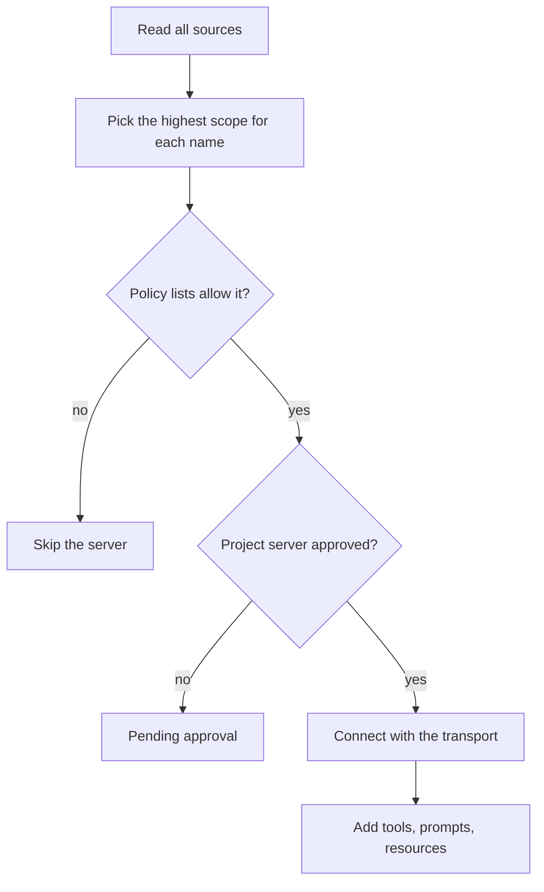

# MCP


MCP is the Model Context Protocol, an open standard that lets Claude Code use tools, files, and prompts from other programs.
A program that offers them is an MCP server.
For example, `claude mcp add --transport http notion https://mcp.notion.com/mcp` adds a server over HTTP.
This page covers the big picture. The other pages list every option.

## At a Glance

| Question | Answer |
| --- | --- |
| Can you use it? | ✅ Yes. Add servers with `claude mcp add`, `.mcp.json`, or `--mcp-config`. |
| Can you change it? | ✅ Yes. Config, settings, and env vars control servers, limits, and approvals. |
| Can you turn it on or off? | `/mcp` enable and disable, `disabledMcpjsonServers`, `--strict-mcp-config`, and the policy lists. |
| Where does it live? | `.mcp.json`, `~/.claude.json`, plugin files, and managed settings |
| Status | [Documented] [Undocumented] [Gated: XAA needs CLAUDE_CODE_ENABLE_XAA] |

## Transports

The transport is how Claude Code talks to a server. Set it with `type` in the server entry.
Source: [Connect Claude Code to Tools via MCP](https://code.claude.com/docs/en/mcp), [Control MCP Server Access for Your Organization](https://code.claude.com/docs/en/managed-mcp), and the program (the server schema).

| Transport | Status | What It Does | How It Works |
| --- | --- | --- | --- |
| `stdio` | [Documented] | Runs a local process. | The default when `type` is missing. Needs `command`. Claude Code sets `CLAUDE_PROJECT_DIR` in the process env. |
| `http` | [Documented] | Talks to a remote server over streamable HTTP. | The recommended remote transport. `streamable-http` is an alias. Supports OAuth and `headers`. |
| `sse` | [Documented] [Deprecated: Use --transport http] | Talks to a remote server over server-sent events. | Deprecated. `--transport http` tries HTTP first and falls back to SSE (`2.1.265` and later). |
| `ws` | [Documented] | Talks to a remote server over WebSocket. | Header-only auth, no OAuth. `claude mcp add --transport` does not accept it. The first connect is not retried. Use it in `.mcp.json`, `add-json`, plugins, and agent files. |
| `sdk` | [Documented] | An in-process server of an SDK host. | Only an SDK host can register it. Claude Code skips it in `.mcp.json` and settings. |
| `sse-ide` | [Undocumented] | A server of an IDE extension over SSE. | Has `ideName` and `ideRunningInWindows`. The idle timeout does not apply. |
| `ws-ide` | [Undocumented] | A server of an IDE extension over WebSocket. | Has `ideName`, `authToken`, and `ideRunningInWindows`. |
| `claudeai-proxy` | [Undocumented] | A claude.ai connector through the MCP proxy. | A config file cannot declare it. Claude Code says `type "claudeai-proxy" is used only by claude.ai connectors`. |

## Scopes

A scope says where a server is stored and who sees it.

| Scope | Status | What It Is | How It Works |
| --- | --- | --- | --- |
| `local` | [Documented] | A private server for one project. | The default scope. Stored in `~/.claude.json` under `projects["<path>"].mcpServers`. |
| `project` | [Documented] | A server shared with the team. | Stored in `.mcp.json` at the project root. Interactive sessions ask for approval. |
| `user` | [Documented] | A server for all your projects. | Stored in `~/.claude.json` under `mcpServers`. |
| Plugin | [Documented] | Servers that a plugin bundles. | Named `plugin:<plugin>:<server>`. Tools are `mcp__plugin_<plugin>_<server>__<tool>`. |
| claude.ai connectors | [Documented] | Servers you added in claude.ai. | Fetched at start for a claude.ai login. Lowest precedence. |
| `managed` | [Documented] | Servers your organization provides. | From the `managedMcpServers` key in managed settings (the `managed-mcp.json` file gets the `enterprise` scope; source: the program). Ranks above every other source (`2.1.259` and later). |
| `dynamic` | [Undocumented] | Servers passed at run time. | Used for `--mcp-config`, for the remote copy from `CLAUDE_CODE_REMOTE_MCP_CONFIG`, and for plugin servers. |
| `enterprise` | [Undocumented] | The servers in `managed-mcp.json`. | Read from the managed settings folder. While the file exists it has exclusive control of MCP servers, and agent frontmatter servers are blocked. Checked: user and project servers did not start, `claude mcp list` showed only the managed server, `claude mcp get` showed `Scope: Enterprise config (managed by your organization)`, and `--mcp-config` failed with `You cannot dynamically configure MCP servers when an enterprise MCP config is present`. Checked with a user agent that has `mcpServers` frontmatter: the agent ran, but its server did not start, and a notice said `probe-agent agent MCP server blocked by enterprise MCP config: agent_srv`. `init` listed the managed server with `source` `enterprise`. See [Probes](https://xsyetopz.github.io/claude-code-docs/reference/probes.md#managed-folder-probe). |
| `agent` | [Undocumented] | A server in an agent's `mcpServers` frontmatter. | Starts when that agent runs and stops when it ends. Project agents (`.claude/agents/`) are skipped in a folder you have not trusted. Blocked by `--strict-mcp-config` and `--bare`. Checked in `-p` with a user agent. |

The full scope list is `local`, `user`, `project`, `dynamic`, `enterprise`, `claudeai`, `managed`, `agent`. Plugin servers also use `dynamic`.

## Example

```bash title="Add three kinds of servers"
# Remote server over HTTP
claude mcp add --transport http sentry https://mcp.sentry.dev/mcp

# Local server with an env var (use -- before the command)
claude mcp add my-server -e API_KEY=xxx -- bunx my-mcp-server

# Shared with the team through .mcp.json
claude mcp add --scope project files -- bunx @example/files-server
```

## How It Works



Claude Code merges all sources and keeps one entry per name.
Precedence is on the [Server Configuration](https://xsyetopz.github.io/claude-code-docs/extend/mcp/config.md#precedence) page.
After a server connects, its tools get names like `mcp__github__create_issue`. See [MCP Runtime](https://xsyetopz.github.io/claude-code-docs/extend/mcp/runtime.md).

## Pages in This Section

| Page | What It Covers |
| --- | --- |
| [Server Configuration](https://xsyetopz.github.io/claude-code-docs/extend/mcp/config.md) | File shape, options per transport, env var expansion, names, precedence |
| [MCP Settings and Policy](https://xsyetopz.github.io/claude-code-docs/extend/mcp/settings.md) | Settings keys, allow and deny lists, approvals, `managed-mcp.json`, flags |
| [MCP Commands](https://xsyetopz.github.io/claude-code-docs/extend/mcp/cli.md) | Every `claude mcp` subcommand and flag, and `/mcp` |
| [MCP Runtime](https://xsyetopz.github.io/claude-code-docs/extend/mcp/runtime.md) | Tool names, resources, prompts, elicitation, channels, limits, recovery |
| [MCP Authentication](https://xsyetopz.github.io/claude-code-docs/extend/mcp/auth.md) | OAuth, `headersHelper`, XAA, claude.ai connectors |
| [MCP Env Vars](https://xsyetopz.github.io/claude-code-docs/extend/mcp/env.md) | Every MCP env var |
| [MCP Settings Keys](https://xsyetopz.github.io/claude-code-docs/configure/settings/mcp-and-channels.md) | The same keys on the settings side |

## Related Pages

- [Plugins](https://xsyetopz.github.io/claude-code-docs/extend/plugins.md) can bundle MCP servers.
- [Plugin and MCP Env Vars](https://xsyetopz.github.io/claude-code-docs/configure/env-vars/plugins-and-mcp.md)
